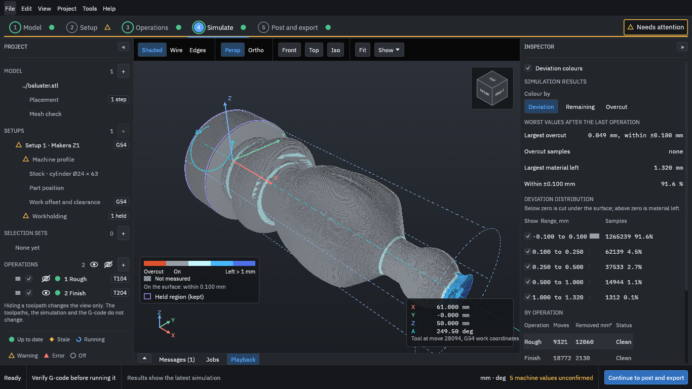

# OpenChuckCAM

OpenChuckCAM is a CAM program: you give it a 3D model, and it works out the tool movements and writes the G-code that a CNC machine reads. It is for **true 4-axis (XYZA) machining**, where the work is held in a chuck and turned by a rotary axis (called A) while the cutter moves along and around it. Typical jobs are turned and carved pieces such as legs, finials, handles, blades and bladed disks. The first machine it supports is the **Makera Z1**; a LinuxCNC post is also included and is used to check the output.




*The real application, with the example piece from [the tutorial](TUTORIAL.md). Top: the toolpath of a finishing operation. Bottom: the simulated cut part, coloured by deviation from the model (grey is on the surface; the blue areas still have material left). The stepped look of the cut part is the simulation's cell size (0.1 mm), not the surface the machine would leave.*

> **Read this first.** OpenChuckCAM is in early development. Generated G-code **must be verified by you before it is run on a machine** (NFR-12). OpenChuckCAM does not guarantee that a program is safe or correct for any machine, tool or setup. It has not been approved for any machine. The project owner has run a few attended test programs on one Makera Z1 (see [Limitations](#main-limitations)); that does not make any program safe for your machine.

## What you can do today

You work along the steps at the top of the window (Model, Setup, Operations, Simulate, and Post and export):

1. **Import a model.** Open an STL file (ASCII or binary), or a STEP file. The program checks the mesh for holes and other faults, asks you to confirm the units, and places the part on the rotary axis.
2. **Describe the machine and the stock.** Choose the machine profile (the Makera Z1 is built in), the shape and size of the stock (cylinder, box, or a bounding box around the part), its material, where the part sits along the axis, and which end or ends the chuck holds. The held length is never cut, and the paths keep clear of it.
3. **Make operations.** Pick tools from the tool library (54 ready-made Makera Z1 tools, plus your own) and add operations: rotary roughing, facing, helical, axial, indexed and simultaneous 4-axis finishing, rest machining, pencil clean-up, and edge and curve following. Swarf (side-of-the-tool) machining and radial drilling need a STEP model. Each operation can be limited to a selected region of the part.
4. **Preview the cut and write the G-code.** Generate the toolpaths, play the cut back in 3D with the material removal simulation, see how much material is left or cut away compared with the model, then write the G-code for the Makera Z1 (or the LinuxCNC verification post) together with a **setup sheet** (HTML and PDF) that lists the tools, the operations and a hash of each program file.

Projects are folders of plain text files, with undo and redo. Everything also runs without a window through the command line program `openchuck-cli`.

## Try it: the tutorial

[**TUTORIAL.md**](TUTORIAL.md) walks you through a first project from start to finish, with a screenshot of every step: a small turned and fluted piece, rough-cut and finished, ending with the G-code and the setup sheet. The model is in this repository ([testdata/examples/baluster](testdata/examples/baluster/README.md)). The speeds and feeds in the tutorial are an example only, not a tested cutting recipe.

## Getting it and running it

There is **no stable release yet**. You can either download a development build or build the program from source.

- **Nightly build (easiest).** When the code changes, a build for Linux (x86-64), Windows (x64) and macOS (Apple silicon) is published as the rolling [`nightly` pre-release](https://github.com/paulhampson/OpenChuckCAM/releases/tag/nightly). Each archive holds `openchuck-ui` (the window), `openchuck-cli` (the command line), `openchuck-step-worker` (reads STEP files; keep it beside the others), the licence and a README. It is a development build that has passed no release gate, and it is not signed: macOS quarantines it (the archive's README gives the command to clear that) and Windows SmartScreen may warn. On Linux you need a Vulkan or OpenGL driver and X11 or Wayland.
- **From source.** Install Rust (the version is pinned in `rust-toolchain.toml`), then:

  ```
  cargo run --release -p openchuck-ui -- [PROJECT_FOLDER]
  cargo run -p openchuck-cli -- --help
  ```

  STEP import needs the OpenCASCADE kernel, which is not built by default and takes a long time the first time; see [crates/openchuck-import](crates/openchuck-import/README.md).

The command line works without a window: `new`, `import`, `setup`, `machine`, `tool`, `library`, `validate`, `report`, `inspect`, `regenerate` (writes the G-code), `simulate`, `tool-numbers` and the placement commands `transform` and `units`.

## Main limitations

Please read these before you rely on the program. They are checked against the requirements, the [work breakdown](docs/work-breakdown.md) and the [open items](docs/open-items.md) at the time of writing.

- **G-code is yours to verify.** The program does not know your machine, your fixture or your tool. Check the origin, axis height, tool lengths, the direction of A and the unwinding at the controller, and run an air cut (no tool, no material) first. The [Makera Z1 air-cut procedure](docs/z1-air-cut-procedure.md) and [safe-practice checklist](docs/z1-safe-practice-checklist.md) are the project's own starting points.
- **Very little has run on a real machine.** The project owner reports attended air cuts of two Z1 reference programs (a sphere and a cone) and one small first cut in tooling board on one Z1 ([results](docs/z1-gates-4-5-test-instructions.md#10-results)). Nothing else has been run, and nothing has been run on any other machine. Five Makera Z1 profile values are still unconfirmed (the axis height, the travel, the clearance, the short-block window and the spindle speed range): the application says so, and you must measure them on your machine.
- **4-axis rotary work only.** The axis is A, turning about X, with the work in a chuck. There is no 3-axis flat-bed milling, no 5-axis, and no second rotary axis.
- **Two posts.** The Makera Z1 and a LinuxCNC post (the one used to verify the output). Other controllers need a post you write and verify yourself; the post files are editable text. The output is in millimetres only, and A is continuous (it does not wrap at 0 to 360 degrees).
- **No collision checking against the machine.** The program does not model the chuck, the tailstock, the spindle, the tool holder or the machine body, and does not check them against the part. The chuck (and a tailstock, if you use one) is represented only by a **held region**: a length at an end of the stock that is never cut. It is not a 3D body. The flute length and shank of a tool are not checked against the depth of a roughing layer. Check clearances yourself.
- **Models.** STL (ASCII and binary) and STEP. An STL has no exact surface: gouge tolerance is measured against its triangles. STEP keeps its exact faces and edges for selection, drilling and swarf, but most paths on a STEP part are still computed from a mesh made from it (the operation says so; exact-surface work is under way, [decision 0209](docs/decisions/0209-step-geometry-for-every-strategy.md)). Only STEP files written by OpenCASCADE and one owner file have been tested; files from other CAD programs are not yet (OI-25). There is no re-import of a changed file and no import of DXF or SVG curves (IMP-07 and IMP-08 are planned, not built).
- **Strategies.** The strategies listed above are all there is. Reaching tight inside corners and walls that run along the tool axis is limited: helical finishing "may not reach tight inside corners", and pencil clean-up makes one pass along each crease. Swarf and radial drilling need a STEP model, and Simultaneous 4-axis finishing can refuse a part it cannot follow (it says so, and does not cut it badly), so check its path and the simulation ([OI-318](docs/open-items.md)). There are no canned drilling cycles in the output.
- **Not every requirement is built.** Items marked P2 and P3 in the [requirements](docs/requirements.md) (for example collision detection, re-importing a changed model, curve import from drawings, built-in version control) are not built. The project format is still changing and is not stable until the first release.
- **Time and size.** Generating and simulating are not instant. In the tutorial, on a small part, generating two operations and simulating the cut each took about a minute on a cloud machine with no graphics card. Very fine stepovers on large parts will take much longer, and the simulation's cell size trades accuracy against memory and time. The programmed time shown is the sum of the moves at their programmed feeds; it is not an estimate of the machine's time.
- **Platforms.** Nightly builds exist for Linux, Windows and macOS (Apple silicon), unsigned. Most hands-on checking has been done on Linux; the Windows and macOS builds have had less (open items OI-129 and OI-523).

## Getting help and reporting problems

- Questions, bugs and requests: [GitHub issues](https://github.com/paulhampson/OpenChuckCAM/issues). Please say which build you used (the commit is in the archive's README), what you did, and what you expected.
- The program writes a local log file (start-up details, the graphics adapter, warnings, errors). Open it with **Help > About > Open log folder**. The file is `openchuckcam.log`, in the folder of the program if that can be written, otherwise in your user log folder (`~/.local/state/openchuckcam` on Linux, `~/Library/Logs/OpenChuckCAM` on macOS, `%LOCALAPPDATA%\OpenChuckCAM\logs` on Windows). It never leaves your computer; attach it to an issue only if you choose to.

## Licence

AGPL-3.0-or-later for every crate. See [LICENSES/](LICENSES/).

## For contributors

The documents in [docs/](docs/README.md) are the source of truth. Start with [docs/README.md](docs/README.md), [AGENTS.md](AGENTS.md) (also for coding agents) and [CONTRIBUTING.md](CONTRIBUTING.md). Contributors sign the [contributor licence agreement](CLA.md) once. Work is planned by lane in the work breakdown's "Parallel work" section; read it before starting.

### Status

Early development. The work is planned as numbered slices in the [work breakdown](docs/work-breakdown.md), whose slice status table and "Parallel work" section are the authority on what is done and which lanes can run in parallel. Slices 0 to 7 (workspace, project files, STL import, machine and setup, tool library, the pathing core, posts, simulation) are closed; the viewport and shell, background jobs, selection, STEP import, the finishing, roughing, rest, pencil, edge, swarf and drilling strategies, workholding, output options and the setup sheet are built and in various stages of review; slice 20 (hardening and the first release) is in progress. The project format (`schema` in every project file) is still changing and is not stable until the first release.

### Documents

The documents in [docs/](docs/README.md) are the source of truth: [requirements](docs/requirements.md), [architecture](docs/architecture.md), [work breakdown](docs/work-breakdown.md), [verification plan](docs/verification-plan.md), the [crate selection](docs/crate-selection.md), the [dependency register](docs/dependencies.md), the [open items](docs/open-items.md) and the [decision records](docs/decisions/). For the Z1, see the [reference jobs](docs/reference-jobs.md), the [air-cut procedure](docs/z1-air-cut-procedure.md) and the [safe-practice checklist](docs/z1-safe-practice-checklist.md). Contributors and coding agents start with [AGENTS.md](AGENTS.md).

### Layout

| Path | Contents |
| --- | --- |
| `crates/openchuck-types` | Shared plain data: units, meshes, B-rep faces, stock, tools, machine profile, the neutral toolpath IR, kinematics. |
| `crates/openchuck-path` | The reusable 4-axis pathing library: strategies, A-axis management, linking, entry moves, gouge protection, feed intent. |
| `crates/openchuck-post` | Post-processing from the IR to controller G-code, with user-editable template posts. The built-in post definitions (the Makera Z1 and the LinuxCNC verification post) are in its `posts/` folder (decision 0103). |
| `crates/openchuck-gcode` | A reader and replay for the G-code the posts emit, used for checks and round trips. |
| `crates/openchuck-geom` | Mesh checks, transforms and selection algorithms. |
| `crates/openchuck-import` | Model readers: STL, and STEP through the OpenCASCADE worker (optional `kernel` feature). |
| `crates/openchuck-sim` | Material removal simulation (dexel stock) and deviation reports. |
| `crates/openchuck-project` | The project folder: files, IDs, order keys, schema migration, the tool library. |
| `crates/openchuck-app` | The application layer: commands, undo, jobs, caches, the pipeline. |
| `crates/openchuck-viewport` | The wgpu viewport. Only this crate and `openchuck-ui` use egui or wgpu. |
| `crates/openchuck-testkit` | Test-only: analytic parts, the independent kinematic oracle and gouge checker. |
| `apps/` | `openchuck-cli` and `openchuck-ui` (wiring only). |
| `testdata/` | Verification corpus, golden G-code and its size policy. |
| `fuzz/` | Fuzz targets (separate workspace, nightly toolchain). |
| `benches/` | Cross-crate benchmarks, including the 1M-triangle viewport model. |
| `tools/`, `docker/` | The LinuxCNC simulator replay (gate 3) and its image. |
| `xtask/` | Repository checks. |

The library family (`openchuck-types`, `-path`, `-post`, `-gcode`) depends on nothing outside itself, so it can be used by another host.

### Building and running

The toolchain is pinned in `rust-toolchain.toml`.

```
cargo build --workspace
cargo run --release -p openchuck-ui -- [PROJECT_FOLDER]
cargo run -p openchuck-cli -- --help
```

The command line works without a window: `new`, `import`, `setup`, `machine`, `tool`, `library`, `validate`, `report`, `inspect`, `regenerate` (writes the G-code), `simulate`, `tool-numbers` and the placement commands `transform` and `units`. Nightly builds of both programs for Linux, Windows and macOS are produced when `main` changes ([decision 0023](docs/decisions/0023-nightly-builds.md)); they are unsigned.

STEP import needs the OpenCASCADE kernel, which is not built by default and takes a long time the first time. See [crates/openchuck-import](crates/openchuck-import/README.md):

```
cargo build -p openchuck-import --features kernel --bins
```

### Checking

```
cargo fmt --all
cargo clippy --workspace --all-targets -- -D warnings
cargo nextest run        # or: cargo test --workspace
cargo xtask all          # dependency rules, licences, dependency records, test data, traceability
cargo deny check
```

`cargo xtask golden` audits the golden G-code. `cargo xtask replay --docker IMAGE` runs the LinuxCNC programs in the simulator (gate 3; see [tools/linuxcnc](tools/linuxcnc/README.md)). Each library builds and tests alone, for example `cargo test -p openchuck-path`. Long tests are listed in `.config/nextest.toml` and run nightly.
