# Your first project

This tutorial takes you through one complete job in OpenChuckCAM, from an empty window to G-code and a setup sheet. Every step has a screenshot of the real application. The job is a small turned and fluted piece (a baluster with a ball finial), rough-cut with one tool and finished with another, for a Makera Z1 with a chuck.

**Please read this before you start.**

- The piece, the tools and every speed and feed in this tutorial are **an example for learning the program, not a tested cutting recipe**. Nothing here has been cut on a machine. Choose your own tools, speeds and feeds for your material and machine.
- Generated G-code **must be verified by you before it is run on a machine**. OpenChuckCAM does not guarantee that a program is safe or correct for any machine, tool or setup. The last step of this tutorial says what to check.
- OpenChuckCAM is in early development. See the [main limitations](README.md#main-limitations).

You will need the program (see [Getting it and running it](README.md#getting-it-and-running-it)) and one file from this repository: [`testdata/examples/baluster/baluster.stl`](testdata/examples/baluster/baluster.stl) (269 KB). Save it somewhere you will find it again. A finished copy of the project is in [`testdata/examples/baluster/baluster-project`](testdata/examples/baluster/baluster-project) if you want to compare or skip ahead.

The screenshots were taken with a software renderer at 1366 x 768, so colours and line widths on your screen may differ a little. File paths in them are from the machine that took them; yours will be your own.

## Words used in this tutorial

- **Rotary axis, A axis.** On a 4-axis machine the work is held at one end in a chuck and turned about a line along its length. That line is the rotary axis; on the Makera Z1 it lies along X, and the turning is called **A**. The cutter moves along X and across the work (Y and Z) while A turns the part, so the cutter can reach all the way round.
- **Stock.** The blank you start with: here a round bar. The program cuts the part out of the stock.
- **Held region.** The length of the stock that the chuck grips. It is never cut, and the toolpaths keep clear of it. (You can also hold the far end, for example with a tailstock; the program only knows that end as a held length, not as a body.)
- **Tool library.** The list of cutters. Each tool has a diameter, a shape and cutting data for a material.
- **Stepover.** How far the cutter moves sideways between neighbouring passes.
- **Stepdown.** How deep each layer of roughing goes.
- **Stock to leave.** Material deliberately left on the part by an operation so that a later operation can finish it.
- **Tolerance.** How closely the toolpath may differ from the model.
- **Post (post-processor).** The part of the program that turns the toolpaths into the G-code dialect a given machine controller reads. The Makera Z1 has its own post.
- **Work offset (G54).** The register in the controller that stores where the part's zero is. Here it is on the rotary axis at the model's X = 0.

## 1. Create a project

Start the program and choose **New project...** (or File > New project..., Ctrl+N). A project is a folder; the program asks for the folder it should go in and a name.

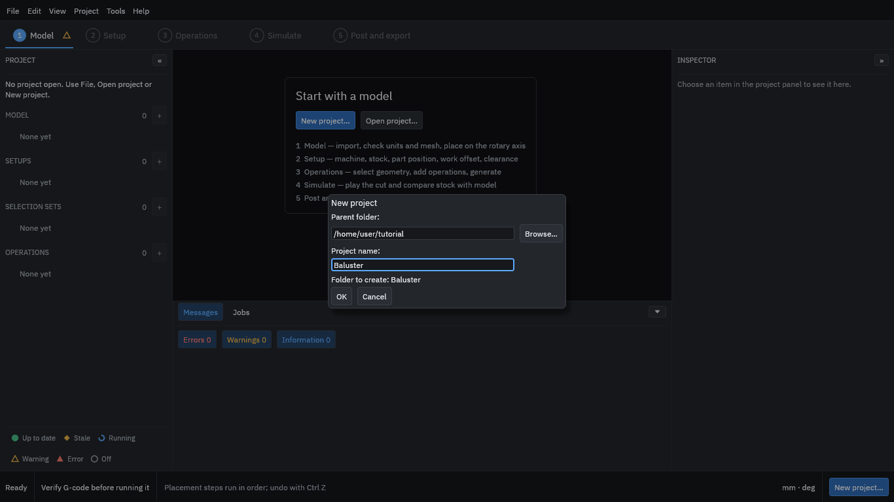

Type or browse to a **Parent folder**, call the project **Baluster**, and press **OK**. The program creates the folder and opens the empty project.

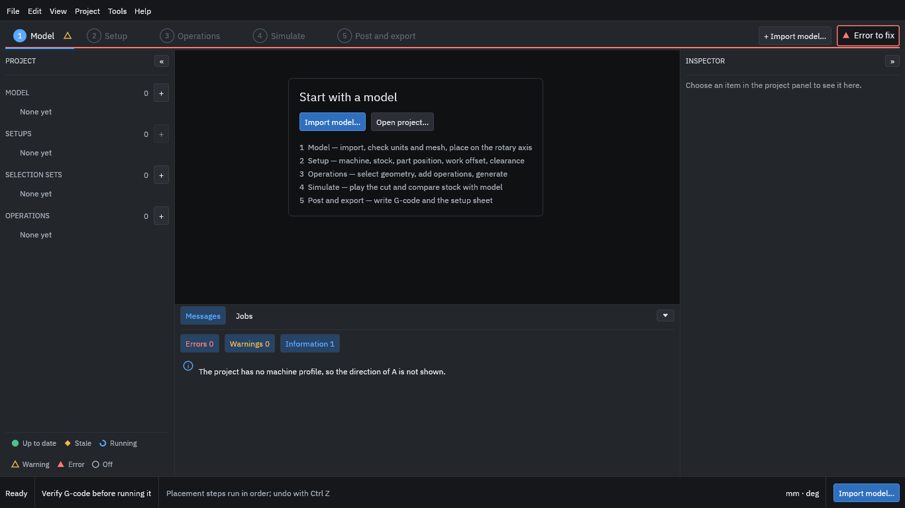

The row of steps along the top (Model, Setup, Operations, Simulate, Post and export) is the order you work in. The marks beside each step show whether it is ready. At this point the program notes that the project has no machine yet; you add one in step 3.

The program does not save by itself: use **File > Save** (Ctrl+S) as you go. Edits in a form are applied when you press Enter or leave the field.

## 2. Import the model

Choose **Import model...** and type the path of `baluster.stl` (or use Browse...). Press **Check and preview**.

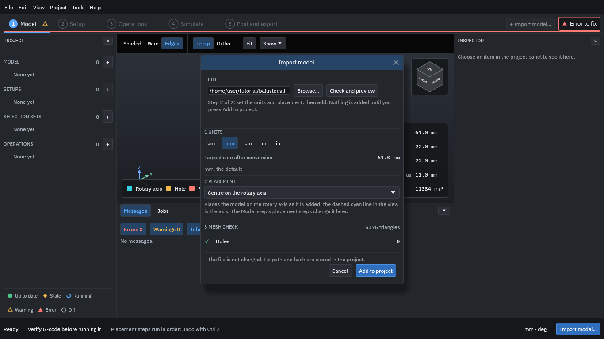

The dialog shows what the file holds before anything enters the project:

- **Units.** An STL file does not say what its numbers mean, so the program reads them as millimetres unless you choose another unit. The piece is 61 mm long and 22 mm across.
- **Placement.** "Centre on the rotary axis" puts the model's centre line on the A axis. The piece was made along X, so it needs nothing else.
- **Mesh check.** The program looks for holes, flipped faces and other faults. This model has none.

Press **Add to project**, then **Continue to setup** at the bottom right.

## 3. Choose the machine

The Setup step describes the machine, the stock and how the work is held. Press **Add setup**, then in the Inspector (the panel on the right) under **Machine** choose **Makera Z1** and press **Use this machine**.

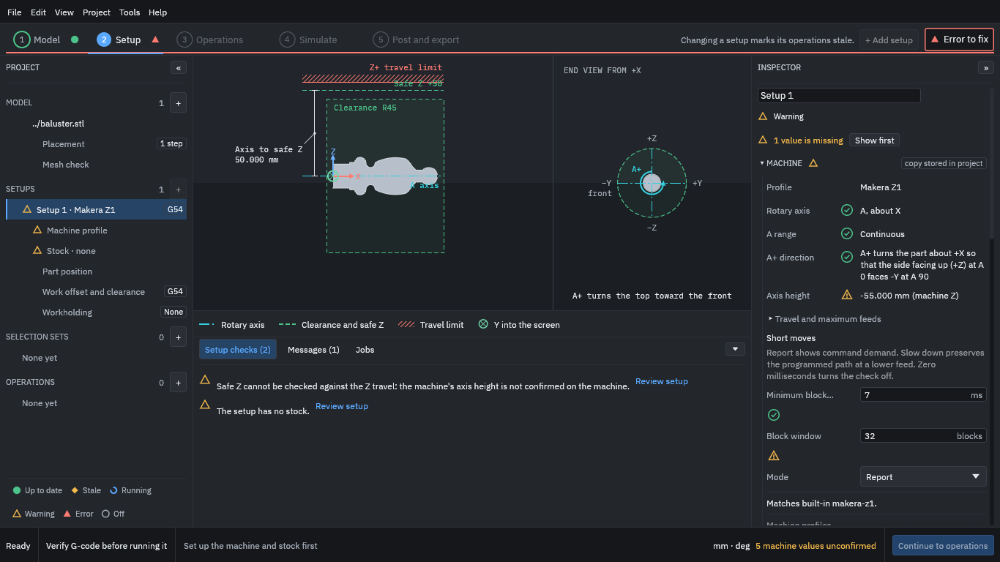

The view on the left of the window now shows the part on the A axis with the safe height and travel limit; the end view shows which way positive A turns. The Inspector shows the machine's rotary axis (A, about X), its range and direction.

Notice **"5 machine values unconfirmed"** at the bottom right. The built-in Z1 profile includes values nobody has confirmed on *your* machine, such as the height of the axis above the bed. They are the values the program uses to check that moves stay in range, so **measure them on your machine and correct the profile** before you trust a check that depends on them.

## 4. Set up the stock

In the project tree on the left, choose **Stock** under Setup 1 (or scroll the Inspector to Stock). Choose the **Cylinder** shape. The program fills in a diameter and length that surround the part with a small allowance: a 24 mm diameter, 63 mm long bar starting 1 mm before the part. Leave them, and under **Material** pick **Hardwood**.

The stock appears as the dashed outline around the part. The material choice matters because the tool library has cutting data for each material, which the operations use later.

## 5. Hold the work

Under **Workholding and tabs**, tick **Held at the start** and set **Grip length** to **8** (millimetres), then press **Apply** at the bottom of the section.

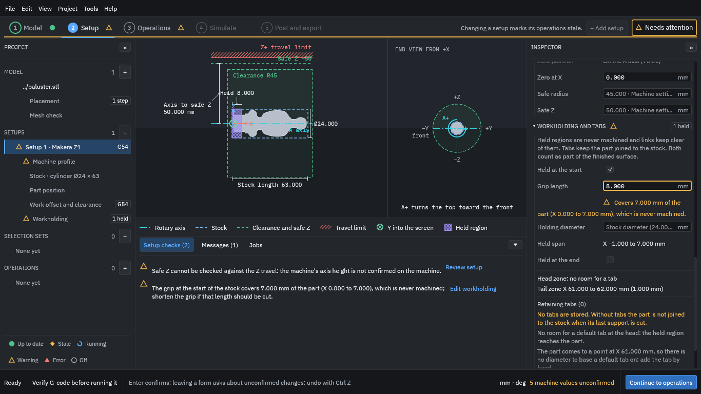

The first 8 mm of the stock, from X = -1 to X = 7, is now a held region: it is where the chuck grips. It is never cut and the paths keep clear of it. The program warns that this length covers 7 mm of the part (the plain end), which therefore stays as bar. That is what you want here; the warning would matter if you had held part of the shape you meant to cut.

The program also reminds you that, without tabs, the part is not joined to the stock when its last support is cut. This piece stays joined to the held bar, so this tutorial uses no tab; add tabs if your own job cuts the part free. A **tab** is a small bridge left uncut so that a part stays attached until you separate it yourself.

If you also support the far end of the stock, tick **Held at the end** the same way. The program treats the tailstock end as a held length only, so keep your own track of clearances there.

Press **Continue to operations**.

## 6. Choose the tools

Choose **Tool library...**. This lists the tools you can use: 54 ready-made Makera Z1 tools and some standard ones. Type `3.175` in the search box to see the 3.175 mm tools, and select **Z1 O-flute 3.175x25**.

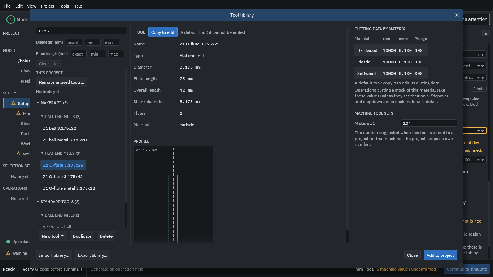

On the right is the tool's **cutting data by material**: a spindle speed, a feed per tooth and a plunge feed for each. For Hardwood this tool has 10,000 rpm and 0.100 mm per tooth. **These are example numbers from the default library; they are not proven cutting data.** A default tool cannot be edited, but you can copy it and change the copy.

Press **Add to project**, then select **Z1 ball 3.175x22** and press **Add to project** again. The project now holds two tools, numbered T104 and T204 (the numbers the Makera Z1 tool set suggests).

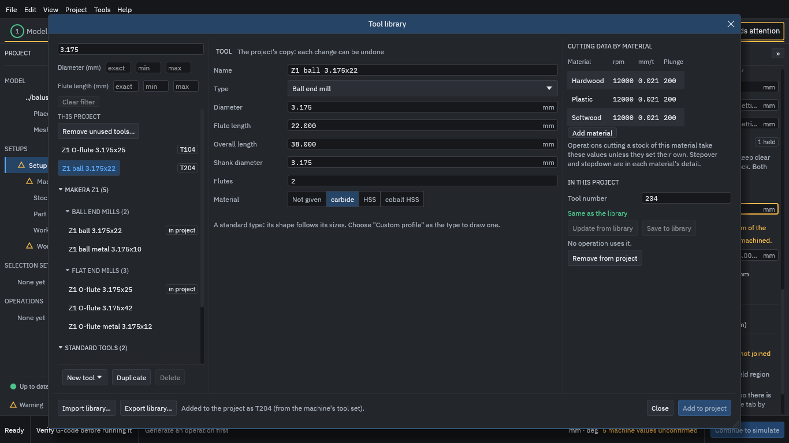

Press **Close**.

## 7. Add the operations

An operation is one machining job with one tool. You will add two: a **roughing** operation that removes most of the material quickly, and a **finishing** operation that cuts the final surface.

Choose **+ New operation**. The list of strategies shows what the program can do:

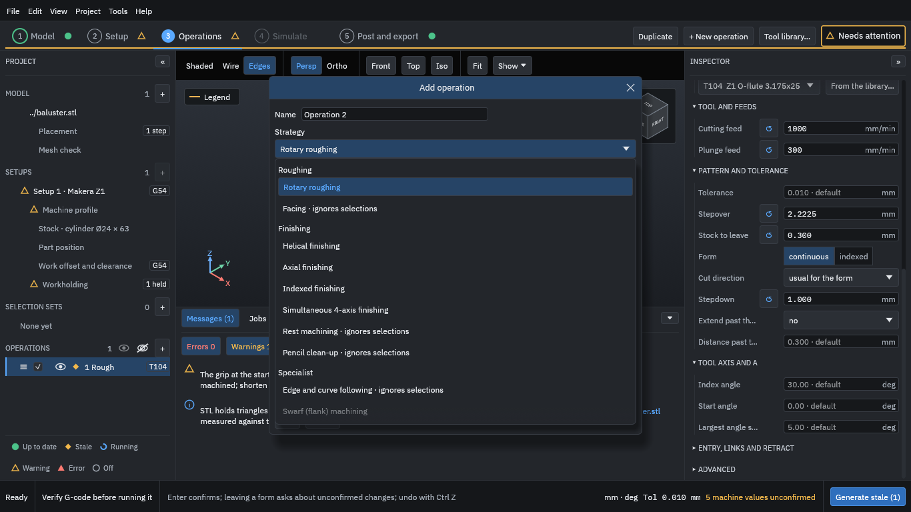

Each entry has a one-paragraph description. Swarf is greyed because it needs a STEP model.

### Roughing

Name the operation **Rough** and keep **Rotary roughing** as the strategy. The setup (Setup 1), the tool (Z1 O-flute 3.175x25) and the material preset (the setup's Hardwood) are already right. Press **Add**.

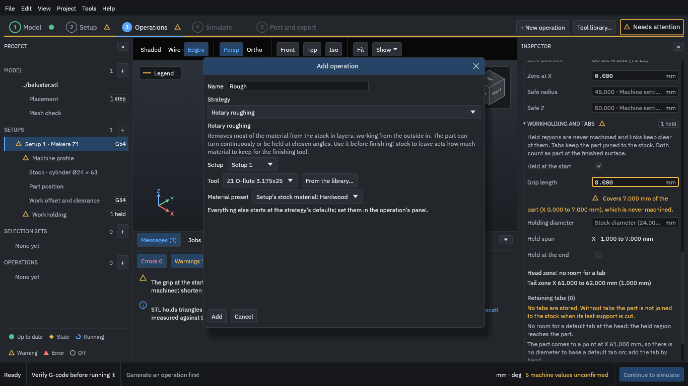

In the Inspector, set **Stepdown** to **1** mm. This field starts empty ("required"): the program will not guess how deep a layer should be.

The rest comes from the tool and the strategy. Two to look at:

- **Stepover 2.2225 mm** is 70 % of the tool's diameter, from the tool's cutting data.
- **Stock to leave 0.300 mm**: roughing stops 0.3 mm short of the part so that the finishing tool has a little to cut.

The **cutting feed** shown is the programmed feed; the machine profile's own feed limits can slow moves that turn A (the export dialog in step 10 reports the effective feed).

### Finishing

Choose **+ New operation** again. Choose **Helical finishing**, name it **Finish** and pick the tool **Z1 ball 3.175x22**. Press **Add**.

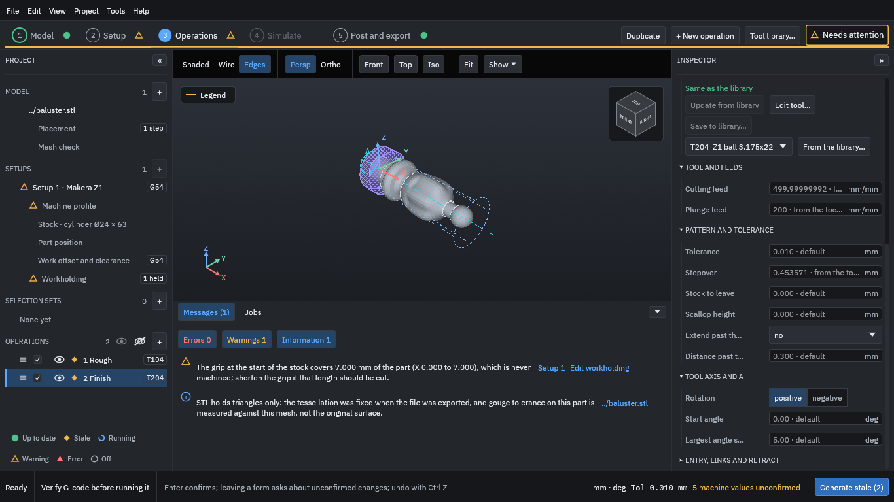

Helical finishing follows the surface in a spiral around the part as the tool moves along it. Its stock to leave is 0, so it cuts to the model. The description warns that "the tool may not reach tight inside corners": a ball of this size cannot cut a sharper corner than its own radius.

## 8. Generate the toolpaths

Press **Generate stale (2)** at the bottom right. "Stale" means the operation has no up-to-date toolpath. The status bar shows the progress; on a small part this takes about a minute without a graphics card, and faster with one.

When both operations show a green dot in the project tree, they are up to date.

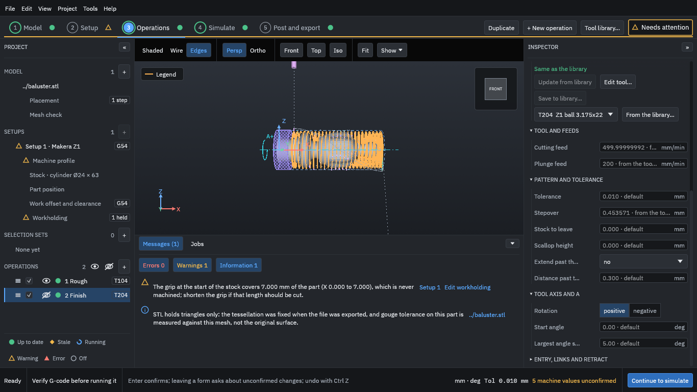

The orange lines are the roughing toolpath in the front view, with the held region hatched on the left. The eye icon beside an operation shows or hides its path in the view; hiding a path changes only the view, never what is machined. Use the view buttons (Front, Top, Iso, Fit) and the mouse to look around.

Press **Continue to simulate**.

## 9. Simulate and read the results

The Simulate step plays the whole program back as a cut and compares the result with the model. The program first prepares the cut part, which takes a little longer than generating.

Press **Show** and set **Cut part display** to **Solid** if you want a solid view, then use the playback controls under the view. The buttons go to the start, step back one move (left arrow), play or pause (Space), step on one move (right arrow), and go to the next operation (Shift and right arrow). **Speed** sets how fast it plays.

Jump to the start of the Finish operation to see the stock after roughing:

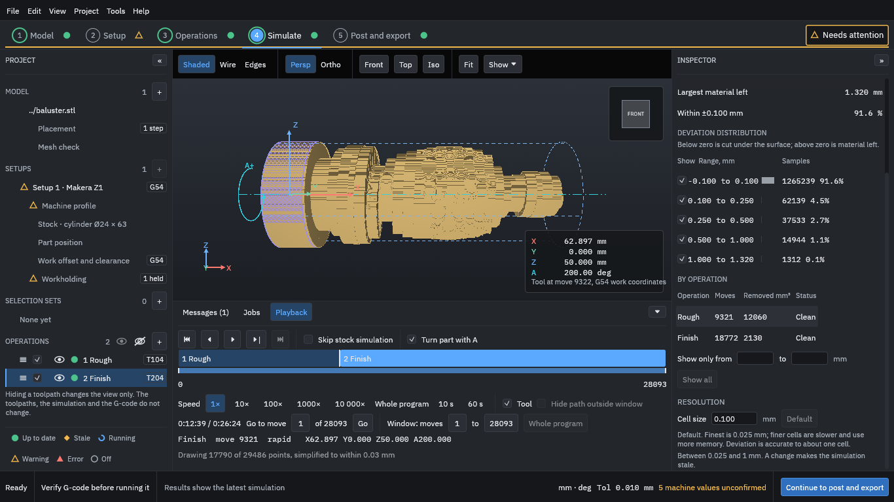

Then play on to the end of the program:

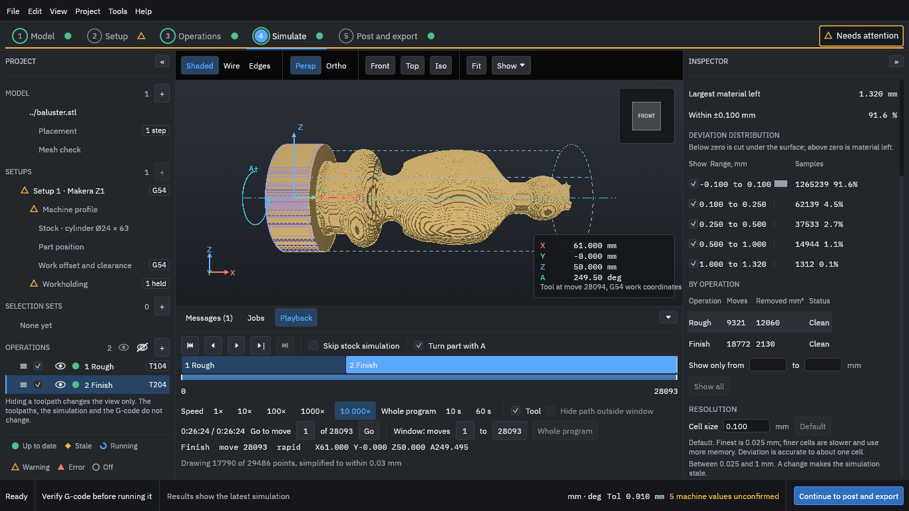

The results on the right say how closely the cut matches the model:

- **Largest material left** (1.320 mm for this run) and **Within ±0.100 mm** (91.6 % of the sampled points). The rest is material the finishing tool left. Tick **Deviation colours** at the top of the Inspector to colour the cut part by how far each point is from the model (grey is on the surface, blue still has material left) and see where it is.
- The **deviation distribution** counts samples in each band of material left; below zero would mean cut *under* the surface.
- **By operation**: how many moves each makes and the volume it removes.
- **Cell size 0.100 mm** is the simulation's resolution. The stepped surface in the view is that cell size; it is not the finish the machine would leave. A finer cell is more accurate and slower.

Treat the simulation as a check on the toolpaths, not a guarantee. It does not model the chuck, the holder or the machine, and it cannot show whether your tool, speed and feed will cut well.

The **Playback** panel also shows the programmed time: about 26 minutes 24 seconds here. This is the sum of the moves at their programmed feeds. It is not an estimate of the machine's time.

## 10. Post and export the G-code and the setup sheet

Press **Continue to post and export**, then **Post and export...**.

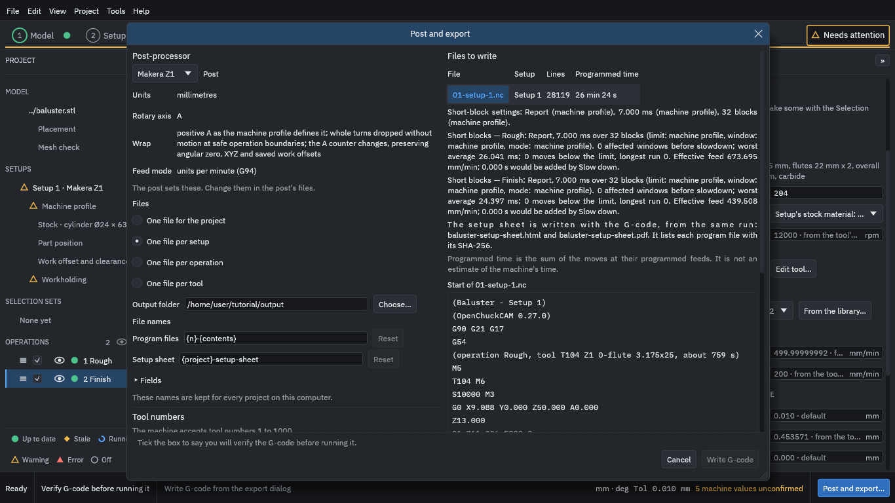

The dialog shows:

- **Post-processor.** *Makera Z1* writes G-code for that machine (units in millimetres, A as the rotary axis, feed in units per minute). A *LinuxCNC* post is also available; it is used to check the output in a simulator.
- **Files.** One file for the project, per setup, per operation or per tool. Keep **One file per setup** here.
- **Output folder.** Where the files go. Type a folder.
- **File names.** The names are made from templates ("{n}-{contents}" gives 01-setup-1.nc). The defaults are fine.
- **Files to write.** The list shows the file's lines (here 28,119) and programmed time, and the start of the program so you can read it.

Scroll down to **Checks before writing**:

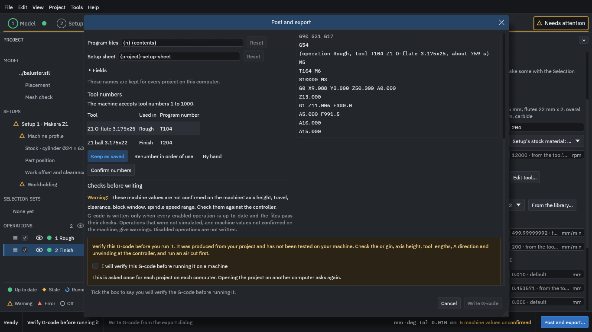

Read the warning about the unconfirmed machine values, and the notice **"Verify this G-code before you run it."** Tick **I will verify this G-code before running it on a machine** (the program asks this once per project on each computer), then press **Write G-code**.

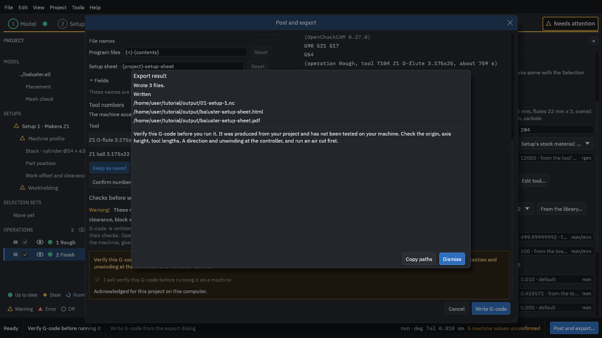

Three files are written to the output folder:

- `01-setup-1.nc`: the G-code (about 800 KB for this job).
- `baluster-setup-sheet.html` and `baluster-setup-sheet.pdf`: the **setup sheet**. It lists the project, machine, stock, held length, tools, operations with their speeds and times, each program file with its **SHA-256 hash**, and the notice to verify. Compare the hash of a file on the machine with the sheet to be sure it is the file the sheet describes.

Dismiss the result and save the project with **File > Save**.

## Before you run anything: verify the G-code

This is the part that matters most. **The example job is not a tested machining recipe.** The tools, speeds, feeds, stock and the hold in this tutorial have never been cut on a machine. Even for your own jobs, the program cannot know your machine, your fixture or your tool.

Before any program runs on a machine:

1. **Read the program** from the first line to the last, or at least up to the first cut and the end. The header names the project, the setup and the software version. Check the units, the tool numbers and the safe Z.
2. **Check the machine values.** The axis height, travel and clearance in the profile must be what you measured on your machine, not the built-in assumptions. Set the work zero (G54) on the A axis centre line, at the X your setup says.
3. **Check the direction of A** and what the controller does at the unwinding between operations.
4. **Run an air cut first**: no tool and no material, at reduced feed, attended, with a hand on the stop, watching the first moves. Stop at anything unexpected.
5. Only then consider cutting, with a tool and material you have chosen for your machine, attended, starting with a trial in cheap material.

For the Makera Z1 the project keeps a [safe-practice checklist](docs/z1-safe-practice-checklist.md) and an [air-cut procedure](docs/z1-air-cut-procedure.md). They are the project's own starting points, written for its owner's machine. **The generated G-code is yours to verify.** OpenChuckCAM does not guarantee that a program is safe or correct for any machine, tool or setup.

## What next

- Open the finished project (File > Open project) in `testdata/examples/baluster/baluster-project` and change something: try **Indexed finishing** or a smaller stepover and see the result in the simulation.
- Read the [main limitations](README.md#main-limitations) before relying on any strategy.
- If something is wrong or unclear, please [open an issue](https://github.com/paulhampson/OpenChuckCAM/issues).
