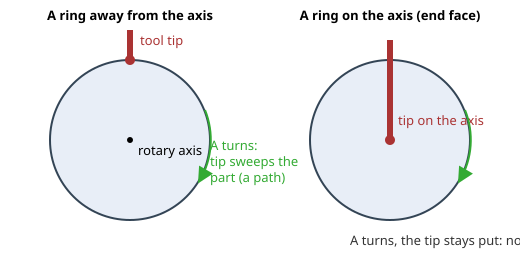
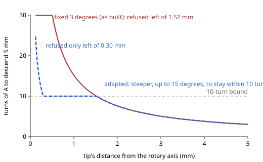
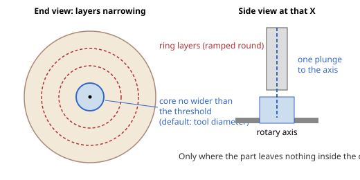

# 0543: A ramp entry follows the pass's own toolpath, for every strategy that uses the shared entry (OP-11, OP-13, OP-14, OP-15, SET-09, OP-21, OP-02, NFR-07, NFR-12, GC-07, NFR-06; issue #639; lane RAMPENTRY)

- **Status:** accepted by the project owner on 8 Nov 2026, relayed by the coordinator (decision 0049), on the condition that the clarification of "ramp to the first cut point" (the ramp reaches the pass's own depth at the first point) is in the record: it is, in section 1 and its worked examples. Proposed the same day by lane RAMPENTRY from the owner's proposal in issue #639. The owner's answers (relayed): every recommendation D1 to D10 as a package, with D7 made a setting on the operation, **Allow single-point plunge**, off by default; D10 as its own commit. **Amendments (8 Nov 2026, relayed by the coordinator):** the owner decided the points found while building, as amendments to this accepted record: point 1 accepted as built; point 2 decided as option (b), the tip descending on the axis while A turns; point 3 decided as (iii), both the steeper ramp near the axis and the plunge to remove face nubs. The record is accepted as amended.
- **What it would amend or supersede:**
  - accepted [decision 0026](0026-entry-moves.md): item 5 (A does not move during a ramp) and the as-built ramp direction ("the ramp runs back from the first cut point along the first horizontal move of the pass"). Items 1 to 4 and 6 to 8 are unchanged; the helix keeps item 5 (D9).
  - accepted [decision 0242](0242-optional-back-and-forth-ramp.md): items 1 to 3, 5 and 8 (the flag, the fixed-A corridor, its one-diameter minimum and its certificate) are superseded; items 4 (no cut changed to make an entry fit), 6 (bounds, cancellation, no partial operation) and 7 (slotting and the NFR-12 notice) carry over to every ramp.
  - accepted [decision 0248](0248-ramp-clearance-budget.md): superseded whole (it schedules the certificate that D10 removes).
  - accepted [decision 0312](0312-plain-back-and-forth-ramp-refusals.md): items 1 to 3 are superseded (the STEP refusal, the corridor refusal, and the refusal of a pass that starts above the stock: such a pass is now entered as a plunge would be, section 4); item 4's form carries over in the form of [decision 0536](0536-message-levels-operation-reference-and-setting-links.md); the follow-up D4 = C (OI-1271) is built as D7's setting.
  - accepted [decision 0204](0204-new-operation-strategy-list-and-inspector-heading.md) item 4 for the ramp only (a single-point pass), by D7; for the lead, decision 0544 L4.
- **Decisions it uses:** [0390](0390-helical-finishing-in-rings.md), [0420](0420-rings-for-rest-roughing-and-round-facing.md) and [0497](0497-rings-for-the-simultaneous-spiral.md) (rings); [0161](0161-tools-keep-clear-of-the-gripped-length.md) (held region); [0241](0241-continuous-rotary-operation-boundaries.md) (A between operations); [0033](0033-slice-14-rotary-roughing.md) (the stock each pass carries; `Tool::can_plunge`); [0048](0048-pre-1-0-api-changes.md) (API changes before 1.0); [0536](0536-message-levels-operation-reference-and-setting-links.md) (the message form, proposed: relied on as guidance for the wording of new refusals, and followed as built on `main` when this is built).
- **Date:** 8 Nov 2026.
- **Open items** ([docs/open-items.md](../open-items.md)): would close OI-553 and OI-790 (answered), retire OI-1270 (no certificate left to support on STEP parts, D10) and close OI-1271 (D7 builds its option as the Allow single-point plunge setting). New: OI-2111 (D5: strategies other than roughing carry no stock per layer).

Numbering: provisional. On 8 Nov 2026 the highest record on `main` and on every unmerged branch was 0542 and the highest open item OI-2110, so this record takes 0543 and OI-2111; [decision 0544](0544-a-lead-on-a-pass-that-turns-a-stays-in-the-plane-of-the-cut.md) is its companion. The Merge Manager assigns the final record, OI and library version numbers at release. No project schema number: operation parameters are a free map (decision 0008 item 6), as `ramp_back_and_forth` was added without one (0242 item 8); the new `allow_single_point_plunge` flag is stored the same way, and `ramp_back_and_forth` stays in the map, read and inactive (D1).

## Context

OP-11 asks for ramping; decision 0026 placed every entry in one shared module (`crates/openchuck-path/src/assemble/entry.rs`) used by every strategy that assembles passes. As built (0026 "As built"), a ramp is one straight move at the pass's start A, starting `rise / tan(angle)` behind the first cut point (about 19 mm per mm of descent at 3 degrees), along the reverse of the pass's first move that changes machine X or Y (`direction_at_start`). Decision 0242 added a back-and-forth option in a one-diameter corridor behind the first cut point, from the top of the whole stock, proved by a whole-target clearance certificate (`EntrySafety`, decision 0248), refused on STEP parts (0312 item 1, OI-1270) and on single-point passes (OI-1271).

The direction rule was written for line passes. On rings (0390, 0420, 0497) and spirals the tool barely moves sideways in the machine: the part turns under it. The "first horizontal move" is then the spiral's drift along X or the step after a ring, so the ramp runs along the part's axis, where the pass never goes, off the end of the part, and over the held region when there is one there. No record chose this for passes that turn A; holding A still is all it gains.

Records and items read: 0026, 0204, 0242, 0248, 0312 (ramp entry); 0161 (held region); 0390, 0420, 0497 (rings); 0033, 0043 (roughing, regions); 0241; 0536 (message form); OI-117, OI-553, OI-790, OI-1270, OI-1271; issues #291, #343, #421, #527, #199, #640.

### What was measured (issue #639's probe, re-run by this lane)

The issue's throwaway probe (an example on `openchuck-path`'s own test fixtures; its source and output are in the issue) was re-run in release mode on `main` `1f3675d` on 8 Nov 2026 and not committed. Every line of its output matches the issue's, refusal texts included; only the wall-clock times differ. Fixtures are synthetic (a cylinder of radius 15 mm and a cone 8 to 12 mm; 6 mm ball and flat tools; stock radius 16 mm; 3 degrees; "held" is a keep-out at the starting end, tip X from -25 to -4 mm), not the owner's projects and not machine results:

| Strategy, passes | Single-line ramp | Back-and-forth ramp | With the held region |
| --- | --- | --- | --- |
| Helical finishing, Spiral | 38.162 mm along -X at A 0 | 6 mm corridor along -X, 8 legs | both refused, naming the held region |
| Helical finishing, Rings | 38.162 mm along -X | 6 mm corridor along -X, 8 legs | both refused |
| Continuous roughing, Spiral | about 57 mm along -X per layer | refused: pass 4 is a single point | single-line refused |
| Continuous roughing, Rings | about 55 mm along -X per layer | 11, 17 and 23 legs on layers 1 to 3 | both refused |

With the held region in place, Plunge entered both pass shapes of roughing, and Helix entered the rings case and was refused on the spiral.

## Decision (proposed)

### 1. The rule

**A ramp follows the pass's own toolpath. It starts at the approach distance above the stock and descends, at no more than the ramp angle, to the pass's own depth. It arrives at the first point of the pass, at that depth, and the pass is then cut unchanged. It does not stop short of depth, and no part of the descent is left to the pass.**

**What "the first cut point" means.** It is the first point of the pass, at the depth the pass cuts there, where normal cutting begins: the layer depth in roughing, the finished surface plus the stock to leave in finishing. The ramp's earlier positions are the same path of the pass, raised along the tool axis; the raise falls to zero at the first cut point.

**Worked examples** (3 degrees, so the tip falls 0.0524 mm per mm of travel; stock 16.0 mm from the rotary axis; approach distance 1.0 mm):

- *A line pass* whose first cut point is 14.0 mm from the axis. The ramp starts above that point at 17.0 mm (the approach distance above the stock), so it has 3.0 mm to descend, which needs 3.0 / 0.0524 = 57.2 mm of travel. It goes 28.6 mm out along the pass, falling to 15.5 mm, and 28.6 mm back, falling to 14.0 mm, and arrives at the first cut point at the pass's depth (14.0 mm). The pass then cuts from there as generated.
- *A ring* whose first cut point is 12.0 mm from the axis. The ramp starts at 17.0 mm, 5.0 mm above it, which needs 95.4 mm of travel. At the ring's 12.0 mm radius that is 455.5 degrees of A, about 1.27 turns. The ramp starts 455.5 degrees before the first point, at the ring's own X, and turns A the way the ring turns, falling steadily from 17.0 mm to 12.0 mm, and arrives at the first cut point at the ring's depth (12.0 mm). The ring is then cut whole from there; its last stretch passes again, at depth, under the ramp's last turn, so no wedge of material is left.

1. **Path.** The ramp's positions are the pass's own positions, in machine coordinates (X, Y, A), with the tool raised along its axis (machine Z, the height from the rotary axis) by an offset that falls to zero at the first cut point.
2. **Start.** The approach distance above the highest stock beneath the ramp's whole path (D5).
3. **Angle.** The tip descends no more steeply than the ramp angle, measured on its real path relative to the part (D4).
4. **Finish.** At the first point of the pass, at the pass's own depth there (the ramp reaches depth; nothing of the descent is left to the pass); the pass is cut exactly as generated (0242 item 4 carries over). The ramp never leaves a wedge of material that the pass does not cut again (section 2).
5. **Moves.** `LeadIn` at the plunge feed with no contact point (0026 item 4 unchanged). Where A moves, the moves are timed by the shared rules for simultaneous moves (OP-13), the plunge feed taken at the tool tip relative to the part, within the machine's A rate.

### 2. Closing over the wedge, by the shape of the pass

The entry module tells the shapes apart from the pass's points (no field is added to `Pass`): a pass "starts by turning A" when its first move turns A; it starts as a **full ring** when, within its first 360 degrees of A, the tip comes back to its first position (X, Y and height within the path tolerance) at the same machine X and Y; as a **spiral** when it turns A and drifts in X; as a **partial ring** when it turns A at fixed X and Y and then stops (a rapid, the end of the pass, or a move along X) before a whole turn.

| Pass starts as | Ramp | A |
| --- | --- | --- |
| **A line**: indexed lines, the step between rings, axial, line and contour strategies | Back and forth over the start of the pass, an even number of legs, so the last leg ends at the first cut point: two legs (down along the pass and back) when the pass is long enough | fixed: the pass's own |
| **A full ring**: Rings in helical finishing, rest machining, continuous roughing, round Facing, simultaneous finishing | Around the ring, before its first point: it starts Δ earlier in the Rotation direction and turns the Rotation way, descending to the first point. That stretch is the ring's own last stretch, which the ring cuts again at full depth, removing the wedge | turns the Rotation way, never reverses |
| **A spiral** | Around the axis at the spiral's start X, before its first point (D2). Its base height at each angle is the higher of the first cut point's height and the height at which the tool (with the stock to leave) meets the finished surface at that X and angle. A spiral that starts with an end ring (a held end, 0161; round Facing) is a full ring, as above | turns the Rotation way |
| **A partial ring** (material, a region or a split stops it before a whole turn) | Back and forth over the run's own arc (D3) | reverses during the entry only |
| **A single point** | No path to follow. Refused unless **Allow single-point plunge** is on; then plunged (D7) | — |

The span a ramp may use stops at the first rapid inside the pass (`Pass::rapids`) and, on a line pass, where the pass starts to turn A. On a ring the ramp's length is the straight ramp's length wrapped round at the tip's smallest radius on the ramp; at 3 degrees and a 2 mm rise that is 146 degrees at 15 mm and 729 degrees at 3 mm (the issue's table). Near the axis it is several turns at the same X, still over the ring's own path, bounded by D4.

**The link before a ring or spiral ramp** arrives at `A0 - Δ` and is written so that A then turns the Rotation way. The A range and unwinding (OP-15, 0241) count Δ like any other A travel: `fit_range` and the link take the pass's A values with Δ before them.

### 3. Why it is safe, and the checks that stay

- **Dominance.** Every ramp position on a line, full ring or partial ring is a position the pass cuts, raised along the tool axis, at the same X, Y and A. The posted moves are linear in machine coordinates, so this holds along each whole move, not only at its ends. Raising the tool along its axis only takes it away from what a drop along that axis touched. So the ramp clears what the pass clears: the finished surface with its stock to leave; tabs and the held region (both part of the target, `composite.rs`); the keep-out X intervals; avoid surfaces and the region boundary (OP-02); the machine's travel (it stays between the pass height and the link height); the A range (the pass's A values, plus Δ).
- **Material.** The ramp removes material only inside the pass's own footprint, which the pass removes anyway.
- **Not dominated:** the spiral ramp of D2 (a). It lies just off the spiral's path at its start X; in roughing that is the margin beyond the part.
- **Checks that stay:** the gouge drop on every ramp position (`Entry::gouge`, mesh and STEP alike), the whole-path keep-out check (`strategy::check_clear`) and the collision oracle on every move. Where dominance holds they should never fire; if one does, generation is refused with a request for a defect report (NFR-07).
- **What goes (D10):** the one-diameter corridor search, the whole-target certificate (`EntrySafety`, `SweepSession`; 0242 item 5, 0248), the STEP refusal of 0312 item 1 and the application's `ramp_entry` check. The ramp is then available on STEP parts.

### 4. Refusals (NFR-07)

In the form of decision 0536 as built on `main` when this is built (`Ramp entry (operation '<name>'): what. why. what to change.`, naming the setting by its label), with no internal names. The library gives the topic, the sentences and the setting key; the application adds the context. Each names the pass:

- a line or arc too short to ramp along (D3), with its length and the minimum;
- too many legs (the 10,000-leg bound of 0242 item 6 stays);
- too many turns around a ring (D4), naming the radius and the turns;
- an A range that cannot take the extra Δ (D6), naming the A range field (Setup step, Machine);
- a single-point pass with Allow single-point plunge off (D7): "Ramp entry (operation '<name>'): pass <n> is a single point, so there is no path for the ramp to follow. Turn on Allow single-point plunge, or set Entry to Plunge or Helix.";
- a single-point pass with the setting on, for a tool that cannot plunge (D7), naming the tool and its Centre cutting field;
- a defensive gouge, keep-out or collision hit, with a request for a defect report.

No refusal recommends a smaller angle (0242 item 6). Plunge and Helix remain the ways out where the ramp does not fit.

A pass that starts above the stock has nothing to ramp down into. It is entered as a plunge entry would enter it, the descent passing through air, as the single-line ramp of decision 0026 did; it is not refused. Refusing it, as 0312 item 3 did for the back-and-forth ramp, would refuse many roughing layers that start partly in air, since every ramp now follows the toolpath.

**Found while building, on the public baluster example (8 Nov 2026).** The coordinator put three points to the owner; his answers (relayed, decision 0049) are given with each.

**1. A step shorter than the minimum before a ring (D3): accepted as built (owner, 8 Nov 2026, relayed).** Roughing in Rings starts some passes with a step along X shorter than the tool radius before its ring. Refusing it would refuse that roughing often. The back-and-forth continues over the pass's own path past the step, into the ring, up to the first rapid; A reverses during the entry only, inside the pass's footprint, and the note counts the reversals.

**2. A ring with its tip on the rotary axis: decided, option (b) (owner, 8 Nov 2026, relayed).**

*What it is.* Most rings keep the tool tip some distance from the rotary axis: as A turns, the part turns under the tip and the tip sweeps a circle on the part (left of the drawing). At an end face the finishing pass can come down to the axis itself: the tip then sits on the axis (right). Turning A still turns the part, but the point under the tip does not move. Such a ring has no length, so no ramp can follow it.

*The owner's decision: option (b), the tip descends while A turns.* His reasons: it is what a user expects here; the single-point refusal would be hard to understand in this case; and treating it as a single-point plunge (refused or allowed) could open single-point plunging elsewhere.

*Scope.* Only a pass that starts as a ring or a spiral with its tip on the rotary axis (within the path tolerance of it) at its first point: an end-face ring. Allow single-point plunge (D7) does not apply to it and is not widened by it: that setting stays for genuine single-point passes elsewhere, with its behaviour unchanged.

*The rule.* There is no path length at the axis, so the ramp angle cannot be measured on the tip's path. It is measured at the edge of the tool instead:
- **Start.** Above the first point, the approach distance above the highest stock under the tool's footprint there, as for every ramp (D5).
- **Descent.** The tip moves straight down along the tool axis, from the start to the ring's depth at its first point (the rise h), while A turns the Rotation way, the way the ring turns.
- **Turns.** As many as a ramp at the Ramp angle would take round a ring at the tool's cutting radius R: T = h / (tan(Ramp angle) · 2π R). So the cutting edge descends relative to the turning part at the Ramp angle. Example: a 3 mm tool (R = 1.5 mm), h = 2.0 mm, 3 degrees: T = 4.05 turns.
- **Bounds.** The 10-turn bound applies, with the same refusal as other rings (it names the tool's radius instead of the tip's distance from the axis). The extra A counts against a limited A range, refused naming the A range when it does not fit (D6). The link arrives at the A where the descent starts.
- **Feed and moves.** The descent is written as plunge moves at the plunge feed, A turning with them: relative to the part the tip moves only down the tool axis, so it is a plunge, and the feed applies to that travel (the shared timing rules of OP-13 still hold the A axis within its speed limit). Writing it as a plunge keeps the centre-cutting check: a tool that cannot cut straight down is refused by the application, naming the tool, as for any plunge in a Ramp or Lead operation.
- **Note.** An information note (topic "Ramp entry"): "pass N starts on the rotary axis, where a ramp has no path to follow, so the tool descends there while the part turns T turns".
- **Option of point 3.** If the steeper-ramp option of point 3 is accepted and on, it applies here with r taken as the tool's cutting radius R.

*Lead entry on such a ring (decision 0544).* A lead arc has no plane of the cut at the axis. A Lead entry on an end-face ring is entered as a single-point pass is under Lead (0544 L4: a plunge with a path note, and no lead-out at the axis), refused for a tool that cannot plunge (0544 item 7). Lane RAMPLEAD builds it.

*Alternatives, kept for the record.* (a) Treat it as a single point under D7 (built first, replaced by this decision): refused unless Allow single-point plunge is on. (c) Always refuse. (d) Always plunge, without A turning.

**3. Rings near the axis: decided (iii), both options below (owner, 8 Nov 2026, relayed).** The steeper ramp near the axis and the plunge to remove face nubs are both built, each off by default. When both are on, the nub plunge applies first: it removes the narrow material round the axis where the part leaves none, so those ring layers are not cut; the steeper ramp then handles the rings that remain.

*The problem.* The descent is measured on the tip's real path (D4 (a)). Near the axis a ring is short, so a ramp at the Ramp angle needs many turns: descending 5 mm at 3 degrees takes 15.2 / r turns at a tip radius of r mm, more than the 10 allowed below 1.52 mm. The baluster's last roughing layers, 0.86 mm from the axis, need 17.6 turns and are refused.

*Proposed setting.* **Steeper ramp near the axis** (`ramp_steeper_near_axis`, a flag, **off** by default), with **Maximum ramp angle** (`ramp_angle_max`, degrees, default 15, from the Ramp angle up to 45), both in the operation's Entry, links and retract section, labelled inactive unless Entry is Ramp. Tooltip: "Near the rotary axis a ramp round a ring needs many turns. With this on, a ring or spiral ramp that would need more than 10 turns at the Ramp angle uses a steeper angle, just enough to fit in 10 turns, never steeper than the Maximum ramp angle. Lines are not affected. Check that the tool can enter at the steeper angle."

*Behaviour.* For each pass that starts as a ring or a spiral, with rise h (from the ramp's start to the first cut point) and the tip's mean distance r from the axis round the ring:
- the turns needed at angle θ are T(θ) = h / (tan θ · 2π r);
- if T(Ramp angle) ≤ 10, the Ramp angle is used, unchanged;
- otherwise the angle used for that pass is θ = atan(h / (10 · 2π r)), the angle that fits the descent in exactly 10 turns; it is used for the whole ramp of that pass (one angle per pass, so the descent stays even);
- if that θ is above the Maximum ramp angle, the pass is refused: "Ramp entry (operation '<name>'): pass N turns round the part with its tip R mm from the rotary axis, so even at the Maximum ramp angle of M degrees a ramp round it would take T turns, more than the 10 allowed. Raise Maximum ramp angle, or set Entry to Plunge or Helix.";
- an information note names the passes ramped more steeply and the steepest angle used.

In the drawing (5 mm of descent, Ramp angle 3 degrees, maximum 15): fixed, a ring is refused below 1.52 mm; adapted, the ramp keeps to 10 turns down to 0.30 mm, steepening as the radius shrinks, and is refused only below that. The baluster's 0.86 mm layers would ramp at about 5.3 degrees.

*What stays.* D4 (a)'s measure on the real path is kept: the option only chooses the angle for a pass, and the descent is still measured on the tip's real path. The 10-turn bound is kept. Lines and arcs that go back and forth are not affected. With the option off, the output is as built.

*The owner's second option: plunge to remove face nubs.* "Once a suitable diameter of material is all that remains, the tool can plunge that aspect to remove the remaining material. This could be set at the tool diameter by default or be a user setting." Decided (iii), with the names below. In user-facing text the material is a *face nub*, never a core.

*How it would work.*
- **Which passes.** Rotary roughing (and rest roughing) in Rings or as a spiral, only. Never finishing: a finishing pass leaves the surface exact, and a plunge at the axis would not.
- **When.** At a place along X where the material still to remove is a core round the axis no wider than the threshold, and the part leaves nothing inside that core (the core is all stock: past the part's free end, a cut-off, a waist the part does not fill). The core's width is the diameter of the deepest layer's ring there (twice the tip's distance from the axis), and the part's absence inside it is checked with the gouge drop along the tool axis at the axis itself.
- **What replaces what.** The ring layers whose tip would be inside the core are not cut; one plunge at the axis at that X, at the plunge feed, removes the core (several plunges, one tool diameter apart along X, where the core is longer along X than the tool is wide). The layers above the core are ramped round as now.
- **Setting.** **Plunge to remove face nubs** (`plunge_face_nubs`, a flag, off by default) with **Face nub diameter** (`face_nub_diameter`, mm; empty means the tool's cutting diameter; from 0 up to the tool's cutting diameter), in Entry, links and retract, roughing only. Tooltip: "Where roughing in rings has narrowed the stock round the rotary axis to a nub no wider than the Face nub diameter, and the part leaves nothing inside it, the tool plunges at the axis to remove the nub instead of ramping round ever smaller rings. The tool must be able to plunge (centre cutting), and it cuts with its full width."
- **What the user sees.** A note in the form of decision 0536: "Face nubs (operation '<name>'): the nub no wider than N mm round the rotary axis at X a to b mm is removed by K plunges instead of ring layers."

*Challenges, honestly.*
- **Centre cutting.** Only a tool that can cut straight down can plunge; with any other tool the setting would be refused naming the tool (as D7's plunge is).
- **Load.** A plunge at the axis engages the tool's full width in solid stock, with poor chip evacuation; a ball tool leaves a small point at the axis that the next operation must take. This is the load a ramp exists to avoid.
- **Width.** One plunge clears a core no wider than the tool's cutting diameter, so the threshold cannot exceed it.
- **Scope against single points (D7).** The plunge is told apart by where it is: only at the axis, only in the core of a roughing pass in Rings or a spiral, only where the part leaves nothing inside the core. It does not change Allow single-point plunge, which stays for genuine single points.
- **Option (b) (point 2).** An end-face ring on the axis keeps option (b); the core plunge would usually remove such places before that ring is reached.
- **10-turn bound.** Unchanged for every ring that is still ramped. Where the part does fill the core (a thin neck), the core cannot be plunged, and those rings still need the 10-turn bound, or (i).
- **The finishing pass after it.** Unchanged where the part is: the core plunge removes only material outside the part. A ball tool's point at the axis is stock the next operation meets.

*Comparison.*
- **(i) Steeper ramp near the axis.** Works wherever a small ring is ramped, part present or not; keeps every entry a ramp; the angle rises only as far as needed and never past a limit the user sets. Does not help where even the maximum angle needs more than 10 turns.
- **(ii) Plunge the core.** Fewer turns and less time near the axis where the core is free stock; but a full-width plunge, centre-cutting tools only, roughing only, and no help where the part fills the core.
- **(iii) Both.** (ii) where the core is free stock, (i) for the small rings that remain.

*The lane's recommendation was (i) now and (ii) later; the owner decided (iii), both.*

*Considered: a fixed-A face pass over Y (the owner's idea, 8 Nov 2026, relayed).* Small rings round the axis arise only where the part leaves nothing there: past a free end in roughing, round Facing and rest roughing in Rings, and the end-face rings of finishing. A face pass at a fixed A, sweeping in Y with the tool's flank from two views (A and A+180), as Facing's End mode does (decisions 0252, 0504), removes the stock past a flat free end down through the axis, so no nub forms there. It needs an end face that is flat and square to the axis, flutes that reach each band, and the held region clear of the sweep. It cannot cover ends that are not flat, nor a thin neck inside the part, where only the steeper ramp helps. Built into the strategies it would take some days. The owner chose to keep the plunge to remove face nubs and to open no follow-up for this idea; the user guide says instead that a Facing operation in End mode before roughing removes the stock past a flat free end, so roughing leaves no nub there. (i) covers every case that refuses today, including rings round a thin part where (ii) cannot apply, and keeps the entry a ramp, the reason the user chose Ramp. (ii) brings back the full-width plunge the ramp avoids, so it is better added as its own option once there is evidence it is worth that load. (iii) is the complete answer if the owner wants both now; it costs the most to build and test before the freeze.

**Where the tool's ability to plunge is checked (D7).** The path library does not know whether the tool is centre cutting. The application checks after generation: a Ramp or Lead operation whose path holds a plunge (a single-point pass) is refused, naming the tool, when the tool cannot plunge. This also covers decision 0544 item 7.

## Owner decisions (answered 8 Nov 2026, relayed by the coordinator)

All recommendations accepted as a package, with D7 changed as its row says. D10: the owner confirmed (a) on 8 Nov 2026 (relayed): the removal is made, as its own last commit in the series.

| # | Question | Options | Recommendation |
| --- | --- | --- | --- |
| D1 | Replace, or add an option? | (a) replace: every ramp follows the toolpath; (b) add a "Ramp placement" option and keep today's ramp as the default | **(a).** No case was found where today's ramp is the better entry. The program of every saved operation with ramp entry changes at the next version (GC-07 is per version); golden files are updated with a changelog entry and a release-notes line. `ramp_back_and_forth` is still read in saved projects, has no effect, and the form shows it only when it is on, as inactive with a note. Plunge, lead and helix output is unchanged. |
| D2 | Closing a spiral's wedge | (a) ramp around the axis at the spiral's start X, before its first point, relying on the gouge drop and keep-out checks; (b) follow the spiral backwards from its first point, X going back a fraction of a pitch; (c) ramp forward along the first turn, then add one full turn at depth at the start X | **(a).** It is the ring ramp at the start X. (c) changes the pass; (b) follows a path the pass does not have. |
| D3 | Short open passes and partial rings | (a) back and forth over the pass's own path, A reversing on a partial ring during the entry only, the reversals counted in a path note; (b) refuse. Minimum length: (i) the tool radius or (ii) one tool diameter (0242) | **(a)(i).** Partial rings are common in rings roughing near the part; reversals inside the pass's own footprint are safe. |
| D4 | How the angle is measured | (a) the tip's real descent along its path relative to the part (arc length at the tip's radius on a ring, the smallest radius on the ramp); (b) relative to the pass beneath | **(a)**, with a bound of 10 turns around a ring and a refusal that names the radius; Plunge or Helix is then the way out. Where the pass drops more steeply than the angle, the offset grows and the ramp stays above the pass. **A steep drop just before the first point (owner's answer A, 8 Nov 2026, relayed):** where the pass itself drops more steeply than the angle just before its first cut point, so that no ramp within the angle can arrive there at full depth, the ramp follows the pass's own drop in that stretch only: it descends more steeply than the angle only where, and only as steeply as, the pass descends at that same place, which the pass makes at full depth when it closes. A path note (information) counts the passes where this happened. The same rule applies on a line pass whose profile drops steeply after its first point (the last leg ends by following the pass). The alternatives, refusing (many blisk and finishing rings would be refused) and starting the ramp elsewhere on the ring (it changes the pass), were not taken. |
| D5 | What the approach height is measured from | (a) the approach distance above the highest stock under the ramp's whole path: the stock the pass carries (roughing, per layer), else the stock as it was at the start of the operation; (b) the top of the whole stock (0248 item 4) | **(a)**, the rule plunge already uses. Known limit: strategies other than roughing carry no stock per layer, so a later finishing layer ramps through some air; OI-2111 records it rather than widening this change. |
| D6 | A motion during a ramp | (a) allowed: the ring ramp turns A the Rotation way, partial rings reverse it per D3; (b) A stays fixed (0026 item 5 as now) | **(a)**, amending 0026 item 5, with OP-13 timing on the combined A and Z moves, the machine's A rate limit, and Δ counted against the A range with a refusal naming it. |
| D7 | Single-point passes (no path to follow) | (a) plunge to the point when the tool can plunge, with a path note; (b) refuse, with OI-1271's option to plunge, off by default | **Owner's answer (8 Nov 2026, relayed): (b), as a proper setting.** The operation's Entry, links and retract section gains **Allow single-point plunge** (`allow_single_point_plunge`, a flag, default off; applies to Ramp entry). Off: a single-point pass refuses the operation, naming the setting (section 4). On: the pass is plunged to its point when the tool can plunge (`Tool::can_plunge`; OI-117), and a path note (information, decision 0536) names the passes; when the tool cannot plunge, the operation is refused naming the tool. Saved operations without the setting load with it off. Tooltip: "A pass that is a single point has no path for a ramp to follow. With this on, the tool plunges straight down to that point instead of refusing the operation. The tool must be able to plunge (centre cutting)." This keeps the owner's earlier choice D4 = C on OI-1271 and closes it. Today 0204 item 4 plunges such a pass silently, whether or not the tool can plunge; that ends. Drilling is out of scope (its plunge is the cut). |
| D8 | Lead entry has the same flaw | — | **Decided by the owner:** issue #640, decision 0544. This record does not change the lead. |
| D9 | Helix entry (off the path by design) | (a) keep it unchanged as its own style (0026 item 1); (b) retire it for passes that turn A | **(a).** It is chosen explicitly; on rings the ramp now covers what it was used for. |
| D10 | Clearance certificate and API | (a) remove `EntrySafety`, `StrategyInput::entry_safety` and `EntryParameters::back_and_forth` from the library (decision 0048: workspace minor bump and changelog), and the application's `ramp_entry` check; (b) keep them, unused | **(a)**, confirmed by the owner (8 Nov 2026, relayed). They exist only for the corridor ramp. The removal touches about 48 files that build a `StrategyInput` (examples and tests), so it is its own last commit. |

## Alternatives considered

- **Keep today's ramp and add the path-following one as an option (D1 b).** Two ramp rules to test and explain, and the default would stay the one that fails on every pass that turns A.
- **Keep the corridor and certificate for line passes only.** The path-following ramp is dominated by the pass on a line too, so the certificate proves nothing the pass does not; keeping it keeps the STEP refusal (OI-1270) for no gain.
- **Start the ramp at the free end of the part (OI-553's unbuilt option).** Moves the problem rather than removing it, and changes the pass order.
- **Raise the rapid stop for a long shallow ramp (OI-790's follow-up).** The path-following ramp measures its start from the highest stock under its whole path (D5), so the stop is already where the ramp needs it.

## Consequences

- **Code.** `openchuck-path`: `assemble/entry.rs` (pass shape, the four ramp shapes, the single-point rule), `params.rs` (the `allow_single_point_plunge` flag in the common schema and `EntryParameters`, with whether the tool can plunge), `assemble/ramp.rs` (the leg planner over a path, not a straight corridor; the 10,000-leg bound and the written-precision reserve stay), `assemble/ramp_refusal.rs` (rewritten to the new refusals), `assemble.rs` (the link arriving at `A0 - Δ`, `fit_range` with Δ, the "reversing ramp keeps high links" rule removed), `params.rs`; removal of `entry_safety.rs`, `entry_safety/` and `StrategyInput::entry_safety` (D10). `openchuck-app`: `ramp_entry.rs` removed with its three uses (form line, overview, generation), `operation.rs` stops building `EntrySafety`, `posting.rs` and `form.rs` treat the flag as inactive. `openchuck-ui`: the form shows `ramp_back_and_forth` only when on, as inactive, and shows Allow single-point plunge (active for Ramp entry, labelled inactive otherwise, as 0242 item 1 did). User guide: `user-docs/src/reference/operations.md` (Entry, Ramp angle, the new setting's row with its tooltip text, the inactive flag's row).
- **Output.** Every saved operation with ramp entry gives a different program at the next version (D1); golden files are regenerated, with a changelog entry and a release-notes line. Plunge, lead and helix output stays byte-identical; the test suite asserts it.
- **Library API.** A breaking change under decision 0048 (D10, and `EntryParameters` gaining what D7 needs to know whether the tool can plunge): workspace minor bump (0.50.0 to the next free one, assigned by the Merge Manager) and a changelog entry with migration notes.
- **Documents (proposed, not edited until the owner agrees):**
  - architecture section 5.2: in the shared services list, "entry and exit moves (plunge, lead, ramp, helix)" gains "a ramp follows the pass's own toolpath (decision 0543)"; the paragraph on optional back-and-forth ramping (line 128) is replaced by one sentence: "A ramp follows the pass's own toolpath, raised along the tool axis, from the approach distance above the stock beneath it to the first cut point at full depth (decision 0543); the `ramp_back_and_forth` flag is read and has no effect." No change to `docs/requirements.md`.
  - verification plan: row OP-11 (each ramp shape meets its geometry: in the pass's footprint, within the angle on the real path, even legs, A the Rotation way on rings), and the ROUGHPATH and RAMPBUDGET paragraphs marked superseded by this record.
  - UI specification: the Entry settings (a row for Allow single-point plunge, default off, with its tooltip), and the "Optional back-and-forth ramp" section (replaced by a short note that the flag is inactive).
  - `docs/open-items.md`: close OI-553, OI-790 and OI-1271 ("Built as the operation setting Allow single-point plunge, off by default, by decision 0543 D7: off refuses naming the setting; on plunges with a path note, refused for a tool that cannot plunge"); retire OI-1270; OI-2111 new (added with this record, proposed).
  - the work breakdown: no slice changes; the lane is listed under Parallel work by the coordinator.
- **Slotting.** The first line, or the first ring of a layer, is entered with the full tool width, as the pass cuts it at depth; the ramp's description and the NFR-12 wording say so (0242 item 7 carries over). Managing slotting is #527.
- **A travel and rate.** The ring ramp adds Δ of A to each entry, several turns near the axis at a high A rate; partial rings reverse A during the entry (D3).
- **Not proved.** Dominance is geometric. It says nothing about chip load, feed or tool suitability. No machine trial is claimed. Generated G-code remains the user's to verify before running it on a machine (NFR-12).

## Verification

Tests written first, named by requirement (`req_op_11_*`, with `req_op_13_*`, `req_op_15_*`, `req_set_09_*`, `req_nfr_07_*` where they apply), in `crates/openchuck-path/tests/entry.rs` (a module of the crate's one integration binary, decision 0516) and the app's `tests/operation.rs`:

- **Lines:** the ramp never leaves the pass's footprint; the tip descends within the angle on its real path; the leg count is even and the last leg ends at the first cut point; the span stops at a rapid and where the pass starts to turn A; a pass shorter than the tool radius is refused by name.
- **Rings:** the ramp holds the ring's X and Y; A turns only the Rotation way, from `A0 - Δ`; the angle holds at the smallest radius; the ring is cut unchanged after it; several turns near the axis; the turn bound refused by name; the A range refusal; feed and duration of the combined A and Z moves (OP-13).
- **Spiral (D2), partial rings (D3, A reversals counted in a note).**
- **A ring with its tip on the axis (section 4, point 2, option (b)):** the tip descends straight down at the first point while A turns the ring's way, the turns given by the Ramp angle at the tool's radius, written as plunge moves at the plunge feed, with the note; Allow single-point plunge on or off gives the same output; a tool that cannot plunge is refused naming the tool; the 10-turn and A-range refusals name what to change.
- **Single-point passes (D7):** refused with Allow single-point plunge off, naming the setting; plunged with a note naming the passes when on; refused when on and the tool cannot plunge; a saved operation without the setting loads with it off (app round trip).
- **The checks still fire** on a seeded obstacle where dominance does not apply (the spiral ramp).
- **Regressions:** every probe case above, with a held region at the start end, generates; a STEP part (`testdata/step/valid/blisk.step`) generates with a ramp; public stand-ins for the owner's cases (the blisk start example `testdata/examples/blisk-start`, the baluster and `crankshaft.step`); plunge, lead and helix output byte-identical to `main`; the output the same at 1, 2 and N threads (GC-07, NFR-06); simultaneous finishing in Rings (0497) keeps its smoothed A and lead.
- **Not re-run by the lane:** the owner's own projects behind OI-553 (helical finishing with a ramp) and OI-790 (roughing at a 3 degree ramp). The owner re-runs them and reports numbers only.

Every new test is timed uninstrumented; the changed crates' line coverage is checked locally (decision 0102).

### As built (lane RAMPENTRY, PR 1; 8 and 9 Nov 2026)

Environment: managed Linux container, Rust 1.97.0, cargo-nextest, 4 cores, debug test profile. Branch `claude/lane-rampentry-wip`, merged with `main` at `645256c3` (#648). Synthetic fixtures and the repository's public examples only; no machine or air cut (NFR-12).

**Reproduction first.** The probes of issue #639 (and #640) were re-run in release mode on `main` `1f3675d` before any change: every line of their output matched the issues. Issue #642 was reproduced by tests written first and seen failing on `main` (`entry_link_stock.rs`: the lead-in's and the ramp's sideways rapid at a low link height enter a block of stock beside the first cut point).

**Tests** (path crate unless named; all uninstrumented, each under a few seconds unless given):
- `assemble::pass_shape` (6): a pass's start is told apart as a line, full ring, spiral, partial ring or single point, either way of turning.
- `assemble::path_ramp` (7): heights within the angle, never under the pass; even legs ending at the first point; minimum length and leg bound refused; a steep drop before the first point followed (D4, answer A); a partial ring reversing A only inside its arc.
- `ramp_follows.rs` (14): a ring ramped round itself, A the pass's way, within the angle on the real path; beside the held region (refused on `main`); every roughing ring layer, with and without the held region; the same at 1, 2 and 8 threads; a spiral round the axis at its start X (D2); continuous roughing spiral layers, and its single-point pass refused or plunged by Allow single-point plunge (D7); a short step before a ring continued over the pass (point 1); a ring on the axis descending while A turns, the same with Allow single-point plunge on or off (point 2, option (b)); the 10-turn refusal by name; the steeper ramp near the axis fitting 10 turns up to its maximum and refused past it (point 3); face nubs plunged beyond the part's end and not where the part fills the nub (point 3); the singular note.
- `entry.rs`: a line ramp within the pass's footprint, within the angle, an odd number of turns (even legs), ending at the first cut point; a ramp on a rising cone that the old ramp refused, without gouging; a single-point pass under a ramp refused unless the setting is on, under a lead plunged as before. The corridor ramp's tests (0242, 0248, 0312) were removed with it.
- `entry_link_stock.rs` (3, issue #642): the rapid to a lead-in's start and to a ramp's start never sweeps the tool through the stock; the plunge control stays clear.
- Application: a ring ramped round itself from the application; no refusal up front on a STEP part or with a wider shank; Allow single-point plunge in the form, refusing when off in the form of decision 0536, plunging when on, a tool that cannot plunge refused by name under Ramp and Lead; a ramp beside the held region generates (`held_region.rs`); a ramp that follows the toolpath posts cleanly on both posts and the same at 1, 2 and N threads (`posting.rs`); the inactive back-and-forth flag changes nothing.
- `ramp_example.rs` (public baluster example, Allow single-point plunge on): Rings at 3 degrees generates (58 s); the spiral at 10 degrees generates (40 s). At 3 degrees the spiral is refused by name (last roughing layers 0.86 mm from the axis need 17.6 turns).
- `step_strategies.rs` (kernel feature): helical finishing with ramp entry in Rings on the STEP cone and as a spiral on the STEP revolved spline: no gouge of the exact surface (deepest 0.0000 mm), clean replay on both posts, identical G-code at 1, 2 and N threads (36.7 s).
- `openchuck-sim` roughing: helix, ramp and plunge entries in continuous roughing simulate without faults (found a spiral ramp beside nothing of the part refusing with infinite turns; fixed).

**Suites.** Path crate: 834 of 834 before the point-3 commits; its entry, ramp and ring tests 52 of 52 on the final head. Application, UI, command line, simulation and project: 1916 of 1918 before the last fixes, the two failures being the sim spiral case and a stale UI assertion, both fixed and passing. Clippy clean; `cargo xtask deps`, `licences`, `records`, `trace`, `messages` and `topics` pass. No golden program uses ramp entry, so none changed.

**Not verified.** No machine trial. The owner's own projects behind OI-553 and OI-790 are not in the repository: the owner re-runs them himself (numbers only). Chip load and tool suitability on entry are not modelled.

## Open items

- OI-2111 (new, proposed): only roughing carries the stock per layer, so a ramp in a later layer of another strategy (finishing layers, 0345) measures its start from the stock at the start of the operation and may ramp through some air (D5). Decide whether those strategies carry the stock per layer.
- Closes OI-553, OI-790 and OI-1271 and retires OI-1270 when built.
