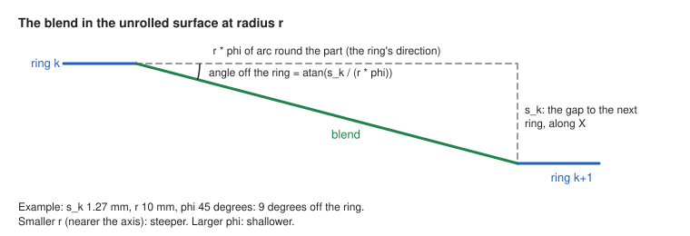

# 0545: Steps between rings can be blended, so the tool does not turn 90 degrees into a slot at depth (OP-03, OP-04, OP-05, OP-09, OP-11, OP-12, OP-14, OP-15, OP-24, GC-07, NFR-06, NFR-07, NFR-12; issue #638; lane RINGSTEP)

- **Status:** accepted by the project owner on 8 Nov 2026, relayed by the coordinator (decision 0049), with its drawings, after the owner read it in full. Proposed by lane RINGSTEP the same day. The owner's answers to its five questions were relayed by the coordinator (session_01CFw3bzew7zizFQ91L5tvT7) on 8 Nov 2026, each the recommended option: D1 option A (a whole ring, then a blend), D2 option 1 (a **Blend over** setting, default 45°, greater than 0 and at most 180, anything else refused by name), D3 option 1 (saved operations keep Sharp, new ring operations are written Blended, with a library minor bump), D4 option 1 (one lane and one pull request for all five strategies; simultaneous finishing may follow in a pull request of its own, with its setting, if it slips) and D5 option 1 (#642, then #641, then the rest). The number is provisional: the Merge Manager assigns the final number at release (the next after `main`'s highest when it merges).
- **Date:** 8 Nov 2026.
- **Issue:** #638, "Smooth steps between rings (no lateral plunge), and a survey of other sharp transitions and links".
- **What it amends, for operations with `ring_step = blended` only** (with `sharp`, all of them are unchanged):
  - [0390](0390-helical-finishing-in-rings.md) item 1: "each starts and ends at the Start angle, so all the steps lie on that one line of the part";
  - [0420](0420-rings-for-rest-roughing-and-round-facing.md) item 1: "then a step along the part at a constant A";
  - [0497](0497-rings-for-the-simultaneous-spiral.md) item 3: "the tool steps along X with A held at the angle the ring ended at".
- **Builds on:** [0297](0297-helix-strategies-turn-at-faces-across-the-axis.md) (a ring at each face across the axis), [0161](0161-tools-keep-clear-of-the-gripped-length.md) (whole rings at a held region's end), [0506](0506-combine-pure-a-runs.md) (pure-A runs combined into one block), [0521](0521-low-links-for-helical-rest-and-simultaneous-finishing.md) item 6 (a new operation written with a different default from a saved one), [0048](0048-pre-1-0-api-changes.md) (library version before 1.0), [0536](0536-message-levels-operation-reference-and-setting-links.md) (the form of notes).
- **Related:** [0546](0546-run-outs-follow-ring-and-spiral-passes.md) (#644, the run-outs past the stock on the same passes, proposed with this record and accepted the same day); issues #639 and #640 (entries that follow the toolpath, lane RAMPENTRY, its proposed records 0543 and 0544), #641, #642, #643 (the other transitions of the #638 survey; D5).
- **Open items:** OI-2112 (acceptance of the record), new, closed on 8 Nov 2026 with the owner's acceptance. OI-993 (the Z1 stops at the end of a pure-A block) is unchanged and not closed: blending moves where the stop happens, it does not remove it. OI-1373 (engagement limits) is not closed: this record adds a width-of-cut check to the test kit (Verification), which OI-1373 may later reuse. No project schema change (a free parameter, as for 0390).

## Context

Every strategy that offers **Passes: Rings** cuts a whole turn of A at constant X, then steps along X with A held to the next ring:

| Strategy | Where the step is made today |
| --- | --- |
| Helical finishing (OP-04) | `helical::ring_passes`: an axial `Fit` (`total_angle: 0`) from `x_k` to `x_k+1`, joined into one cut by `helical::join` |
| Rest machining (OP-09) | the same `helical::ring_passes`, through rest's `wanted` filter |
| Continuous rotary roughing (OP-03) and round Facing (OP-24) | `Job::continuous_rings` in `roughing.rs`: `Piece::Ring`, then `Piece::Step { a: a + 360 }`, at the layer's depth |
| Simultaneous finishing, spiral pattern (OP-05) | `simultaneous::ring_passes`: a step `Track` with `th0 == th1`, driven by `held_plan` |

In the unrolled plane of the cut (X along the part, arc length round it) that step is a 90-degree corner at each end, made at full depth. In roughing and round Facing everything ahead of the step is uncut down to the layer depth, so the tool runs sideways into a slot: the issue's model gives a width of cut of 2.45 mm (median) and 2.95 mm (peak) on the step, against 1.26 mm on the ring, for a 3.175 mm end mill at a 1.27 mm (40 %) stepover. In finishing, rest and the simultaneous rings the material is only the stock to leave and the scallop, so the load is smaller, but the corner still marks the surface.

Nothing in the assembly slows the feed at the corner: every in-pass move is `Cutting` at the cutting feed. On the Makera Z1 a pure-A block reaches the planner with no direction vector and is planned to stop at its end (OI-993, read from the firmware source, not checked on the machine), so at the end of each ring the tool stops at depth and then starts straight into the slot.

### The model, re-run

The issue's model script (`engagement.py`, a 2D dexel model of one roughing layer, independent of the product code) was re-run by this lane on 8 Nov 2026 (Python 3, NumPy 2.5.3; script SHA-256 `3392946313e0e2b8ca94da4588cc1bda9739e171212b154082ee98f8a3fde0b8`). Its output is identical, line for line, to the output in the issue:

| Path | Corner off the ring | Width of cut on the ring, median | On the step or blend, median and peak |
| --- | --- | --- | --- |
| Spiral | 0° | 1.24 mm | – |
| Rings, sharp step (today) | 90° | 1.26 mm | 2.45 mm, 2.95 mm |
| Option A, φ = 15° | 25.9° | 1.26 mm | 1.30 mm, 1.90 mm |
| Option A, φ = 30° | 13.6° | 1.26 mm | 0.97 mm, 1.65 mm |
| **Option A, φ = 45°** | **9.2°** | 1.26 mm | **0.86 mm, 1.52 mm** |
| Option A, φ = 90° | 4.6° | 1.26 mm | 0.75 mm, 1.43 mm |
| Option B, φ = 45° | 9.2° | 1.26 mm | 1.27 mm, 1.52 mm |

The peak on the ring itself falls from 2.20 mm (sharp: the ring after a step starts in the step's slot) to 1.41 mm at 45°. The model measures path shapes, not the product's output; the product's output is graded in the tests below by an independent check in the test kit.

### Drawings

The surface of the part unrolled into a plan view: A (the degrees turned from the **Start angle**, not wrapped, so A builds up) runs to the right, and X (along the part) runs down. A ring (blue) is a whole turn, 360 degrees at one X. The gaps between rings are not to scale.

**1. The step between rings, today and blended (items 1 and 2).**

**2. Where the blend starts and ends (D1).**

**3. The blend's angle off the ring (D2, item 6).** In the unrolled surface at radius r, the blend crosses one gap s_k while it goes r · phi round the part. At s_k = 1.27 mm, r = 10 mm and phi = 45 degrees the angle is 9 degrees (the model's 9.2); nearer the axis (smaller r) it is steeper, and a larger phi makes it shallower.

**4. The gap s_k against the ring spacing.** The ring places are unchanged (`helical::ring_places`, 0390 item 3): the part's length is split into n equal gaps s, each no wider than the stepover, with a ring at each end and one at each face across the axis (0297). Each blend turns the same phi whatever its gap, so a shorter gap gives a shallower blend:

| Rings | Gap s_k to the next ring | Blend after the ring |
| --- | --- | --- |
| x_0 (the part's start, or a held region's end, 0161) | s = length / n, at most the stepover | over phi |
| x_1, x_2, ... | s | over phi |
| a face's ring (0297), or a rest wall ring (closer than the stepover) | shorter than s on one or both sides | over phi, at a smaller angle off the ring |
| x_n (the part's end) | none | none: the last ring has no blend |

## Decision (accepted; the owner's answers D1 to D5 relayed on 8 Nov 2026)

1. **The setting (D3, option 1, the owner's choice, relayed).** Each of the five ring strategies (helical finishing, rest machining, continuous rotary roughing, round Facing, simultaneous finishing's spiral pattern) gains **Steps between rings** (`ring_step`), shown beside **Passes** and only when Passes is Rings, with two choices:
   - `sharp` (shown as "Sharp"): today's step, made by exactly today's code, so its output and every golden program stay byte-identical;
   - `blended` (shown as "Blended"): item 2.

   An operation saved without the parameter is `sharp`. `Application::add_operation_on` writes `ring_step = blended` into a new operation of each of these strategies, the way 0521 item 6 writes `link_height = low`. No saved project, golden program or reference program changes: none of them uses rings (checked on `main` `1f3675d`), and none is made from a new operation.
2. **The shape (D1, option A, the owner's choice, relayed).** After ring k, a whole turn at `x_k` from `a_k` to `a_k + 360·sign`, a blend runs from (`x_k`, `a_k + 360·sign`) to (`x_k+1`, `a_k + (360 + φ)·sign`), with X linear in A: a helix piece whose lead is `s_k / φ` (per degree), where `s_k = x_k+1 − x_k`. Ring k+1 starts where the blend ends, so ring, blend and ring are one cut where nothing splits them.
   - A turns the Rotation way throughout and never reverses (OP-15). It builds up 360° + φ per ring instead of 360°; range checks, unwinding and counter resets work on it unchanged (0241).
   - The last ring has no blend. The first ring starts at the Start angle as today; ring k starts at the Start angle + k·φ·sign, so the blends no longer lie on one line of the part (the amendment of 0390 item 1).
   - The blend is cut on the surface the same way as the ring: the same fit, stock to leave, zones, region, leave zones, tabs, protections, gouge test (OP-12) and splits. The shared services link any pieces (OP-14).
3. **The blend angle (D2, option 1, the owner's choice, relayed).** A parameter **Blend over** (`ring_blend_angle`), in degrees, default 45, greater than 0 and at most 180, shown only with Rings and Blended. Any other value, including NaN, is refused naming **Blend over** (NFR-07). It is a free parameter; a saved operation without it takes 45.
4. **Per strategy.**
   - **Helical finishing and rest machining** (`helical::ring_passes`): the blend is a `Fit` with `x0: x_k`, `length: s_k`, `start: a_k + 360·sign` (as a wrapped angle, the Start angle + k·φ·sign) and `total_angle: φ`, a helix fit that already exists. Rest filters the blend through `wanted` as it filters the step today (0420 item 2). Rings that adaptive spacing (0239) adds are separate passes, as today, and are not blended; adaptive spacing measures each ring from its own start angle.
   - **Continuous roughing and round Facing** (`Job::continuous_rings`): a third piece, `Piece::Blend { x0, x1, a0, nodes }`, with X and A both linear in the node and at least `max(ceil(φ / max_angle_step), ceil(s_k / line_spacing))` nodes. The estimate that refuses a stepover too fine to cut (NFR-07) counts the blends. `Job::layers` and the spiral's arithmetic do not change. A face ring (0297) and the end rings (0161, round Facing's ends) stay whole rings; the blend leaves them at their end.
   - **Simultaneous finishing** (`simultaneous::ring_passes`): the blend is a short spiral-pattern `Track` from the drive angle the ring ended at to φ further round (`th1 = th0 − sense·rotation·φ`), from `x_k` to `x_k+1`, driven as the spiral is (the lead in the direction of travel, A smoothed within the tilt band, `axis_plan_from` starting at the ring's end) instead of `held_plan`. It is split where the section changes zone, as the step is. Where a face ring is cut by `turn_passes` (a face in a zone round the axis) the blend starts at that ring's end angle.
5. **What stays the same.**
   - The ring places (`helical::ring_places`), including the whole rings at each end, at each face across the axis (0297) and at a held region's end (0161).
   - Entries, leaves and links, including low links (0496, 0521). Lane RAMPENTRY's #639 and #640 take the entry and leave directions from the pass; a blended ring pass still starts and ends with a whole ring that closes on its first tip (the same X, Y and height, within the tolerance) before the blend leaves it, so their shape reading (lane RAMPENTRY's `assemble/pass_shape.rs`) still sees a full ring at the pass's ends, as agreed with that lane on 8 Nov 2026.
   - 0506's combining: a whole ring is still one pure-A block, and a blend (an XA move) ends the run.
   - The Z1 still stops at the end of a pure-A block (OI-993), but now at ring engagement rather than at the start of a slot.
   - Extend past the stock: the run-outs on these passes are [0546](0546-run-outs-follow-ring-and-spiral-passes.md)'s subject, decided separately.
6. **Notes.** The ring note keeps its count and spacing and says how the steps are made. With Blended it gives the blend and the steepest angle it makes with the ring, `atan(s / (r·φ))` at the largest radius cut, rounded to whole degrees: for example "steps between rings blended over 45°, at most 9° off the ring". Notes are written in decision 0536's form (topic, operation, what, why, what to change) through the `openchuck_app::lead_in` / `Notice` constructors once lane MSGREVIEW's step 3 is on `main`.
7. **NFR-12.** The parameter description and the note say the blend keeps the load nearer the stepover. They do not say the program is safe or checked: generated G-code remains the user's to verify before running it on a machine.
8. **Library (0048).** One added parameter pair in five schemas, and added public constants (`helical::parameter::RING_STEP`, `SHARP`, `BLENDED`, `RING_BLEND_ANGLE`, shared by the other four strategies as `PASS_SHAPE` is). A new operation's output changes (item 1), so the library family takes a minor version bump (provisionally 0.51.0; the Merge Manager assigns it at release, in merge order) with changelog entries in `openchuck-path` and `openchuck-app`, as 0521 item 5 did. No project schema change.
9. **Scope (D4, option 1, the owner's choice, relayed).** All five strategies in one lane and one pull request. If simultaneous finishing's blend slips, it follows in a pull request of its own that adds its setting with it: no strategy shows the setting before its blend is built.
10. **Follow-ups (D5, option 1, the owner's choice, relayed).** The other transitions found by the #638 survey are issues of their own: #642 first (a possible rapid into stock at lead and ramp starts), then #641 (End Facing), then the rest (#643, #644, #639, #640). They are other lanes' work, except #644 (0546, this lane).

## Alternatives considered

| | Option | Engagement at the step | Corner | Why not chosen (or chosen) |
| --- | --- | --- | --- | --- |
| **A** | **Whole ring, then a blend** (proposed) | Near the stepover (1.52 mm peak at 45°) | about 9° at 45° | Every ring stays a whole turn at one X, so faces, held ends and round Facing's ends are unchanged. A builds up an extra φ per ring, the steps no longer lie on one line, and the cut is about φ/360 longer per ring (12.5 % at 45°). |
| B | Blend in place of the ring's end (0390's option 3) | Same as A | Same as A | Not longer, and A builds up exactly one turn per ring. But no ring is a whole turn at one X, so the end rings, held-region ends and face rings need special cases; 0390 declined this shape because "each ring is not quite flat at its end". |
| C | Sharp step at a lower feed | Still a full slot | 90° | A mitigation only. The Z1 still stops at the corner. |
| D | Fillet inside the step only | Close to a slot (about 1.9 mm peak) | Smooth | The step is too short for a fillet to change the engagement much. |
| E | Lift for the step | Swaps the slot for a plunge per ring (OI-151) | – | Worse and slower; 0390's option 4. |
| F | Keep the step and warn | Unchanged | Unchanged | Documents the load but does not remove it. |

For D2, the other choice is φ derived for each ring from a fixed largest angle off the ring (for example 10°): the blend's length then follows the stepover and the radius. Not recommended: the user sets an angle they cannot see on the part, and on a small radius φ grows past a useful size; a blend angle with the steepest angle in the note is easier to read. For D3, the other choice is `sharp` for new operations as well (no output changes at all, no version bump), at the cost of new ring operations keeping the slot unless the user finds the setting.

## Consequences

- **Code** (lane RINGSTEP; the functions agreed with lanes RAMPENTRY and PATHFEED, who own `assemble/entry.rs`, `ramp.rs`, `facing/end.rs`, `assemble.rs` and `walls.rs`):
  - `crates/openchuck-path/src/helical.rs`: the two parameters and their specs beside `pass_shape_spec`; `ring_passes` makes the blend; the ring note.
  - `rest.rs`: the schema and the ring call.
  - `roughing.rs` (and Facing's round shape through it): `Piece::Blend`, the node estimate, the note.
  - `simultaneous.rs`: `ring_passes` makes the blend track.
  - `crates/openchuck-app/src/opflow.rs`: new operations (item 1); `form.rs` where the inspector lists parameters shown only with another's value.
- **Documents** (proposed here, edited in the build pull requests after acceptance; `docs/requirements.md` and `docs/architecture.md` are not changed):
  - UI specification, section 8, after the **Passes** entry: "**Steps between rings**: a segmented control, Sharp or Blended, shown when Passes is Rings; Blended for a new operation, Sharp for one saved before it. Tooltip: 'Sharp: step along the part with A held still, a square corner at each end of the step. Blended: after each whole ring, move to the next ring while A turns on by the Blend over angle, so the tool eases across instead of turning into the uncut wall.' **Blend over**: degrees, 45 by default, shown when the steps are Blended."
  - Verification plan, "Rings instead of a spiral (decisions 0390 and 0420)": add 0497 and this record to the heading, and the blended cases listed under Verification.
  - Work breakdown: lane RINGSTEP in "Parallel work".
  - `openchuck-path` and `openchuck-app` changelogs and the release notes: one line each, "New ring operations blend the steps between rings; saved operations keep sharp steps."

## Verification

### Done for this proposal (8 Nov 2026)

- The issue's model script re-run by this lane (Context, "The model, re-run"): output identical to the issue's. Run in the session's scratchpad, not kept in the repository; its source is in issue #638.
- Read on `main` `1f3675d`: the four step sites above; `helical::join` accepts a piece whose start A differs from the pass end by whole turns only, so a blend fitted from the ring's end angle joins as today; `Fit` already fits a helix piece (`length > 0`, `total_angle > 0`); no golden, reference or example program uses `pass_shape = rings` or `extend` (a search of `testdata/`).
- The independent width-of-cut check, `openchuck_testkit::engagement` (`UnrolledStock`, `smoothed`, `peak_and_median`), built ahead of the owner's answers with the coordinator's agreement, because every option needs it (on `claude/lane-ringstep-wip`, commit `5b74f29`; it reaches `main` with the build pull request). Its unit tests re-make the model's case in the model frame (each under 2 s uninstrumented with `cargo nextest run`): `req_op_03_the_width_of_cut_on_a_spiral_is_the_stepover`, `req_op_03_a_sharp_ring_step_is_a_slot`, `req_op_03_a_blend_over_45_degrees_keeps_near_the_stepover`, `req_op_03_nothing_left_to_cut_is_no_width` and `req_op_03_a_cut_lowers_the_stock_to_the_tip`. It agrees with the model to within 0.04 mm: spiral 1.35 mm peak, 1.28 mm median (model 1.31, 1.24); sharp step 2.98 mm, 2.43 mm (2.95, 2.45), the rings 2.16 mm, 1.27 mm (2.20, 1.26); blend over 45° 1.55 mm, 0.86 mm (1.52, 0.86), the rings' peak 1.43 mm (1.41). `openchuck-testkit` is excluded from the coverage gate (`xtask/coverage.toml`).
- Not done: no product code changed or run; the finishing and simultaneous loads are not measured; nothing run on a machine.

### To do when built (tests written first, each watched to fail)

In `crates/openchuck-path/tests/spiral_rings.rs`, `helical_rings.rs`, `simultaneous_rings.rs` and `crates/openchuck-app/tests/operation.rs`:

- `req_op_04_req_op_11_blended_rings_are_whole_turns_joined_by_helix_pieces` (each strategy: every ring a whole turn at one X; each blend X-linear in A over φ; the last ring has none)
- `req_op_03_blended_ring_steps_cut_no_wider_than_near_the_stepover`, graded by a new independent width-of-cut check in `openchuck-testkit` (the tool's footprint swept over a dexel stock along the product's cutting moves, as the model does): on the blends, the peak no more than 1.25 times the stepover; the sharp step, checked the same way, near the full diameter
- `req_op_12_blended_rings_leave_no_more_than_sharp` (the test kit's gouge and coverage checks on a cylinder and a cone, and the stepped shaft's faces)
- `req_op_15_blended_rings_turn_one_way` (A monotonic in the Rotation's sense; built up by 360 + φ per ring)
- `req_op_05_blended_simultaneous_rings_follow_the_spiral_drive` (lead 0, 5 and −5 degrees; the lobed part split by zone)
- `req_op_09_blended_rest_rings_cut_only_where_material_is_left`
- `req_op_24_blended_round_facing_reaches_the_diameter_and_the_ends`
- `req_gc_07_sharp_steps_are_unchanged` (each strategy: `sharp`, and no value, give byte-identical passes to the code before the change)
- `req_gc_07_req_nfr_06_blended_rings_identical_at_1_2_and_n_threads`
- `req_nfr_07_a_bad_blend_angle_is_refused_by_name` (0, −1, 180.0001, NaN, infinity; and a stepover too fine counted with its blends)
- `req_op_11_a_new_ring_operation_blends_its_steps` (all five strategies; others get nothing)
- `req_gc_07_a_saved_ring_operation_keeps_sharp_steps`

Also: simulate one roughing and one finishing operation on a public stand-in (`testdata/step/valid/crankshaft.step` or `testdata/projects/cone`) both ways, as 0521's Verification did, and record the cycle time and the material left. Each test timed uninstrumented (`cargo nextest run`); the local coverage check of `openchuck-path` and `openchuck-app` on their own tests; `cargo xtask deps`, `licences`, `records`, `trace` and `messages`.

### As built (lane RINGSTEP, the build pull request for #638 and #644, 8 Nov 2026)

Built on `main` `1f3675d`, with `main` `645256c` (MSGREVIEW step 3) merged, on the records of pull request #647. Library 0.52.0, as the Merge Manager sequences it (MSGREVIEW took 0.51.0). The Decision above is as the owner accepted it; these are the refinements the build made, each within it:

- **Item 4, helical finishing and rest machining.** The blend's `Fit` starts at the ring's own start angle, the Start angle + k·φ·sign (a ring ends a whole turn on, so `helical::join` joins them as before), and is seeded no more coarsely than a sharp step (one seed per `CONSTRAINED_SPACING` of X) or the largest angle step. With sharp steps every ring still starts at the Start angle, by the code before. Adaptive spacing measures a blended ring's angles round one turn from the Start angle (`rem_euclid(360)`), as a ring closes on itself.
- **Item 4, roughing and round Facing.** `Piece::Blend { x0, x1, a0, phi, nodes }` has `max(ceil(φ / (360 / per_turn)), ceil(s_k / line_spacing), 1)` nodes, so no further apart in A than a ring's nodes nor along X than a step's. Ring k starts at the Start angle + 360·k + φ·k; with sharp steps the term φ·k is absent and the arithmetic is the code before.
- **Item 6, the note.** It is information under the topic Rings (decision 0536), with the blend's words added to the rings note. A "steepest" angle over the whole part would be near 90 degrees wherever a ring is cut close to the axis, so the note gives the angle at a stated radius (the stock's top for roughing and round Facing, the part's largest radius for the finishing strategies): "steps between rings blended over 45°, 9° off the ring at a radius of 10.0 mm (steeper nearer the axis)".
- **The setting** is `helical::parameter::RING_STEP` (`SHARP`, `BLENDED`) and `RING_BLEND_ANGLE` (`DEFAULT_RING_BLEND_ANGLE` 45), shared by the five schemas through `helical::ring_step_specs` and hidden by `helical::ring_step_schema_for` unless Passes is Rings (and Blend over unless the steps are Blended). `Application::add_operation_on` writes `blended` into a new operation of each strategy that has it.

Tests, each written before its code and run uninstrumented with `cargo nextest run` (the longest 39 s, at 1, 2 and N threads for all five strategies):

- `crates/openchuck-path/tests/ring_steps.rs`: `req_op_11_every_ring_strategy_offers_steps_between_rings_only_with_rings`, `req_gc_07_sharp_steps_are_unchanged` (all five, byte-identical, and the blend angle ignored with Sharp), `req_op_04_req_op_11_blended_rings_are_whole_turns_joined_by_helix_pieces` (roughing, round Facing, helical, rest at 45 and 90 degrees), `req_op_15_blended_rings_turn_one_way`, `req_op_03_blended_ring_steps_cut_no_wider_than_near_the_stepover`, `req_op_12_blended_rings_leave_no_more_than_sharp` (helical and simultaneous on a cone), `req_op_05_blended_simultaneous_rings_follow_the_spiral_drive` (lead 0, 5 and −5 degrees), `req_op_09_blended_rest_rings_cut_only_where_material_is_left`, `req_op_24_blended_round_facing_reaches_the_diameter_and_the_ends`, `req_gc_07_req_nfr_06_blended_rings_identical_at_1_2_and_n_threads`, `req_nfr_07_a_bad_blend_angle_is_refused_by_name`, `req_nfr_07_blended_roughing_counts_its_blends_against_the_node_limit`.
- `simultaneous_off_axis.rs`: `req_op_26_req_op_05_blended_rings_finish_the_inner_corners_of_the_crankshaft` (the public crankshaft model: the blends cross the off-axis pins' zones and are split there; the corners are finished as with sharp steps). `adaptive.rs`: `req_op_04_rings_with_blended_steps_are_spaced_as_sharp_rings_are`.
- `crates/openchuck-app/tests/operation.rs`: `req_op_11_a_new_ring_operation_blends_its_steps`, `req_gc_07_a_saved_ring_operation_keeps_sharp_steps`; `playback.rs` expects the value in a new operation. `apps/openchuck-ui`: `req_op_11_ring_steps_are_shown_in_plain_words`.
- The test kit's `engagement` check (above).

Results:

- **The load,** by the independent width-of-cut check on one roughing layer as in the model (a 3.175 mm flat end, a 1.27 mm stepover, a 10 mm radius, the fixture's stock from 1 mm before the part to 1 mm after it): the sharp steps peak above 2.6 mm (a slot); the blends stay within 1.25 times the stepover (1.59 mm) away from the stock's ends. At the stock's start the first blend reaches about 1.77 mm: the first ring there is cut in pieces where the tool stands partly past the stock, so the blend leaves a slot. The model has no stock end; this is recorded, not excluded silently, and the test grades the blends from 0.5 mm inside the stock's ends.
- **Sharp is unchanged** for all five strategies; no golden or reference program uses rings, so none changes.
- **Suites run locally,** uninstrumented: all of `openchuck-path`, `openchuck-ui` and `openchuck-testkit` (1623 tests, all passed, on the code with `main` `645256c` merged), and the 256 `openchuck-app` tests on the areas this change touches (operations, playback, the form, held regions, Extend, rings, Facing, roughing, helical, rest and simultaneous finishing, messages, notices and topics; all passed). The rest of the `openchuck-app` suite (about 590 tests) was not run locally: it takes hours on the session's 4-core container; CI runs it. `cargo fmt`, `cargo clippy --workspace --all-targets`, and `cargo xtask deps` (with its topics check), `licences`, `records`, `trace` and `messages` pass.
- **Coverage,** on `openchuck-path`'s ring, Extend and spiral-ring tests only (instrumented, then `cargo llvm-cov clean --workspace`): every new line is covered except defensive ones (the first run found two real gaps, adaptive spacing with blended rings and the simultaneous blend split by zone, and the two tests above were added for them): `helical::ring_blend`'s refusal and its default (the schema refuses a bad blend angle and supplies the default first) and the run-out's empty pass. `openchuck-app`'s one new branch is run by its tests but was not measured instrumented.
- **Not done:** the simulated time and material left for one roughing and one finishing operation both ways (the "Also" of the list above) is not run in this pull request; nothing was run on a machine. Generated G-code remains the user's to verify before running it on a machine (NFR-12).