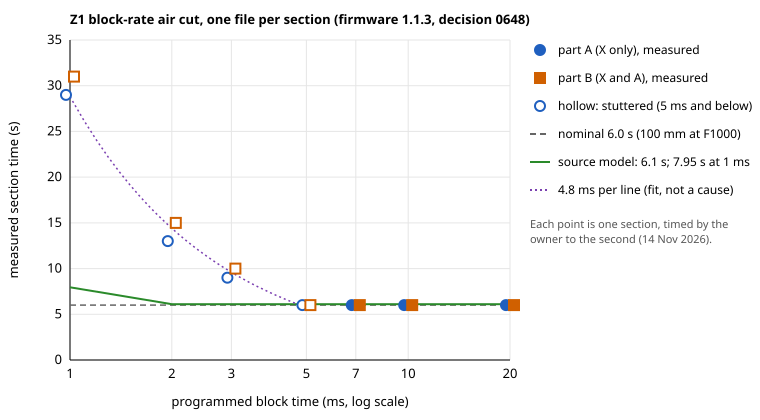

# 0648: The Z1 block-rate air cut runs one section per file; 7 ms holds on firmware 1.1.3 (GC-17, NFR-12; issue #793; lane FWDIFF)

- **Status:** Accepted by the project owner on 14 Nov 2026, relayed by the coordinator (decision 0049). Proposed by lane FWDIFF on 14 Nov 2026; the owner's two decisions recorded under *Decision* (a record of its own; the K4 copy with `G61`) were relayed by the coordinator the same day.
- **Date:** 14 Nov 2026.
- **Lane:** FWDIFF, an investigation of Makera Z1 firmware 1.1.2 against 1.1.3 for issue [#793](https://github.com/paulhampson/OpenChuckCAM/issues/793), on the coordinator's instruction.
- **Requirements:** GC-17 (short-block demand), GC-09 (the Z1 post), GC-10 (the verification post), NFR-12 (the user verifies a program before it runs).
- **What it amends:** none. Like [0232](0232-block-rate-program-checked-as-sp-12-was.md), it is an exception to verification plan section 1, policy 6, for named programs only: the 14 split files below. 0232 itself is unchanged and still covers only the full program at 69d532f.
- **Builds on:** [0222](0222-short-moves-minimum-block-time.md) (the block-rate air cut and its 7 ms result), [0232](0232-block-rate-program-checked-as-sp-12-was.md) (K1 to K4), [0245](0245-short-block-report-and-slowdown.md) (Report and Slow down at 7 ms / 32 blocks).
- **Related:** [0647](https://github.com/paulhampson/OpenChuckCAM/tree/claude/lane-alimit-793) (lane ALIMIT, unmerged at the time of writing): the firmware clamps A to 1800 deg/min, which explains #793's slow helical programs. That clamp does not touch this test: part B asks A for about 10.5 deg/s.
- **Spike:** branch `spike/sp-14-split-files`, commit `fed4809`, one commit on `spike/sp-14-short-moves` at 69d532f. Never merged. Write-up in `spikes/sp14-short-moves/air-cut/split/README.md` and `split/K4-RESULTS.md` on that branch.
- **Open items:** OI-2144, new: (a) the whole-file refusal, deferred by the owner on 14 Nov 2026 (relayed), no bisect now; (b) how blocks shorter than 5 ms are timed, open.

Numbering: on 14 Nov 2026 the highest record on `main` was 0646 and the highest open item OI-2142. Lane ALIMIT's unmerged branch holds 0647 and OI-2143. The coordinator reserved 0648 and OI-2144 for this lane, and no branch uses either.

## Context

On firmware 1.1.3 (ESP32 1.1.3, WiFi upload) the Z1 refused the full block-rate program, `block_rate_z1.nc` at 69d532f, in every section (#793 item 5). That program is 1,170,259 bytes and 27,966 lines. The owner later reported the refusal as Makera Studio's "could not be loaded"; a direct upload ended with an alarm and no further feedback. On firmware 1.1.2 the same program ran (0222).

**What the open source says (read):**

- The published firmware (MakeraInc/MakeraZ1Firmware) changes only `ATCHandler.cpp`, `ZProbe.cpp` and the version string between v1.1.2 (`3426fa8`) and v1.1.3 (`8ae81f3`). File play, the planner and the ESP32 link (`Player.cpp`, `Planner.cpp`, `SerialConsole.cpp`) are byte-identical.
- The program is stored on the ESP32 board, whose firmware is closed source. The LPC1768 asks the ESP32 for lines in packets of up to 224 lines of 64 bytes (`Player.cpp:67`), so the LPC side has no limit on file size or line count.
- Nothing in the published source explains the refusal. A limit on the ESP32 or in Makera Studio can be neither read nor ruled out.

To tell a size limit from a content problem, lane FWDIFF split the program into one file per section. The coordinator then put the files on the spike branch.

## Decision

1. **The split procedure.** `gen_block_rate.py N` writes section N alone as `split/block_rate_z1_sN.nc`, for N = 1 to 14. Each file holds:
   - the full program's header (lines 1 to 5);
   - one `G0 X<start> Y0.000 Z50.000 A<start>` to where section N starts in the full program;
   - the section exactly as in the full program, byte for byte: its marker `G1 Z55.000` / `G1 Z50.000` and its G1 blocks;
   - the full program's footer.

   Block times, F1000, block lengths and coordinates are unchanged, so results compare with the 1.1.2 trial. With no argument the generator still writes the full program byte for byte (checked with `cmp`). Files are 12,573 bytes (s1, 314 lines) to 257,706 bytes (s14, 6,014 lines). The longest line is 50 characters.
2. **These files get a record of their own** (owner decision, 14 Nov 2026, relayed). This record is their exception to policy 6, as 0232 is for the full program (0232 item 3: no other program gains that exception). They are checked by K1 to K4 of instructions section 4.8, read per file: header and footer, the forbidden-word grep, and the one section; then gate 3. A change to any file sends it back to that check.
3. **K4 uses a LinuxCNC copy with `G61`** (owner decision, 14 Nov 2026, relayed; simulator copy only). The command per file is
   `sed -e '/^G92.4 A0 S0$/,$d' -e 's/^G54$/G54\nG61/' block_rate_z1_sN.nc > block_rate_sN_g61_linuxcnc.ngc`, then `printf 'M5\nM30\n' >>` the copy, then `cargo xtask replay --docker openchuck-linuxcnc` on it.
   - Without `G61`, LinuxCNC blends the corner between the header's G0 and the extra G0, so it never reaches the corner point. Ten of the 14 copies fail for that reason; s1, s3, s5 and s7 pass because their extra G0 is a zero-length move.
   - The application's LinuxCNC post writes `G61` (every reference `*_linuxcnc.ngc`, line 6), and the Z1 program itself is unchanged.
4. **No product change.** The Z1 profile keeps `min_block_ms` 7, window 32 and Report (0245). The air cut on 1.1.3 confirms that value (results below).

## Results

**Checks (lane FWDIFF, 13 Nov 2026).**

- K1 to K3, with `split/check_split.py` as an aid to the owner's reading: all 14 pass. Each section body is byte-identical to the full program's.
- K4, with the `G61` copy: all 14 reached every move with no fault, at the 0.1 mm tolerance. s2's largest difference was exactly 0.1000 mm.
- The details, image ID and hashes are in `split/K4-RESULTS.md` on the spike branch.

**The air cut (owner, 14 Nov 2026; firmware 1.1.3, ESP32 1.1.3, WiFi upload, played from the machine).** All 14 files were accepted and ran. Nominal time per section is 6.0 s (100 mm at F1000). Times were taken to the second.

| Block time | Part A (X only) | Part B (X and A) | Lines per section | Measured time per line, A / B |
| --- | --- | --- | --- | --- |
| 20 ms | 6 s, smooth | 6 s, smooth | 300 | 20 / 20 ms |
| 10 ms | 6 s, smooth | 6 s, smooth | 600 | 10 / 10 ms |
| 7 ms | 6 s, smooth | 6 s, smooth | 857 | 7 / 7 ms |
| 5 ms | 6 s, stuttering | 6 s, stuttering | 1,200 | 5 / 5 ms |
| 3 ms | 9 s, stuttering | 10 s, stuttering | 2,000 | 4.5 / 5.0 ms |
| 2 ms | 13 s, stutter and pauses | 15 s | 3,000 | 4.3 / 5.0 ms |
| 1 ms | 29 s, heavy stutter and pauses | 31 s | 6,000 | 4.8 / 5.2 ms |

- Step B15 of the gate (stop at an alarm or unexpected motion) was not triggered.
- **B16: `min_block_ms` = 7 ms on firmware 1.1.3**, the same as on 1.1.2 (0222, OI-930). 7 ms is the shortest tested block time that ran smoothly in both parts. 5 ms kept its time but stuttered.
- The full 1.17 MB program was not run again.

## Findings

1. **The split files run where the full program was refused.** The largest file (s14, 257,706 bytes, 6,014 lines) loaded and ran; the full program (1,170,259 bytes, 27,966 lines) did not. The likely cause is a file size or line-count limit somewhere between those two, in Makera Studio or on the ESP32. This is inferred, not read: neither is open source. A content cause is unlikely, since every section's lines run unchanged in the split files. The owner deferred this on 14 Nov 2026 (relayed): no bisect now, and it is not a release to-do. OI-2144 (a) keeps the hypothesis and the proposed experiment, a bisect with intermediate sizes, for when it is taken up.
2. **Blocks shorter than 5 ms are much slower than the published source predicts** (hypothesis about the cause only).
   - A model of the published planner (`Robot::append_milestone`, `Planner`, `configZ1.default`: acceleration 150 mm/s², junction deviation 0.01, 32-block queue) gives 6.1 s per section down to 2 ms.
   - At 1 ms it gives 7.95 s, because the queue's stopping distance (`sqrt(2 a 32 L)`, 12.6 mm/s) caps the speed.
   - The machine took 29 to 31 s at 1 ms and 13 to 15 s at 2 ms.
   - Once the program asks for more than about 200 lines a second, every short section took 4.3 to 5.2 ms per line, whatever its block time. That fits a throughput floor in line delivery or line handling, not in the planner.
   - The ESP32 link's raw rate (230400 baud, about 1.8 ms for a 42-byte line) and 0222's estimated floor of about 1.5 ms per line are both well below what was measured. So either the shipped firmware plans or handles very short blocks differently from the published Smoothieware source, or the closed ESP32 and its packet requests (`Player.cpp`: a refill request when fewer than 180 lines are queued) add cost per line.
   - This explains the time, not the cause. The 1.1.2 trial recorded stutter but no times for these sections, so whether 1.1.3 is slower there is not known.
3. **7 ms stays valid.** Decisions 0222, 0232 and 0245 and the closed OI-930 remain correct for the 7 ms threshold. The slowdown model for blocks shorter than 5 ms should be revisited (OI-2144): 0245's Slow down only lifts blocks to 7 ms, which these results support. But 0222's stated per-line floor and its explanation of the floor should not be relied on below 5 ms.

## Options not chosen

- **Run the split files under 0232.** The owner chose a record of their own, because 0232 item 3 names one program.
- **Make the K4 copy as 0232 does, without `G61`.** Ten copies fail on a corner that LinuxCNC blends and the Z1 does not, which says nothing about the program.
- **Shorten the full program instead of splitting it.** That changes the section lengths and block counts the 1.1.2 result was measured with.

## Consequences

- `docs/work-breakdown.md`: the SP-14 Status cell names `spike/sp-14-split-files` (`fed4809`), this record, #793 and OI-2144.
- `docs/open-items.md`: OI-2144, new.
- Proposed, not made here, for the owner (decision text of other records is not edited by this record):
  - 0222, "How lines arrive": add that on 1.1.3 sections faster than about 5 ms per line ran at 4.3 to 5.2 ms per line, so the floor is near 5 ms per line, not 1.5 ms.
  - Instructions section 4.8: point to this record for the split files and their K4 copy.
- No requirement, architecture, crate or dependency changes. Generated G-code is still the user's to verify (NFR-12).

## Verification

- **Environment:** the generator and checks ran on `spike/sp-14-split-files` (`fed4809`). The replays used xtask from `main` at `bc1df28` and LinuxCNC v2.9.10 in image `sha256:47fc56843a91ee2c1a4e7bc08b7ef41cf15a4546a5cf3d3460d16eed32179b69`, built from `docker/linuxcnc` with three lines for the session's proxy (its CA and apt over HTTPS).
- **What was checked and how:**
  - `python3 -I gen_block_rate.py | cmp - <(git show 69d532f:.../block_rate_z1.nc)`: identical.
  - `python3 -I check_split.py ../block_rate_z1.nc block_rate_z1_s*.nc`: 14 of 14 pass.
  - `cargo xtask replay --docker openchuck-linuxcnc` on each copy: 4 of 14 pass without `G61`, 14 of 14 with it, all on the first attempt.
- **Machine results:** the owner's, relayed by the coordinator on 14 Nov 2026. Times to the second.
- **The source model:** a transcription of the published firmware's planner for this investigation. It is not product code and is not committed. It reproduces #793's slow helical programs within 2 % once A is capped at 30 deg/s (0647).
- **Not verified:** the cause of the whole-file refusal; the cause of the per-line floor; the shipped 1.1.3 binary against the published source; the ESP32 firmware; whether the same per-line floor applied on 1.1.2.
- **Open items:** OI-2144: (a) deferred by the owner (14 Nov 2026), (b) open.
