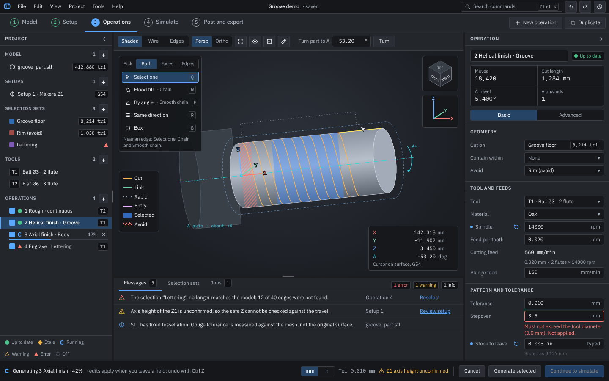

# OpenChuckCAM user interface specification

- **Status:** accepted by the project owner on 15 Oct 2026, with [decision 0038](../decisions/0038-ui-specification-and-requirements.md). It ranks with the decision records (`docs/README.md`, precedence 5): where it disagrees with an accepted decision record, the record wins until one of them is changed. The known differences from what slice 8 built are listed in section 17, with the agreed resolutions. Sections 7.5 and 11.7 (held regions and retaining tabs) were added on 18 Oct 2026 for [decision 0104](../decisions/0104-held-regions-and-tabs-in-the-interface.md) (work breakdown slice 21d), with the other sections' references to them; what the current build does differently is D13 in section 17. On 18 Oct 2026 the catch-up edits agreed with [decision 0114](../decisions/0114-slice-22-conformance-report.md) were made (OI-340 items 1 to 7, and the hover and selection widths of OI-341; the owner's answers, relayed by the coordinator and confirmed by the owner in the lane X1 session): sections 7.5, 11.2, 11.5, 11.6, 12.2, 15 and 16. On 19 Oct 2026 the four readings of [decision 0117](../decisions/0117-slice-22-shell-frame.md) (lane X2, the shell frame) were written into sections 3, 4, 5 and 9 (OI-350, the owner's answer A, relayed by the coordinator). On 19 Oct 2026 section 11.3 item 3 (Part position) was edited to the owner's answer on OI-366 ([decision 0123](../decisions/0123-slice-22-inspectors.md)): the model's turn about the rotary axis is set by its placement steps. On 20 Oct 2026 sections 3, 5, 6, 8, 11.4 and 12.1 were edited for [decision 0127](../decisions/0127-slice-22-tool-library-window.md) (lane X9, the tool library window, and trial feedback F-10, issue 148; the owner's decisions, relayed by the coordinator): tools leave the project tree (UI-06 as amended), an operation's inspector shows its tool, and the tool library window manages tools.
- **Date:** 15 Oct 2026; sections 7.5 and 11.7, 18 Oct 2026; the decision 0114 catch-up edits, 18 Oct 2026; the decision 0117 readings, 19 Oct 2026; the decision 0123 edit of 11.3, 19 Oct 2026; the decision 0127 edits, 20 Oct 2026.
- **Design source:** the design canvas "OpenChuckCAM UI Design" (a claude.ai artifact, private to the project owner: <https://claude.ai/artifact/1Qi5cpiyAiz3r5DkFnXkbu>). Its boards are named in section 1. The mockups use example data (the "Groove demo" project); the numbers in them are not results.
- **Requirements:** the requirements this design needs were added by decision 0038: UI-10 to UI-16, GC-15, GC-16 and NFR-15 (P1), and UI-17 to UI-24 and SIM-11 to SIM-13 (P2); SIM-14 (P2) was added later for the per-operation deviation. An element that serves a P2 requirement is marked with its ID in italics and is not part of the first release. UI-25 (P1) and the amended UI-03 were added by decision 0104.

## 1. Purpose and scope

This document says how the desktop application (`openchuck-ui` on egui, with `openchuck-viewport` on wgpu) looks and behaves: the layout, the workflow, the states shown, the wording and the visual tokens. It is written for the lanes that build the user interface (lanes A, M, N, O, S and T of the work breakdown's parallel plan).

It does not change what the engine does. Requirements stay in `requirements.md`, and how the code is split stays in `architecture.md`. Three rules from the architecture apply throughout:

- The UI holds no CAM logic (architecture section 5.8). Every value it shows comes from a view model or query in `openchuck-app`.
- Every edit to the project is a command, and undoable (UI-08).
- Long work runs as a job, never on the UI thread (UI-09, NFR-04).

Each element below names the requirement it serves. An element that serves only a P2 requirement is not part of the first release.

**Boards in the design canvas**

| Board | Section |
| --- | --- |
| 0 New project (empty state) | 11.1 |
| 1 Model; 1b Import dialog | 11.2 |
| 2 Setup | 11.3 |
| 2c Workholding and tabs | 11.7 |
| Held regions and tabs in the view | 7.5 |
| 3 Operations; 3b Inspector, operation in error | 11.4 |
| 4 Simulate and review | 11.5 |
| 5 Post and export | 11.6 |
| Tool library and profile editor | 12.1 |
| Selection sets (now in the inspector, [decision 0215](../decisions/0215-selection-sets-in-the-inspector-and-direct-set-editing.md); the board predates it) | 12.2 |
| Undo history (popover) | 12.3 |
| Operations at 1366 × 768 | 3 |

Every workspace board has a dark and a light theme (its Tweaks panel on the canvas). Rendered images of the boards are in [mockups/](mockups/), listed in section 20.

## 2. Users and design principles

The user is the one in requirements section 2: a machinist, maker or small-shop programmer, comfortable with G-code, tooling, feeds and speeds, who may know Fusion, SolidWorks or FreeCAD. The workflow is the eight steps of that section.

1. **Familiar CAD layout.** Menu bar, project tree on the left, 3D view in the centre, properties on the right, messages below, status at the bottom. A user of another CAD or CAM tool should find each thing where they expect it.
2. **The workflow order is visible.** The four steps (Model, Setup, Operations, Simulate) follow requirements section 2 and architecture section 6, left to right. Post and export is an action at the end of Simulate ([decision 0282](../decisions/0282-four-step-workflow-with-separate-simulate-and-export-actions.md)).
3. **Hierarchy of importance.** On any screen, in this order: whether the job can go on (errors, stale results, running work), then the result of the selected item, then its parameters, then reference information. Layout, size and weight follow that order.
4. **State is always visible, and never by colour alone.** Each state has a shape as well as a colour, and a legend that does not scroll away.
5. **Problems are shown where they are, and in one list.** A problem is marked on its item, explained in the inspector, and listed in the messages panel with a way to fix it.
6. **One primary action, bottom right.** Each screen has one filled button for the next step of the job (section 5).
7. **Nothing implies the G-code is safe.** Generated G-code is the user's to verify (NFR-12). No wording, colour or icon says "ready to run", "safe" or "verified".
8. **Geometry in the view, numbers in the panels.** The viewport shows shape and position. Exact values are in readouts, panels and tooltips.
9. **Keyboard and pointer are equal.** Every command has a menu entry, most have a shortcut, and anything shown on hover is also shown on keyboard focus.
10. **Never block.** Import, scene building, generation and simulation run as jobs with progress and cancel (UI-09).

## 3. Window structure

Sizes are logical pixels at 100% scale. The default scale is 100% (decision 0148 item 3, owner's decision of 20 Oct 2026, which reopened and closed OI-166; it was 120% from decision 0029). View > Scale offers 80, 90, 100, 110 and 120%; Ctrl plus and Ctrl minus still reach the rest of the 80% to 200% range, and the chosen scale is remembered (UI-15), so a saved scale outside the list stays as it is and shows no tick.

| Region | Size | Contents |
| --- | --- | --- |
| Title bar | 32 high | Menus (File, Edit, View, Project, Tools, Help); project name and save state; command search *(UI-17)*; Undo, Redo, Undo history *(UI-22)* |
| Workflow bar | 44 high | The four steps and the G-code status (section 4) on the left; actions that start something new or change context on the right (New operation, Duplicate, Add setup, Import model, Simulate from). Nothing that moves the job forward is here (section 5) |
| Project panel | 264 wide (200 to 400) | The project tree (section 6) and its status legend |
| Viewport toolbar | 44 high | View controls (section 7.1). A strip, not an overlay |
| Viewport | the rest | The 3D view and at most five overlays (section 7.2) |
| Legend strip | 36 high, optional | A legend in a strip under the view on Model and Setup, where there are no paths |
| Dock | 260 high (120 to half the window) | Tabs: Messages, Jobs, Results; Setup checks on Setup; Playback on Simulate (section 9; Selection sets are in the inspector) |
| Inspector | 340 wide (280 to 520) | The selected item (section 8) |
| Footer | 48 high | Status on the left; display settings and the step's actions on the right, primary right-most (section 10) |

- **Splitters** are 5 pixels with a grip mark. Double-clicking one resets its panel to the default size.
- **Collapsing.** The project panel, the inspector and the dock collapse with the chevron in their headers, or Ctrl 1, Ctrl 2 and Ctrl 3. A collapsed side panel leaves a 28-pixel rail with its icon. The collapsed dock leaves a rail with its tabs at the left and its open button at the right end, where the open dock's collapse button is (decision 0440). *(UI-16)*
- **Smallest window.** At 100% scale, everything stays usable at 1366 × 768 logical pixels (UI-16). At the default 100% a 1366 × 768 screen gives the full 1366 × 768 logical pixels, so no change of scale is needed. At that size: the panels keep their defaults, the viewport shrinks, and overlays keep clear of each other (the "Operations at 1366 × 768" board). Below that size the dock collapses, and the inspector too when the viewport would be narrower than 420 pixels. Neither is kept as the user's choice: the user can open either again, and the rule applies afresh once the window is large again. *(UI-16)*
- **Remembered layout.** Panel sizes, collapsed panels, open sections, scale and theme are remembered per user on the computer, never in the project (section 13). *(UI-15)*
- **Dialogs.**
  - Modal dialogs (open, new, unsaved changes, errors) stay inside the main window.
  - Tool windows (import, tool library, export) open in their own operating-system window where the platform allows, through the `floating` helper of decision 0029 item 17, and inside the main window where it does not.
  - A tool window draws no 3D. The import preview stays in the main viewport.

## 4. Workflow steps

The steps are views over one project, not modes. The tree, menus, undo history and messages are the same in every step. Any available step can be opened at any time. An edit in an earlier step marks later results stale (architecture section 6; decision 0030).

| Step | Purpose | Available when | Reason shown when not | Primary action in the footer |
| --- | --- | --- | --- | --- |
| 1 Model | Import, check units and mesh, place on the rotary axis (IMP-01 to IMP-06) | Always | | "Import model…" with no model; "Continue to setup" otherwise |
| 2 Setup | Machine, stock, part position, work offset, clearance (SET-01, SET-03, SET-05, SET-06) | A model is in the project | "Import a model first" | "Continue to operations" |
| 3 Operations | Select geometry, add operations, generate (OP, UI-04 to UI-07) | The setup has a machine and stock | "Set up the machine and stock first" | Section 5 |
| 4 Simulate | Play the cut and compare stock with model (SIM-01 to SIM-07) | One enabled operation has been generated | "Generate an operation first" | Section 5 (two actions) |

**Post and export** is not a step ([decision 0282](../decisions/0282-four-step-workflow-with-separate-simulate-and-export-actions.md)). It writes G-code and the setup sheet (GC-02 to GC-06, GC-12, GC-14) from the export dialog (11.6), opened from "Post and export…" on Simulate's footer, from File > Post and export…, with Ctrl E, or with Alt 5. It is available when the project has a model, a setup, a machine, a tool and an operation, and no required value is missing (generated or not: the dialog makes its own files; decision 0148 item 1, amended by decision 0173 item 6); otherwise it gives the first missing item: "Import a model first", "Add a setup first", "Choose a machine first", "Add a tool first", "Add an operation first" or "Fill in the missing values first". "Write G-code" is the dialog's primary action.

**The step indicator.** Each step shows a numbered circle and a name.

- The active step has an accent underline and a filled circle.
- A step whose outputs are complete has a green ring round its number. Complete means:
  - Model: there is a model and none is in error;
  - Setup: there is a machine, every setup has stock and a part, and no setup check warns;
  - Operations: every enabled operation is up to date;
  - Simulate: every enabled operation has been simulated as it is now.
- An unavailable step is dimmed, and its tooltip gives the reason.
- Each available step shows its own health after its name, by shape as well as colour: a green filled circle (good to go), an amber triangle outline (stale or needs attention) or a red filled triangle (an error to deal with, such as a missing tool or stock); its tooltip names what needs attention (decision 0173).
- Machine values not confirmed on the machine do not change the bar (they are in the footer and on the machine row; decision 0173, OI-624). The bar stays amber until every enabled operation is simulated as it is now (OI-625).
- **The G-code status.** After step 4 the bar says whether G-code has been written, completely, from every enabled operation as it is now and from no other (an exported operation since turned off or removed makes it "not written"): "G-code written" with a green ring round a tick, or "G-code not written" with a hollow grey circle. Its tooltip says why ("No G-code has been written in this session" or "The project has changed since G-code was last written") and that past write results are in Messages. It does not change the health, and it is not a button (decision 0282 item 5).
- A badge at the right end of the bar shows the worst of the four as the same shape and words ("Good to go", "Needs attention", "Error to fix"), with a line in its colour along the foot of the bar. Its tooltip lists each step that is not good and why; clicking it goes to the first problem. A project with no machine profile reads "Needs attention" ("Choose a machine"), not "Error to fix": choosing a machine is a to-do, and Messages counts no error for it (FIRSTRUN item 1; owner's answer relayed by the coordinator).
- Alt 1 to Alt 4 open the steps. Alt 5 opens Post and export, as Ctrl E does (decision 0282 item 4).

*(UI-10)*

## 5. The primary action

- **One per screen.** Each screen has exactly one primary (filled) button, right-most in the footer. Secondary actions sit to its left, the most likely nearest. Cancel for running work sits left of them.
- **Simulate has two actions in fixed places** ([decision 0282](../decisions/0282-four-step-workflow-with-separate-simulate-and-export-actions.md) item 2): the simulation action (rules 1 to 3), and right-most "Post and export…". Neither moves or changes into the other. Exactly one is filled: the simulation action while the simulation does not match the project, otherwise "Post and export…"; so on Simulate the filled button may not be right-most. Each is enabled by its own rules (item 3): the simulation action by the rules below, and once the simulation matches the project it reads "Run simulation" (or "Generate toolpaths" while the stock simulation is skipped), disabled, with the reason, and with every operation turned off it is disabled with "Turn on an operation to simulate"; "Post and export…" is disabled by an enabled item's error that blocks it, naming it, or by the first missing item of section 4, but not by a stale or missing simulation, since the dialog blocks writing from a stale run (GC-15). Both are disabled while a job runs, and both wait for the pending-edit guard (decision 0233).
- **It is the next required step.** It is the first of these that applies:
  1. If an enabled item has an error that blocks the next step, the primary button is disabled. Its tooltip names the problem, and the problem's row in the messages panel is highlighted.
  2. If enabled operations are stale, it is "Generate stale (n)".
  3. On Simulate, if an operation has not been simulated, it is "Run simulation". If it has not been generated either, it is "Generate and simulate op N". On Simulate this rule is checked before rule 2, since simulating generates.
  4. Otherwise it continues to the next step; on Simulate, it is "Post and export…".
- **Disabled means explained.** A disabled primary button always has a tooltip with the reason, and the footer status says the same.
- **Dialogs follow the rule.** Import has "Add to project", the tool library "Add to project" (primary when opened to add a tool or to choose an operation's tool), and export "Write G-code". Each is bottom right.
- **Other actions go elsewhere.** Actions that start something new (New operation, Add setup, Import model) go in the workflow bar. Row actions go on the row.

## 6. Project panel

**One tree in every step** (UI-06). Groups, in pipeline order:

1. **Model.** One row per model, named by its original file name; a model linked from outside the project folder has a small link mark and the chip "linked" after its name, with a tooltip saying moving the folder will lose it ([decision 0307](../decisions/0307-model-copied-into-the-project-folder.md)). Child rows for its placement and mesh check: "Placement", with a chip for its steps ("as in file", "1 step", "2 steps") and a tooltip that says the placement is shared by every setup, and "Mesh check", with the model's mark. Choosing one selects the model and opens its inspector at that section ([decision 0201](../decisions/0201-setup-offset-moves-the-part.md) item 6).
2. **Setups.** One row per setup, with child rows for the machine profile, stock, part position, work offset and clearance, and workholding (11.7).
3. **Selection sets.** Each set's colour swatch, name and size.
4. **Operations.** In machining order, each with its tool's number as a chip.

**Tools are not in the tree** (UI-06 as amended; decision 0127). An operation's tool is in the operation's inspector (section 8), and the tool library window (12.1) lists and manages tools: it opens from Tools, "Tool library…", from "Tool library…" on the Operations step's workflow bar, and from an operation's Tool section. The Tool section also holds the operation's **Spindle speed** (rpm; decision 0196): empty, it shows the tool's cutting data for the setup's material as the default ("from the tool's cutting data"), ↺ takes the operation's own value away, and a missing one is marked with what to enter and where.

Each group header shows a count and a "+" button (22 pixels):

| "+" on | Does |
| --- | --- |
| Model | Opens the import dialog (11.2) |
| Setups | Opens Setup with a new setup, "Setup 1", with the project's first model as its part (decision 0144). It is disabled with the tooltip "Import a model first" until the project has a model. It creates exactly one: once a setup exists the "+" stays visible but disabled, with the tooltip "More than one setup per project is not supported yet (SET-07)", until SET-07 (P2) is built |
| Selection sets | Opens Operations with picking on and the inspector's New selection (12.2) |
| Operations | Opens Operations and the New operation dialog, with its registered-strategy dropdown and information panel (OP-16; decision 0237) |

**Rows** are 28 high. Columns, left to right:

1. A drag handle (operations).
2. An enable box (operations).
3. The status mark.
4. An icon or colour swatch.
5. The name, cut with an ellipsis.
6. A chip (tool number, triangle count, work offset).
7. A row action: progress and cancel while running, or the visibility eye on operations (every step; open, or struck through when hidden; saved with the project; [decision 0169](../decisions/0169-playback-window-and-path-visibility.md)).

The selected row is tinted, with a 2-pixel accent bar on its left edge.

**Operation rows** (decision 0029 item 10):

- the enable box;
- move earlier and later, by dragging or Alt ↑ and Alt ↓;
- duplicate (Ctrl D), and delete (Del), each one undoable step.

A disabled operation's name is struck through and muted. It is skipped everywhere: no toolpath, no stock removal, no G-code, and its tool is not in the tool-number plan.

**Group headers.** The Operations header also has Show all and Hide all toolpaths (an open and a struck eye), each disabled when there is nothing for it to do (decision 0169).

**Context menu** (right click or the menu key): Rename, Duplicate, Enable or Disable, Delete (operations and selection sets; a set is refused while an operation uses it, naming them), Show in view, and Generate (operations).

**Status marks** *(UI-11)*:

| State | Mark | Applies to | Meaning |
| --- | --- | --- | --- |
| Up to date | Filled green circle | Operations | Generated, and nothing it reads has changed since (decision 0030) |
| Stale | Amber diamond | Operations | Something it reads changed; its toolpath and the stock after it are out of date |
| Running | Blue ring with a gap, the percentage, a cancel button, and a 3-pixel progress bar under the row | Operations, import, scene | A job is working on it |
| Error | Red triangle | Operations, selection sets, models | It cannot be used. The tooltip and inspector say why and how to fix it (decision 0032 item 7, decision 0037 item 8) |
| Warning | Amber triangle outline | Models, setups, machine | It can be used, with a caveat (a mesh finding, an unconfirmed machine value) |
| Off | Grey ring, name struck through | Operations | Disabled by the user |

- **The legend** of these marks is pinned to the bottom of the panel and never scrolls away.
- **Tooltips** on a mark give the cause, for example "Stale: operation 2 changed" or "Error: 12 of 40 edges are missing".
- **Problems go up the tree.** An operation that uses a selection set with a problem shows its own error mark (decision 0037 item 7).

## 7. Viewport

### 7.1 Toolbar

A 44-pixel strip above the view, never over it. Icon-only buttons have a tooltip with their shortcut and an accessible name.

| Control | Steps | Requirement |
| --- | --- | --- |
| Display: Shaded, Wire, Edges (shaded with feature edges at 30°, decision 0029 item 4) | All | UI-02 |
| Projection: Persp, Ortho | All | UI-02 |
| Standard views: Front, Top, Iso (all seven in View > View direction and on the view cube). The same rule everywhere (decision 0148 item 2): every 3D view has them; Setup's two fixed panes (11.3) do not, and the menu items are greyed with "Setup shows fixed front and end views" | Every 3D view; not Setup's panes | UI-02 |
| Fit (F) | All | UI-02 |
| Show or hide (V): part, stock, rotary axis and work axes, held regions and tabs, selections, toolpaths by operation | All | UI-03, SIM-01 |
| Section plane (S) | All | *(UI-21)* |
| Measure (M): distance, angle, radius about the rotary axis | All | *(UI-21)* |
| Turn part to A [angle] Turn: turns the part in the view only, never the program; a chip "View turned to A −53.20°" shows while it is turned, and Fit resets it | All | *(UI-21)* |
| Show: Part, Cut part, Toolpaths, tick boxes in any combination; Cut part only by default; quick boxes and the Show menu share one state and protect the last checked main choice. Cut part is the simulated Stock layer. Axes, Held regions and tabs, and Selections stay menu-only flags. Overall Toolpaths masks the existing per-operation tree choices, which return unchanged when it is shown again (owner direction, issue 299; accepted [decision 0238](../decisions/0238-simulate-display-and-operation-navigation.md)) | Simulate | SIM-01, SIM-03, SIM-05 |
| Cut part display: Translucent (default) or Solid, in the Show menu; remembered per user, not in the project (issue 300; decision 0238, accepted) | Simulate | SIM-05, UI-15 |
| Show findings | Model | IMP-04 |

### 7.2 Overlays

At most five floating boxes, each in a fixed place, never overlapping. All are dark in both themes, because the viewport stays dark (section 14.2).

| Place | Box | Steps |
| --- | --- | --- |
| Top left, under the toolbar strip | Selection tools: a filter, "Pick" (a muted label) with Both, Faces, Edges as one framed segmented control, then a line naming the active mode and what the pointer is over (decision 0153) (Both, the default, picks an edge when the pointer is near one and the surface otherwise), then Select one, Flood fill, By angle, Same direction, Box *(Box is OI-201)*; on edges, Select one, Chain and Smooth chain *(decision 0066 items 3 and 4)* | Operations, while picking |
| Left, below the tools | Path legend: Cut, Link, Rapid, Entry, Selected, Avoid; then Held region and Tab when the setup has them (7.5) | Operations |
| Top right | View cube; clicking a face gives that standard view. Its labels lie flat on the faces and turn with them; a face within 15° of edge-on shows none (decision 0149) | All with a 3D view |
| Bottom right | Readout: X, Y, Z in mm to 3 places, A in degrees to 2 places, wrapped into 0 to 360 (360 reads 0), with a tooltip giving the continuous A of the G-code ([decision 0168](../decisions/0168-simulate-controls-and-stock-simulation.md)); its frame (G54 work coordinates) and source (cursor on surface, or tool at move N) | Operations, Simulate |
| Bottom left | Axes gadget: X red, Y green, Z blue, drawn without a box (decision 0149). On Simulate the colour scale (11.5) sits above it, 8 pixels clear | Gadget: all with a 3D view; colour scale: Simulate |

- **Small windows.** When the view is under 480 pixels high, the path legend collapses to a button.
- **Probe.** A probe tooltip (11.5) may sit anywhere near the pointer, and is drawn above the other boxes.

### 7.3 Scene and camera

- **What is drawn** (UI-03; decision 0029 item 3): the part, the stock outline, the held regions and retaining tabs (7.5), the rotary axis along model X past both ends, the A+ arrow from the shared kinematics, and the work coordinate system at the work zero labelled X, Y and Z. The A+ label sits an eighth of a turn along the arc so it never covers the Y label.
- **Camera** (decision 0029 item 6):
  - Z-up, model X along the rotary axis.
  - Standard views as that record's table.
  - Orbit with the primary button, pan with the secondary or middle, zoom with the wheel.
  - Fit on open and on each standard view.
  - Switching projection keeps the size on screen.

### 7.4 Colour roles

The same role has the same colour everywhere. Hex values are the dark theme; the viewport uses them in both themes.

| Role | Colour | Mark |
| --- | --- | --- |
| Part | Grey `#b7bfca`, shaded | |
| Feature edges | `#d3d9e0` | Thin line |
| Stock outline | Blue `#7fb4ea` | Dashed |
| Rotary axis and A+ arrow | Cyan `#35d0e0` | Dash-dot line, arrow with "A+" |
| X, Y, Z | Red `#ff7b72`, green `#6fd3a8`, blue `#6fb2ff` | Arrows with letters |
| Cut moves | Amber `#ffb454` | Solid |
| Link moves | Green `#6fd3a8` | Solid, thinner |
| Rapid moves | Grey `#9aa6b5` | Dotted |
| Entry and exit moves | Lilac `#e8b6ff` | Solid |
| Tool | Grey body, lilac tip | |
| Working selection | Blue `#3d8bff` at 40% | Fill (OI-163, settled) |
| Hovered triangle or face | Yellow `#ffe066` | Outline (OI-163, settled) |
| Hovered edge | Magenta `#ff4fd8`, a colour of its own so it reads apart from a hovered triangle or face (decision 0153) | Line 2 pixels wide |
| Selected edge | In the working selection orange `#ff6a00` (a pair with the blue of selected triangles and faces), or the shown set's swatch | Line 3 pixels wide, against the 1-pixel feature edges, so state is not by colour alone (section 16; decision 0112, OI-335) |
| Saved set | Its own swatch from a fixed set of eight, none blue, red, orange or grey (decision 0216) | Fill at 40% when shown, with a framed outline round its edge: 2 pixels in its colour inside 4 pixels of `#15171a`; the legends show it the same way |
| Avoid and check surfaces | Red `#ff7b72` | Hatched |
| Mesh findings | Red outline; holes ringed amber | (decision 0029 item 13) |
| Clearance cylinder and safe Z | Green `#4cc38a` | Dashed |
| Machine travel limit | Red `#ff7b72` | Hatched band |
| Held region | Violet `#9d8df1` at 35% | Cross-hatched fill, solid outline (7.5) |
| Retaining tab | Sand `#d8b98a`, shaded | Opaque, dark solid outline (7.5) |
| Deviation | Section 11.5 | |

### 7.5 Held regions and retaining tabs

UI-03 and UI-25 ([decision 0104](../decisions/0104-held-regions-and-tabs-in-the-interface.md)); the solids are those of decision 0045 item 1 (a held region at each end, then each tab; a tab around the axis is `count` solids). The view draws what the setup stores, except while the workholding section has unapplied changes (11.7), when it draws the draft. Board "Held regions and tabs in the view" (section 20).

- **Two roles that differ by more than colour** (principle 4; NFR-15):

  | Role | Colour | Fill | Outline |
  | --- | --- | --- | --- |
  | Held region | Violet `#9d8df1` | Translucent (35%), cross-hatched in two directions at 6 pixels on screen | Solid 1.5-pixel line in the role colour round the silhouette and both end circles |
  | Retaining tab | Sand `#d8b98a` | Opaque and shaded, like the part | Solid 1.5-pixel dark line (`#15171a`) round the silhouette and both end circles |

  The cross-hatch is not the single-direction hatch of avoid surfaces and the travel limit (7.4), and neither role uses dashes, which mean outlines of stock and clearance. A held region is translucent so the part and stock behind it stay visible; a tab is opaque because it is part of the finished surface (decision 0035 item 1).
- **They turn with the part.** Like the part and the stock, they are fixed to the workpiece, so they turn with A in the machine view and with "Turn part to A" *(UI-21)*.
- **Show or hide.** The "Show or hide" control (V, 7.1) has one entry, "Held regions and tabs", on by default. Hiding them changes only the view, never what is machined; a line under the entry says so.
- **Legend.** Whenever the setup has a held region or a tab, the legend of the step lists the roles that are present, with a swatch drawn the way the role is drawn (a hatched violet square, a sand square with a dark border): in the legend strip on Setup, in the path legend on Operations (after "Avoid"), and under the colour scale on Simulate (outline swatches, labelled "Held region (kept)" and "Tab (kept)").
- **Hover.** Pointing at a held region or a tab outlines the whole solid with a 2-pixel line in the hover yellow `#ffe066` (7.4) and opens a tooltip with its name and size, for example "Tab 2 · frustum · X 14.000 to 16.000 mm · Ø 4.000 to Ø 8.000 mm", or "Held region at the start · 6.000 mm · Ø 26.000 mm (stock)". A tab around the axis adds "1 of 3 at 90.00°". The same outline and tooltip appear when the solid's row in the inspector (11.7) has keyboard focus (principle 9).
- **Selection.** Clicking one selects its setup, opens the inspector at the workholding section with that held region or tab expanded and its first field focused, and draws the solid with a 3-pixel `accent` outline while it stays selected. Esc clears it. A tab around the axis is selected as one tab, all its solids together.
- **Widths.** One scale holds across the view: plain lines and feature edges 1 pixel, role outlines 1.5, hovered 2, selected 3, the same as hovered and selected edges (decision 0112 item 3; decision 0114, OI-341).
- **While picking** (Operations, 11.4) they are drawn as outlines only, with no fill, and cannot be picked: clicks and the hover outline go to the part's triangles, so a selection is never made on a solid. A selection that reaches one gets the warning of 11.7.
- **A draft that cannot be drawn.** A held region or tab of the draft that fails a check (11.7) is drawn with its outline only, in `error` red `#ff7b72`, and the others as usual. If the setup's own workholding cannot be built (for example, a held region on box stock with no holding diameter, decision 0045 item 2), nothing of it is drawn and the messages panel says why, with "Edit workholding" as its action.
- **Default tabs offered, not added** (11.7) are drawn as dashed sand outlines with no fill, labelled "Default tab, not added", while the workholding section is open.
- **On Setup** (11.3), the two orthographic panes draw them in section: in the front view a held region is a cross-hatched violet band over the gripped length, under the chuck jaws, with its length dimensioned ("Held 6.000"), and each tab is its outline (a rectangle or a trapezoid) in sand with a dark border, labelled "Tab 1", "Tab 2". In the end view from +X, a tab on the axis is a circle at its largest diameter; tabs around the axis are small circles at their angles, the first one's angle dimensioned from +Y towards +Z ("Start 90.00°").
- **On Simulate** (11.5), the stock is coloured by deviation everywhere, held regions and tabs included, since they count as part of the target (decision 0035 item 8; decision 0045 item 6). Over it, each held region and tab is drawn as its outline only, in its role colour, so the colours under it can be read. The probe *(SIM-11)* names it: "Tab 1 (kept as part) · within tolerance".

## 8. Inspector

The inspector shows the selected item: a model, setup, selection set or operation, or the simulation results on Simulate.

**While picking** (Operations, 11.4) the inspector shows New selection, or the chosen set, with how to pick, the set's actions and the "Selection" section of the options of picking: "select by angle within" (default 30°, decision 0037 item 4), "same direction within" (default 10°), "Tangent edges" for a working edge selection, "Keep tangent edges by default" and "Warn before a click starts a new selection" (decision 0153). Section 12.2 gives the order.

**Order** (principle 3):

1. **Header.** The name in an editable field, and a status chip in the words of the status mark. An operation or a setup with required values missing shows "1 value is missing" or "n values are missing" under it, with "Show first", from the moment it exists; each missing field has an amber border and, under it, the warning shape and a short sentence ("Choose a tool", "Enter feed", "Set the stock"). Nothing is red until a value is refused or the item is in error (decision 0173). An empty Stepdown, which nothing guesses, reads under its field "Required. Enter the depth of each layer, or add cutting data for this tool and material in the tool library." while the lists keep the short "Enter stepdown" (FIRSTRUN item 2; owner's answer relayed by the coordinator).
2. **Error banner,** when the item is in error. It gives what cannot be done, why, and the actions that fix it (the "Inspector: operation in error" board).
3. **Result summary** of an operation: moves, cut length, A travel, A unwinds and programmed time, in a two-by-two (or two-by-three) grid of large numbers. Programmed time is labelled "programmed time" and is not the SIM-08 estimate (decision 0028 item 3). *(SIM-13)*
4. **Basic and Advanced switch.** *(UI-19)* Without it, every field is shown, grouped.
5. **Sections.** Collapsible, with their open state remembered per item kind. For an operation:
   - Geometry: Cut on, Contain within, Avoid and Check, the roles of decision 0032 item 5, with a list to add from and a button to remove. Each set's options that the strategy takes, under its role: "Limits the pass" and "Limits the tip" tick boxes for the boundary set of swarf (decision 0176 item 3), and Cut short, Warn only or Ignore for each avoid or check set of every strategy that takes a region (swarf, rotary roughing and helical, axial, indexed and simultaneous finishing; decision 0229), with "The set 'X' limits nothing." under a set whose options leave it limiting nothing. A set the strategy cannot use on this part shows an amber Warning line under its role, with the reason and what to do, before anything is generated (decision 0209 item 10; the wording is decision 0210's). Whenever Warn only is selected on rotary roughing or helical, axial, indexed or simultaneous finishing, an amber line below the set says: "Warn only samples the path and can miss a narrow set. No warning does not establish clearance; verify the cut before running G-code." This is shown before generation and regardless of detected hits (decision 0229, OI-970).
   - Tool (decision 0127): the tool's name and size; its project tool number (TL-06), editable, with the machine tool set's number under it when the two differ (TL-11); how the project's copy stands against the library (TL-07): "Same as the library", "Differs from the library: " and the fields, or "Not in the library (kept in the project)"; "Update from library" (one undoable step, keeping the number), "Edit tool…" (the tool library window on the project's copy) and "Save to library…" (a confirmation naming the fields it changes); a list of the project's tools to choose another, and "From the library…";
   - Tool and feeds;
   - Pattern and tolerance;
   - Tool axis and A;
   - Entry, links and retract (decision 0026);
   - Advanced.

**Fields** (UI-07; decision 0029 item 11):

- **Layout** (decision 0440). A form has one label column, as wide as its widest label needs (the label, the reset slot and a gap), from 104 to the smaller of 220 and 55% of the pane; the value is to its right, so every box starts at the same x. Every number box (and the tool number) is 168 wide, so the compact boxes share their left and right edges; a drop-down list is as wide as its longest option; a text, name or path box fills the rest. Widening the pane therefore gives its width to the labels first. A label that still does not fit at the narrowest pane is cut with an ellipsis and its whole text is in its tooltip. A default's source that a compact box cuts is in the tooltip of the box (on hover and on keyboard focus). Units sit inside the field on its right. The allowed range is in the tooltip.
- **Hint and source.** An empty field shows the value that applies as a hint, with its source: the operation, the tool's cutting data for the stock material, or the strategy default.
- **Committing.** Enter applies a value, as does moving to another field in the same form. Leaving a form with unconfirmed changes first asks Keep, Discard or Cancel and names the changed fields (issue 304; the owner’s OI-983 choice, relayed; accepted decision 0233). Keep checks every pending field before applying any, uses the existing undoable commands and staleness, then re-evaluates the requested action. An invalid entry stops departure with its inline reason and keyboard focus. Discard restores the last confirmed buffers before continuing; Cancel stops departure and returns focus to the edited box. This applies to navigation, item or selection changes, generation, opening dialogs, save and close, in inspectors and dialogs alike. The New project dialog's enabled OK and Cancel buttons themselves accept or discard that dialog's input without this additional question ([decision 0246](../decisions/0246-new-project-buttons-resolve-their-own-fields.md)); other departures retain the guard. Esc restores the last applied text. Existing draft Save and Apply boundaries remain; confirming a field never silently saves or applies its enclosing draft. Each applied project value is one undoable command.
- **Refusals.** A refused value stays in its field with a red border, and the reason in red under it ("Must not exceed the tool diameter (3.0 mm). Not applied."). The project and the undo history are unchanged.
- **Pending fields in closed sections.** Keep, Cancel, or an invalid entry's restored focus opens the section containing the field. Before any confirmation, Keep checks that every pending field can be drawn. If a field remains hidden, the warning names it and preserves the drafts; Cancel or Esc returns to the form so it can be shown again, and Discard remains explicit. Keep checks interacting setup and tool entries together before applying any, and scene selections resume by geometry identity after any placement rebuild (accepted decision 0233).
- **Sums in number boxes** (decision 0206; proposed UI-26). A number box accepts numbers with `+ - * /` and brackets ("12.5 + 3", "60 / 2"), worked out when the entry is committed and shown as its result, rounded to the places of the field's unit; a plain number is applied as typed. An entry that cannot be read is refused like any other value: red border and, under the box, a plain line that quotes it ("Cannot read '12*'; expected a number or a sum."); the last good value stays applied, and the step bar reads "Error to fix" until it is corrected or Esc puts the last value back. Units, percent and functions are not read.
- **Reset.** A value the operation sets has a reset button (↺) in the label column. *(UI-19)* It also has a 6-pixel accent dot before its label.
- **Derived values** are read-only, with how they were worked out under them, for example "0.020 mm × 2 flutes × 14000 rpm". *(UI-19)*
- **Typed units.** A field accepts a number with a unit ("0.005 in"), converts it, and says "Stored as 0.127 mm". *(UI-18)*
- **Choices** are drop-down lists. Two to four exclusive choices are a segmented control. Flags are check boxes.

**Status icons in the machine panel** *(UI-13; data from decision 0011 item 8, `provenance`)*:

- **Placement.** Each machine value has a 20-pixel icon at the right end of its label, so the icons line up in one column.
- **The two icons:**
  - green tick in a circle: confirmed on the machine;
  - amber triangle: not confirmed on the machine.
- **Tooltip.** It opens on hover and on keyboard focus, and gives where the value came from (the date it was confirmed, the vendor's profile, or a placeholder) and, when it is not confirmed, how to confirm it. For example: "Unconfirmed placeholder. Measure it by touching the tool tip to the chuck centre and reading G53 Z."
- **The rest of the machine panel** (decision 0029 item 16):
  - the profile chooser;
  - "copy stored in project";
  - the comparison with the library source, with an Update button;
  - "Create the library folder" or "Open the library folder".
  - "Manage machines…", which opens the machine library window (12.5; SET-10).

## 9. Dock

**Tabs:** Messages, Jobs and Results, on every step (Results once a project is open). Setup adds "Setup checks". Simulate adds "Playback" (11.5). Selection sets are in the inspector (12.2; decision 0215). A tab's contents take the whole dock, so no part of it is left undrawn, however little the tab holds (decision 0192 item 5).

**Results** *(UI-12, UI-16; decision 0630, replacing the Results window of decision 0430)*:

- The tab sits after Jobs and has no menu entry. Its label is "Results (n)", n being the warning and error lines of the latest run, one more for a failed run, a grouped line once; information is not counted and the chips do not change it. A failed run selects the tab and opens the dock.
- A wrapping top row holds the summary line, "Copy all" and the chips Errors, Warnings and Information with their counts (all on, kept for the session only). Below it one scroll area holds the error of a failed run, the changed-project line, the lines (a group opens on its moves), "Results as plain text" and the verify-G-code notice, so a dock 120 pt high reaches everything.
- The chips filter the lines. Copy all and the plain-text box hold every line and the build information whatever the chips show. When the chips hide every line the tab says "No lines at this level.".

**Messages** *(UI-12)*:

- **Rows.** Each row has:
  - a severity icon (error, red triangle; warning, amber triangle; information, blue "i");
  - one or two plain sentences saying what happened and why;
  - the source item, as a link;
  - an action link ("Reselect", "Review setup", "Generate").
- **Order.** Errors first, then warnings, then information. Messages are worked out from the project's state and carry no time, so within a severity they follow a fixed order of their sources, from the latest kind of news to the earliest: job failures, generation, selection sets, setups, models.
- **Filters.** Chips for each severity with their counts.
- **Links.** Choosing the source selects the item in the tree and the view.
- **Where messages come from:**
  - changed and missing model files when a project opens (decision 0029 item 13);
  - the import check;
  - setup checks;
  - generation errors (decision 0032 item 7);
  - selection set problems (decision 0037 item 6);
  - selections that reach a held region or a tab, and a stored workholding that cannot be built (11.7);
  - job failures.
- **Clearing.** A message goes away when its cause is fixed.
- **No pop-up errors.** None, except when a command the user gave fails outright (a failed save, an unreadable file).

**Setup checks:** one row per check, each with a green tick or an amber triangle (SET-06). The checks of the stored workholding against the part and the tools are rows here (11.7).

**Jobs** (UI-09):

- running and queued jobs, with progress, elapsed time and cancel;
- finished jobs, with their outcome, for example "Generated 2, reused 1" (decision 0030 item 6).

## 10. Footer

- **Left:** the current job with its spinner and percentage, or "Ready". The percentage is one figure for all the job's work that never goes back, followed by the operation being worked on ("Generating… 42 %: Generating 'Roughing'"), and "(and 1 more job)" when others run too. Choosing it opens the Jobs tab, with every job, its history and Cancel ([decision 0218](../decisions/0218-one-progress-figure-and-the-job-in-the-status-bar.md)). After the job comes a short note about the step ("Enter confirms; leaving a form asks about unconfirmed changes; undo with Ctrl Z"). After it comes the G-code notice in short form: "Verify G-code before running it" (NFR-12; decision 0029 item 8 shows it in the status bar).
- **Right**, left to right:
  - the display units switch, "mm | in" *(UI-18)*; with P1 only it reads "mm · deg" and cannot be changed;
  - the tolerance of the selected operation or setup;
  - machine warnings in amber, linking to Setup;
  - a separator;
  - the step's actions, with the primary right-most (section 5; Simulate keeps its two actions in fixed places).
- **Save state** is in the title bar: the project name, then "· saved" or a neutral grey dot and "Edited, not saved", with the tooltip "Changes are kept in memory only. File > Save (Ctrl S) writes them to the project." Nothing saves the project by itself (FIRSTRUN item 4; owner's answer relayed by the coordinator). Amber is kept for warnings.

## 11. The steps in detail

### 11.1 New project (empty state)

File > New project opens a dialog for a parent folder and project name (decision 0165 item 4). Enabled OK accepts these entries and creates the project; Cancel discards them, with no additional unconfirmed-field warning (decision 0246). Empty or unusable input remains refused. Esc in an edited field restores its previous value; the application's window close control remains a guarded application close.

- **The window.** The tree shows each group with "None yet". Steps 2 to 4 are dimmed with their reasons. Undo and Redo are dimmed.
- **The centre card,** "Start with a model":
  - a drop zone for a model file;
  - "Import model…" and "Open project…";
  - the four steps, one line each;
  - recent projects *(UI-23)*.
- **The footer** primary is "Import model…".

### 11.2 Model, and the import dialog

**Import dialog** (IMP-01, IMP-03, IMP-04; decision 0029 item 13; board 1b):

- **Opening.** File > Import model, the Model "+", or a dropped file. It opens in its own window.
- **Size.** The window has a fixed size (460 by 520 points) that fits 1366 by 768 at 120% scale; it cannot be resized or maximised. The path, its button and the step line are pinned at the top and the footer at the bottom; the blocks between them scroll (UI-16).
- **The path.** It is typed, with Browse (`rfd`, decision 0029 item 15) and the button "Check and preview". Under it, a line says where the flow is: "Step 1 of 2: check the file. Nothing is added to the project yet.", then "Step 2 of 2: set the units and placement, then add. Nothing is added until you press Add to project." once the check has run. A status row of fixed height shows the spinner while a check runs, so nothing moves when it appears.
- **Coming back.** When the application returns from the background, the window is brought to the front once (UI-14).
- **The preview** is the main viewport behind the window, not a pane of it, because a tool window draws no 3D (section 3; decision 0029 item 17). It shows the placed model, with findings highlighted:
  - flipped and degenerate triangles outlined in red;
  - holes ringed in amber;
  - open and non-manifold edges in red.

  A legend sits bottom left of the view, and size, largest radius and volume bottom right.
- **The window: three blocks.**
  1. **Units.** The unit used. The unit question, when the file names another unit or the size is implausible (decision 0010 item 4), is in an amber box. Under it, a unit chooser and the largest side after conversion.
  2. **Mesh check.** One row for each kind of finding, with its count. A tick when there are none; selecting a row highlights its triangles. One sentence says the check changes nothing.
  3. **The STL statement,** word for word as `STL_TESSELLATION_NOTICE`.
- **Placement.** An orientation choice that places the model on the rotary axis as it is added (IMP-05), shown in the preview; the Model step's placement steps edit it later.
- **Copy into the project folder** ([decision 0307](../decisions/0307-model-copied-into-the-project-folder.md), accepted). Once the check has run, above the footer's buttons: the tick box "Copy the file into the project folder", ticked by default, with the file's size beside it ("84.2 MB"), and a line under it: ticked, "It will be copied into the project's models folder and listed as part.stl, so the project folder can be moved, zipped or shared. The original file is not changed."; cleared, "The file stays where it is and is linked by its path. If the project folder is moved without it, the model will be missing." A file already in the project folder turns the tick box off, with "The file is already in the project folder." The copy is named by the file's content hash (`models/<hash>.stl`) and listed by its original name.
- **Footer.** It says the file is not changed and that its path and hash are stored. Cancel, and "Add to project" (primary), which stays off until the check has run.

**Model step** (board 1):

- **Viewport.** The placed model; the bounding box with sizes along X and across Y and Z; the rotary axis labelled; a corner triad; the findings when "Show findings" is on.
- **Legend strip.** Rotary axis, bounding box, hole, flipped triangles, model origin.
- **Inspector:**
  - file, format and triangle count, size;
  - unit (a segmented control, with a hint for where the unit came from);
  - placement steps (IMP-05):
    - a muted line first: "The placement puts the model on the rotary axis and is shared by every setup. To move the part along the axis in one setup only, use that setup's Offset along X (Setup step, Part position)." ([decision 0201](../decisions/0201-setup-offset-moves-the-part.md));
    - an ordered list with a drag handle, and a description and value on each row;
    - removing a step is one undoable command;
    - "Add step" offers centre, orient, translate, rotate, scale and mirror;
  - mesh check summary and "Open full report";
  - source: where the file is ("part.stl, stored in the project folder (models/d2a8b35f….stl)", or for a model linked from outside the folder "part.stl, linked from outside the project folder (../../elsewhere/part.stl). Moving the project folder will lose this model." in the warning colour, with "Copy model into project"; the section opens by default for a linked model; [decision 0307](../decisions/0307-model-copied-into-the-project-folder.md)), the content hash, "Replace file…" (which copies its file into the project folder too) and "Show in folder". Opening a project with linked models asks, each time, "This project's model is outside its folder. Copy it into the project now?" (Copy, Not now), and Messages keeps an information note for each.
- **Dock.** Messages and Import history.
- **Footer** primary: "Continue to setup".

### 11.3 Setup

Board 2 (SET-01, SET-03, SET-05, SET-06; UI-03).

**Viewport: two panes side by side.**

- **Front view,** orthographic (looking from −Y). It shows:
  - the stock and part, and the rotary axis. No chuck is drawn at this stage: the project holds no chuck geometry, and the held region already shows what the chuck grips (decision 0129 item 4; OI-380, deferred until a data change);
  - the work zero, with X and Z arrows and Y marked as into the screen (a circle with a cross);
  - the clearance cylinder and its radius;
  - the safe Z line, the Z+ travel limit, and the dimensions (stock length, stock diameter, axis to safe Z).
- **End view from +X** (270 wide). It shows:
  - stock, part and clearance circles;
  - +Y to the right, +Z up, −Y labelled "front";
  - the A+ arrow, with the sentence "A+ turns the top toward the front". This matches decision 0013 and the check on the machine (OI-03).

Both panes also draw the held regions and tabs in section (7.5).

**Zoom and pan** ([decision 0203](../decisions/0203-setup-panes-zoom-and-pan.md)). Each pane zooms with the wheel about the pointer, from its fitted view up to 20 times it, and moves with a drag that starts in it, never so far that its centre leaves the drawing. A double-click, or the pane's "Fit" button at its top right (shown while it is zoomed or moved), fits it again. Each setup keeps its panes' zoom and pan while the program runs, also when the user leaves the step and comes back; they are not saved in the project. A click without a drag still selects a held region or tab (7.5).

A legend strip sits under the panes; it lists the held region and tab roles when the setup has them (7.5).

**Inspector:**

1. **Machine** (section 8): profile; rotary axis; A range; A+ direction; axis height (machine Z); travel and maximum feeds (collapsed). The provenance icons are on the first four and on travel. A **Spindle height** part follows the short-move settings (decision 0317): tool length measurement, then, on a machine that measures tool lengths, spindle to axis (blank when not known) and the recommended minimum safe Z (also shown once given), each editable on the project copy with its provenance icon.
2. **Stock** (SET-03): shape (Cylinder, Box, Bounds, where Bounds is the model's bounding box plus an offset), diameter or sizes, length, material. Imported stock (SET-04) is P2.
3. **Part position** (SET-05; [decision 0201](../decisions/0201-setup-offset-moves-the-part.md)): **Offset along X**, which moves the part along the rotary axis in this setup only, from where the Model step's placement puts it, while the stock, the held regions and tabs and the work zero stay where they are, so the toolpaths and G-code move with the part (its tooltip says so in those words); **Position**, read-only, the part's X range in this setup ("X 12.500 to 42.500 mm"), with a muted line under it naming where it comes from ("Placement X 0.000 to 30.000 + offset 12.500 mm") and a tooltip that says it is the placement plus the offset, measured from the machine's rotary reference point; the model's turn about the rotary axis is set by its placement steps (11.2), and the section says so in a read-only row (decision 0123, OI-366).
4. **Work offset and clearance** (SET-05, SET-06): work offset register; zero position "On the A axis (Y0 Z0)", read-only (decision 0011 item 1); safe radius; safe Z above the axis.
5. **Workholding and tabs** (SET-09, OP-21, UI-25): the held regions, the head and tail zones and the retaining tabs, edited as a draft and applied; section 11.7.

**Dock:** Setup checks and Messages. While the axis height is a placeholder, the first check is "Safe Z cannot be checked against the Z travel" (OI-60). When the project's Makera Z1 copy still holds the old placeholder axis height (machine Z -55), a check and a message say so and ask the user to choose the Makera Z1 again (decision 0317). On a machine that measures tool lengths and gives its spindle-to-axis distance, a check and a message name each tool whose assumed stick-out (flute length + 5 mm) would take the spindle past the top of the Z travel at the setup's safe Z, with the safe Z that fits and, under the recommended minimum, the owner's line (decision 0318).

**Footer** primary: "Continue to operations".

**Facing extent diagram (0252, accepted).** The relevant Setup diagram and viewport use the same geometry description for the operation’s target plane/cylinder and dimensions, coverage rectangle or Round axial span, margin, protected held/tab solids and actual necessary additional cutter sweep. Use existing overlay conventions. An invalid draft carries its reason and does not replace a valid generated preview.

### 11.4 Operations

Boards 3 and 3b.

- **Viewport.**
  - The selected operation's toolpath, and the others by the visibility settings (SIM-01).
  - The working selection, saved sets and avoid surfaces.
  - The held regions and tabs, outlines only while picking (7.5). A selection that reaches one gives the warning of 11.7 under its Geometry role.
  - While picking: the selection tools, using the modes of decision 0037 item 4 (one triangle; connected shell; smooth patch by angle; same direction). Shift adds, and Ctrl (Command on macOS) removes: to the working selection, or, when a set is chosen, to the set itself (12.2).
- **Generating.**
  - The footer and the "Generate" item in a row's menu start a job. Its row shows progress and cancel.
  - Several operations generate in chain order. An operation served from the cache shows "reused" in the Jobs tab.
  - Cancelling leaves no partial result: the operation stays stale.
- **New operation** ([decision 0237](../decisions/0237-strategy-dropdown-and-information-panel.md), accepted). Keep one creation dialog. After the name, a Strategy dropdown shows the selected strategy's plain name. Choices follow the registry's Roughing, Finishing and Specialist groups and order. Unavailable choices remain visible and disabled, with their full reasons readable in the open list without hover. The application supplies eligibility; the UI does not list STEP-only strategies itself. Strategies that ignore selections say so.
  - An always-visible, text-only information panel below the dropdown shows the selected strategy's name and complete wrapped explanation on one left edge. There is no explanation checkbox or preference. Repainting and resizing retain the choice. A setup change that makes the choice unavailable retains it, shows why and disables Add.
  - The operation takes the selection and last tool used. Setup, tools, material preset and "From the library…" retain their existing behaviour (decisions 0127 and 0230). Choosing a strategy edits only the creation draft; Add creates the operation. Ordinary field-to-field confirmation and guarded form departures follow decision 0233.
  - Long content scrolls within the bounded dialog without covering its footer. All controls remain keyboard accessible, in reading order; explanations wrap within the available width at supported scales.
- **Inspector strategy** (decision 0237). Under the operation's name and status, show a Strategy heading, plain strategy name and the same information-panel presentation. The strategy is read-only; the operation name remains independently editable.
- **An operation in error** (board 3b):
  - **Banner:** "This operation can't be generated", then the cause in one sentence, for example "The selection 'Lettering' no longer matches the model. 12 of its 40 edges were not found after the model file changed".
  - **Actions:** "Reselect in the view" (primary in the banner) and "Show missing". "Use the N matching edges" is *(UI-24)*.
  - **The broken field** has a red border and shows the count found ("28 of 40").
  - **A closing line** says export is blocked while the operation is in error, and that turning it off lets the others export.
- **Footer** primary: section 5. While generation runs with an operation in error, "Continue to simulate" is disabled, with its reason in the tooltip.

**Facing controls (0252, accepted).** Preserve legacy Flat/Round and add End opposite held end and Box sides. Box sides offers individual standard faces and All four, plus arbitrary-angle rows with per-face model-derived offsets or explicit overrides and Reset to part plus allowance. Show opposite-plane separation. Standard selections run in fixed model order; arbitrary rows follow their listed order with keyboard-accessible Move up/down and an explicit stable Sort by A angle action. Sorting/reordering keeps offsets attached and is one undoable confirmed edit. New box sides offers Full stepdown, shorter final pass by default or Equal stepdowns; legacy layers are unchanged. End mode labels its maximum depth Axial stepdown and shows inferred end, target X and Length to opposite model end. Extents offer Whole stock, Part and Part plus tabs; planar margin expands four edges, Round Axial margin expands both X ends around the full circumference, all defaulting to zero. Tabs are always protected. Unsupported/unreachable requests explain the reason and produce no usable partial path.

**Finishing layers and free ends ([decisions 0344](../decisions/0344-finishing-stepdown-and-free-ends.md) and [0345](../decisions/0345-finishing-layers.md), accepted; the inspector entries below are proposed by lane ENDFACE for the owner to check).** The inspector of a helical, axial or indexed finishing operation (and rest machining for Face free ends and Stepdown) shows, after the strategy's own settings and before the extension past the stock:

- **Face free ends** (helical, axial, rest): a checkbox, ticked for a new operation and unticked for one saved before it. Its tooltip is the parameter's description. When the operation is refused because a free end is deeper than the tool's flutes, this is the field marked in red, with the message under it.
- **Finishing layers** (helical, axial, indexed): a checkbox, unticked by default.
- **Stepdown** (all four): a number in mm, filled by the material preset with the hint "from the tool's cutting data for Oak", as roughing's Stepdown is (decision 0230). With Finishing layers ticked and no value, it shows "Required. Enter the depth of each layer, or add cutting data for this tool and material in the tool library." With them unticked and no value, it shows no error; a free end that needs it gives the operation's warning, which names the field.
- **Finish allowance** (helical, axial, indexed): a number in mm, 0.1 by default, shown only while Finishing layers is ticked, with an error under it when it is not less than the Stepdown.
- The free-end warnings ("can be cut free and thrown while the rotary axis turns") and the layer and free-end notes show in Messages and on the operation as other path warnings and notes do.

**Adaptive spacing ([decision 0239](../decisions/0239-adaptive-pass-spacing.md), accepted; the entries below are proposed by lane ENDFACE for the owner to check).** The inspector of a helical, axial or indexed finishing operation, of a simultaneous finishing operation with the axial pattern, of a rotary roughing operation whose passes run along the axis (the indexed form in its own direction, or either form turned along the length) and of a flat Facing operation shows:

- **Adaptive spacing**: a checkbox, ticked for a new operation and unticked for one saved before it (project schema 24; 25 for rotary roughing and Facing). Its tooltip is the parameter's description. Rotary roughing with its passes around the part, and Facing's other shapes, do not show it.
- **Scallop height / Allowed excess**: one number in mm, the same value. Unticked, it is labelled Scallop height, 0 by default, as before; ticked, it is labelled Allowed excess, 0.01 by default when the operation holds none, with the description saying that 0 asks for no excess at all. Indexed finishing, rotary roughing and Facing (which have no Scallop height) show it only while Adaptive spacing is ticked, labelled Allowed excess, and simultaneous finishing only while it is ticked on the axial pattern. For rotary roughing the excess is measured against the part with its stock to leave only: the layers above the last are not individually checked (the owner's choice on OI-1453).
- **Smallest spacing**: a number in mm, 0.01 by default, shown only while Adaptive spacing is ticked.
- **Turning it on from a saved 0.** Ticking Adaptive spacing on an operation that holds a Scallop height of 0 opens a dialog, "Turn on adaptive spacing", that explains that 0 meant no limit and asks for the Allowed excess, suggesting 0.01 mm and accepting a deliberate 0. Cancel changes nothing; Turn on sets the switch and the height in one step that one Undo reverses. Unticking it again keeps the height as the Scallop height.
- **A partial path.** When adaptive spacing met a limit or could not confirm a place, the operation's warning (in Messages and on the operation) says where and why, and that the path made so far is kept and is not complete. Post and export (11.6) lists it and asks for its own tick box before writing.

**Rings ([decision 0390](../decisions/0390-helical-finishing-in-rings.md), accepted; the entry below is proposed by lane LINKEDPASS for the owner to check).** The inspector of a helical finishing operation shows, in Pattern and tolerance:

- **Passes**: a segmented control, Spiral or Rings, Spiral for a new operation and for one saved before it. Its tooltip is the parameter's description: "Spiral: one continuous spiral that moves along the part as it turns. Rings: one full turn at a time at a fixed place along the part, with a short step along the part between turns, at the start angle."
- The note "helical finishing cut n rings, s mm apart, …" shows in Messages and on the operation as other path notes do.

### 11.5 Simulate

**Facing completion (0252, accepted).** A separately labelled operation result checks its requested face; outside-extent stock reads Intentionally unfaced, never Within tolerance. Whole-part comparison, worst values and other operations’ misses remain available and counted. Always show overcut, including outside the facing extent and into tabs/held solids. Legacy composite-target protrusions are distinguished from the nominal flat/cylindrical setting. Show cell resolution and unmeasured regions; this result does not imply toolpath certification from simulation alone.

Board 4 (SIM-01 to SIM-07).

**Tree:** the same tree. Each operation has an eye button that shows or hides its toolpath in the view only, in every step (section 6). Simulation results and the G-code do not change when something is hidden; a line under the tree says so (decision 0169). On Simulate, a single click or Enter on a focused operation row opens Operations with that operation selected and its inspector visible. Row controls (enable, visibility, reorder and duplicate) do not navigate. The shared pending-edit guard (accepted 0233) runs before departure: Cancel preserves the draft and current context. Returning to the same available run preserves playback position and the Simulate camera; departure pauses playback and resets only its window under 0169. A new run starts normally, operation edits produce the correct stale state, and disabled/deleted operations keep the existing run-drop rule (navigation policy accepted directly by the owner; accepted record 0238).

**Workflow bar:** "Simulate from" (start of operation N).

**Viewport:**

- **The stock** at the playback cursor, plain or with optional projected final-result colours (SIM-05; owner-authorised approach, issue 300; decision 0238, accepted). Colouring and numeric probes use the actual stock surface. Each displayed value comes from the nearest counted final-result sample within the comparison search distance plus one cell; it is not a fresh measurement at the current move. More remote triangles are Not measured. Tooltips identify “Final result · … (nearest target sample)”. Solid stock occludes internal model/toolpaths. Translucent plain stock keeps 30% opacity; mapped colours use 98% opacity to preserve the accepted palette’s rendered readability, while internal geometry still contributes. The choice is personal, with Translucent the default. The stock may be coloured by deviation from the model (SIM-05). The scale is diverging and ordered by lightness, so it can be read without hue. Decision 0040 (accepted) built six bands by triangle with their own thresholds; which thresholds stand is OI-194 (D12). The colours are those of [decision 0216](../decisions/0216-selection-set-colours-and-deviation-scale.md):

  | Band | Colour | Meaning |
  | --- | --- | --- |
  | Deeper than one cell | Vermilion `#df5230` | Overcut |
  | Within one cell | Grey `#9aa0a8` | Within tolerance |
  | Up to 0.25 mm left | Ice `#c6f9ff` | Material left, small |
  | 0.25 to 1 mm left | Sky blue `#4bb7fc` | Material left, more |
  | More than 1 mm left, or a bound | Strong blue `#4e71ea` | Material left, most |
  | Not measured | Grey `#9aa0a8`, hatched | Not measured |

  Neighbouring bands differ by at least 20 (CIEDE2000), and by at least 16 for the common colour vision differences; each has 3:1 contrast with the view's background (decision 0216).

  The tolerance band is the operation's tolerance. The scale is in a bottom-left box with labelled ends.
- **Held regions and tabs** are coloured by deviation like the rest of the stock, with their outlines over it (7.5).
- **The tool** at the current move, with the part turned by A (SIM-02). Its label gives the tool and A.
- **The probe** *(SIM-11, in part; [decision 0162](../decisions/0162-simulation-results-histogram-and-probe.md))*. With the cut stock coloured by deviation, resting the pointer on its surface (0.3 s) shows a tooltip with the value for the view chosen ("Overcut 1.020 mm", "Material left 0.350 mm", "No overcut"), in millimetres at three decimals, without the position. A click keeps the value on screen at the point; a click off the part hides it. With the part hidden, nothing is read and a kept value is not drawn. The value is the one its stock triangle is coloured by, explicitly labelled as a projected final result. Picking uses the same stock mesh on the CPU; a nearer visible model/stock face hides hover and pinned values in either display mode. A changed mesh clears pins because triangle identities change. While playback plays, the cut part is drawn without its picker, so nothing is read under the pointer and a kept value is not drawn; once playback is still (paused, stopped, stepped or jumped), the frame shown is made again with its picker and the probe works as above ([decision 0322](../decisions/0322-simulate-playback-frame-cost.md) item 6, the owner's decision D5 on issue #382). The operation and move that left the point are added with the rest of SIM-11.

**Results inspector:**

- “Deviation colours”, available for current and stale simulated results when cut-part preparation has not failed. A preparation failure disables the checkbox, shows its reason beside it and in its disabled tooltip, and retains the Playback error; no target-model fallback is used (#330). Off shows the plain cut part and removes the colour mapping, without hiding the stale warning or changing result validity (owner direction, issue 293);
- colour by (Deviation, Remaining, Overcut);
- worst values after the current operation: largest overcut, largest material left, the share within tolerance *(SIM-14)*;
- "Go to overcut" and "Go to largest left" *(SIM-11)*;
- "Overcut samples": the samples cut deeper than the tolerance and the separate places, so the largest overcut reads as one point or many (decision 0162);
- a deviation histogram in the same colours, one labelled row per bin: the range in millimetres, a bar, and the count and share. The bins are the surface band ±tolerance and the colour thresholds (0.25, 0.5, 1.0 mm, mirrored for the overcut); the first row starts at the largest overcut and the last ends at the most material left, so the worst values are always on it. An end at the search limit is marked ≤ or ≥ (decision 0162);
- band visibility *(SIM-15)*: a "Show" tick box on each histogram row and "Show only from … to … mm"; the choice lasts for the session; the view says "Some bands are hidden" while any is hidden ([decision 0163](../decisions/0163-band-visibility-requirement-proposal.md)). Built as [decision 0217](../decisions/0217-band-visibility-and-the-kept-comparison.md) (accepted) sets out: the tick box is labelled with the row's range and a bin stays chosen across runs; the range is in signed millimetres (negative is overcut), ends included, an empty field without a limit, and narrows the ticked bins; "Show all" shows everything again. A triangle hidden by a band/range choice uses the distinct hidden-band slate of accepted 0216 (so does one that "Colour by" leaves out); a triangle not measured stays hatched. A hidden row is drawn faint and one the range cuts across half faint; on the colour scale a hidden band is faint, a partly hidden one in its lower half, and the scale says "Some bands are hidden". The worst values, the share and the counts stay those of the whole part; a hidden band is drawn in a solid dark slate `#5d6570` of its own, never the part's grey, so it does not read as "within tolerance" ([decision 0216](../decisions/0216-selection-set-colours-and-deviation-scale.md) item 8)
- a table by operation (overcut and left *(SIM-14)*, status);
- resolution: the cell size, default 0.1 mm and finest 0.025 mm, with the cost stated (SIM-07; decision 0025).

**A result out of date** *(NFR-12, UI-11; owner direction, issue 297; accepted amendment to [decision 0192](../decisions/0192-simulate-result-out-of-date.md) in [0238](../decisions/0238-simulate-display-and-operation-navigation.md))*. While the latest run no longer matches the project (the export check’s test), one actionable banner appears in the viewport only: the stale mark, “Simulation out of date”, the existing plain-language reason, and “Run simulation again” without an operation number. No duplicate warning or rerun button appears in Playback or the inspector. The step-bar status mark remains. Old numbers stay dimmed under “Results of the out-of-date simulation:”, as do retained playback controls, and export remains blocked. A run with an operation turned off or removed leaves the view under 0172 item 3. With no enabled operation, show the existing guidance without a run button. Explicitly skipped stock simulation retains the accurate toolpath-only action and wording of accepted 0192 item 3.

**Playback dock** (SIM-04). The transport row (with “Skip stock simulation” and “Turn part with A”, adjacent with a thin divider only, no group label or box), the timeline, preparation progress and the window strip are a strip that does not scroll; the rest scrolls under it, its bar in a strip of its own so it never lies over a control. At the default dock height everything fits without scrolling; in a dock too short for the strip, it scrolls with the rest, and the dock never grows past its height (issue 262; [decision 0192](../decisions/0192-simulate-result-out-of-date.md) items 7 and 8).

- **Transport:** previous operation, step back, play or pause (Space), step forward, next operation. With nothing to play (no run, or a run being prepared), the buttons stay in their places, disabled, so the tab does not move (issue 215; decision 0192 item 6).
- **Preparation progress** (owner direction, issue 305; accepted 0238): directly below the playback position bar, during initial loading and regeneration. Read the existing monotonic pipeline progress; show its reported percentage without a time estimate. Other preparation stages without a stable total show activity without a percentage. Remove the display on readiness or failure; a disabled position bar provides the anchor before a timeline exists. Dock bounds stay fixed.
- **Synchronized cut playback** (SIM-02/03/04, issue 333; [decision 0322](../decisions/0322-simulate-playback-frame-cost.md) item 8, the owner's decision D3 on issue #382): Cut part includes the swept portion of the current move. When playback is still (paused, stopped, stepped or jumped), the viewport's stock, tool pose, A rotation and tool readout share the exact same cursor: the tool stays where it is while the cut part at that move is prepared, and the previous cut part stays on screen until then. While playback plays, the tool pose, A rotation and readout follow playback time, and the cut part shown is the newest one prepared, which may be behind the tool; pausing never moves the tool back. Expensive work stays off the UI thread. With Cut part hidden, tool motion follows playback time directly.
- **Cut-part bar** (decision 0322 item 8): with Cut part shown, a thin bar under the position bar, on its scale and in the stock colour: filled up to the move of the cut part on screen, with a mark at its end; outlined from there to the play head while the cut part is behind; and a lighter fill that grows with the progress of the cut part being prepared, or of preparing the cut part for playback. At its right end it says "Preparing the cut part N%", "Cut part N s behind" (program time, while playing) or "Updating cut part N%", and nothing once the cut part matches the play head. Its tooltip says that while playing the cut part may follow behind the tool, and that it catches up on a pause. While the simulation itself is being prepared, its progress line under the position bar takes the bar's place.
- **Speed:** 1×, 10×, 100×, 1000×, 10 000×, or the whole program in 10 s or 60 s. Speed and path-display choices share a row where they fit, with their existing target sizes; Playback uses denser row gaps and the drawing-detail note uses remaining row space.
- **Timeline:** one segment per enabled operation, sized by moves. A segment not generated is dashed amber and labelled. The playhead is a vertical line, with move numbers under it.
- **Go to move** N, and the feed at the current move.
- **Window** ([decision 0169](../decisions/0169-playback-window-and-path-visibility.md)): a strip under the timeline with a band and two handles: drag an end to resize, the band to move, elsewhere to start one; "Window: moves [from] to [to]" and "Whole program" on the Go to move row. The play head runs only inside it. The rest of the path is a faint grey trace unless "Hide path outside window" is ticked (kept per user, section 13). Not remembered: leaving Simulate, a new run or opening a project lifts it.
- **Skip stock simulation** (the project's choice, undoable; [decision 0168](../decisions/0168-simulate-controls-and-stock-simulation.md)). Otherwise the stock simulation runs with every generation and the cut part is prepared without being asked for.
- **Turn part with A,** on by default (SIM-02), beside Skip stock simulation with only a thin divider between them (issue 305).
- **The readout** gives A as in 7.2.
- **G-code panel** (300 wide) *(SIM-12)*. The posted lines around the current move, with the current line highlighted. It uses the post the export will use.

**Footer:** the simulation action and "Post and export…", in fixed places (section 5).

### 11.6 Post and export

Board 5. Opened from "Post and export…" on Simulate, from File > Post and export…, with Ctrl E, or with Alt 5 ([decision 0282](../decisions/0282-four-step-workflow-with-separate-simulate-and-export-actions.md); before it, step 5). Built in lane S ([decision 0071](../decisions/0071-slice-19-export-dialogs.md), accepted): until step 5 exists it opens from File, "Post and export…" as well as with Ctrl E; the post, grouping and folder are not remembered between openings (OI-248); a file that fails its own checks also blocks writing; the acknowledgement is kept when the first write succeeds.

**Left column:**

1. **Post-processor.**
   - The post for the machine (GC-02).
   - Feed mode (GC-04), read from the post and shown read-only: units per minute, or inverse time (G93) where the post uses it (decision 0071 item 8).
   - Units, A letter and wrap, read from the post (read-only).
   - Files (GC-05, decision 0028 item 1): Project, Setup (default), Operation or Tool. "Project" is disabled while the project has more than one setup run, with the reason.
   - Output folder.
   - **File names** ([decision 0267](../decisions/0267-output-file-names-sheet-hashes-and-staged-writes.md); #308, #310): a template for the program files (default `{n}-{contents}`) and one for the setup sheet (default `{project}-setup-sheet`), each with Reset, and a folded list of the fields. The defaults give the names written before templates existed. The post adds the program extension; the sheet is `.html` and `.pdf`. They are the user's setting on this computer, kept for every project once a change is confirmed. A template that cannot name a file (an unknown field, an unmatched brace, a field with no single value for a file) is shown in red under the fields and blocks writing with the same sentence. Outputs whose templates give one name, letter case ignored, across every program file and both sheets, get `-2`, `-3` and so on, with a warning in amber naming each change; writing is not blocked and no output is written over another (owner's choice on OI-1072).
2. **Tool numbers** (GC-14).
   - One row per tool: library tool, used in, and program number.
   - The machine's range is shown.
   - "Keep as saved", "Renumber in order of use" or "By hand". Duplicates are refused, and the choice is saved in the project.
3. **Checks before writing** *(GC-15)*:
   - Writing is blocked while an enabled operation is stale or in error.
   - Operations not simulated, and unconfirmed machine values, give warnings. A project that skips the stock simulation gives one warning saying so, in place of the per-operation "not simulated" warnings (decision 0168).
   - Disabled operations are listed as not posted.
   - A sentence states the rule.

**Right column:**

- the files to write, each with the name it is written as (decision 0028 item 1, decision 0267), setup, line count and programmed time, and a line naming the setup sheet's two files, written with them (decision 0189), which says the sheet lists each program file with its SHA-256; the names shown include any number added to tell clashing names apart, with the warning; while a template cannot name the files each shows a dash and the problem is shown;
- **Preview** (decision 0327, issue 312): the program as it would be written, read-only. A "File" box picks the file when the output is split; under it the name, line count, size and SHA-256 with a Copy button; a Go to line box (Ctrl or Cmd G) and a Find box (Enter next, Shift Enter previous, wrapping); then 16 monospaced rows with a line-number gutter and a scroll bar. The wheel scrolls the preview while the pointer is over it; Up, Down, Page Up, Page Down, Home, End, Left and Right work with the keyboard on it. The bytes are those "Write G-code" writes; it leaves with the files when an edit makes them out of date. It does not say the program is checked or safe (NFR-12).

The read-only post summary explains rotary boundary behavior (decision 0241). The Z1 summary states that a non-moving whole-turn reset changes the A counter while preserving angular zero, XYZ and saved work offsets. The rotate-only summary states that continuous A is retained at operation boundaries.

**Safety notice band** (NFR-12; GC-16):

- **Always shown** at export, in an amber box. The text is fixed: "Verify this G-code before you run it. It was produced from your project and has not been tested on your machine. Check the origin, axis height, tool lengths, A direction and unwinding at the controller, and run an air cut first."
- **The tick box** "I will verify this G-code before running it on a machine" must be ticked before the first export of a project on a computer.
- **Where it is remembered.** In the user's settings on that computer (section 13), not in the project. Opening the project on another computer asks again, and a sentence under the box says so.
- **Once ticked,** the box stays visible, ticked, with "Acknowledged for this project on this computer".
- **While the project skips the stock simulation,** the band also says so, with the tick box "I know the cut has not been simulated for this project", which must be ticked before writing; it is remembered as the export's is, per project on each computer ([decision 0168](../decisions/0168-simulate-controls-and-stock-simulation.md)).

**Footer:** Cancel, and "Write G-code" (primary) on the right. "Write G-code" is disabled until the checks pass and the boxes are ticked, and its tooltip says which is missing. It writes the G-code files and, beside them, the setup sheet as HTML and PDF (GC-12), made from the same run; there is no separate setup sheet button ([decision 0189](../decisions/0189-setup-sheet-written-with-the-g-code.md)).

The footer stays outside the scrolling body. The body's scrollbar occupies
its own strip: text, file rows and controls never extend underneath it,
including long paths, validation errors and expanded tool-number controls
(UI-16, issue 311). The dialog remains inside the main window (decision 0164).

**Replacement and write results (UI-12, GC-15; behaviour approved by the owner
24 Oct 2026, accepted decision 0240).** Write G-code preflights the complete
same-run NC/HTML/PDF batch without creating files or folders. If destinations
exist, an in-main-window confirmation lists every existing full path with
Replace files (primary) and Cancel. Cancel or Esc writes nothing. After the
pending-edit guard resolves, replacement revalidates readiness, choices and
destination existence; changed inputs require another review.

After writing, an in-main-window Export result modal lists actual Written
paths, a Failed path and reason when applicable, and Not attempted paths.
Its count includes setup sheets. Files are written in order; a failure stops
later writes, and earlier completed writes remain. The result stays until
Dismiss (primary) or Esc; clicking the backdrop does not dismiss it. Copy
paths copies only actual written destinations and is disabled if none were
written. The fixed NFR-12 notice is shown. Result/confirmation actions remain
outside scrolling content, whose scrollbar has its own strip. Messages keeps
each result for the open project session and offers Show result through the
shared pending-edit guard. Dismissal and project edits do not remove history;
historical failures do not block present readiness. Full batch success shows
"G-code written" in the step bar (section 4). The existing unattended CLI behaviour is unchanged.

**A partial path at export ([decision 0239](../decisions/0239-adaptive-pass-spacing.md) item 10, proposed by lane ENDFACE for the owner to check).** When the files hold an operation whose path is partial, the checks list it as a warning, "Operation 'Finish' has a partial path, which must be acknowledged before the files are written: …", and the safety band below the notice shows what it is and a tick box, "I accept the partial path made for this result: it is not complete, and I will check the surface before running the program". Write G-code stays disabled until it is ticked, with the reason in its tooltip. The tick holds for the files shown only: files made again, or the dialog opened again, ask again. The export result says which operations were written with a partial path and that it is not complete.
### 11.7 Workholding and retaining tabs

UI-25, with SET-09 and OP-21 ([decision 0104](../decisions/0104-held-regions-and-tabs-in-the-interface.md); the data is decision 0041, the defaults and checks decision 0035 and its owner's answers, the wiring decision 0045). Board "Workholding and tabs" (section 20). The viewport display is section 7.5.

**Where it lives.**

- **Inspector.** The fifth section of the setup inspector (11.3), "Workholding and tabs", after "Work offset and clearance". Its header has a count chip ("1 held · 2 tabs", or "None") and, while the section has unapplied changes, a second chip "Not applied".
- **Tree.** A child row of the setup (section 6), "Workholding", after "Work offset and clearance", with the same count chip. Choosing it selects the setup and opens the inspector at this section. It carries the Warning mark (section 6) while a setup check (below) finds a problem with a tab, and the Error mark while the stored workholding cannot be built.
- **Steps.** It belongs to Setup. On the other steps the inspector shows the same section when the setup is selected, and editing it works the same way. An applied change marks every operation of the setup stale, as any setup edit does (the operation's key includes its setup, decision 0030 item 1), and the footer primary follows section 5.

**Editing a draft.** Unlike the other inspector sections (section 8, "Committing"), this section edits a draft and stores it with **Apply**, because the checks span several rows and the checks against the part and the tools run as a job (decision 0045 items 4 and 8).

- A field's value goes into the draft when the field loses focus or on Enter. Esc in a field puts back its last value in the draft.
- **Apply** checks the draft against the part and the tools (a job, with a spinner and Cancel in its place), then stores it as one undoable command, "Edit workholding of Setup 1" in the undo history *(UI-22)*. It is disabled while the draft is unchanged or fails a check, with the reason in its tooltip.
- **Revert** discards the draft and shows the stored values again.
- The draft is kept while the user selects other items and comes back, until it is applied or reverted, or the project is closed. While it has unapplied changes, the footer status says "Workholding changes not applied", and the viewport draws the draft (7.5) with a chip "Showing unapplied workholding" at the top left of the view.
- **Undo** (Ctrl Z, UI-08) undoes an applied change. When an undo, a redo or another edit changes the stored workholding while the draft has unapplied changes, the draft is replaced by the stored values and a note under the header says so: "The stored workholding changed (an undo, a redo or another edit), so your unapplied changes were discarded." The note goes when the draft is next edited.
- Apply is a secondary button (section 5): the footer primary stays the step's own.

**Layout, top to bottom.** Fields follow section 8: the label column of section 8, the unit inside the field on its right, the allowed range in the tooltip; lengths and positions in mm to 3 places, angles in degrees to 2 (section 14.3). A segmented control chooses between two exclusive choices.

1. **One sentence** at the top: "Held regions are never machined and links keep clear of them. Tabs keep the part joined to the stock. Both count as part of the finished surface." (SET-09, OP-21.)
2. **Held at the start** and **Held at the end**, one block each, for the low-X and high-X ends of the stock (decision 0041 item 3):

   | Field | Kind | Unit | Default when turned on | Notes |
   | --- | --- | --- | --- | --- |
   | Held | Check box | | Off | Turning it on adds the region; off removes it from the draft |
   | Grip length | Number | mm | 10.000 | How far the chuck grips the stock from that end |
   | Holding diameter | Number, may be empty | mm | Empty | Empty shows the hint "Stock diameter (26.000 mm)" (section 8, hint and source). On stock that is not a cylinder it is required (decision 0045 item 2) |
   | Held span | Read-only | mm | | "X −16.000 to −10.000", worked out from the stock and the grip length |

3. **Head and tail zones**, read-only, from the part's extent against the stored held regions: "Head zone X −10.000 to −8.000 mm (2.000 mm)" and "Tail zone X 8.000 to 16.000 mm (8.000 mm)". A zone with no length reads "No room for a tab". They are worked out as a job when the section opens and after each apply, with a spinner meanwhile, and say "Set the stock first" when there is no stock. Tabs may lie only in these zones (decision 0035, owner's answers).
4. **Retaining tabs**, a header "Retaining tabs (2)", then one collapsible row per tab, numbered by its place in the list ("Tab 1", "Tab 2"; removing one renumbers the rest, and the messages use the same numbers). A collapsed row shows its number, its shape and span ("Frustum · X −10.000 to −8.000"), its zone ("Head") and, when it matches the default, the "Default" chip (below). An expanded row has:

   | Field | Kind | Unit | Notes |
   | --- | --- | --- | --- |
   | Shape | Segmented: Cylinder, Frustum | | Changing to a frustum keeps the diameter as the diameter at the start and makes the far end 1.5 times it; changing to a cylinder keeps the diameter at the start |
   | Place automatically | Check box | | A tab at the head or the tail: ticked, its Start X and Length fill the gap at that end of the part and follow the part, the stock and the held regions; editing Start X or Length by hand unticks it, keeping the other as shown; unticking keeps the position shown. Disabled, with the reason in its tooltip, for a tab in neither zone ([decision 0202](../decisions/0202-head-and-tail-tabs-placed-automatically.md)) |
   | Start X | Number | mm | Model X of the tab's low-X end |
   | Length | Number | mm | Along X |
   | Diameter | Number | mm | Cylinder only |
   | Diameter at start X, Diameter at end X | Number, two rows | mm | Frustum only. Under them a derived line says which end faces the part: "Small end towards the part", or in `warning` amber "Large end towards the part" |
   | Narrowest | Read-only | mm | The smallest diameter, compared with the tools (below) |
   | Placement | Segmented: On the axis, Around the axis | | |
   | Count | Whole number, 1 to 64 | | Around the axis only; default 2 |
   | Start angle | Number | ° | Around the axis only; default 0.00; from +Y towards +Z, evenly spaced after it (decision 0041 item 4); a hint names the angles, "0.00°, 180.00°" |
   | Offset from axis | Number | mm | Around the axis only; default 5.000; the distance from the rotary axis to each tab's centre line |

   The row's menu (right click, the menu key, or a "⋯" button) has Remove (Del when the row has focus) and Duplicate. Both change the draft only.
5. **Add tab** and **Add default tabs**, side by side under the list. Add tab adds a cylinder on the axis, 5.000 mm long and a quarter of the stock's diameter across (at least 1.000 mm), rounded to the field's 3 places, starting at the inner edge of the held region at the start (or the start of the stock), expanded with its Start X focused. Under them, **Head tab** and **Tail tab** ([decision 0202](../decisions/0202-head-and-tail-tabs-placed-automatically.md); the owner's option A on OI-780): each adds a tab with "Place automatically" ticked that fills the gap at that end of the part, from the part to the held region (or the end of the stock), as a cylinder on the axis of Add tab's diameter; each press adds another. A button is disabled with the reason in its tooltip without a part ("Import a model first") or stock, while the part is being read, or when there is no room ("No room at the head: the held region reaches the part.", "No room at the tail: the stock ends at the part."). A collapsed row of a tab placed automatically ends "· Automatic". When such a tab finds no room at its end it keeps its last position, and its row and the Setup checks carry a warning saying so; it is not removed.
6. **Check against the part and tools**, a secondary button that runs the same checks as Apply without storing anything, then lists what it found under it, or "The tabs are in the head and tail zones and wide enough for the tools."
7. **Apply** and **Revert**, right-aligned, Apply right-most.

**The default tabs shown as defaults** (decision 0035, owner's answers; decision 0045 item 3; OI-198). The defaults are never applied silently, and the stored data stays explicit (decision 0041 item 2). So:

- **When the setup has no tabs,** the section works out the default tabs (a job, as the zones are) and shows them in the tab list as dimmed rows labelled "Default tab, not added", with their shape, span and diameters, read-only. Over them, an amber Warning line: "No tabs are stored. Without tabs the part is not joined to the stock when its last support is cut." While a held region is stored the part stays joined to the held bar, so the line instead reads "No tabs are stored. The part stays joined to the stock at the held end. Add tabs if an operation will cut it free of the held end, so it cannot drop or shift." (FIRSTRUN item 3: a wording fix that makes the first sentence true.) The by-design grip warning reads "The chuck grips N mm of the part here (X a to b mm), so that length is never machined. Shorten the grip if it should be cut." The viewport draws them as in 7.5. "Add default tabs" adds them to the draft as ordinary rows, to be applied or edited.
- **Add default tabs** is enabled only while the draft has no tabs and its held regions are the stored ones (the defaults fit the stored held regions). Otherwise its tooltip gives the reason: "Remove the tabs first" or "Apply the held regions first: the default tabs fit the stored ones."
- **No default.** When there is no room in a zone, no default row is shown for it, and a line says why: "No room for a default tab at the head: the held region reaches the part." When the part ends in a point there, "The part comes to a point at X 8.000 mm, so there is no diameter to base a default tab on; add the tab by hand."
- **After they are added,** a tab whose values all equal, to 0.001 mm, the default for its zone carries the "Default" chip, in its collapsed and expanded row. **Overriding** a default is editing it: as soon as a value differs, the chip goes. Its tooltip says "Same as the default tab for the head zone. Editing a value overrides it." A tab that once was a default but no longer matches is an ordinary tab; nothing records where it came from.

**Validation** (NFR-07; decision 0041 item 5; decision 0045 item 4). Checks on the draft alone run as values are entered; the first problem, in the order of the fields, marks its field with a red border and the reason in red under it, and Apply is disabled. The words are plain (section 15): no field paths, and tabs numbered from 1.

| Check | Marked field | Message |
| --- | --- | --- |
| A length or a diameter is zero or less | That field | "Must be more than 0 mm." |
| Text that is not a number | That field | "Not a number." |
| A grip length longer than the stock | Grip length | "Longer than the stock (32.000 mm)." |
| A holding diameter wider than the stock | Holding diameter | "Wider than the stock (26.000 mm)." On box stock: "Wider than the stock's smaller side (20.000 mm)." |
| No holding diameter on stock that is not a cylinder | Holding diameter | "Needed: box stock has no diameter to hold at." |
| The two held regions overlap | Grip length, at the end | "Overlaps the held region at the start of the stock." |
| A tab outside the stock | Start X | "Not inside the stock (X −16.000 to 16.000 mm)." |
| A tab in a held region | Start X | "Overlaps the held region at the start of the stock." |
| A tab reaching beyond the stock's radius | Diameter (on the axis) or Offset from axis (around it) | "Reaches 14.000 mm from the axis, outside the stock (radius 13.000 mm)." |
| Two tabs on the axis overlapping | Start X, of the later tab | "Overlaps tab 1." |
| A frustum with equal diameters (within 0.001 mm) | Diameter at end X | "The same as the diameter at start X; use a cylinder." |
| A count out of range | Count | "From 1 to 64." |
| An offset from the axis below zero | Offset from axis | "Must be 0 mm or more." |

The checks that need the part and the tools run as a job on Apply and on "Check against the part and tools". A finding marks the tab's row header and puts its reason under it: on Apply with the Error mark, in red, and nothing is stored; on a check with the Warning mark, in amber:

| Check | Message |
| --- | --- |
| A tab not wholly in the head or the tail zone (OI-180) | "Tab 3 (X −1.000 to 1.000 mm) is not wholly in the head or the tail zone. Tabs lie between the held region (or the end of the stock) and the part, or between the part and the other end." |
| A tab narrower than a tool of the setup's operations (OI-159) | "Tab 2 is 3.000 mm across at its narrowest, narrower than the tool T2 Flat Ø6 (6.000 mm) of 1 Rough. Make the tab wider or use a smaller tool." |
| The part, the stock or a tool changed while checking | "The part, stock or tools changed while checking; check again." |
| The draft changed while it was being checked | "The draft changed while it was being checked; apply it again." |

The same findings for the stored workholding are rows of the Setup checks tab (section 9; SET-06), with "Edit workholding" as their action.

**The warning when an operation's selection reaches one** (UI-25; decision 0045 item 7). A selection the operation cuts in that has a triangle corner inside or on a held region or a tab is a warning, not an error: those regions are never cut, so the operation cuts less than the selection names.

- **In the operation's inspector,** under the Geometry role that holds the set, an amber Warning line with the triangle outline: "The selection 'Groove floor' reaches tab 1, which is never machined. This operation leaves it uncut there." Actions: "Show in view" (selects the tab, 7.5, and shows the set) and "Edit workholding" (selects the setup at this section).
- **In the messages panel** (section 9), a warning row with the operation as its source and the same actions.
- **In this section,** under the tab or held region, a muted line names the operations whose selections reach it: "Reached by the selections of 2 Helical finish."
- It does not change the operation's status mark, and it does not block generating or exporting. It goes away when the selection or the workholding no longer reaches. Working it out reads the part, so it runs as a job when the operation or the setup is shown, and after each change to either.

**Keyboard** (UI-14; section 16). Every field, row header, menu and button is reached with Tab in reading order. Enter on a collapsed row header expands it, and Left and Right arrows collapse and expand it. Del on a focused tab row removes it from the draft. Ctrl Enter (Cmd Enter on macOS) anywhere in the section is Apply. Revert has no shortcut, so a stray key cannot discard a draft; Esc keeps its meaning of section 16. Tooltips, including the "Default" chip's, open on focus as well as hover; a focused row's solid is outlined in the view (7.5).

**States.**

| State | What is shown |
| --- | --- |
| No stock | The held region and tab blocks work, but the extent checks and the zones wait; a line says "Set the stock first: held regions and tabs are placed on it." Add default tabs is disabled with the same reason |
| No model | As no stock; the zones and the default tabs need the part: "Import a model first" |
| Nothing stored | The default tabs offered, with the warning line (above) |
| Working out the zones or defaults | A spinner in the zones block and in the tab list, "Working out from the part…" |
| Unapplied changes | The "Not applied" chip, Apply and Revert enabled, the footer note, the draft in the view |
| A draft that fails a check | The marked field and its message; Apply disabled with the message in its tooltip; the solid outlined red in the view |
| Checking | Apply replaced by a spinner and Cancel; fields stay editable, and an edit made meanwhile makes the result stale (message above) |
| A check found problems | The tab rows marked, the messages under them |
| The stored workholding cannot be built | An error banner at the top of the section (section 8), with the reason; nothing drawn (7.5); the tree row's Error mark |

## 12. Supporting windows

### 12.1 Tool library and profile editor

TL-01 to TL-07, TL-11, TL-12; decision 0014; decision 0029 item 12; decision 0127 (the owner's decisions on editing, deleting, drafts, import and the project's tools).

- **Opens** from Tools, "Tool library…", from "Tool library…" on the Operations step's workflow bar, from an operation's Tool section ("Edit tool…", "From the library…") and from the New operation dialog ("From the library…"). It opens without a project, to edit the library.
- **Left: the tool list.** A search field (name, type or material), and under it the size filter; "This project" first, one row per project tool with its tool number chip; then the library's tools in **sections** (decision 0199): one for each machine whose tool set holds them, in name order, then "Standard tools" for the tools no machine's set holds; inside a section the tools are in type groups (ball end, flat end, bull-nose and tapered, V-bit, chamfer and drill, custom profile), each with a chip "in project" on a library tool the project holds; a tool two machines hold is listed under each; New tool (by type), Duplicate and Delete.
  - **Folding.** Every section and type group has a heading with an arrow and the number of tools inside ("⏷ MAKERA Z1 (3)"); a click folds or unfolds it. Which are folded is remembered per user (section 13).
  - **Size filter.** "Diameter (mm)" and "Flute length (mm)", each with three boxes: exact, min and max. An exact value shows tools of that size (within 0.0005 mm) and the range beside it is then not used; min and max, either or both, show the tools between them, ends included. It applies with the search and hides the groups and sections it leaves empty. A box that cannot be read is not used, and a line says which and why. The filter keeps its state when the window is closed and opened again and between runs (section 13); "Clear filter" empties it by hand.
- **Remove unused tools…** beside "This project" opens an unfiltered project-wide checklist of unused snapshots, in tool-number order, showing name, type, dimensions and number (decision 0236, issue 313). Checkboxes start clear. Disabled operations retain their tools. Only project copies are removed; the library is unchanged. "Remove selected…" opens a second confirmation naming the selected tools and numbers; Cancel changes nothing. With no candidates, show "No unused project tools." and Close. Revalidate selected snapshots and references before removal: any changed, missing or newly used selection cancels the entire removal, refreshes the list, clears selection and requires fresh confirmation. Removal is one undoable edit, freeing numbers under existing allocation rules without renumbering survivors or making unrelated results stale. Opening and confirmation use the pending-edit guard, preserving library Save and workholding Apply boundaries. Escape cancels the active cleanup stage.
- **Two kinds of tool** (decision 0127 items 1 and 4):
  - **A project tool** is the project's own copy (TL-07). Each change is one undoable step; the library is untouched.
  - **A library tool** is edited as a draft: nothing is written until Save; Cancel drops the changes; leaving a draft with changes (another tool, New tool, Duplicate, Import library, Close) asks "Discard the changes?" first. New tool starts from the default standard tool of its type (TL-12), named "New <type>"; Duplicate makes a library draft "<name> copy" with a new ID, no tool set numbers and not in the project.
- **Centre top: the tool form.** Name, type (changing it keeps the sizes), diameter ("from profile" for a custom profile), flutes, flute length, shank diameter, overall length, material. For a library tool, Save and Cancel, with "New: not saved yet", "Changed: not saved yet" or "Saved in the library".
- **A default tool** (a library tool equal to the default the application ships, TL-12; decision 0199 item 5) shows a read-only view in place of the form: "A default tool: it cannot be edited", its name, type, the dimensions that make it up (diameter, flute length, overall length, shank diameter, and corner radius, tip radius, taper angle, included angle, tip diameter or point angle where its shape has them), flutes and material, and its profile drawn as a custom profile's silhouette with nothing to edit. The primary button **"Copy to edit"** makes an editable library draft "<name> copy" (as Duplicate) and leaves the default as it is. The cutting data has no "Add material" and no editing; the machine tool set numbers stay editable (OI-771). A default the user changed earlier is theirs and opens in the form.
- **Esc** in a text field ends the edit only; Esc again, with no field editing, closes the window (OI-536).
- **Centre: the profile editor,** for a custom profile.
  - **Preview.** The revolved silhouette to scale on both sides of the axis. The selected segment and its end points are highlighted. The outline is green when valid and red when not.
  - **Segment table.** Number, type, end (r, z), arc radius; the selected arc's centre can be edited under the table.
  - **Editing.** "+ Line", "+ Arc", move up, move down, delete.
  - **The verdict.** Live, naming the failing segment, with the same rules as a profile file.
  - **Files.** Import and export of a profile file.
  - **Apply.** One undoable step on a project tool; on a library tool it changes the draft, which Save writes.
- **Right: data for the tool.**
  - Cutting data by material (TL-05): rpm, feed per tooth, plunge, then stepover and stepdown in detail; "Add material".
  - For a library tool, the machine tool sets (TL-11): the suggested number for each machine, with a note that the project keeps its own number.
  - For a project tool, "In this project": its tool number (TL-06), how it stands against the library with "Update from library" and "Save to library" (a confirmation naming the fields it changes), the operations that use it, and "Remove from project" (refused while an operation uses it, naming them).
- **Delete** (a library tool) asks first, naming what it affects: the project's copy stays and its operations then show "Not in the library"; the tool is taken out of the machine tool sets that list it; a default tool is not installed again (TL-12). It cannot be undone.
- **Footer.** Import library and Export library (TL-01) on the left; Close, and "Add to project" on the right: primary when opened to add a tool or choose an operation's tool, where it also gives the operation the tool in the same undoable step ("Use for the operation" for a tool the project holds). It is disabled while a library draft has unsaved changes.
- **Import library** reads a library folder and lists what it would do before writing anything: new tools, tools the same as the library's, and tools that differ, with their fields. For each that differs, or for all: "Keep mine" (chosen at first), "Replace", or "Keep both" (the import is added with a new ID and " (imported)" after its name). Tool sets are not imported.

### 12.2 Selection sets

UI-05; decisions 0032, 0037, 0153 and [0215](../decisions/0215-selection-sets-in-the-inspector-and-direct-set-editing.md). In the inspector; the tree (section 6) is the list of sets.

- **The list.** The tree's Selection sets group: each set's swatch, name, size and status mark with its reason. Choosing a row selects the set, shows it on the part and turns picking on. Rename and Delete are in the row menu; Delete is refused while an operation uses the set, naming the operations.
- **New selection** (the "+", or a plain click that starts a new selection). The inspector shows, from the top: "New selection"; how to pick ("Click the part to select. Shift-click adds. Ctrl-click takes away. Esc stops picking.", the keys Q, W, E and R, and what can be picked: triangles and edges on meshes, faces and edges on STEP models); the count selected, a name field, "Save as new set" and "Clear" (empties the working selection, without asking); the options of picking (below).
- **A chosen set.** The inspector shows, from the top: the header; the size and model; the error banner of a set with a problem; Used by (operations and roles); how to change it ("Shift-click adds to this set. Ctrl-click takes away from it. A click without Shift or Ctrl asks before it starts a new selection."); "Pick again"; the colour, from the swatches or "Default" (decision 0046 item 2); the tangent edges choice of a set of a STEP model's edges, "Project default (drop)" or "Project default (keep)", "Keep tangent edges", "Drop tangent edges" (decision 0066 item 9); the options of picking; and "Editing a set marks every operation that uses it stale."
- **Changing a set on the part.** While a set is chosen, Shift-click adds to it and Ctrl-click takes from it, directly, each one undoable step, so what is shown is what the set holds. A plain click asks "Start a new selection?" first, unless the warning is turned off (section 15). A set with a problem cannot be added to or taken from.
- **Pick again.** Shows the set's current selection as a dashed grey ghost and starts an empty pick for it: "Pick the new selection, then Replace." "Replace" asks first, with the counts it keeps, drops and adds ("Replace 'Pocket'? It holds 40 faces. The new selection has 12: 31 are dropped and 3 are added."), and makes a set with a problem current again (decision 0125).
- **Options of picking.** The "Selection" section: the angle for selection by angle (default 30°, decision 0037 item 4; the board shows 15° as an example) and the angle for Same direction (default 10°); "Tangent edges" for a working edge selection; "Keep tangent edges by default", the project's default (off), until a project and software preferences screen exists to hold it *(OI-260)*; and "Warn before a click starts a new selection" (on by default; it also turns off the question before a Pick filter switch clears the selection), until such a screen exists *(OI-260)*.
- **Checking.** Saving or changing a set in a way that changes what it selects checks it against the model as a job: "Checking the selection against the model…" with Cancel, and the other save and change buttons disabled until it ends (decision 0112 item 1). Clicks made on a chosen set while a check runs are joined into the next change.

### 12.3 Undo history

*(UI-22)*. A popover from the title bar (Ctrl H).

- **Rows,** newest first: the command in words with its item, and the time.
- **Marks.** The current state is highlighted. Undone steps are italic, marked "undone".
- **Jumping.** Choosing a row undoes or redoes to it.
- **Text.** A line at the foot gives the shortcuts and says that a new edit after undoing discards the undone steps.

### 12.4 About window

NFR-16, NFR-10, NFR-12, UI-14; decisions 0151 and 0152 (accepted). Opened from Help, "About OpenChuckCAM…".

- **A modal dialog** in the main window, like the other dialogs (section 3).
- **From the top:** the name; one line on the licence (AGPL, version 3 or later); the NFR-12 notice; **Build**, the facts of one build in monospace (version, commit, uncommitted changes, build date, Rust version, target, and the version of each crate); **Licences**, a read-only monospace box of about ten rows that scrolls, holding the AGPL, the IBM Plex notice, the SIL OFL 1.1 text and the OpenCASCADE notice, with a first line pointing to `THIRD-PARTY-NOTICES.html` for the third-party crates; **Log file** (NFR-17, decision 0155), the path of the file this run writes its log to (or "This run is not writing a log file.") and an "Open log folder" button that shows the folder in the file browser, with a failure written under the button.
- **Footer.** "Copy build information" on the left (secondary; copies the Build block and nothing else; the window stays open), "Close" bottom right (the one primary button, section 5).
- **Keyboard.** Tab visits the Licences box, Open log folder, Copy and Close in that order; the box scrolls with the arrow keys; The tooltips of Open log folder and Copy open on focus (section 16).
- A fact the build could not find reads "unknown".

### 12.5 Machine library

SET-10, SET-01, UI-13, TL-11, NFR-07; [decision 0380](../decisions/0380-machine-library-in-the-application.md) (the owner's answers on OI-1470 to OI-1474).

- **Opens** from Tools, "Machine library…", and from "Manage machines…" in the Machine section of the Setup inspector, on the project's machine when it has one. It opens without a project, to edit the library.
- **Left: the machines.** New machine, Duplicate and Delete… at the top. The list has three parts:
  - **This project:** the project's copy.
  - **Built in:** read-only.
  - **Library:** the profile files in the library folder. A file that cannot be read is listed in red with its reason in the tooltip.

  The library folder is named at the foot.
- **Three kinds of machine:**
  - **Built in.** "Built in: it cannot be edited", with the primary button **Copy to edit**. The form is read-only and nothing in it can be confirmed.
  - **A library profile** is edited as a draft: nothing is written until Save, Cancel drops the changes, and leaving it with changes (another machine, New machine, Duplicate, Close) asks "Discard the changes to this machine?" first. Beside Save it says "New: not saved yet", "Changed: not saved yet" or "Saved in the library".
  - **The project's copy** reads "The project's copy: each change can be undone". Each change is one undoable step that keeps the copy's source, and the library is untouched.
- **New machine** starts with the name, the rotary reference point, the travel, the feeds and rapids, and the clearance blank, each marked "Fill in before saving". Save names what is still blank. Everything else starts neutral and not confirmed. To start from the Makera Z1, choose it and Copy to edit.
- **Duplicate and Copy to edit** make a draft named "<name> copy" (then "copy 2") with a new reference, so projects made from the original keep comparing with the original.
- **Centre: the form.** The groups are Profile, Rotary axis, Travel, Maximum feeds, Clearance, Tools and spindle, Short moves and Spindle height. Their values are the fields of section 8, with the inspector's typed entry and sums (UI-26).
  - A value that is refused keeps the last good value, and a line under it says why in plain words, naming both values when the rule is between two ("The safe Z (30 mm) must not be below the safe cylinder radius (40 mm).").
  - A rotary axis about Y is shown and refused as not supported yet (SET-02).
  - After the last value of each provenance entry, a line has its status icon (section 8; the tooltip gives where the value came from and how to confirm it) and "Confirmed on the machine" or "Not confirmed on the machine".
  - A value the user changes becomes not confirmed.
  - Where it is not confirmed and the machine is not built in, **Mark confirmed…** asks how it was confirmed (for example what was measured and when). The note becomes its source; it cannot be blank. The short-move mode is a software setting and has no icon.
- **Save to library…** (the project's copy):
  - When the copy came from a library profile, it asks whether to write over it, naming the values that change, or to save as a new profile.
  - When it came from a built-in profile, or from none, it offers only a new profile.
  - A new profile gets its own reference, and the project's copy then records it (one undoable step).
- **Renaming** a saved library machine that a machine tool set names (TL-11): Save asks "The tool set for "<old>" holds this machine's tool numbers. Also rename the tool set to "<new>"?" with **Also rename the tool set** ticked at first.
- **Delete…** (a library profile) asks first: "Delete "<name>" from the library? This cannot be undone." It adds that projects keep their own copy, and that the project's copy will then say its profile is not in the library when that is so. It cannot be undone; a built-in profile cannot be deleted.
- **Footer.** **Import…** and **Export…** on the left (TOML profile files), Close on the right, and under them the last result or why it was refused.
  - **Import** says, before writing anything, whether the file's machine is new, the same as one already known, or differs from it (naming the values). For one that differs the choices are Keep mine, Replace (a library profile only) and Keep both, which adds it with " (imported)" after its name.
  - **Export** writes the machine shown, with its reference.
- **Wording.** Values are "confirmed on the machine" or "not confirmed on the machine" (section 15). Nothing in the window speaks of the G-code (NFR-12).

## 13. Per-user settings

*(UI-15)*

- **Kept per user on the computer, never in the project:**
  - window and panel layout;
  - scale and theme;
  - display units;
  - recent projects;
  - recovery checkpoint interval, three minutes by default and configurable from one to fifteen whole minutes (PRJ-08; owner's CHECKPOINT policy). Settings explains that three periodic checkpoints are retained independently of a single interim checkpoint updated after fifteen seconds without a confirmed project change;
  - memory for playback checkpoints, 1,536 MB by default and configurable from 256 to 8,192 MB in steps of 256 ([decision 0322](../decisions/0322-simulate-playback-frame-cost.md) item 5, the owner's decision D1 on issue #382). Settings explains that Simulate keeps copies of the cut part along the program so a jump in playback replays only a short stretch, that more memory gives shorter waits and less longer ones, that the cut part shown is the same either way, that the copies never use more than this, and that a change applies the next time the cut part is prepared. The memory used is also capped at a quarter of the computer's physical memory, and Settings shows "This computer: at most N MB" beside the value when the cap applies (the owner's decision on OI-1315);
  - "Generate playback information with toolpath generation", a tick box under the memory for playback checkpoints ([decision 0333](../decisions/0333-playback-information-with-generation.md), the owner's decision D2 on issue #382). On, generating keeps the copies of the cut part that playback needs while it simulates, within the memory for playback checkpoints, so the cut part plays at once; off, nothing more is held and the copies are made when the cut part is first played, as before. Unset, the computer's default applies: on with 16 GB of memory or more (a computer sold as 16 GB counts), off below and when the memory cannot be read. Settings names the default this computer gives ("On by default on this computer (32 GB)"), offers "Use this computer's default" once the user has chosen, and explains the trade-off: a little more time for each generation and the memory held while its result is shown, against the wait when the cut part is first played; the toolpaths, the G-code and the cut part are the same either way; a change applies from the next generation.
  - remembered sections;
  - the tool library's folded sections and groups and its size filter (`tool_library` in the `[interface]` table; decision 0199, issues 192 and 193);
  - the export acknowledgements of 11.6, and the acknowledgement that a project skips the stock simulation;
  - the Simulate step's choices: Turn part with A, Part/Cut part/Toolpaths, Translucent or Solid cut stock, Hide path outside window, and whether new projects skip the stock simulation (one tick box in Settings) (decisions 0168 and 0169);
  - whether the user's actions are recorded in the log (NFR-18, decision 0157): on by default, one checkbox "Record my actions in the log" in a small Settings dialog (File, Settings…, and the same item in Help; both open the same dialog) with a sentence saying what is recorded (names, never values), that the log stays on the computer, and the log's path.
- **Where.** The platform configuration folder of decision 0029 item 15: `OpenChuckCAM/` beside `machines/` and `tools/`, under `$XDG_CONFIG_HOME` (else `~/.config`), `%APPDATA%` or `~/Library/Application Support`.
- **Format.** One `settings.toml`, written with the `toml` crate already in the workspace. Not eframe persistence, which would bring the `directories` crate that decision 0029 declined.
- **When the file is bad.** A missing or unreadable file gives defaults and a message, never a crash (NFR-07).
- **How a project is identified** for the acknowledgement: by its canonical folder path on that computer (OI-165, closed). Moving or renaming the folder asks again; no project file changes.

### 13.1 Recovery checkpoints

Recovery (PRJ-08; accepted CHECKPOINT policy, accepted design record 0243, amended by decision 0460) is offered only for the project being opened. It presents that project's retained choices from an unexpected session with the captured project name, project folder, UTC capture time and Periodic/Interim label, newest published state first. No checkpoint is restored automatically: choose one and use **Recover selected**. Explain that recovery is unsaved and ordinary explicit Save is needed. The dialog says the changes are for the project being opened and names its folder (without Windows' `\\?\` prefix). **Keep saved project** keeps the requested project open, as saved, without deleting checkpoints; **Discard recovery data…** requires a separate deletion confirmation and deletes only that project's checkpoints; neither ever opens another project. When the requested project's saved files cannot be loaded, its valid checkpoints are still offered after the load error, so a damaged saved project can be recovered into unsaved memory. Show damaged-checkpoint errors alongside remaining valid choices and preserve damaged/partial data. Missing or changed model references give clear warnings. Another project's kept recovery data never opens a dialog: startup discovery lists it as one warning in Messages per project, whose **Open project** action opens the ordinary Open dialog with that folder filled in (that project then offers its own choices); a moved/inaccessible location's line offers **Locate folder**, a folder-path dialog checked against the recovery identity; a failed lookup keeps the dialog for retry. A copied project folder never offers the original's checkpoints: Messages says it is a copy, and the copied recovery data is kept set aside in the copy. A timestamp outside the supported display calendar is labelled clearly without losing recovery choices. Cancel from the existing pending-field or unsaved-project warning stops close; after Save/discard is resolved, close waits asynchronously for recovery retirement. Report checkpoint failures in Messages without interrupting normal editing.

## 14. Visual design

### 14.1 Tokens

| Token | Dark | Light | Use |
| --- | --- | --- | --- |
| `bg` | `#1b1d21` | `#e6e9ed` | Window background, splitters |
| `panel` | `#23262b` | `#f6f7f9` | Panels, dock, bars |
| `raised` | `#2b2f35` | `#ffffff` | Buttons, add buttons |
| `field` | `#16181b` | `#ffffff` | Inputs, code, readouts |
| `bar` | `#15171a` | `#dde1e6` | Title bar, footer |
| `line` | `#383d45` | `#c9ced5` | Borders |
| `line-soft` | `#2d3137` | `#e2e5e9` | Row dividers |
| `text` | `#e4e7eb` | `#1d2125` | Text |
| `muted` | `#a3abb5` | `#56606b` | Labels, secondary text |
| `heading` | `#c3c9d1` | `#2f363d` | Section headings |
| `accent` | `#5aa9ff` | `#1d6ad0` | Focus, active step, selection bar, links |
| `selected` | `#264466` | `#d4e5fb` | Selected row and segment |
| `primary` | `#2f6fbd`, border `#4a8fe0`, white text | same | The primary button |
| `ok` | `#4cc38a` | `#1b7f53` | Up to date, confirmed |
| `warning` | `#f2b84b` | `#8a5d00` | Stale, warnings, unconfirmed |
| `error` | `#ff7b72` | `#c22b2b` | Errors, refused values |
| `overcut` (text) | `#ff8a66` | `#a8321a` | Overcut values in panels (decision 0216) |
| Warning box | bg `#2a2316`, border `#6b5420`, text `#f2d28a` | `#fff4d6`, `#e0b44c`, `#5c4300` | Unit question, safety notice |
| Error box | bg `#2e1a1a`, border `#7a3330`, text `#ffb4ae` | `#fde8e7`, `#e59a95`, `#7a1d18` | Error banners |

### 14.2 Themes

Dark is the default. The light theme *(UI-20)* changes the panels, bars and dialogs. The viewport keeps its dark gradient (`#2c3139` to `#1b1e23`) and dark overlays in both themes, so the colour roles of 7.4 keep their contrast.

### 14.3 Type and size

- **Typefaces.** IBM Plex Sans for text and IBM Plex Mono for numbers, as in the mockups (accepted 15 Oct 2026, OI-164). They are bundled with the application under the SIL Open Font License 1.1, on these conditions: ship the unmodified font files with IBM's copyright line and the OFL text (`LICENSES/OFL-1.1.txt`, and a line in the release and nightly notices, which `cargo about` does not produce for files that are not crates); do not subset or otherwise modify them, since a modified font may not be called "Plex"; never sell them on their own; load them from the application, never from Google Fonts at run time (NFR-09). egui's own fonts stay as the fallback for characters Plex does not have.
- **Sizes** at 100% scale:
  - text and values: 12 pixels;
  - section headings and group labels: 11, upper case, with letter spacing;
  - the operation name: 13;
  - result figures: 14;
  - empty-state titles: 18.
- **Numbers** are monospaced with tabular figures, with fixed decimal places per quantity: mm to 3 for positions and 1 to 3 for parameters, degrees to 2, feeds whole.
- **Spacing** is on a 4-pixel grid. Corners have a 3-pixel radius (6 for cards and popovers).
- **Targets.**
  - Buttons are 28 high; icon buttons 28 square; small icon and "+" buttons 22.
  - Check boxes are 14 with a 20-pixel hit area.
  - Rows are 28 to 34 high.
  - The focus ring is 2 pixels of `accent`.

## 15. Wording

- **Style.** Plain British English, in sentence case. Labels are nouns ("Stock to leave"); buttons are verbs ("Generate stale (1)").
- **Leave out internal language.** No requirement IDs, decision or open-item numbers, internal type names, "IR" or "schema" in the interface.
- **Messages** say what happened, why, and what to do, in that order.
- **Units.** Every number carries its unit: "mm", "deg" or "°", "mm/min", "rpm". Dates are written "13 Oct 2026".
- **G-code safety.** Never "safe", "verified", "ready to run" or "machine-ready" for G-code (NFR-12).
- **Time.** "Programmed time" until SIM-08 gives an estimate (decision 0028 item 3).
- **Selecting edges.** The filter reads "Pick", then "Both", "Faces" and "Edges". With the filter on Edges, or a working selection of edges, the tools read "Select one", "Chain" and "Smooth chain"; Same direction is hidden with the filter on Edges, and selects the edge alone on an edge. While picking, Q, W, E and R choose Select one, Flood fill, By angle and Same direction (R added by the owner, decision 0046 item 4). A Shift or Ctrl click of the other kind is refused: "The selection holds faces, so an edge cannot join it: a selection holds one kind. Choose Faces in the box on the view to pick only faces, or click without Shift or Ctrl to start a new selection." A plain click (no Shift or Ctrl) asks first whenever the working selection is not empty, in a dialog titled with what it clears, "Clear 12 faces?": "This click picks an edge, and the selection holds faces: a selection holds one kind. Starting a new selection with it clears the 12 faces selected now." (for a pick of the same kind: "This click starts a new selection. Hold Shift to add to the selection, or Ctrl to take from it. ..."), with "Clear", "Cancel" and "Don't show me this warning again". Switching the filter to one that cannot hold the selection (Edges on triangles or faces, Faces on edges) asks the same way. The "Clear" button of New selection and Esc (which ends picking and keeps the working selection, or the chosen set) do not ask (decision 0153). While a set is chosen, a plain click asks "Start a new selection?": "This click starts a new selection. 'Pocket' stays as it is. Hold Shift to add to the set, or Ctrl to take from it." (decision 0215).
- **The machine.** Machine values are described by provenance ("confirmed on the machine", "not confirmed on the machine"), not by blame.

## 16. Keyboard and accessibility

*(UI-14 and NFR-15)*

| Keys | Command |
| --- | --- |
| Ctrl N, Ctrl O, Ctrl S | New, open, save project |
| Ctrl I | Import model |
| Ctrl E | Post and export |
| Ctrl Z, Ctrl Y, Ctrl H | Undo, redo, undo history |
| Ctrl K | Search commands *(UI-17)* |
| Alt 1 to Alt 4 | Workflow steps |
| Alt 5 | Post and export (as Ctrl E) |
| Ctrl 1, Ctrl 2, Ctrl 3 | Collapse the project panel, inspector, dock |
| F, V, S, M | Fit; show or hide; section; measure |
| Numpad 1, 3, 7, 0 | Front, right, top, isometric |
| N | New operation |
| G, or F5 | Generate selected; Shift G, or Shift F5, generates every stale operation |
| Ctrl D, Del, F2 | Duplicate, delete, rename the selected item |
| Alt ↑, Alt ↓ | Move the selected operation earlier or later |
| Q, W, E, R, B | Select one, flood fill, by angle, same direction, box (while picking); on an edge, Q, W and E are select one, chain and smooth chain |
| Ctrl Enter (Cmd Enter on macOS) | Apply the workholding draft (in its section, 11.7) |
| Space, ←, →, Shift ←, Shift → | Play or pause, step, previous or next operation |
| Esc | Cancel the running job, or leave picking, or close a popover |

On macOS, Ctrl is Command.

- **Keyboard.** Every control can be reached and used with the keyboard, in reading order. Tooltips and help bubbles open on focus as well as hover (the Setup board shows one open on focus).
- **Screen readers.** Icon-only buttons have accessible names. egui's AccessKit support is used, so controls are exposed to screen readers.
- **Contrast.** Text has at least 4.5:1 contrast with its background, and graphics that carry meaning at least 3:1.
- **Colour.** State is never shown by colour alone (section 6 marks, 7.4 line styles). Colour maps differ in lightness.
- **Scale.** The interface works at 80% to 200%, and text is never smaller than 12 pixels at 100% except headings and chips at 11.

## 17. Differences from the current build

Slice 8 (decision 0029, proposed) and the unmerged lane M (decision 0037, proposed) built or proposed some things differently. The owner agreed these resolutions with decision 0038 (15 Oct 2026); each is work for the lane named in the work breakdown. D13 was added with sections 7.5 and 11.7 (decision 0104) and is open.

| # | Built or proposed | This specification | Resolution |
| --- | --- | --- | --- |
| D1 | The rotary axis is drawn orange (0029, owner's run, observation 3) | Cyan; amber is for cut moves | Change the viewport's role colour (done by lane X3, [decision 0119](../decisions/0119-slice-22-viewport-drawing.md); image 10 again on 20 Oct 2026 by lane X9, [decision 0127](../decisions/0127-slice-22-tool-library-window.md)) |
| D2 | The NFR-12 notice is always in the status bar (0029 item 8) | Kept in short form in the footer, and in full at export with the acknowledgement | Keep both; the mockups omit the footer form and are to be read with this section |
| D3 | Parameters are applied on focus loss, with Reset (0029 item 11) | The same, plus a changed-value dot, derived values and typed units (UI-18, UI-19, P2) | No change to P1 behaviour |
| D4 | Inch display is not part of P1 (0029 item 11) | The "mm \| in" switch is P2 (UI-18); with P1 only the footer reads "mm · deg" | As 0029 |
| D5 | A disabled operation's name is struck through (0029 item 10) | Struck through and muted | Keep strike-through; the mockups show muted only |
| D6 | Placement steps have no enable flag (decision 0010 item 6) | No enable box on a step | The Model board's boxes are dropped |
| D7 | Highlights: working selection orange, chosen set green, hover yellow (decision 0037 item 5, accepted 15 Oct 2026) | Working selection blue, each set its own swatch, hover yellow outline | Agreed (OI-163 closed); decision 0038 amends 0037 item 5, and the built overlay colours change with the slice 8 interface items |
| D8 | The machine panel lists the values not yet confirmed (0029 item 16) | A provenance icon on each value with a tooltip (UI-13) | Replace the list with the icons |
| D9 | A tree mark for partly unconfirmed machine values used the stale diamond (the Setup and Model boards) | A Warning mark (amber triangle outline); the diamond means only stale results | Fix the boards when next edited |
| D10 | Steps, the footer primary action and the messages dock are not built | Sections 4, 5 and 9 | New work for lane A or T (decision 0038) |
| D11 | Size and scale are not remembered (0029, owner's run, observation 1) | Remembered per user (UI-15) | New work |
| D12 | The part is coloured in six bands by the worst deviation per triangle: overcut deeper than one cell, within one cell, up to 0.25 mm left, 0.25 to 1 mm, more than 1 mm or only a bound, not measured, with a legend giving each band's triangle count (decision 0040 item 10, accepted) | A diverging scale ordered by lightness with its thresholds at the operation's tolerance, +0.10 and +0.50 mm (section 11.5) | Open (OI-194). Until it is decided, decision 0040's bands stand; the colours of section 11.5 apply to them (overcut magenta, on the surface grey, material left in blues by depth, not measured hatched) |
| D13 | The workholding panel and the display of held regions and tabs (slice 21c item 2, decision 0045 item 8) predate sections 7.5 and 11.7: among other things the panel stands alone in the inspector, shows messages with field paths, offers the default tabs only by a button, and the two roles are opaque shades of blue and amber with no second cue, no legend and no hover | Sections 7.5 and 11.7 | Partly built by lane 21d (slice 21d item 3; OI-325 closed). What remains, mainly the layout parts and the Setup step panes, is OI-334 and goes with slice 22 |

## 18. Traceability

| Section | Existing requirements | Proposed (decision 0038) |
| --- | --- | --- |
| 3 Window | UI-01, NFR-02 | UI-16, UI-17, UI-22 |
| 4 and 5 Steps and primary action | Requirements section 2 workflow | UI-10 |
| 6 Project panel | UI-06, UI-09 | UI-11 |
| 7 Viewport | UI-02, UI-03, UI-04, SIM-01, SIM-02, NFR-03 | UI-21 |
| 7.5 Held regions and tabs | UI-03, UI-25 (decision 0104), NFR-15 | |
| 8 Inspector | UI-07, UI-08, SET-01, UI-13 | UI-18, UI-19, SIM-13 |
| 9 Dock | UI-05, UI-09, PRJ-02, IMP-04, SET-06 | UI-12 |
| 10 Footer | NFR-12 | UI-18 |
| 11.1 Empty state | | UI-23 |
| 11.2 Model | IMP-01 to IMP-06 | |
| 11.3 Setup | SET-01, SET-03, SET-05, SET-06, UI-03, UI-13 | |
| 11.4 Operations | OP-01, OP-02, OP-16, UI-04 to UI-09 | UI-24 |
| 11.5 Simulate | SIM-01 to SIM-07 | SIM-11, SIM-12, SIM-14 |
| 11.6 Export | GC-02, GC-04, GC-05, GC-06, GC-12, GC-14, NFR-12 | GC-15, GC-16 |
| 11.7 Workholding and tabs | SET-09, OP-21, UI-25 (decision 0104), UI-07, UI-08, UI-14 | UI-22 |
| 12 Supporting windows | TL-01 to TL-07, TL-11, TL-12, UI-05, UI-08 | UI-22 |
| 13 Settings | PRJ-03 (nothing generated or personal in the project) | UI-15 |
| 14 to 16 Visual design, wording, keyboard | NFR-12 | UI-14, UI-20, NFR-15 |

## 19. Open items

Tracked in [open-items.md](../open-items.md):

- **OI-163 (closed 15 Oct 2026):** selection highlight colours are the ones in section 7.4 (D7).
- **OI-164 (closed 15 Oct 2026):** the typeface is IBM Plex Sans and Mono, bundled under the OFL (section 14.3).
- **OI-165 (closed 15 Oct 2026):** the export acknowledgement is keyed by the project folder path (section 13).
- **OI-166 (closed 15 Oct 2026, reopened and closed again 20 Oct 2026):** the default scale was kept at 120% on 15 Oct and became 100% on 20 Oct 2026 (decision 0148 item 3, OI-435); UI-16 is measured at 100% scale (section 3).
- **OI-194 (open):** the deviation display: decision 0040's six bands by triangle against this specification's continuous scale (D12).
- **OI-340 and OI-341 (closed 18 Oct 2026):** the catch-up edits and the width scale of decision 0114, made here. **OI-342 (open):** the boards re-rendered lane by lane (decision 0114 section E). **OI-345 (open):** UI-13 and section 8 with two provenance states, proposed in decision 0114.
- **OI-325 (closed 18 Oct 2026):** the differences of the workholding panel and display from sections 7.5 and 11.7 (D13), built by lane 21d. **OI-334 (open):** what lane 21d did not build.

## 20. Rendered mockups

Images of the design canvas boards, rendered at 100% scale in headless Chromium (15 Oct 2026; images 03, 13, 14 and 17 again on 18 Oct 2026 by lane X3; images 01, 02, 03, 04, 13, 14, 15 and 16 again, and 03c added, on 21 Oct 2026 by lane BUG-STALE for the step bar's status (decision 0173), [decision 0119](../decisions/0119-slice-22-viewport-drawing.md); images 00, 01, 02, 03, 04, 14, 15 and 16 again on 29 Oct 2026 by lane FOURSTEP for the four steps, the G-code status and Simulate's two actions, [decision 0282](../decisions/0282-four-step-workflow-with-separate-simulate-and-export-actions.md)), for reference. They show example data; where an image and the text above disagree, the text wins. The board sources (`.dc.html`) are in [mockups/source/](mockups/source/).

| Image | Board | Section |
| --- | --- | --- |
| [00-new-project.png](mockups/00-new-project.png) | New project (empty state) | 11.1 |
| [01-model.png](mockups/01-model.png) | Model | 11.2 |
| [01b-import-dialog.png](mockups/01b-import-dialog.png) | Import dialog | 11.2 |
| [02-setup.png](mockups/02-setup.png) | Setup, with a status tooltip open on keyboard focus | 11.3 |
| [03-operations.png](mockups/03-operations.png) | Operations: one operation generating, one in error | 11.4 |
| [03b-operation-error.png](mockups/03b-operation-error.png) | Inspector for an operation in error | 11.4 |
| [03c-operation-missing.png](mockups/03c-operation-missing.png) | Inspector for a new operation with required values missing: the count and "Show first", the amber fields and their sentences (21 Oct 2026) | 8 |
| [04-simulate.png](mockups/04-simulate.png) | Simulate, with the deviation probe | 11.5 |
| [05-export-dialog.png](mockups/05-export-dialog.png) | Post and export | 11.6 |
| [10-tool-library.png](mockups/10-tool-library.png) | Tool library and profile editor | 12.1 |
| [11-selection-sets.png](mockups/11-selection-sets.png) | Selection sets tab (before decision 0215) | 12.2 |
| [12-undo-history.png](mockups/12-undo-history.png) | Undo history | 12.3 |
| [13-operations-1366x768.png](mockups/13-operations-1366x768.png) | Operations at 1366 × 768 | 3 |
| [14-operations-light.png](mockups/14-operations-light.png) | Operations, light theme | 14.2 |
| [15-simulate-light.png](mockups/15-simulate-light.png) | Simulate, light theme | 14.2 |
| [16-workholding.png](mockups/16-workholding.png) | Workholding and tabs: the setup inspector section with a draft not applied, a default tab and a refused value (18 Oct 2026) | 11.7 |
| [17-held-regions-and-tabs-view.png](mockups/17-held-regions-and-tabs-view.png) | Held regions and tabs in the view: Setup, Operations with a hovered tab and the selection warning, and Simulate (18 Oct 2026) | 7.5 |

Known gaps in the images: the footer omits the short G-code notice of section 10 (D2), and the tree check boxes are drawn without a tick.

### Optional back-and-forth ramp

The common Entry, links and retract section includes "Back-and-forth ramp (ramp entry only)", default off (accepted decision 0242). Its description says that it applies only to ramp entry and repeated descending passes may engage the full tool width as a slot. Other entry styles ignore the flag; a retained true flag is labelled inactive in their parameter form. Show the shared refusal when the complete tool envelope, whole target, protected geometry or machine constraints cannot be certified. State the required diameter and verified usable travel when the corridor fails. The existing NFR-12 verification notice remains; a successful geometric certificate does not validate feeds, tool suitability or machining.

**Refusals the user can act on (#291, lane RAMPERRORS; [decision 0312](../decisions/0312-plain-back-and-forth-ramp-refusals.md), accepted).** Every refusal of the back-and-forth ramp says, in the words of section 15, what is wrong, where the user changes it (the step, the inspector section and the field, for example "In the Setup step, under Work offset and clearance, set Safe Z to at least 36.000 mm", or "In the operation's Entry, links and retract settings, turn off Back-and-forth ramp or set Entry to Plunge, Lead or Helix") and what to try, with no internal names. What is known before Generate (the setup's part is a STEP file, on which the clearance cannot yet be checked; the tool's shank is wider than its cutter) is one check, read in three places as the STEP set refusals are (decision 0209 item 10): an amber warning line under the Back-and-forth ramp field in the Entry, links and retract section; the operation in error in the operations list, with the line in Messages and a Show link; and generation, which refuses with the same words. With the ramp off, or another entry chosen, nothing is shown. The refusals that only the moves can show (the pass has no straight line to ramp along; the ramp would start above the safe height; a run would cut into the part, reach a held region or tab, or go beyond the machine's travel or A range; too many runs or too small a descent per run; the check limit for one entry) appear when the operation is generated, each naming the field to change. The corridor refusal keeps the approved first sentence (decision 0242 item 3) and then names the cause and the fix (0312 item 2).

### Short-move command demand (GC-17, decisions 0222 and 0244)

The machine inspector exposes Minimum block time (ms), Block window (1 to 4096) and Off/Report/Slow down. Explain that zero disables the check, a larger time trades speed for smoothness, and slowdown preserves programmed geometry. User edits preserve the machine library identity and mark the edited field provenance unconfirmed. The new Z1 profile starts at Report / 7 ms / 32; loaded older project copies retain Off.

The Files area shows effective mode, time and window with each setting's source, including Off and post overrides. Same-run HTML/PDF setup sheets show the same settings and per-operation demand figures, predicted or applied added time, with export warnings for deficient windows. The selected post's timing drives replay and output estimates. Geometry-only setup sheets without a posted run have no post-specific command-demand result. No wording promises smoothness on untested hardware.
