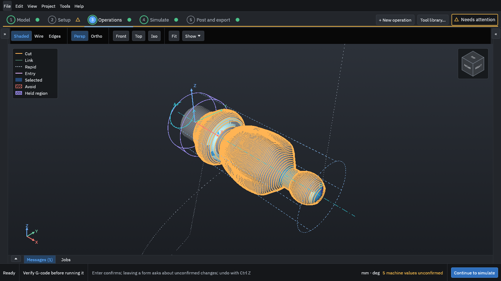

<section class="hero" aria-labelledby="hero-title">

User guide for the development version · <a href="versions.html">Other versions</a>

<h1 id="hero-title">Turn a 3D model into G-code for 4-axis rotary machining</h1>

OpenChuckCAM is free, open-source CAM software for machines that hold the work in a chuck and turn it while the cutter works around it, such as the Makera Z1. This guide is for anyone making parts with it, including people new to CAM.

<ol class="routes">
<li><a href="start/install.md">1Start hereInstall the program and open it for the first time.</a></li>
<li><a href="tutorial/index.md">2Your first projectTake one part from a model file to G-code, in ten steps.</a></li>
</ol>

<strong>Before you cut:</strong> generated G-code must be checked by you before it is run on a machine. OpenChuckCAM does not guarantee that a program is safe or correct for your machine, tool or setup.

<figure class="hero-figure">

<figcaption>The Operations step: the finishing toolpath of the tutorial's baluster, in orange, around the part on the rotary axis. From a development build.</figcaption>
</figure>
</section>

## Where to start

New to the program
: Read *Install and first run*, then work through [Your first project](tutorial/index.md). The tutorial takes one small part from a model file to G-code in ten steps, with a screenshot of each.

New to CAM or to 4-axis work
: The *Concepts* pages explain what a rotary axis does, what stock and a held region are, and why a job is usually cut in two passes, roughing and then finishing.

Ready to run a program on the Makera Z1
: Follow *Air cut on the Makera Z1* and the *Safe-practice checklist*. An air cut runs the program with no tool and no material, so you can watch the moves before anything can be damaged.

Looking for a setting or a word
: Use the search box, the [glossary](glossary.md), or the *Reference* pages.

## What the program does

| Step in the program | What you do there |
| --- | --- |
| Model | Import an STL or STEP file, check it, and place it on the rotary axis. |
| Setup | Choose the machine, describe the stock and how the work is held. |
| Operations | Choose tools and add the cutting operations, from roughing to finishing. |
| Simulate | Generate the toolpaths, watch the cut, and compare the result with the model. Then post and export the G-code and a setup sheet. |

## About this guide

This guide describes the development version of OpenChuckCAM. Each release has its own copy; use **Version** at the top of the page to switch. The guide is part of the project's source and is licensed AGPL-3.0-or-later. To report a mistake in it, open an issue in the project's repository.
