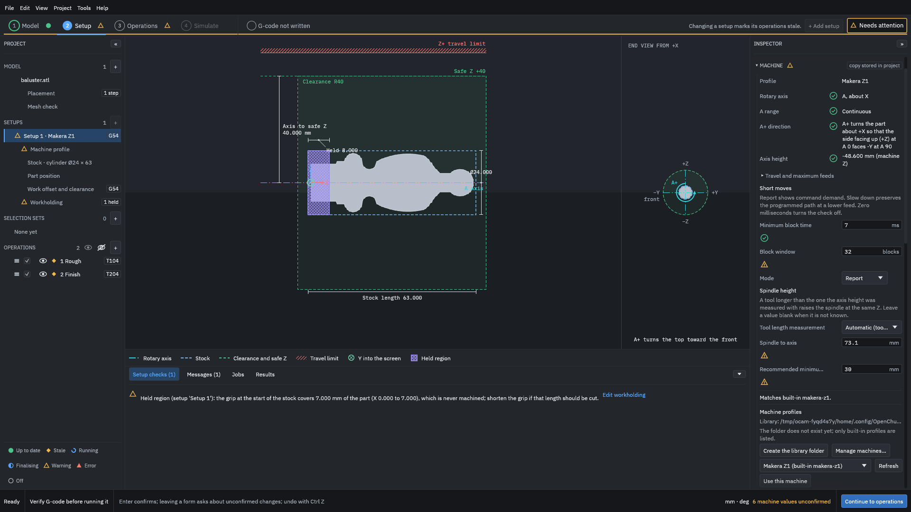
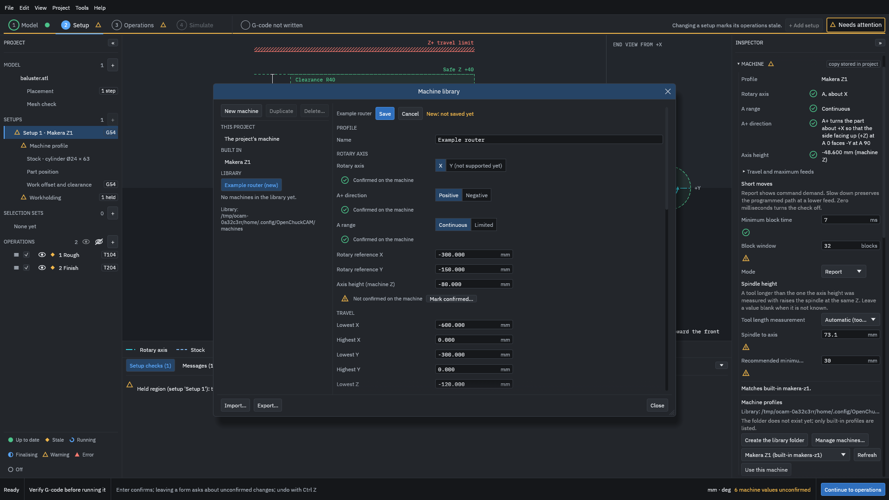
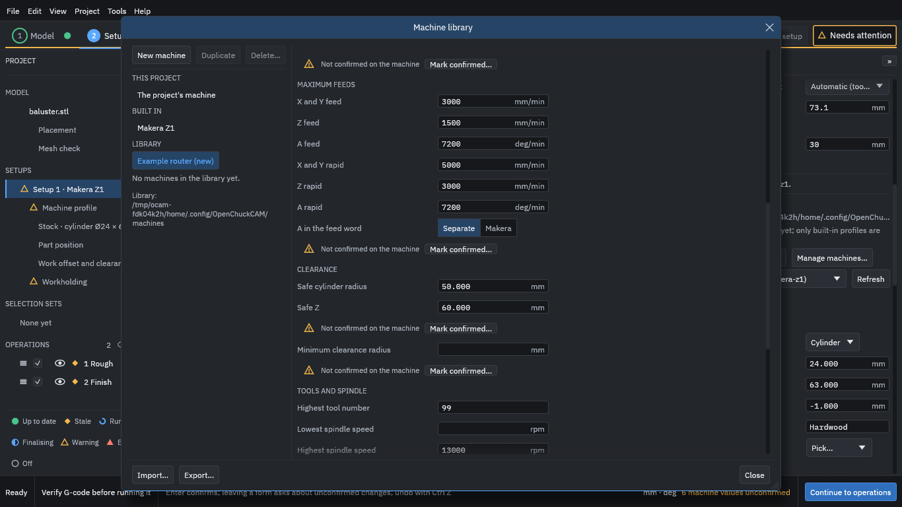
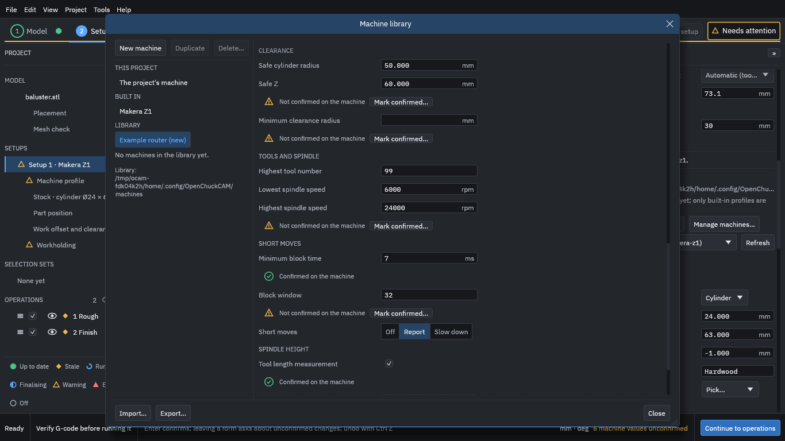
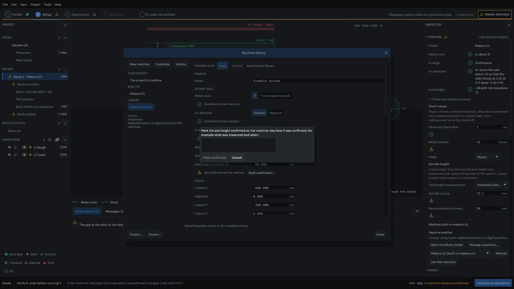
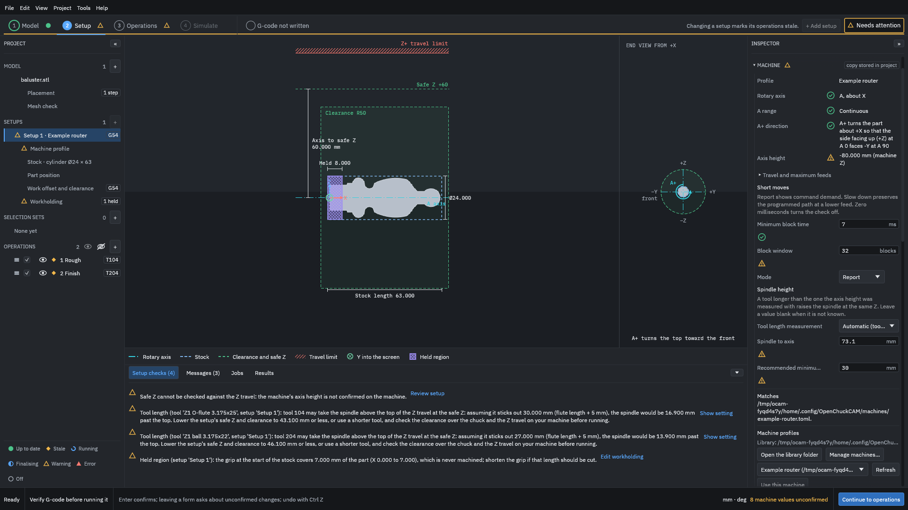

# Create a custom machine

This example makes a [machine profile](../glossary.md#machine-profile) for a machine that is not built in, saves it in your machine library, and uses it in a project. The machine is a made-up 4-axis router, called "Example router", with round numbers: it is not a real machine, so its values are for the example only. Copy the steps, but put in your own machine's values. [Machine profiles](../reference/machine-profiles.md) describes every field.

> [!WARNING]
> A machine profile you make is yours to check. The program checks every program it writes against the profile, so a wrong value, such as the height of the rotary axis or a travel limit, makes those checks wrong too, without any warning. Measure each value on your machine, confirm it, and run an [air cut](../glossary.md#air-cut) before anything else. Generated G-code must be verified by you before it is run on a machine.

You need the tutorial's finished project, [`testdata/examples/baluster/baluster-project`](https://github.com/paulhampson/OpenChuckCAM/tree/main/testdata/examples/baluster/baluster-project). Copy it to a folder of your own and open the copy with **File > Open project**, so the example in the repository stays as it is.

## 1. Find the machine section

1. Click **Setup** at the top of the window.
2. In the project panel, under **Setup 1**, click **Machine profile**. The Inspector shows the project's machine, the built-in Makera Z1.
3. Find **Machine profiles** at the bottom of the Inspector; in a smaller window, scroll the Inspector down to it.

<figure>
<a href="images/custom_machine/01-machine-section.png"></a>
<figcaption><b>Figure 1.</b> The machine section of the Inspector. "Matches built-in makera-z1" says the project's copy is the same as the built-in profile.</figcaption>
</figure>

The library folder does not exist until you save a profile in it, or click **Create the library folder**.

## 2. Copy the built-in profile

Starting from a copy is quicker than **New machine**, which leaves 18 values for you to fill in. A copy keeps every value of the profile it came from until you change it, including the marks that say a value was confirmed on that machine.

1. Click **Manage machines...**. The machine library window opens.
2. Under **BUILT IN**, click **Makera Z1**. It says "Built in: it cannot be edited".
3. Click **Copy to edit**. A new profile, "Makera Z1 copy", appears under **LIBRARY** as "(new)": it is a draft, and nothing is written until you save.

<figure>
<a href="images/custom_machine/02-built-in.png"></a>
<figcaption><b>Figure 2.</b> The built-in Makera Z1 profile. The ticks mark values confirmed on a Z1, not on your machine.</figcaption>
</figure>

## 3. Describe the machine

Type each value and press <kbd>Enter</kbd>. For the example router:

| Field | Value | Why |
| --- | --- | --- |
| Name | `Example router` | The name in lists. |
| Rotary reference X, Y | `-300`, `-150` mm | A point on the rotary axis, such as the centre of the chuck face, in machine coordinates. |
| Axis height (machine Z) | `-80` mm | The machine Z of the rotary axis. Every Z the program writes is measured from it. |
| Lowest X, Lowest Y, Lowest Z | `-600`, `-300`, `-120` mm | The travel limits; the highest are 0 on this machine, as on the Z1. |

<figure>
<a href="images/custom_machine/03-copy-edited.png"></a>
<figcaption><b>Figure 3.</b> A changed value is marked "Not confirmed on the machine". The rotary axis, A direction and A range keep the Z1's ticks, because they were not changed.</figcaption>
</figure>

Scroll down the form and go on:

| Field | Value |
| --- | --- |
| X and Y feed, Z feed, A feed | `3000` mm/min, `1500` mm/min, `7200` deg/min |
| X and Y rapid, Z rapid, A rapid | `5000` mm/min, `3000` mm/min, `7200` deg/min |
| A in the feed word | **Separate**, because the router runs LinuxCNC; the Z1 uses **Makera** |
| Safe Z | `60` mm |
| Safe cylinder radius | `50` mm |
| Highest tool number | `99` |

Set **Safe Z** before **Safe cylinder radius**: the safe Z cannot be below the safe cylinder, and a radius of 50 mm is refused while the safe Z is still the Z1's 40 mm.

<figure>
<a href="images/custom_machine/04-feeds-and-clearance.png"></a>
<figcaption><b>Figure 4.</b> The feeds, the clearance and the highest tool number of the example router.</figcaption>
</figure>

Scroll further, and set **Highest spindle speed** to `24000` and **Lowest spindle speed** to `6000` rpm. An operation whose spindle speed is outside this range cannot be posted.

<figure>
<a href="images/custom_machine/05-spindle-and-short-moves.png"></a>
<figcaption><b>Figure 5.</b> The values below were left as the Z1's. Some still carry the Z1's ticks, such as Minimum block time and Tool length measurement, although nobody measured them on the router.</figcaption>
</figure>

Figure 5 shows the trap of a copy. **Minimum block time**, **Tool length measurement**, **Spindle to axis** and **Recommended minimum safe Z** were not changed, so they are still the Z1's values, and two of them still say "Confirmed on the machine". Go through every field, and type in your own machine's value even where it looks right. A typed value is marked unconfirmed until you confirm it.

## 4. Save the profile

1. Scroll to the top of the form.
2. Click **Save**. The draft becomes "Saved in the library", and the window says "Saved Example router in the machine library."

<figure>
<a href="images/custom_machine/06-saved.png"></a>
<figcaption><b>Figure 6.</b> The saved profile. It is a file, <code>example-router.toml</code>, in the library folder.</figcaption>
</figure>

**Export...** writes the profile to a file you can keep or share, and **Import...** reads one.

## 5. Confirm what you measured

When you have measured a value on the machine, click **Mark confirmed...** next to it and say how you confirmed it, for example "Measured with the probe on the chuck face, 7 Nov 2026". Do not confirm a value you have not checked: the mark is what tells you, and anyone you share the profile with, that the value is real.

<figure>
<a href="images/custom_machine/07-mark-confirmed.png"></a>
<figcaption><b>Figure 7.</b> Confirming a value asks how it was confirmed. The example router's values are made up, so here the dialog is cancelled.</figcaption>
</figure>

[Confirm machine profile values](../how-to/confirm-machine-values.md) says how to check each one.

## 6. Use it in the project

1. Click **Close** to close the machine library window.
2. In **Machine profiles**, open the list and choose **Example router**.
3. Click **Use this machine**. The project takes its own copy of the profile.

<figure>
<a href="images/custom_machine/08-in-use.png"></a>
<figcaption><b>Figure 8.</b> The project on the example router. The view shows the new safe Z and clearance, and the setup checks show what the new values mean for this job.</figcaption>
</figure>

## Read the result

The setup checks now say:

- "Safe Z cannot be checked against the Z travel: the machine's axis height is not confirmed on the machine." Confirm the axis height, and this check can be made.
- "Tool 104 (Z1 O-flute 3.175x25) may take the spindle above the top of the Z travel at the safe Z ...", and the same for tool 204. The profile still has the Z1's **Spindle to axis** of 73.1 mm, and a safe Z of 60 mm leaves too little room above it for these tools. Measure the router's spindle-to-axis distance and set it; then lower the safe Z or use shorter tools if the warning remains. A tool that may take the spindle past the top of its travel is a possible collision, so if the warning is still there when you export, the export asks you to acknowledge it before it writes anything.

The status bar counts the unconfirmed values: "8 machine values unconfirmed". Every operation is now out of date, because the machine changed; generate them again before you post.

## On the command line

The command line uses the same library:

```text
openchuck-cli machines --library ~/.config/OpenChuckCAM/machines
openchuck-cli machine baluster example-router --library ~/.config/OpenChuckCAM/machines
```

The first lists the profiles, with how many values are unconfirmed; the second gives the project a copy of the example router and prints every value with `confirmed` or `UNCONFIRMED`. See [Command line](../reference/command-line.md).

## Common mistakes

A value is refused with a red message
: For example "The safe Z (40 mm) must not be below the safe cylinder radius (50 mm)." Change the other value first, then type this one again.

The profile was copied, but not every value was checked
: Values you do not change keep the source machine's values and marks. Go through every field.

A in the feed word does not match the post
: The profile's **A in the feed word** must match the feed rule of the post you export with (**Separate** for the LinuxCNC post, **Makera** for the Makera Z1 post). The program does not check that they match.

The machine is not 4-axis with A turning about X
: It cannot be described: only a rotary axis about X is supported.
