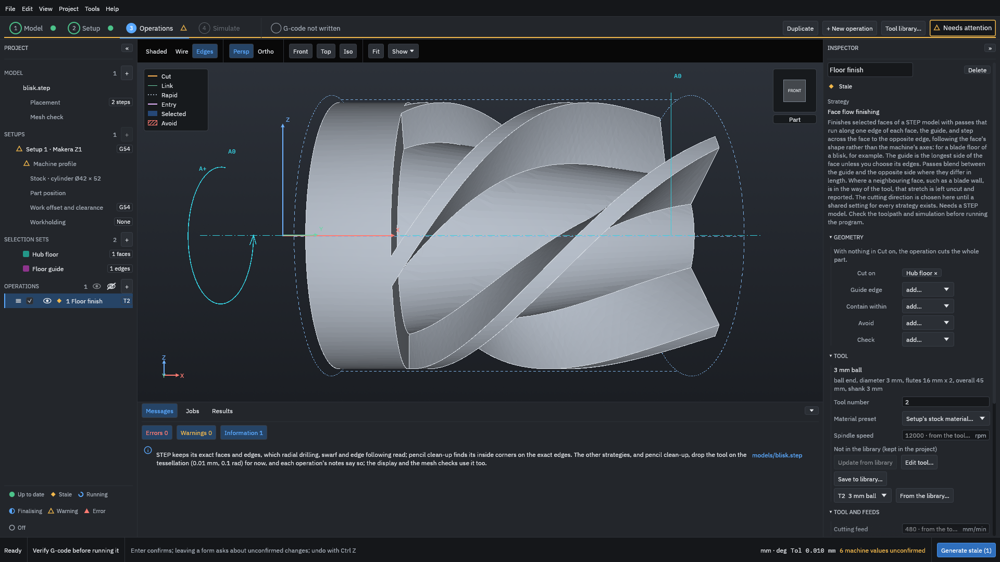
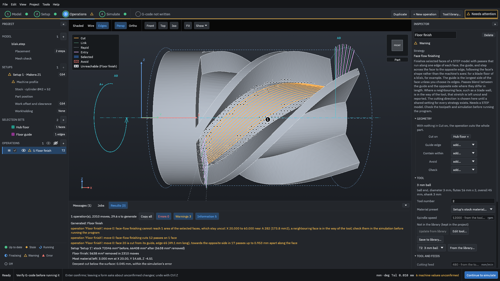
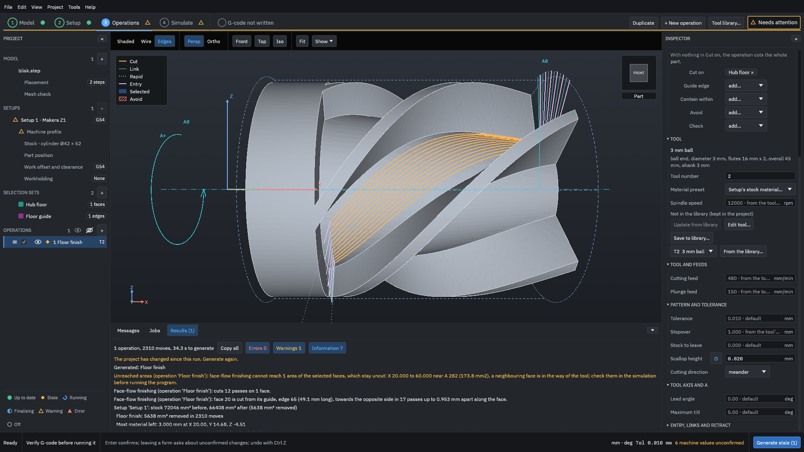
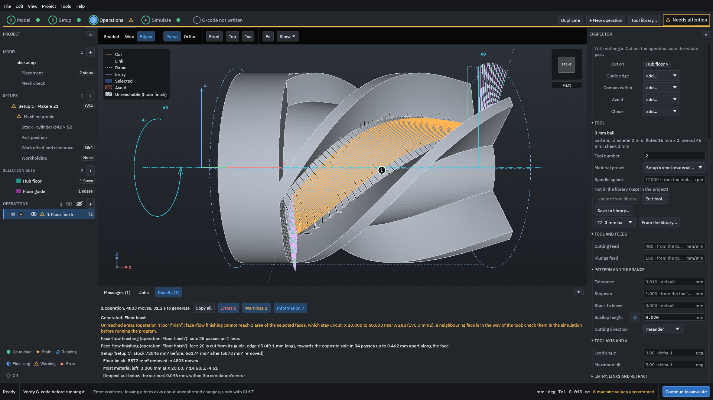
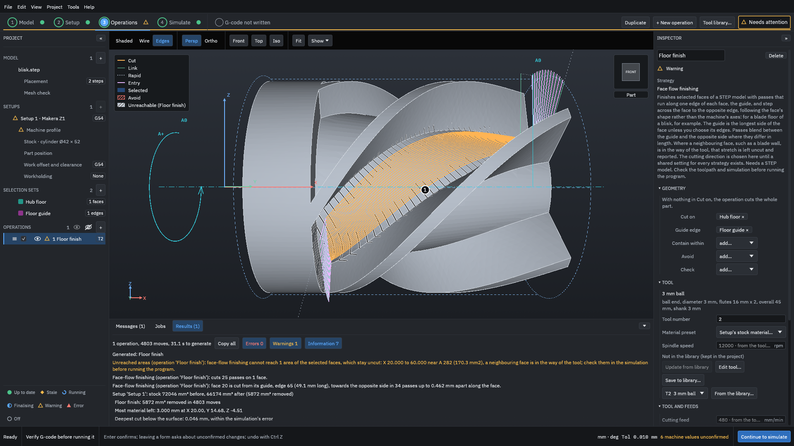

# Face-flow finishing on a blisk floor

This example finishes one hub floor of a bladed disk (a blisk) with face-flow finishing: passes that run along one edge of the face, the guide, and step across it to the opposite side, following the face rather than the machine's axes. It sets the spacing first by [stepover](../glossary.md#stepover) and then by [scallop](../glossary.md#scallop) height, chooses the guide with an edge set, and shows what the Results mean by an area the tool "cannot reach", with the numbers from a real run.

> [!WARNING]
> Face-flow finishing leaves out what it cannot reach and says so, but it checks only what its notes and warnings name. Generated G-code must be verified by you before it is run on a machine: watch the [simulation](../glossary.md#simulation), read every warning, and run an [air cut](../glossary.md#air-cut) first.

You need the example project [`testdata/examples/blisk-start/blisk-project`](https://github.com/paulhampson/OpenChuckCAM/tree/main/testdata/examples/blisk-start/blisk-project). Copy it to a folder of your own and open the copy with **File > Open project**. Face-flow finishing needs a STEP part: it works on the model's exact faces, so it cannot be used on a mesh part. The numbers on this page come from OpenChuckCAM 0.49.0 on Linux.

## 1. Make the sets

Make a face set and an edge set as in steps 1 and 2 of [Selection sets on a blisk](selection-sets.md):

- `Hub floor`: the floor between the two blades in the middle of the front view (face 20);
- `Floor guide`: the edge where the blade above that floor meets it (edge 65).

The edge set is optional: without it, each face starts from its longest side. It is made here so you can choose it in step 4.

## 2. Add the operation

1. Click **+ New operation**. Choose **Face flow finishing**. Its description says what it does and that it needs a STEP model.
2. Choose the tool **3 mm ball**, name the operation `Floor finish`, and click **Add**.
3. In the Inspector, under **Geometry**, choose **Hub floor** beside **Cut on**. Leave **Guide edge** empty for now.

<figure>

<figcaption><b>Figure 1.</b> Face-flow finishing shows <b>Cut on</b> for the faces and <b>Guide edge</b> for the edge the passes follow.</figcaption>
</figure>

4. Click **Generate stale** at the bottom right. It took about 30 s on the test computer.

<figure>

<figcaption><b>Figure 2.</b> With the stepover of the tool's cutting data, 1 mm: the passes follow the floor, and the dotted area along the walls is where the ball does not fit.</figcaption>
</figure>

## Read the result

The Results list three lines for the operation:

"face 20 is cut from its guide, edge 65 (49.1 mm long), towards the opposite side in 17 passes up to 0.953 mm apart along the face"
: The guide is the floor's longest side, the root of the blade above it. The 17 passes are laid out across the floor, never more than the 1.000 mm **Stepover** apart, measured along the face.

"face-flow finishing cuts 12 passes on 1 face"
: The passes that are cut, after the stretches the tool cannot reach are left out. A pass that lies wholly in that area is not cut.

"face-flow finishing cannot reach 1 area of the selected faces, which stay uncut: X 20.000 to 60.000 near A 282 (173.8 mm2), a neighbouring face is in the way of the tool; check them in the simulation before running the program"
: The floor is a narrow strip between two blade walls, and a 3 mm ball cannot reach into the corners where the floor meets them without touching a wall. That strip, along the whole floor from X 20 to X 60, is not cut and is drawn dotted in the view. "A neighbouring face is in the way" means a blade wall, not the stock. The same line appears under **Messages**, with a link to the operation.

How much is that? When face-flow finishing was built, the five floors of this blisk were measured ([decision 0525](https://github.com/paulhampson/OpenChuckCAM/blob/main/docs/decisions/0525-face-flow-finishing.md)): the same on all five, 171.6 mm2 of the 496.3 mm2 floor (35 %) out of reach of the 3 mm ball, all of it along the blade walls, and 118.4 mm2 (24 %) with a 2 mm ball. This run reports 173.8 mm2 at its own stepover. Whether a smaller tool, a different tool, or leaving the strip suits your part is your call; the program does not choose for you, and it has no strategy yet that finishes the strip with a second tool.

The setup's totals say "Floor finish: 5638 mm³ removed in 2310 moves". The stock is not roughed in this example, so most of that is stock above the floor, not finishing allowance.

## 3. Set a scallop height instead

A [scallop](../glossary.md#scallop) height sets the spacing by the ridge a ball leaves between passes, instead of by distance.

1. Scroll the Inspector down to **Pattern and tolerance**.
2. Set **Scallop height** to `0.02` mm and press <kbd>Enter</kbd>. **Stepover** stays 1.000 mm; the scallop height makes the passes closer where it needs to.
3. Click **Generate stale**.

<figure>

<figcaption><b>Figure 3.</b> The settings of face-flow finishing. A value you set has a reset button beside its label.</figcaption>
</figure>

<figure>

<figcaption><b>Figure 4.</b> A 0.02 mm scallop height with a 3 mm ball puts the passes up to 0.462 mm apart.</figcaption>
</figure>

| | Stepover 1 mm | Scallop height 0.02 mm |
| --- | --- | --- |
| Passes laid out | 17, up to 0.953 mm apart | 34, up to 0.462 mm apart |
| Passes cut | 12 | 25 |
| Unreached area | 173.8 mm2 | 170.3 mm2 |
| Moves | 2310 | 4803 |
| Time to generate | 29.6 s | 31.2 s |

Closer passes take longer to cut and leave smaller ridges. They do not get the ball into the corners: the unreached area hardly changes.

## 4. Choose the guide

1. Scroll the Inspector back to **Geometry**.
2. Beside **Guide edge**, choose **Floor guide**. The list offers only edge sets.
3. Click **Generate stale**.

<figure>

<figcaption><b>Figure 5.</b> With <b>Floor guide</b> as the guide, the passes are the same: edge 65 is the floor's longest side, the edge the operation chose by itself.</figcaption>
</figure>

The Results line names the guide, "edge 65 (49.1 mm long)", whichever way it was chosen. Choose a guide when the longest side is not the direction you want the passes to run, for example along a shorter edge of a face whose sides are nearly the same length. The edges in the set must lie on the boundary of a face in **Cut on** and join end to end. The program does not yet draw the guide on the part; read it from the Results.

## Common mistakes

Nothing in Cut on
: Face-flow finishing does not cut the whole part. It is refused: "Operation 'Floor finish' cannot be generated: Face-flow finishing needs a face set: select the faces to cut, save them as a set and put it in Cut on; an edge set there is the guide". Make a face set of the faces to cut and choose it beside **Cut on**.

An edge set in Avoid or Check
: Those roles take faces. It is refused: "Avoid takes faces, not edges, on a STEP part. Take the edge set 'Floor guide' out of Avoid, and select faces instead." Put the edge set in **Guide edge**.

Reading the unreached area as material left by mistake
: The strip along the walls is left because the ball does not fit, not because a setting is wrong. A smaller stepover or scallop height does not shrink it (see the table). A smaller ball reaches more of it (24 % unreached with a 2 mm ball against 35 % with 3 mm, from decision 0525); the walls themselves are cut by another strategy, such as [swarf](swarf.md).

Expecting the passes to stay on the floor near the walls
: The tool is placed on the whole part, so where a blade wall is in the way the stretch is left out rather than cut into the wall. Check in the simulation that what is left out is what you expect.

Leaving stock to leave on and adding a check set
: Both keep the tool further from the walls, so less of the floor is reached. In [Selection sets on a blisk](selection-sets.md), the same floor with a check set on the blade wall and 0.2 mm stock to leave reported 208.6 mm2 unreached.
