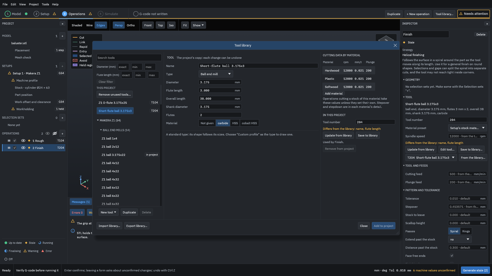
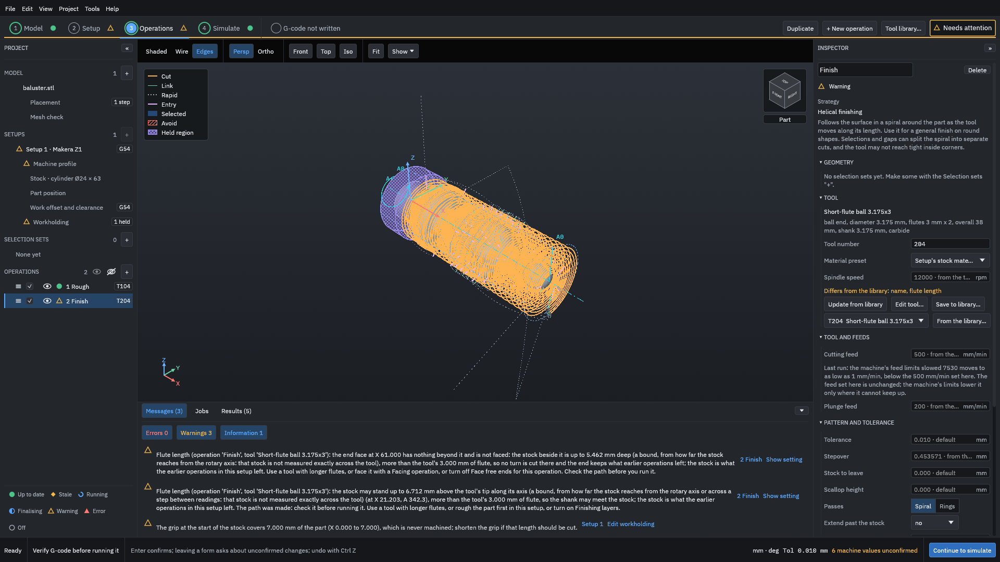
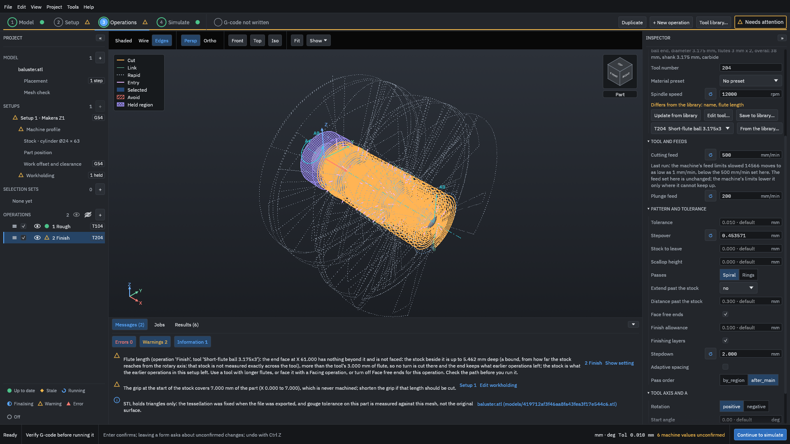
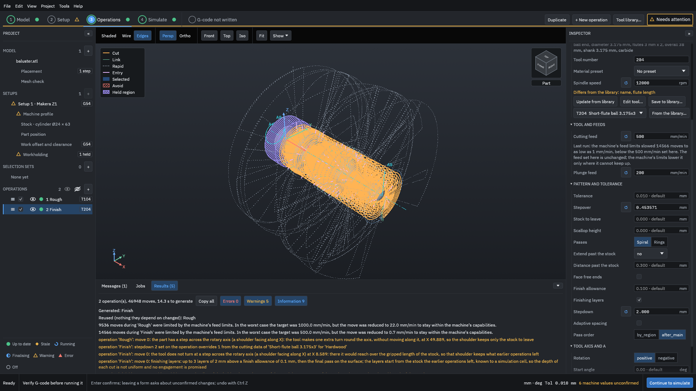

# The flute-length warning

This example gives the tutorial's finishing tool flutes only 3 mm long, so that the program warns that they may not reach the deepest cut. You read the two warnings it gives, then try each of the changes they suggest.

> [!WARNING]
> The flute-length warning is a warning, not a collision check. It compares the tool's flute length with how deep the stock may stand along the tool's axis, and the depth it uses is often a bound, not a measurement. No warning does not mean that the shank, the holder or the spindle clears the stock, the chuck or the part. Check the path in the simulation, and run an [air cut](../glossary.md#air-cut) first. Generated G-code must be verified by you before it is run on a machine.

You need the tutorial's finished project, [`testdata/examples/baluster/baluster-project`](https://github.com/paulhampson/OpenChuckCAM/tree/main/testdata/examples/baluster/baluster-project). Copy it to a folder of your own and open the copy with **File > Open project**. The numbers on this page come from that project on the build named in the figures' record; your own part gives other numbers.

## What the warning means

The flutes are the cutting length of the tool. Above them is the shank, which does not cut. When the stock stands higher above the tool's tip, along the tool's axis, than the flutes are long, the shank may rub or push against the stock. The program checks every operation for this after it makes the path. If the stock may stand too high, it still makes the path, and it warns.

A tool that fits within the flutes can still be too short in other ways: the holder, the collet and the spindle are not checked against the stock by this warning.

> [!NOTE]
> A way to acknowledge a possible collision before the G-code is written is being built. On the build these screens were taken with, the flute-length warnings do not need to be acknowledged: they are listed, and nothing asks you to acknowledge them before the G-code is written.

## 1. Shorten the flutes

1. In the project panel, click **2 Finish**.
2. In the Inspector, under **Tool**, click **Edit tool...**. The tool library opens on the project's own copy of the tool, T204.
3. Set **Name** to `Short-flute ball 3.175x3`, so the copy is not mistaken for the library's tool.
4. Set **Flute length** to `3`.

<figure>

<figcaption><b>Figure 1.</b> The project's copy of the finishing tool, with 3 mm of flute. The library's tool is not changed.</figcaption>
</figure>

5. Click **Close**, then **Generate**.

## 2. Read the two warnings

<figure>

<figcaption><b>Figure 2.</b> Two flute-length warnings for the finish. The path was made: the operation shows a warning, not an error.</figcaption>
</figure>

The first warning is about the passes over the part:

> Flute length (operation 'Finish', tool 'Short-flute ball 3.175x3'): the stock may stand up to 6.712 mm above the tool's tip along its axis (a bound, from how far the stock reaches from the rotary axis or across a step between readings: that stock is not measured exactly across the tool) (at X 21.203, A 342.3), more than the tool's 3.000 mm of flute, so the shank may meet the stock; the stock is what the earlier operations in this setup left. The path was made: check it before running it. Use a tool with longer flutes, or rough the part first in this setup, or turn on Finishing layers.

Read it in parts:

- "may stand up to 6.712 mm ... (a bound ...)": the depth is an upper limit worked out from the stock, not a measurement across the tool. The real depth there may be less.
- "(at X 21.203, A 342.3)": the place along the part and the angle where the bound is largest. Here it is on the vase.
- "the stock is what the earlier operations in this setup left": the check reads the simulated stock after the roughing, not the bare bar.

The second warning is about the end of the part:

> Flute length (operation 'Finish', tool 'Short-flute ball 3.175x3'): the end face at X 61.000 has nothing beyond it and is not faced: the stock beside it is up to 5.462 mm deep (a bound, from how far the stock reaches from the rotary axis: that stock is not measured exactly across the tool), more than the tool's 3.000 mm of flute, so no turn is cut there and the end keeps what earlier operations left; the stock is what the earlier operations in this setup left. Use a tool with longer flutes, or face it with a Facing operation, or turn off Face free ends for this operation. Check the path before you run it.

A finishing operation with **Face free ends** ticked steps down beside each end face that has nothing beyond it, such as the point of the finial, and turns round there. When the stock beside the face is deeper than the flutes, it leaves that end out, and says so. Unlike the first warning, this one changes the path: the end is not cut.

## 3. What to change

The warnings name three changes. Try them in this order.

### A tool with longer flutes

This is the first thing to try. Set **Flute length** back to `22`, or choose the library's **Z1 ball 3.175x22** for the operation, and generate again: both warnings go.

### Finishing layers

**Finishing layers** cuts the finish in layers along the tool's axis, so no one pass is deeper than the **Stepdown**.

1. Scroll the Inspector down to **Face free ends** and **Finishing layers**. **Show setting** beside a warning in the Messages list also takes you to the operation.
2. Tick **Finishing layers**. **Stepdown** now says "required".
3. Set **Stepdown** to `2`, less than the 3 mm of flute, and click **Generate**.

<figure>

<figcaption><b>Figure 3.</b> With finishing layers of 2 mm, the warning about the passes is gone. The warning about the end face remains.</figcaption>
</figure>

The Results tab now says: "finishing layers: up to 3 layers of 2 mm above a finish allowance of 0.1 mm, then the final pass on the surface; the layers start from the stock the earlier operations left, known to a simulation cell, so the depth of each cut is not uniform and no engagement is promised".

Setting **Stepdown** also sets **Material preset** to "No preset", and the Results tab says "stepdown 2 set on the operation overrides 1 from the cutting data of 'Short-flute ball 3.175x3' for 'Hardwood'". The operation now keeps its own feeds and speeds, each with a button to go back to the tool's value.

### Face free ends

The end-face warning remains, because the stock beside the end is still deeper than the flutes. If you do not need this operation to face that end (for example because a facing operation, or the cut that parts the piece off, does it), turn it off:

1. Untick **Face free ends** and click **Generate**.

<figure>

<figcaption><b>Figure 4.</b> No flute-length warning remains. The end of the finial is left as the roughing cut it.</figcaption>
</figure>

## Read the result

| Finish | Flute-length warnings |
| --- | --- |
| 22 mm flutes (the tutorial's tool) | 0 |
| 3 mm flutes | 2 |
| 3 mm flutes, layers of 2 mm | 1 (the end face) |
| 3 mm flutes, layers of 2 mm, **Face free ends** off | 0 |

The finish in layers, with **Face free ends** off, takes 37,002 moves against 19,152 for the tutorial's finish.

With every warning gone, the end of the part still keeps what the roughing left: "Most material left: 1.320 mm at X 60.68". No warning means the program found nothing to warn about along the path; it does not mean that the end is finished, or that nothing touches the stock.

A longer-flute tool is the change that keeps the path the same. Layers make the path longer, and turning off **Face free ends** leaves material on the end.

## Common mistakes

Reading the warning as a collision report
: The flute-length check is about the flutes. It does not check the holder or the spindle, and its depth is often a bound.

Changing the library's tool to make the warning go
: Edit the project's copy only when your tool really is different. Do not raise the flute length above what your cutter has.

"Use a tool with longer flutes, or rough the part first in this setup, or turn on Finishing layers"
: The roughing operation must be in the same setup, before the finish, for the check to read what it left.

"... and is not faced ... so no turn is cut there and the end keeps what earlier operations left"
: Face the end with a **Facing** operation, use a tool with longer flutes, or turn off **Face free ends** and finish the end another way.

Related: [Rest machining](rest-machining.md), [Stepover, stock to leave and scallop](stepover-and-scallop.md), [Tool library](../reference/tool-library.md).
