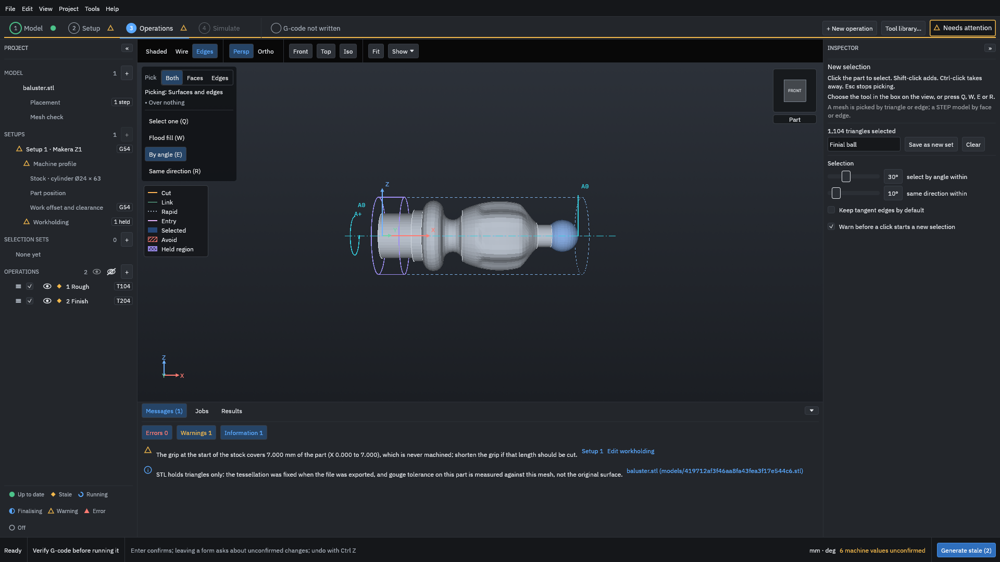
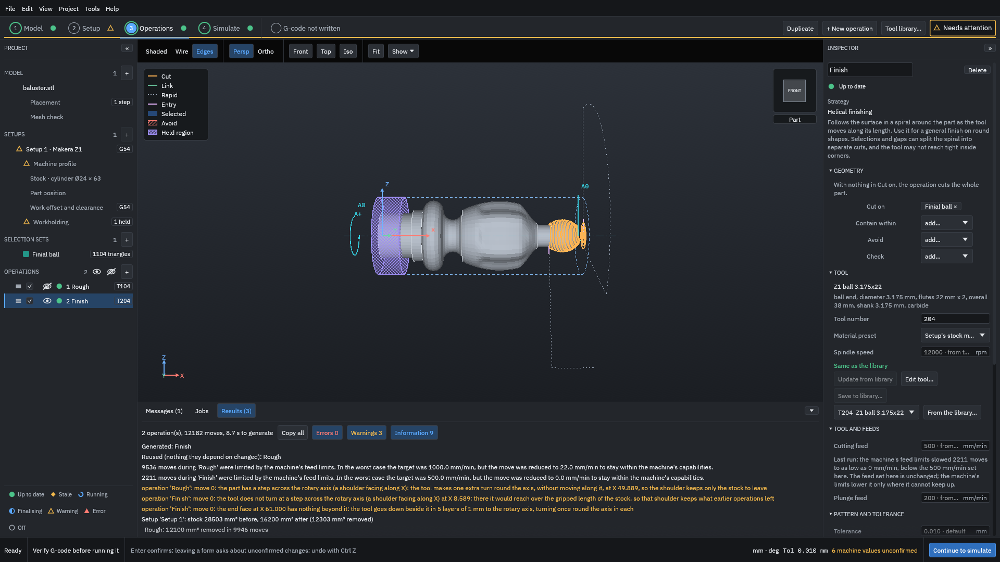
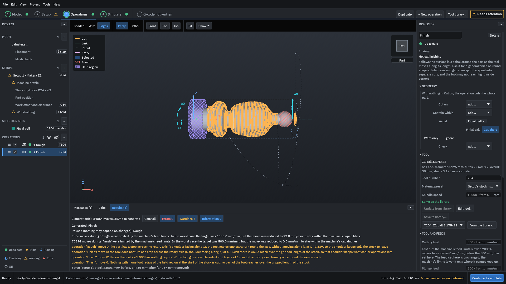

# Limit an operation to a region

This example saves the ball of the baluster's finial as a selection set, then runs the tutorial's finishing operation three ways: on the whole part, on the ball only, and on everything except the ball. You see the path and the numbers change each time.

> [!WARNING]
> A selection limits where the program plans the cut. It does not stop the tool from touching the rest of the part on the way in, on the way out or between cuts. Look at the whole path, simulate it, and run an [air cut](../glossary.md#air-cut) first. Generated G-code must be verified by you before it is run on a machine.

You need the tutorial's finished project, [`testdata/examples/baluster/baluster-project`](https://github.com/paulhampson/OpenChuckCAM/tree/main/testdata/examples/baluster/baluster-project). Copy it to a folder of your own and open the copy with **File > Open project**. The numbers on this page come from that project on the build named in the figures' record; your own part gives other numbers.

## What a region is

A selection set is a named group of the model's surfaces. On an STL model, such as the baluster, it is a group of triangles; on a STEP model it is a group of faces. Each operation has four places to put sets, under **Geometry** in the Inspector:

Cut on
: The operation cuts these surfaces only. With nothing here, it cuts the whole part.

Contain within
: The path stays inside the boundary of these sets.

Avoid
: The tool keeps off these surfaces.

Check
: Surfaces the tool must not cut into, although the operation does not set out to cut them.

A set in **Avoid** or **Check** has a choice beside it: **Cut short** (the path stops where the tool would reach the set), **Warn only** (the path is kept and generation warns where it reaches the set) and **Ignore** (the set is not used for this operation). **Warn only** samples the path and can miss a narrow set.

A path limited to a selection stops at the edge between a selected surface and an unselected one: a contact on that edge counts as off the selection.

## 1. Save the ball as a set

1. In the project panel, click **+** beside **SELECTION SETS**. The pick tools open at the top left of the view.
2. Click **Front** above the view, so the part lies along the screen.
3. Keep **By angle (E)** chosen, with the angle at 30°, and click the ball at the end of the finial. The Inspector says "1,104 triangles selected": the ball's triangles, up to where the surface turns more than 30° into the neck.
4. Type `Finial ball` in the name box and press <kbd>Enter</kbd>.

<figure>

<figcaption><b>Figure 1.</b> The ball picked by angle: one click selects the triangles that join without a sharp turn.</figcaption>
</figure>

5. Click **Save as new set**, then press <kbd>Esc</kbd> to stop picking.

"Finial ball" appears under **SELECTION SETS** with "1104 triangles", and the legend of the view gets its colour. Shift-click adds to a set and Ctrl-click takes away from it, while the set is chosen.

## 2. Before: the whole part

1. In the project panel, click **2 Finish**.
2. Click **Generate** at the bottom right, and wait for the operations to turn green.
3. Click the eye beside **1 Rough** to hide its path, so the view shows the finishing path only.
4. Under the view, click **Results**.

<figure>

<figcaption><b>Figure 2.</b> The finish over the whole part: 29,098 moves for both operations, of which the roughing is 9,946.</figcaption>
</figure>

## 3. Only the ball: Cut on

1. In the Inspector, under **Geometry**, open the list beside **Cut on** and choose **Finial ball**.
2. Click **Generate**.

<figure>

<figcaption><b>Figure 3.</b> With <b>Cut on</b> set, the finish covers the ball and stops at its edge. Only the finish was generated again; the roughing was reused.</figcaption>
</figure>

The finish now has 2,236 moves instead of about 19,150, and removes 204 mm³. The rest of the part keeps what the roughing left, 0.3 mm of stock to leave.

## 4. Everything but the ball: Avoid

1. Click the **×** on **Finial ball** beside **Cut on**, so that it is empty again.
2. Open the list beside **Avoid** and choose **Finial ball**. **Cut short** is chosen beside it.
3. Click **Generate**.

<figure>

<figcaption><b>Figure 4.</b> With the ball in <b>Avoid</b>, the finish stops short of it. The ball keeps the roughing's stock to leave.</figcaption>
</figure>

## Read the result

| Finish limited by | Moves, both operations | Removed, both operations |
| --- | --- | --- |
| nothing (the whole part) | 29,098 | 14,210 mm³ |
| **Cut on**: Finial ball | 12,182 | 12,303 mm³ |
| **Avoid**: Finial ball, **Cut short** | 84,864 | 14,067 mm³ |

The roughing is the same in every row: 9,946 moves and 12,100 mm³.

Avoiding the ball made the finish longer, not shorter: about 74,900 moves for the finish instead of about 19,150. The strategy's description says that "selections and gaps can split the spiral into separate cuts", and here that made the path much longer. Look at the move count and the time as well as the picture when you choose between **Avoid** and **Cut on**. To finish everything but one area, a second operation with **Cut on** for the other areas can be shorter.

## Common mistakes

The set is lost when you click elsewhere
: Type the name, then click **Save as new set** before you click anything else. If you leave the form with a typed name, the program asks "Keep the changes or discard them?"; choose **Keep** and save.

The set takes more or less than you meant
: **By angle** stops where the surface turns more than the angle. Lower the angle to stop sooner, or Shift-click and Ctrl-click to change the set.

"Warn only samples the path and can miss a narrow set."
: The program says this beside **Warn only**. Use **Cut short** where the set must not be cut.

"... it is set to Ignore: the tool is not kept clear of it"
: A set in **Avoid** or **Check** with **Ignore** chosen is not used. Choose **Cut short** or **Warn only**.

Related: [Tabs and held regions](tabs-and-held-regions.md), [Operations and strategies](../reference/operations.md).
