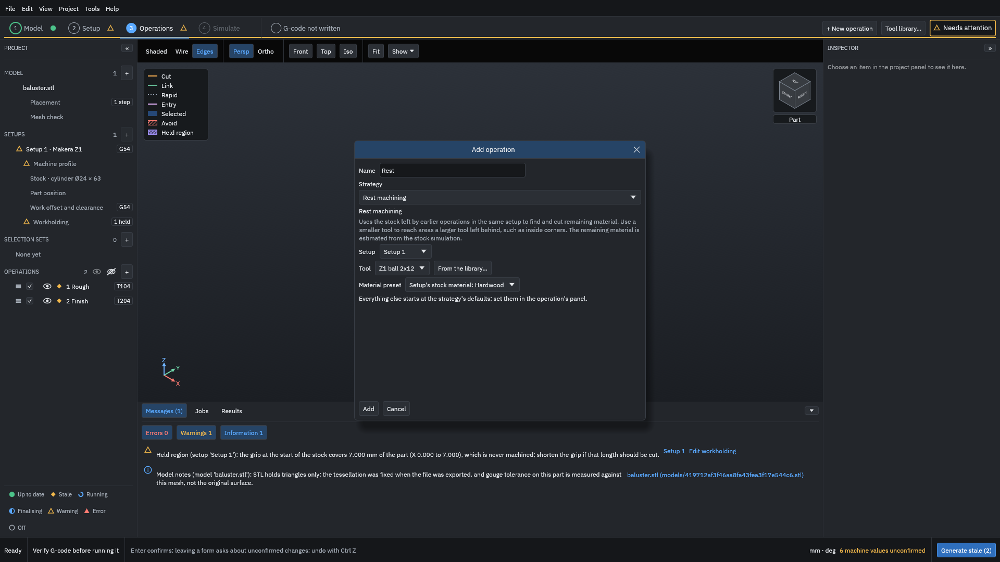
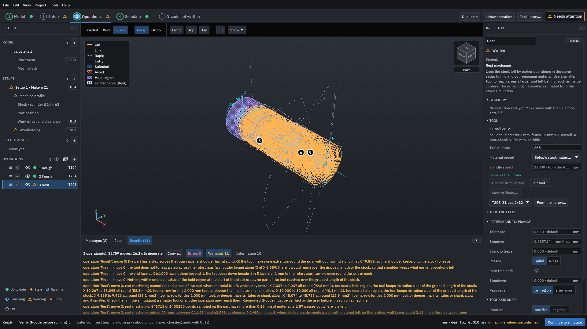
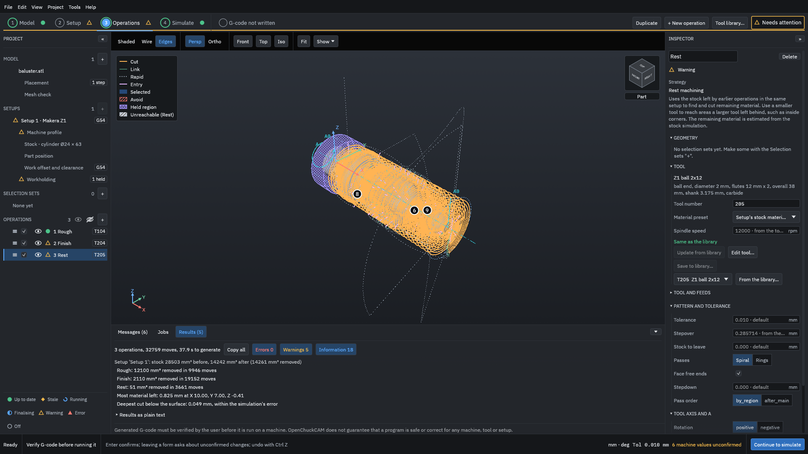
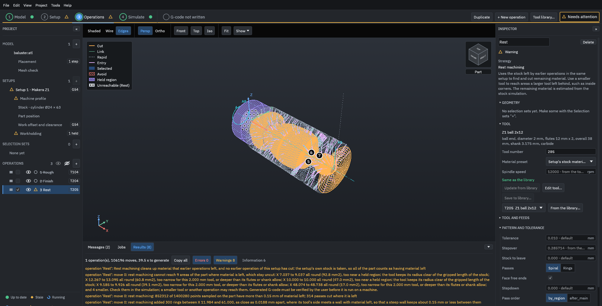

# Rest machining

This example adds a rest machining operation with a 2 mm ball end mill after the tutorial's two operations, which both use 3.175 mm tools. You see what the smaller tool cuts, what it says it cannot reach, and the note it gives when there is no earlier operation to follow.

> [!WARNING]
> Rest machining works out what is left from the stock simulation, not from your real part. If an earlier operation was changed, skipped or run differently on the machine, the material the rest operation meets is not what it planned for, and a small tool can be overloaded or broken. Check the path in the simulation and run an [air cut](../glossary.md#air-cut) first. Generated G-code must be verified by you before it is run on a machine.

You need the tutorial's finished project, [`testdata/examples/baluster/baluster-project`](https://github.com/paulhampson/OpenChuckCAM/tree/main/testdata/examples/baluster/baluster-project). Copy it to a folder of your own and open the copy with **File > Open project**. The numbers on this page come from that project on the build named in the figures' record; your own part gives other numbers.

## What rest machining does

A tool cannot cut a corner tighter than its own radius, or a groove narrower than itself. After a larger tool, material is left in those places. A rest machining operation takes the stock as the earlier operations of the same setup leave it, finds where more than **Smallest material to clean** (0.15 mm unless you change it) is left on the part, and cuts there with a smaller tool. It does not use selection sets: the strategy list says "Rest machining · ignores selections".

## 1. Add the rest operation

1. Click **+ New operation**.
2. Under **Strategy**, choose **Rest machining**.
3. Click **From the library...**, choose **Z1 ball 2x12** under **MAKERA Z1 > BALL END MILLS**, and click **Add to project**. The tool is a 2 mm ball end mill with 12 mm of flute.
4. Name the operation `Rest`.

<figure>

<figcaption><b>Figure 1.</b> The rest operation, with a 2 mm ball: smaller than the 3.175 mm tools of the roughing and the finish.</figcaption>
</figure>

5. Click **Add**. The operation is third in the list, after **1 Rough** and **2 Finish**, so it starts from what they leave.

## 2. Generate and read what it did

1. Click **Generate**.
2. Under the view, click **Results**.

<figure>

<figcaption><b>Figure 2.</b> The numbered markers show where material is left that the rest tool cannot reach.</figcaption>
</figure>

The rest operation reports in several lines. Read them in this order.

What it found
: "rest machining: 549718 of 1400280 points sampled on the part have more than 0.15 mm of material left; 87 passes cut where it is left". The roughing left 0.3 mm on purpose, and the finish took most of it; these are the places it did not reach.

What it added for steep walls
: "rest machining added 20 rings between X 11.984 and 60.998, as close as 0.1442 mm apart, where its tool's side meets a wall with material left, so that a steep wall keeps about 0.15 mm or less between them". On a wall that faces along the axis, passes spaced for a flat surface would leave tall ridges, so the operation adds rings there.

What it cannot reach
: "rest machining cannot reach 9 areas of the part where material is left, which stay uncut: X 7.037 to 9.037 all round (92.8 mm2), too near a held region: the tool keeps its radius clear of the gripped length of the stock; X 12.267 to 13.095 all round (58.3 mm2), too narrow for this 2.000 mm tool, or deeper than its flutes or shank allow; ... and 4 smaller. Check them in the simulation; a smaller tool or another operation may reach them." The numbers match the markers in the view.

Scroll the Results list down to the volumes:

<figure>

<figcaption><b>Figure 3.</b> The rest operation removes 51 mm³ in 3,661 moves.</figcaption>
</figure>

## Read the result

| | Removed | Moves |
| --- | --- | --- |
| Rough (3.175 mm flat end) | 12,100 mm³ | 9,946 |
| Finish (3.175 mm ball) | 2,110 mm³ | 19,152 |
| Rest (2 mm ball) | 51 mm³ | 3,661 |

The rest operation is a small cut: 51 mm³ spread over the corners and walls the 3.175 mm ball could not reach. The largest amount left anywhere, "Most material left: 0.825 mm at X 10.00", is at the collar next to the chuck's grip, where the rest tool must keep its radius clear of the held region. Without the rest operation, the same simulation on the command line (`openchuck-cli simulate`) gives 0.924 mm at the same place. To clean that corner, shorten the grip ([Tabs and held regions](tabs-and-held-regions.md)) or use a tool that can reach it; a smaller ball alone does not help there.

Rest machining reads the stock after the operations above it in the list. Keep it after them: if you move it to the top, or turn the earlier operations off, it has nothing to follow.

## 3. With no earlier operation

To see what happens when the rest operation has nothing to follow, turn the other two off:

1. Untick the boxes beside **1 Rough** and **2 Finish** in the project panel. They are struck through and are not generated or posted.
2. Click **Generate**.

<figure>

<figcaption><b>Figure 4.</b> With no earlier operation, the rest operation starts from the whole stock and cuts all of it with the 2 mm ball.</figcaption>
</figure>

The first line says what happened:

> Rest machining cleans up material that earlier operations left, and no earlier operation of this setup has cut: the setup's own stock is taken, so all of the part counts as having material left

The operation now plans 106,196 moves and removes 14,114 mm³, as much as the roughing and the finish together, with a 2 mm tool and its **Stepdown** at 0. It is a warning, not an error, and a path is made. Read it as "this is not the job you meant": tick the roughing and the finish again, or use a roughing operation for bulk material.

## Common mistakes

The rest operation removes almost nothing
: That is normal when the earlier tools reached most of the part. Look at "Most material left" and the markers before you decide it is needed.

"... has nothing to clean: none of ... points sampled ..."
: No point on the part has more than **Smallest material to clean** left. Move the operation after the one whose leftovers it should cut, or lower **Smallest material to clean**.

"... too near a held region: the tool keeps its radius clear of the gripped length of the stock"
: The material is next to the chuck's grip. No tool reaches it without coming closer to the grip. Shorten the grip, or accept it.

"... too narrow for this 2.000 mm tool, or deeper than its flutes or shank allow"
: Use a smaller tool or one with longer flutes for those areas, in a second rest operation.

The rest tool is the same size as the earlier one
: It then finds little or nothing it can reach. Choose a tool smaller than the one that left the material.

Related: [Roughing and finishing](../concepts/roughing-and-finishing.md).
