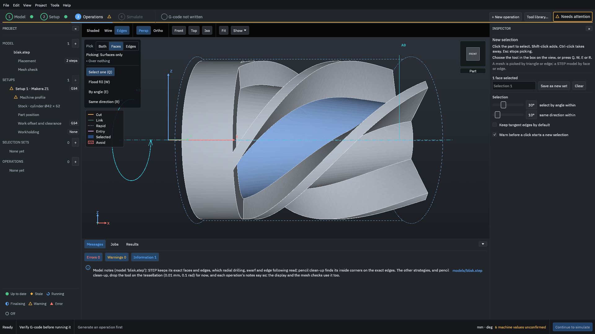
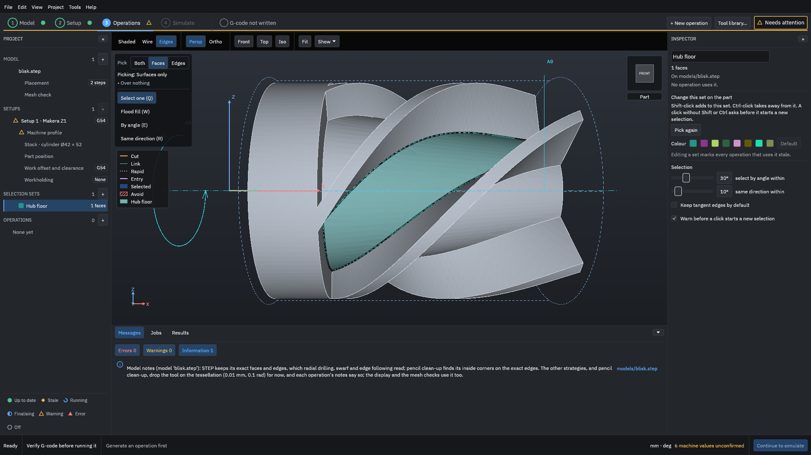
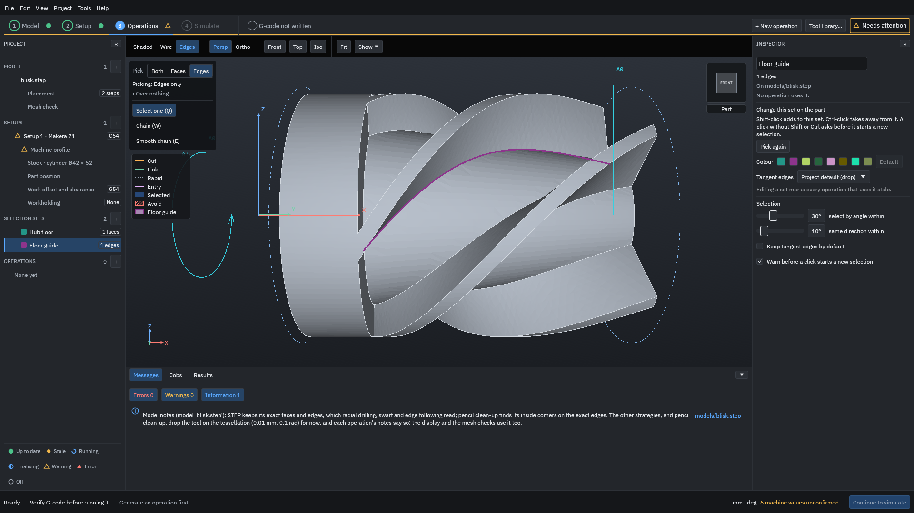
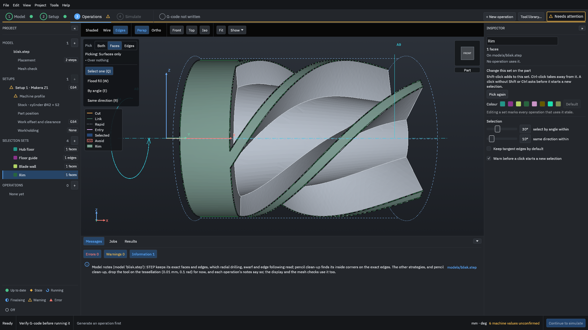
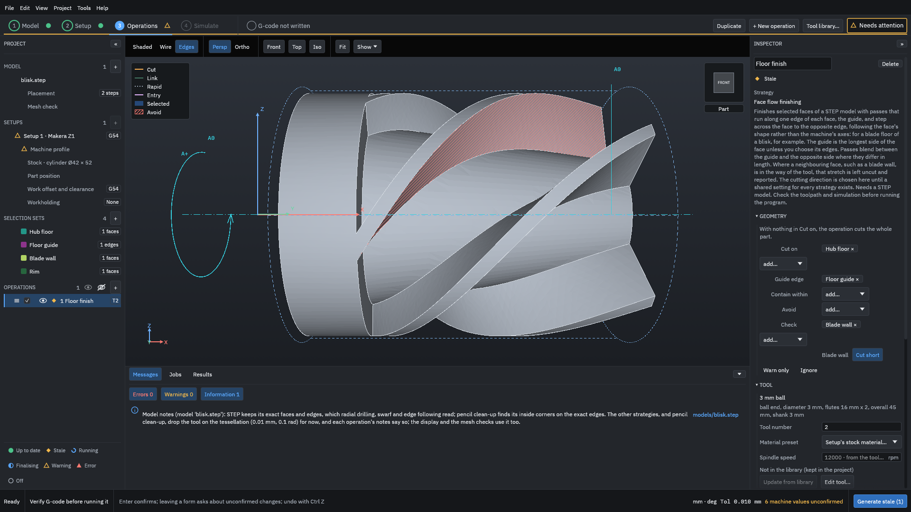
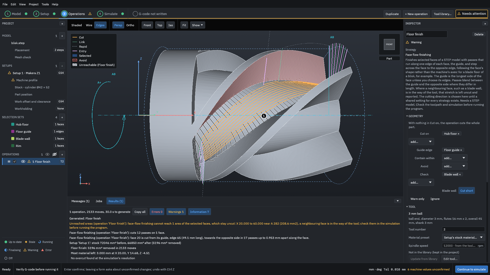
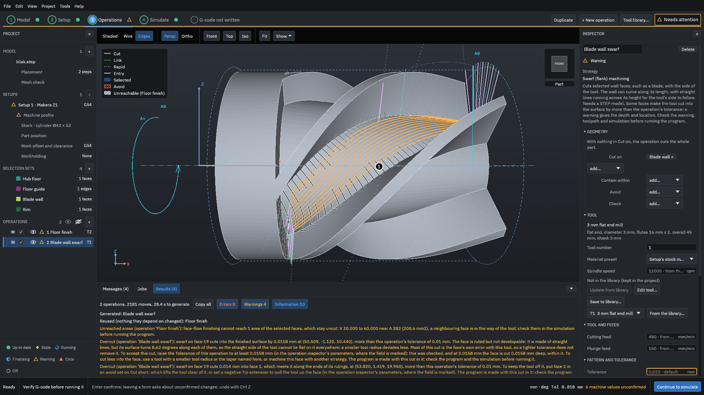
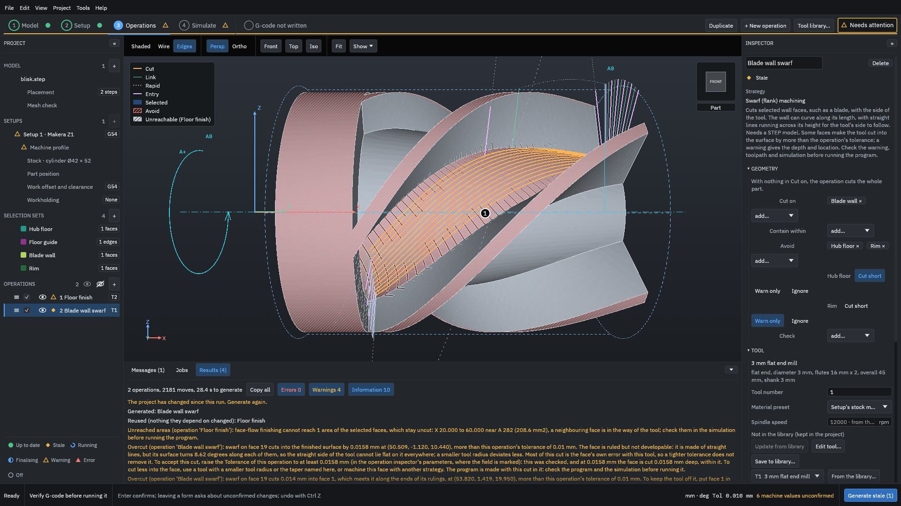
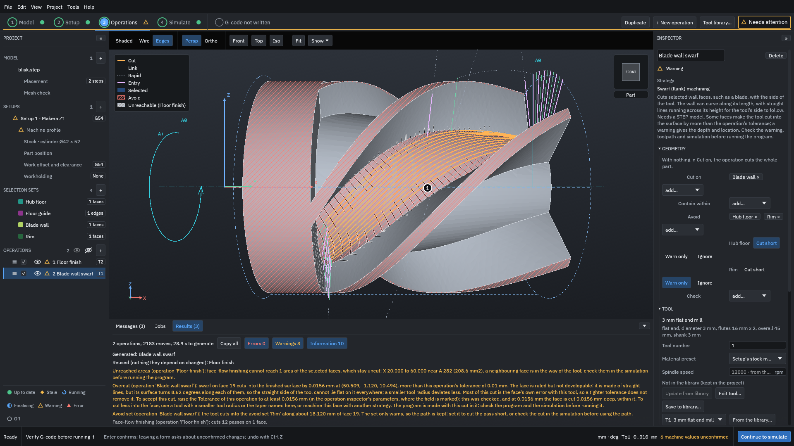
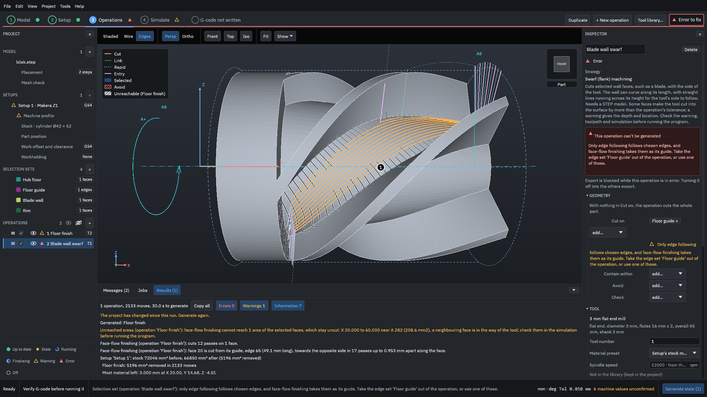

# Selection sets on a blisk

This example makes the five kinds of [selection set](../glossary.md#selection-set) the program uses on a STEP part, and uses them in two operations on a bladed disk (a blisk): a face set to cut, an edge set as the guide of face-flow finishing, a check set, an avoid set that cuts the pass short, and an avoid set that only warns. It shows what each one changes in the toolpath and what the Results say about it, with the numbers from a real run.

> [!WARNING]
> A selection set changes where the tool cuts and what it is kept away from, but the program checks only what the set names and what the messages say was checked. Generated G-code must be verified by you before it is run on a machine: watch the [simulation](../glossary.md#simulation), read every warning, and run an [air cut](../glossary.md#air-cut) first.

You need the example project [`testdata/examples/blisk-start/blisk-project`](https://github.com/paulhampson/OpenChuckCAM/tree/main/testdata/examples/blisk-start/blisk-project). Copy it to a folder of your own and open the copy with **File > Open project**, so the example in the repository stays as it is. It holds the public blisk model (a STEP file), the built-in Makera Z1, oak stock 42 mm across, a 3 mm flat end mill (T1) and a 3 mm ball end mill (T2), and no sets or operations yet. Reading a STEP file needs the STEP reader that comes with the program ([Import a STEP file](../how-to/import-step.md)).

The numbers on this page come from OpenChuckCAM 0.55.0 on Linux (main at 7045731). Another version can give other numbers.

## What the sets are for

A selection set is a named group of faces or edges of the part. An operation uses a set in a role:

| Role in the operation | What it does |
| --- | --- |
| **Cut on** | The faces the operation cuts. With face-flow finishing and swarf, the operation cuts only these faces. |
| **Guide edge** | Face-flow finishing only: the edge each pass runs along. Empty, each face starts from its longest side. |
| **Avoid** | Faces the tool must not cut into. Each set has a choice: **Cut short** (the default) stops or lifts the pass, **Warn only** keeps the path and warns, **Ignore** limits nothing. |
| **Check** | Faces the tool must stay clear of by the operation's [stock to leave](../glossary.md#stock-to-leave), with the same three choices. |
| **Contain within** | A window the cut must stay inside. Not used in this example. |

On a STEP part, these roles take face sets, except **Guide edge**, which takes an edge set. (Edge following, not used here, cuts along an edge set in **Cut on**.) The same set can have a different role in each operation.

## 1. Make a face set: the hub floor

1. Click **Operations** at the top of the window.
2. Click **Front**, then **Fit**, and zoom in with the mouse wheel until the blisk fills the view.
3. In the project panel, click the **+** beside **Selection sets**. The Inspector shows **New selection**.
4. In the box on the view, choose **Faces** and **Select one (Q)**.
5. Click the floor between the two blades in the middle of the view. The face turns blue and the Inspector says "1 face selected".

<figure>

<figcaption><b>Figure 1.</b> The picked floor is blue. The box on the view says what can be picked: <b>Faces</b>, one at a time.</figcaption>
</figure>

6. Type `Hub floor` in the name field and press <kbd>Enter</kbd>.
7. Click **Save as new set**. The set appears in the project panel, and the Inspector shows the set itself.

<figure>

<figcaption><b>Figure 2.</b> A saved set is drawn in its own colour. Shift-click adds faces to it and Ctrl-click takes them away; each change makes every operation that uses it out of date.</figcaption>
</figure>

8. Press <kbd>Esc</kbd> to stop picking.

This floor is face 20 of the model. The Results name faces by number, so it helps to know it.

## 2. Make an edge set: the guide

1. Click the **+** beside **Selection sets** again.
2. In the box on the view, choose **Edges** and **Select one (Q)**.
3. Move the pointer onto the line where the blade above the floor meets the floor. The box says "Over an edge" and the edge is drawn in colour. Click it.
4. Name the set `Floor guide` and click **Save as new set**, then press <kbd>Esc</kbd>.

<figure>

<figcaption><b>Figure 3.</b> An edge set holds edges, not faces. Here it is edge 65, the root of the blade along the floor.</figcaption>
</figure>

## 3. Make two more face sets

In the same way, make two more face sets with **Faces** and **Select one (Q)**:

| Name | Click | What it is |
| --- | --- | --- |
| `Blade wall` | the side of the blade above the floor | face 19, the blade side that rises from the guide edge |
| `Rim` | the plain round part of the disc at the left | face 1, the outer cylinder: the rim of the disc and the tips of the blades |

<figure>

<figcaption><b>Figure 4.</b> One face can reach further than it looks: <b>Rim</b> is one cylinder that runs over the disc and the tips of every blade.</figcaption>
</figure>

## 4. Use the face set, the edge set and a check set

Face-flow finishing cuts the faces in **Cut on** with passes that run along a guide edge ([Face-flow finishing on a blisk floor](faceflow.md) goes through it in detail).

1. Click **+ New operation**. Choose **Face flow finishing**, tool **3 mm ball**, name it `Floor finish`, and click **Add**.
2. In the Inspector, under **Geometry**, open the list beside **Cut on** and choose **Hub floor**.
3. Open the list beside **Guide edge** and choose **Floor guide**. This list offers only edge sets.
4. Open the list beside **Check** and choose **Blade wall**. Leave its choice on **Cut short**.
5. Scroll down to **Pattern and tolerance** and set **Stock to leave** to `0.2` mm.

<figure>

<figcaption><b>Figure 5.</b> Each set in <b>Avoid</b> or <b>Check</b> has its own choice, shown under it.</figcaption>
</figure>

A check set keeps the tool the operation's stock to leave away from its faces. Here the tool stays 0.2 mm clear of the blade wall, and leaves 0.2 mm on the floor too, since the stock to leave is the operation's.

6. Click **Generate stale** at the bottom right. It took about 30 s on the test computer.

<figure>

<figcaption><b>Figure 6.</b> The passes follow the floor along the guide. The hatched area beside the walls is the part of the floor the 3 mm ball cannot reach.</figcaption>
</figure>

The Results say:

- "face 20 is cut from its guide, edge 65 (49.1 mm long), towards the opposite side in 17 passes up to 0.953 mm apart along the face". The guide is the edge of the edge set.
- "face-flow finishing cannot reach 1 area of the selected faces, which stay uncut: X 20.000 to 60.000 near A 282 (208.6 mm2), a neighbouring face is in the way of the tool".
- "Floor finish: 5196 mm³ removed in 2133 moves".

Without the check set and with no stock to leave, the same floor reported 173.8 mm2 unreached: the tool kept 0.2 mm from every face reaches less of the floor.

## 5. Use the same sets the other way round: swarf with avoid sets

[Swarf](../glossary.md#swarf) cuts a wall with the side of the tool ([Swarf on a blisk blade](swarf.md) goes through it in detail). Here the blade wall is the face to cut, and the hub floor, which the face-flow operation cut, is a face to keep off.

1. Click **+ New operation**. Choose **Swarf (flank) machining**, tool **3 mm flat end mill**, name it `Blade wall swarf`, and click **Add**.
2. Beside **Cut on**, choose **Blade wall**.
3. Click **Generate stale**.

<figure>

<figcaption><b>Figure 7.</b> Before: no avoid set. The swarf cuts a little into the rim and the floor, and says so.</figcaption>
</figure>

With only **Cut on**, the Results warn that the tool reaches the faces beside the wall:

- "Overcut (operation 'Blade wall swarf'): swarf on face 19 cuts 0.023 mm into face 20, which meets it along the ends of its rulings, at (57.593, 1.020, 9.305), more than this operation's tolerance of 0.01 mm. To keep the tool off it, put face 20 in an avoid set on Cut short, which lifts the tool clear of it, or set a negative Tip extension ..."
- The same for face 1, the rim: 0.014 mm.

Now add the avoid sets:

4. Beside **Avoid**, choose **Hub floor**. Leave it on **Cut short**.
5. Open the **add...** list under it and choose **Rim**. Under **Rim**, click **Warn only**.

<figure>

<figcaption><b>Figure 8.</b> Two avoid sets with different choices: the floor cuts the pass short, the rim only warns.</figcaption>
</figure>

6. Click **Generate stale**.

<figure>

<figcaption><b>Figure 9.</b> After: the warning about the floor is gone, and the rim is reported as a cut into a set that only warns.</figcaption>
</figure>

## Read the result

Compare the swarf operation's lines before and after the avoid sets:

| | Before (Figure 7) | After (Figure 9) |
| --- | --- | --- |
| Hub floor (face 20) | "cuts 0.023 mm into face 20" (a warning) | "The tool is lifted up to 0.069 mm along the rulings to keep clear of the avoid surfaces, so a strip up to about 0.069 mm wide is left at that end of the face." |
| Rim (face 1) | "cuts 0.014 mm into face 1" (a warning) | "Avoid set (operation 'Blade wall swarf'): the tool cuts into the avoid set 'Rim' along about 18.120 mm of face 19. The set only warns, so the path is kept: set it to cut the pass short, or check the cut in the simulation before using the path." |
| Ends of the wall | stops 0.471 mm short of face 5 and 0.833 mm short of face 15 | 0.470 mm and 0.833 mm |
| Moves of the swarf | 48 | 50 |

What it means:

- **Cut short** on the floor lifted the tool's end up the wall by up to 0.069 mm, so it no longer cuts the floor. A strip that wide is left uncut at the foot of the wall, on purpose.
- **Warn only** on the rim changed nothing in the path. It measures the path against the set and tells you how much of the wall's length the tool reaches into it. The warning names the set by its name, so you can find it.
- **Reused (nothing they depend on changed): Floor finish** says the face-flow operation was not made again. Changing the swarf's sets does not touch it, although the two operations share sets.
- A face that is in no set is still measured if it shares an edge with the swarf's wall, and a cut into it is warned of (the "Before" column). Swarf also stops short of the faces at the ends of the wall by itself; [Swarf on a blisk blade](swarf.md) explains those lines.

The face-flow operation's line about the unreached area is still there, and so is a swarf warning that the twisted wall itself is cut 0.0156 mm deep, more than the 0.01 mm [tolerance](../glossary.md#tolerance). Read each warning and decide what to change: these are yours to judge.

## Common mistakes

A face set leaves a wall or a floor out
: An operation cuts only the faces in **Cut on**, but its tool still reaches the faces next to them. With nothing in **Avoid**, the swarf above warns "swarf on face 19 cuts 0.023 mm into face 20, which meets it along the ends of its rulings ... put face 20 in an avoid set on Cut short, which lifts the tool clear of it, or set a negative Tip extension". Put the face it names in an avoid or check set, as in step 5. For face-flow finishing, a face beside the floor that is in the way shows as the unreached area; cut that face with another operation, such as swarf for a wall.

A selection reaches a held region
: In this project nothing is held. If you click **Workholding** under **Setup 1**, tick **Held at the start**, keep the **Grip length** of 10 mm and click **Apply**, the setup says "The chuck grips 9.000 mm of the part here (X 10.000 to 19.000 mm), so that length is never machined. Shorten the grip if it should be cut.", and Messages repeat it: "The grip at the start of the stock covers 9.000 mm of the part (X 10.000 to 19.000), which is never machined; shorten the grip if that length should be cut." The **Rim** set reaches into that length. An operation on it does not cut there, and its Results say "Nothing within one tool radius of the held region at the start of the stock is cut: no part of the tool reaches over the gripped length of the stock." A set does not override a [held region](../glossary.md#held-region). Shorten the grip or move the part if that length must be cut.

A set of the wrong kind
: Lists such as **Cut on** of swarf and **Avoid** offer every set, edge sets too. An edge set where faces are needed is refused before anything is made. In **Cut on** of swarf: "Only edge following follows chosen edges, and face-flow finishing takes them as its guide. Take the edge set 'Floor guide' out of the operation, or use one of those." In **Avoid**: "Avoid takes faces, not edges, on a STEP part. Take the edge set 'Floor guide' out of Avoid, and select faces instead." Click the **×** on the set to take it out.

<figure>

<figcaption><b>Figure 10.</b> An edge set in <b>Cut on</b> of a swarf operation. The banner names the set to take out.</figcaption>
</figure>

Face-flow finishing with nothing in Cut on
: It is refused: "Selection set (operation 'Floor finish'): face-flow finishing needs a face set: select the faces to cut, save them as a set and put it in Cut on; an edge set there is the guide." Make a face set of the faces to cut and choose it beside **Cut on**.

Editing a set changes more than one operation
: A set is shared. Shift-click or Ctrl-click on a chosen set changes it at once and makes every operation that uses it out of date, as its Inspector says. Make a new set if only one operation should change.
