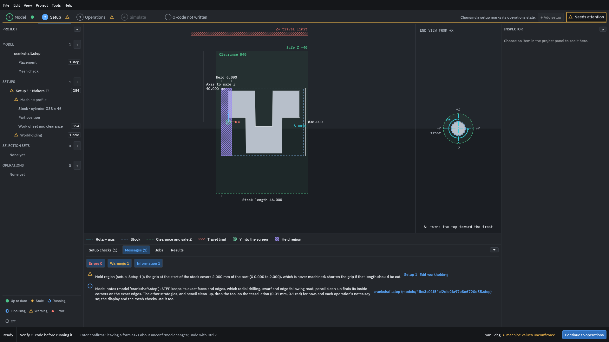
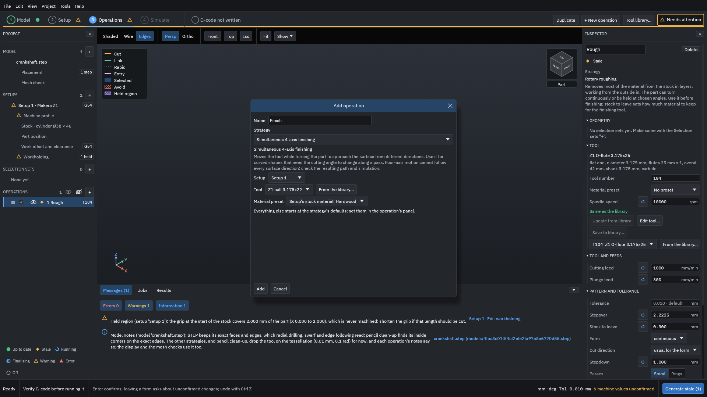
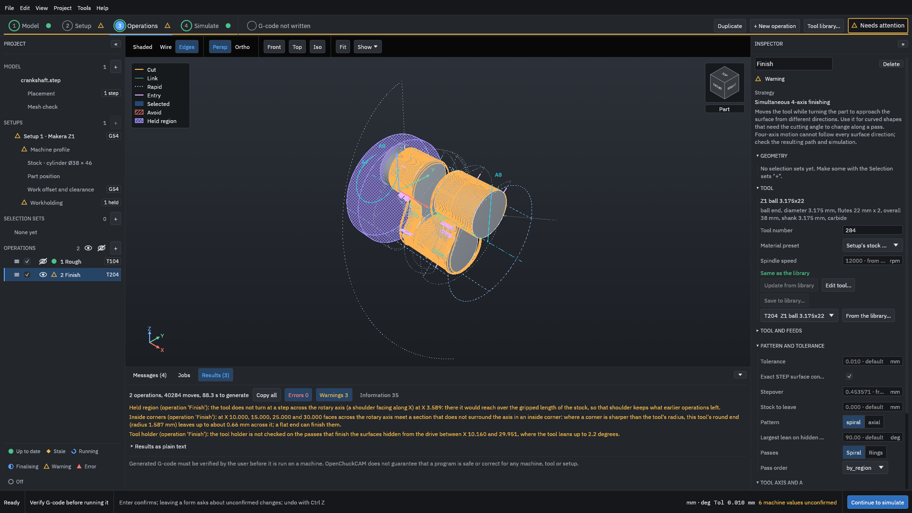
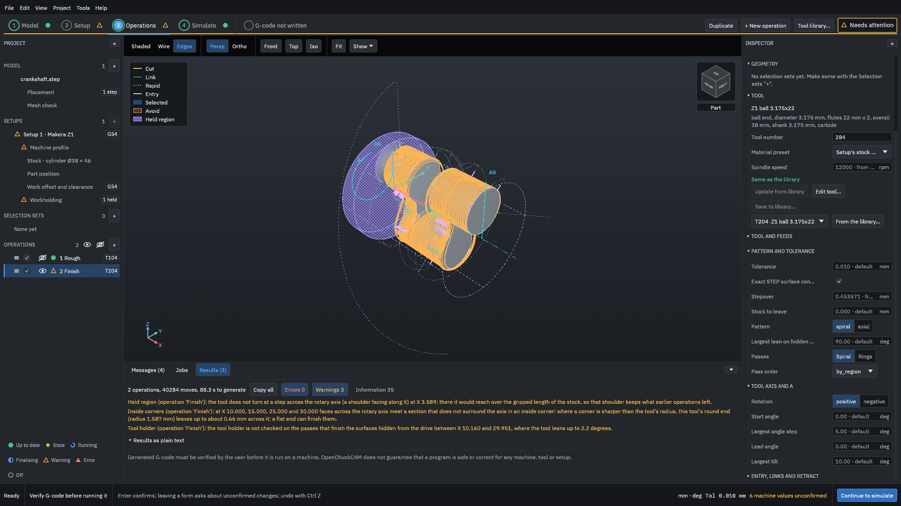
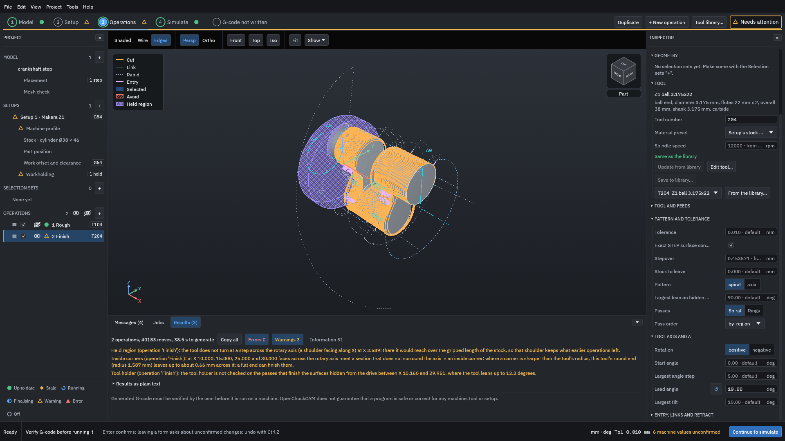
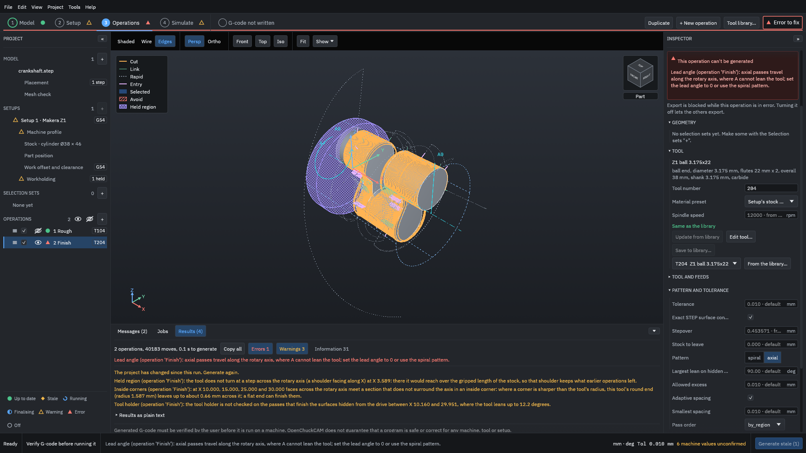

# Simultaneous finishing

This example finishes a part whose section does not surround the rotary axis: a small crankshaft with pins set 10 mm off the axis. You add a roughing operation and a **Simultaneous 4-axis finishing** operation, read what the program says about the off-axis pins and the surfaces it cannot see straight on, and then try the two limits that set how the tool leans: **Lead angle** and **Largest tilt**.

> [!WARNING]
> In simultaneous finishing the part turns while the tool moves, so the tool can come close to the part, the chuck and the stock from directions you do not expect. The program checks gouging against the part, but it does not check the tool holder, and it does not prove that nothing collides. Watch the whole path in the simulation and run an [air cut](../glossary.md#air-cut) first. Generated G-code must be verified by you before it is run on a machine.

You need the example project [`testdata/examples/crankshaft-simultaneous/crankshaft-project`](https://github.com/paulhampson/OpenChuckCAM/tree/main/testdata/examples/crankshaft-simultaneous/crankshaft-project). Copy it to a folder of your own and open the copy with **File > Open project**. Its part is the public model `testdata/step/valid/crankshaft.step`, and the program needs its STEP reader to open it ([Install](../start/install.md)). The numbers on this page come from that project on the build named in the figures' record; your own part gives other numbers.

## When to use simultaneous finishing

Most finishing strategies keep the tool pointing at the rotary axis. That works on parts that are round in section, such as the tutorial's baluster. **Simultaneous 4-axis finishing** instead turns A so that the tool follows the surface's normal as it moves. Use it when:

- the part's section does not surround the rotary axis, such as an off-axis pin, a cam or a lobe;
- surfaces face each other or face sideways, so that a tool pointing at the axis would meet them at a steep angle or not at all.

On a part that is round in section, start with **Helical finishing**: it is simpler to check.

## 1. Look at the part

The project opens on the **Setup** step. The side view shows the crank: the pins at X = 0 to 10 and 30 to 40 sit above the axis and the pin at X = 15 to 25 below it.

<figure>

<figcaption><b>Figure 1.</b> The crankshaft in its 38 mm stock. Its pins are not centred on the rotary axis.</figcaption>
</figure>

The project already has the setup (a 38 mm hardwood bar, gripped for 6 mm) and the two tools; you add the operations.

## 2. Add the operations

1. Click **Operations** at the top.
2. Click **+ New operation**, keep **Rotary roughing**, choose the tool **Z1 O-flute 3.175x25**, name it `Rough`, and click **Add**.
3. In the Inspector, set **Stepdown** to `1`.
4. Click **+ New operation** again. Under **Strategy**, choose **Simultaneous 4-axis finishing**, choose the tool **Z1 ball 3.175x22**, and name it `Finish`.

<figure>

<figcaption><b>Figure 2.</b> The finishing operation. Its description says what it cannot do: four-axis motion cannot follow every surface direction.</figcaption>
</figure>

5. Click **Add**.

## 3. Generate and read the notes

1. Click the eye beside **1 Rough** to hide its path, so the view shows the finish only.
2. Click **Generate**. On the build these screens were taken with, both operations took about 90 seconds.
3. Click **Iso** above the view, then **Results** under it. The notes are listed under **Information**.

<figure>

<figcaption><b>Figure 3.</b> The finishing path follows each pin round its own centre, not round the rotary axis.</figcaption>
</figure>

The finish gives these notes and three warnings. Figure 3 shows the warnings; the notes are under **Information**. Read them before you look at the simulation.

The off-axis pins
: "the part's section does not surround the rotary axis at X 4.088 to 9.960, X 15.008 to 24.953, X 30.001 to 39.946, so the path there goes round the section's own centre: the tool moves across the axis as A turns, to stay on the surface normal". Over each pin, Y and Z change as A turns, so the machine moves on all four axes at once.

How far the tool leans
: "A is smoothed within 10 degrees of the normal; the largest tilt used is 1.3 degrees from that". The tool is allowed to lean up to **Largest tilt** away from the normal so that A turns smoothly; here it needed only 1.3°.

Surfaces it cannot see straight on
: "surfaces hidden from the drive (such as the walls of a slot, an undercut, or sides of the section facing each other) between X 10.160 and 29.951 are finished with passes of their own after the main ones, the tool leaning from the surface normal as little as the part lets it reach them: up to 2.2 degrees (at X 10.160, A 118.471); the tool above its flutes is taken as no wider than its cutting part". The webs between the pins face each other, so they get passes of their own. A warning of its own goes with it, "Tool holder (operation 'Finish')": "the tool holder is not checked on the passes that finish the surfaces hidden from the drive between X 10.160 and 29.951, where the tool leans up to 2.2 degrees". Check the holder's clearance yourself where the tool leans.

A shoulder over the grip, a warning
: "Held region (operation 'Finish'): the tool does not turn at a step across the rotary axis (a shoulder facing along X) at X 3.589: there it would reach over the gripped length of the stock, so that shoulder keeps what earlier operations left."

Inside corners, a warning
: "Inside corners (operation 'Finish'): at X 10.000, 15.000, 25.000 and 30.000 faces across the rotary axis meet a section that does not surround the axis in an inside corner: where a corner is sharper than the tool's radius, this tool's round end (radius 1.587 mm) leaves up to about 0.66 mm across it; a flat end can finish them". A ball cannot cut a sharp inside corner; plan another operation if those corners matter.

The finish also says that it drops the tool on "the STEP part's exact faces, to within 0.0001 mm", while the roughing uses the tessellation.

## 4. The lead and tilt limits

Scroll the Inspector down to **Tool axis and A**.

<figure>

<figcaption><b>Figure 4.</b> The settings that control how the tool leans and how A turns.</figcaption>
</figure>

Lead angle
: Leans the tool from the normal towards the way the path travels round the axis, between -30° and 30°. With a ball, a lead keeps the ball's centre, where it barely cuts, off the surface. The default is 0.

Largest tilt
: How far the tool may lean away from the normal, plus the lead, so that A turns smoothly with fewer reversals. 0 follows the normal exactly. A larger value gives a smoother A, but cuts with more of the tool's side, which changes the finish for flat, bull-nose and V tools. The default is 10°.

Largest angle step
: The largest change of A between two points of the path. The default is 5°.

Largest lean on hidden surfaces
: A limit, between 0° and 90° (the default is 90°), on how far the tool may lean from the normal to reach a hidden surface. Read what it did in the note about surfaces hidden from the drive, which gives the largest lean used. On the build these screens were taken with, setting it to 0 did not change this example's path; that is under review (#619).

Now give the finish a lead:

1. Set **Lead angle** to `10` and press <kbd>Enter</kbd>.
2. Click **Generate**.

<figure>

<figcaption><b>Figure 5.</b> With a 10° lead, the tool leans up to 12.2° on the hidden surfaces.</figcaption>
</figure>

The note under **Information** now reads "A is smoothed within 10 degrees of the normal plus the 10 degree lead; the largest tilt used is 1.3 degrees from that", and the tool holder warning says the tool leans "up to 12.2 degrees" on the hidden surfaces, because the lead adds to the lean. The path is much the same; what changes is the angle at which the ball meets the wood.

## 5. A lead needs the spiral pattern

A can only lean the tool round the axis. Axial passes travel along the axis, so a lead cannot apply to them:

1. Next to **Pattern**, click **axial**, leaving **Lead angle** at 10.
2. Click **Generate**.

<figure>

<figcaption><b>Figure 6.</b> The axial pattern with a lead is refused, and the reason is given.</figcaption>
</figure>

The operation is not generated, and the export is blocked until it is fixed. Set **Lead angle** back to `0`, or click **spiral** again.

## Read the result

| Finish | Moves, both operations | Largest tilt used | Lean on hidden surfaces |
| --- | --- | --- | --- |
| Defaults (lead 0, tilt 10) | 40,284 | 1.3° | up to 2.2° |
| **Lead angle** 10 | 40,183 | 1.3° from the normal plus the lead | up to 12.2° |
| **Pattern** axial, **Lead angle** 10 | not generated | | |

With the defaults the simulation leaves "Most material left: 2.000 mm at X 40.00", at the free end of the last pin, where the stock reaches past the part. The finish removes 1,357 mm³ after the roughing's 34,227 mm³.

Over the pins the machine moves Y and Z while A turns. Before you run it, play the finish in the **Simulate** step and watch the tool over each pin: the program tells you how far the tool leaned, but only the simulation and an air cut show you what the machine does.

## Common mistakes

"axial passes travel along the rotary axis, where A cannot lean the tool; set the lead angle to 0 or use the spiral pattern"
: A lead needs the spiral pattern.

A large **Largest tilt** with a flat or bull-nose tool
: The tool cuts with more of its side, and the surface finish changes. Keep it small, or use a ball.

"... the tool holder is not checked"
: The program checks the tool's cutting part and takes the tool above its flutes as no wider; it does not know the holder. Check the clearance round the pins yourself.

Expecting the inside corners to be sharp
: "this tool's round end (radius 1.587 mm) leaves up to about 0.66 mm across it; a flat end can finish them". Add an operation with a flat end mill for the corners, if they matter.

Related: [Finishing strategies](../concepts/finishing-strategies.md), [Rotary machining](../concepts/rotary-machining.md).
