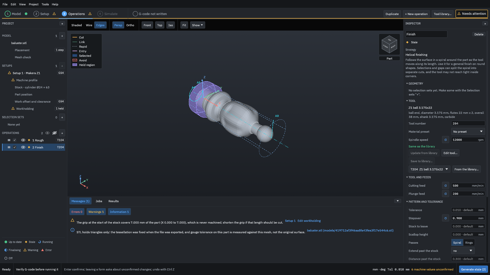
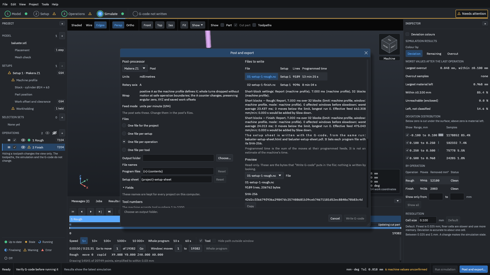
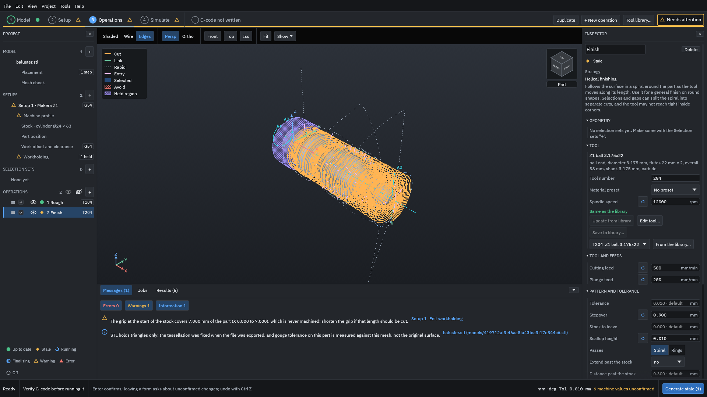
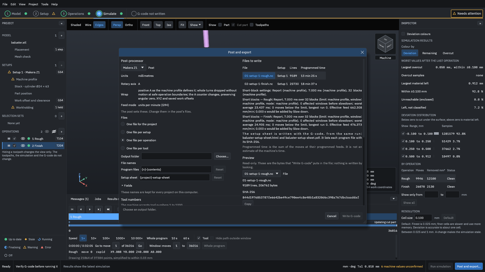

# Stepover, stock to leave and scallop

This example changes the [stepover](../glossary.md#stepover) of the tutorial's finishing operation and its **Scallop height**, and the [stock to leave](../glossary.md#stock-to-leave) of its roughing operation, and puts numbers on what each change does: the height of the ridges left between passes, the programmed time, and how the work is shared between roughing and finishing.

> [!WARNING]
> The times on this page are programmed times: the sum of the moves at their programmed feeds. They are not the time your machine will take, which also depends on its acceleration, the feed override and the spindle. A finer finish is not a safer one: check every path in the simulation and run an [air cut](../glossary.md#air-cut) first. Generated G-code must be verified by you before it is run on a machine.

You need the tutorial's finished project, [`testdata/examples/baluster/baluster-project`](https://github.com/paulhampson/OpenChuckCAM/tree/main/testdata/examples/baluster/baluster-project). Copy it to a folder of your own and open the copy with **File > Open project**. The numbers on this page come from that project on the build named in the figures' record, with the Makera Z1 post; your own part gives other numbers. [Stepover, stepdown, scallop and stock to leave](../concepts/stepover-and-stock-to-leave.md) explains the terms.

## The scallop of a ball end mill

A ball end mill of radius *R* that steps over by *s* between passes leaves a ridge, the [scallop](../glossary.md#scallop), between them. On a flat or gently curved surface its height is about

*h* = *R* − √(*R*² − (*s*/2)²)

The tutorial's finishing tool, **Z1 ball 3.175x22**, has *R* = 1.5875 mm. The program does not measure the scallop on the part, so the heights on this page are worked out with this formula; they are what the stepover allows, not a measurement.

## 1. A larger stepover

1. In the project panel, click **2 Finish**.
2. In the Inspector, under **Pattern and tolerance**, set **Stepover** to `0.9` and press <kbd>Enter</kbd>.

<figure>

<figcaption><b>Figure 1.</b> The stepover set to 0.9 mm. A value typed into the operation is kept with it and shows a button to go back to the tool's value.</figcaption>
</figure>

3. Click **Generate**, then **Continue to simulate**, then **Post and export...**.
4. Under **Files**, choose **One file per operation**, so that the table lists each operation's programmed time.

<figure>

<figcaption><b>Figure 2.</b> With a 0.9 mm stepover the finish is 8 min 04 s of programmed time, against 14 min 55 s at the tutorial's stepover.</figcaption>
</figure>

Close the dialog with the **×** at its top right: nothing is written until you choose a folder and click **Write G-code**.

## 2. Set the scallop height instead

**Scallop height** sets the largest ridge you will accept, and the program works out the spacing from it. "The pitch is the smaller of this and the stepover allows", so it only ever makes the passes closer, never further apart.

1. Click **Operations** at the top, then **2 Finish**.
2. Leave **Stepover** at `0.9`, and set **Scallop height** to `0.01`.

<figure>

<figcaption><b>Figure 3.</b> A scallop height of 0.01 mm with the stepover still at 0.9 mm. The scallop height wins: it allows only about 0.356 mm between passes.</figcaption>
</figure>

3. Generate, and open **Post and export...** again.

<figure>

<figcaption><b>Figure 4.</b> With a 0.01 mm scallop height the finish is 18 min 37 s. The roughing does not change.</figcaption>
</figure>

## Read the result: stepover

| Finish set to | Spacing between passes | Scallop height (worked out) | Finish programmed time |
| --- | --- | --- | --- |
| **Stepover** 0.9 mm | 0.9 mm | 0.065 mm | 8 min 04 s |
| **Stepover** 0.453571 mm (the tutorial's) | 0.4536 mm | 0.016 mm | 14 min 55 s |
| **Scallop height** 0.01 mm | about 0.356 mm | 0.010 mm | 18 min 37 s |
| **Stepover** 0.2 mm | 0.2 mm | 0.003 mm | 32 min 21 s |

The roughing is 13 min 25 s in every row.

- Halving the stepover roughly doubles the time, and divides the scallop height by about four: the height grows with the square of the stepover.
- A scallop of 0.065 mm is easy to feel and to see on a finished surface; one of 0.003 mm is hard to see. Choose the largest stepover that leaves a surface you can accept, then sand or polish the rest if the part needs it.
- On curved and steep parts of the surface the real ridge differs from the formula. **Adaptive spacing**, in the same section, measures the material left between passes and adds passes where it is more than its **Allowed excess**.

The simulation cannot measure ridges this small at its default cell of 0.1 mm: "Deviation is accurate to about one cell". It does show the overall effect. In the Simulate step, the share of the surface **Within ±0.100 mm** rose from 85.4 % with the 0.9 mm stepover to 92.8 % with the 0.01 mm scallop height. The finest cell, 0.025 mm, takes "About 64.0 times the time and 16.0 times the memory of the default", too slow for this comparison.

## Read the result: stock to leave

The roughing leaves **Stock to leave** on the part so that the finishing tool has an even, light cut. The tutorial's roughing leaves 0.3 mm. With the same project, changing the roughing's **Stock to leave** to `1.0` gives, from `openchuck-cli simulate`:

| Roughing stock to leave | Roughing removes | Finish removes | Most material left |
| --- | --- | --- | --- |
| 0.3 mm (the tutorial's) | 12,099.6 mm³ | 2,110.4 mm³ | 0.924 mm |
| 1.0 mm | 9,445.4 mm³ | 4,703.1 mm³ | 0.924 mm |

With 1 mm left, the finish removes more than twice as much, with the same ball and the same stepover: a heavier cut for a small tool, and more load where the ball cuts with its tip. The part ends the same: the most material left, 0.924 mm, is at the collar next to the chuck's grip in both, where neither tool reaches.

A new rotary roughing operation starts with a stock to leave of a tenth of its tool's diameter, rounded to 0.05 mm and kept between 0.1 and 1 mm: 0.3 mm for this 3.175 mm tool. A selection set can have its own stock to leave; the roughing then leaves the largest of the operation's and its sets' values, and says which set gave it.

## Common mistakes

Setting a small stepover to get a fine finish, then finding the job takes hours
: Look at the programmed time in **Post and export...** before you choose. Work out the scallop height you need first.

A **Scallop height** that does nothing
: If the stepover already gives a smaller ridge than the scallop height you set, the stepover wins. The scallop height only makes passes closer.

Stock to leave on the finishing operation
: The finish cuts to the model plus its own stock to leave. Leave the finish's **Stock to leave** at 0 unless a later operation will cut that material.

Too much stock left for the finish
: The finish's tool must take what the roughing leaves in one pass. If you leave more, use **Finishing layers** or a semi-finishing operation.

Related: [Rest machining](rest-machining.md), [Operations and strategies](../reference/operations.md).
