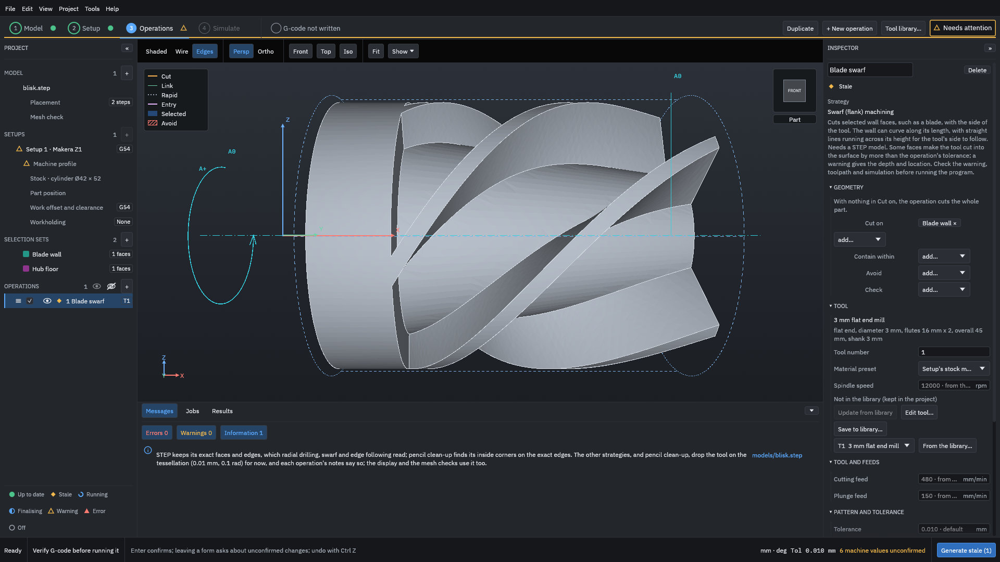
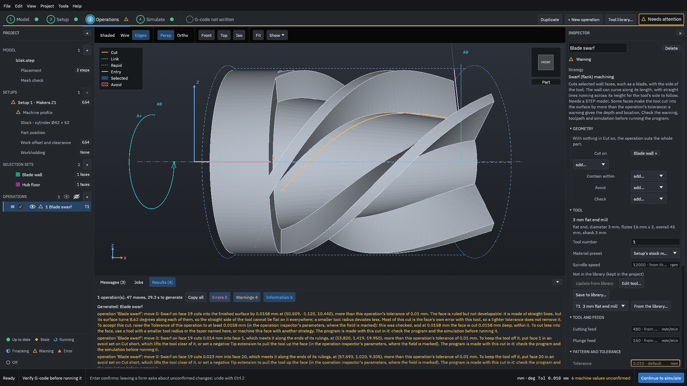
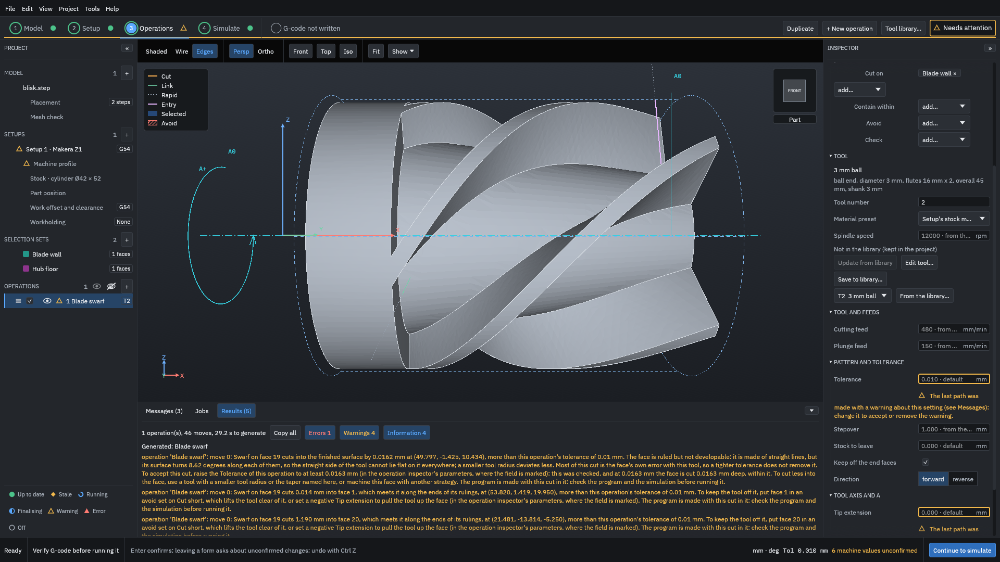
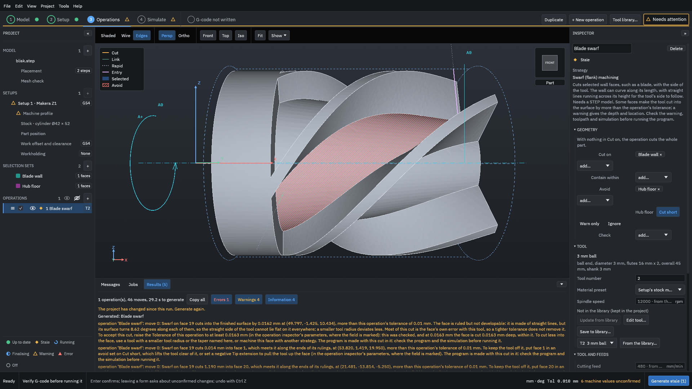
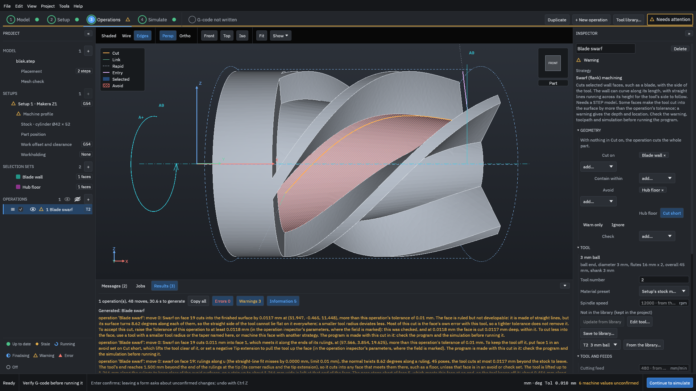
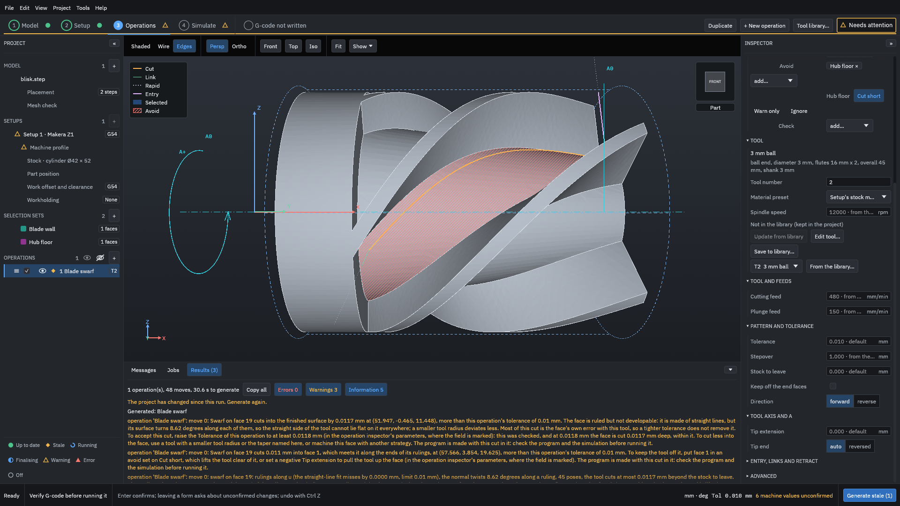
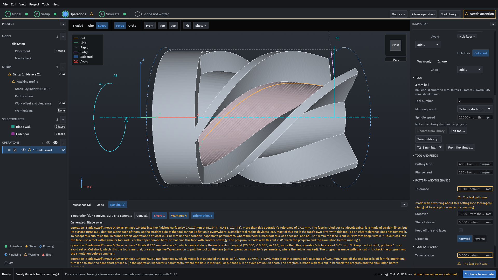

# Swarf on a blisk blade

This example cuts one side of one blade of a bladed disk (a blisk) with [swarf](../glossary.md#swarf), first with a flat end mill and then with a ball end mill. It shows how the pass stops short of the faces at the ends of the blade, what the warnings about the faces beside the blade mean, and what to change: an avoid set that lifts the tool off the floor, or a negative tip extension. The numbers come from a real run and match those measured when this behaviour was built.

> [!WARNING]
> Swarf checks the faces that share an edge with the blade, and only against the cutting part of the tool: not the shank, the holder or the rest of the part. Generated G-code must be verified by you before it is run on a machine: watch the [simulation](../glossary.md#simulation), read every warning, and run an [air cut](../glossary.md#air-cut) first.

You need the example project [`testdata/examples/blisk-start/blisk-project`](https://github.com/paulhampson/OpenChuckCAM/tree/main/testdata/examples/blisk-start/blisk-project). Copy it to a folder of your own and open the copy with **File > Open project**. Swarf needs a STEP part. The numbers on this page come from OpenChuckCAM 0.49.0 on Linux.

## How swarf cuts a blade

The side of a blade is a ruled face: it is made of straight lines, its rulings, that run from the floor up to the tip. Swarf lays the side of the tool along each ruling in turn and moves along the blade, so one pass cuts the whole height. The blade meets other faces:

- at its **ends**: the wall of the disc at X = 20 (face 5 here) and the end plane at X = 60 (face 15);
- along the **ends of its rulings**: the hub floor at the bottom (face 20) and the outer cylinder at the tip (face 1).

## 1. Make the sets

Make two face sets as in step 1 of [Selection sets on a blisk](selection-sets.md):

- `Blade wall`: the side of the blade above the floor in the middle of the front view (face 19);
- `Hub floor`: that floor (face 20). It is used in step 4.

## 2. Swarf with a flat end mill

1. Click **+ New operation**. Choose **Swarf (flank) machining**, the tool **3 mm flat end mill**, name it `Blade swarf`, and click **Add**.
2. Beside **Cut on**, choose **Blade wall**.

<figure>

<figcaption><b>Figure 1.</b> A swarf operation with only the face to cut.</figcaption>
</figure>

3. Click **Generate stale**. It took about 28 s on the test computer.

<figure>

<figcaption><b>Figure 2.</b> One pass along the blade with the 3 mm flat end mill.</figcaption>
</figure>

The face's note, the last swarf line in the Results, says:

> ... The tool's end is level with the end of the rulings at the tip. The pass stops short of face 5, which meets this face at an end, so the tool keeps off it: about 0.471 mm along the face is left uncut there. The pass stops short of face 15, which meets this face at an end, so the tool keeps off it: about 0.833 mm along the face is left uncut there. The faces that share an edge with this face were checked against the tool's cutting part; the shank, the holder and other faces were not.

This is **Keep off the end faces** at work. It is on by default: each pass stops short of a face that meets an end of the blade, by the least length that keeps the tool off it. Without it, the side of the tool would run past the end of the blade into the disc wall.

The other two swarf warnings are about the faces along the ends of the rulings:

- "Swarf on face 19 cuts 0.023 mm into face 20, which meets it along the ends of its rulings, at (57.593, 1.020, 9.305), more than this operation's tolerance of 0.01 mm. To keep the tool off it, put face 20 in an avoid set on Cut short, which lifts the tool clear of it, or set a negative Tip extension to pull the tool up the face ..."
- The same for face 1, the outer cylinder at the tips: 0.014 mm.

And one is about the blade itself: "Swarf on face 19 cuts into the finished surface by 0.0158 mm ... The face is ruled but not developable: it is made of straight lines, but its surface turns 8.62 degrees along each of them, so the straight side of the tool cannot lie flat on it everywhere". The blade twists, so a straight tool cannot follow it exactly. The warning says what you can do: accept it by raising **Tolerance** to 0.0158 mm, or use a tool with a smaller radius or a taper.

## 3. Swarf with a ball end mill

1. Scroll the Inspector to **Tool** and choose **T2 3 mm ball** in the tool list.
2. Click **Generate stale**.

<figure>

<figcaption><b>Figure 3.</b> With a ball, the tool's round end reaches below the end of the rulings into the floor.</figcaption>
</figure>

The note now says "The tool's end reaches 1.500 mm beyond the end of the rulings at the tip (its corner radius and the tip extension), so it cuts into any face that meets them there, such as a floor, unless that face is in an avoid or check set." The flank of a ball end mill starts at its equator, 1.5 mm above its tip, so the tip goes 1.5 mm past the foot of the blade. The warnings show it:

- "Swarf on face 19 cuts 1.190 mm into face 20, which meets it along the ends of its rulings, at (21.481, -13.814, -5.250) ..."
- The simulation finds it too: "Overcut: 1.151 mm deepest, at X 55.53, Y -0.84, Z 9.63; 60878 samples beyond 0.10 mm", counted under **Errors**.

The pass also stops 2.158 mm short of the end plane (face 15) instead of 0.833 mm, because the ball's round end needs more room there.

## 4. Lift the tool off the floor with an avoid set

1. Scroll back to **Geometry**. Beside **Avoid**, choose **Hub floor**. Leave it on **Cut short**.

<figure>

<figcaption><b>Figure 4.</b> On swarf, <b>Cut short</b> lifts the tool's end up the blade until it is clear of the set.</figcaption>
</figure>

2. Click **Generate stale**.

<figure>

<figcaption><b>Figure 5.</b> The warning about the floor is gone, and so is the overcut.</figcaption>
</figure>

The note says: "The tool is lifted up to 1.266 mm along the rulings to keep clear of the avoid surfaces, so a strip up to about 1.266 mm wide is left at that end of the face." That strip at the foot of the blade is left on purpose, and is not counted as material left. The simulation's line is "Deepest cut below the surface: 0.054 mm, within the simulation's error".

The note no longer says the pass stops short of face 15. The faces at the ends are measured against the tool as lifted, so a lift can shorten the stop or make it unneeded. It still stops 0.456 mm short of face 5.

The other way to keep the tool off the floor is a negative **Tip extension** (under **Tool axis and A**): it starts the flank that far up the blade, along the whole pass, and leaves a strip that wide. The avoid set lifts the tool only as much as each place needs.

## 5. Keep off the end faces, turned off

To see what the setting does, turn it off:

1. Scroll to **Pattern and tolerance** and clear **Keep off the end faces**.
2. Click **Generate stale**.

<figure>

<figcaption><b>Figure 6.</b> <b>Keep off the end faces</b> is a tick box in <b>Pattern and tolerance</b>. A setting that a warning points at is outlined.</figcaption>
</figure>

<figure>

<figcaption><b>Figure 7.</b> With the setting off, the pass runs to the end of the blade and into the disc wall.</figcaption>
</figure>

The Results now say: "Swarf on face 19 cuts 0.269 mm into face 5, which meets it at an end of the pass, at (20.000, -17.997, -6.539), more than this operation's tolerance of 0.01 mm. Keep off the end faces is off for this operation: turn it on to stop the pass short of face 5 (in the operation inspector's parameters, where the field is marked), or put face 5 in an avoid set on Cut short." The simulation reports "Overcut: 0.300 mm deepest, at X 20.00, Y -16.89, Z -6.30". Turn the setting back on, unless you mean to cut into that face, for example because it is stock that a later operation removes.

## Read the result

| | Flat 3 mm | Ball 3 mm | Ball, floor in Avoid | Ball, floor in Avoid, Keep off the end faces off |
| --- | --- | --- | --- | --- |
| Stops short of face 5 (disc wall) | 0.471 mm | 0.471 mm | 0.456 mm | no: cuts it 0.269 mm |
| Stops short of face 15 (end plane) | 0.833 mm | 2.158 mm | not needed | not needed |
| Cut into face 20 (floor), warned | 0.023 mm | 1.190 mm | lifted up to 1.266 mm | lifted up to 1.266 mm |
| Cut into face 1 (outer cylinder), warned | 0.014 mm | 0.014 mm | 0.011 mm | 0.266 mm |
| Moves | 47 | 46 | 48 | 48 |

These are the same numbers that were measured on this blade when the stop at the ends was built: 0.471 mm and 0.833 mm with a 3 mm flat end mill, 0.471 mm and 2.157 mm with a 3 mm ball, and the floor cut by 0.023 mm and 1.190 mm ([decision 0532](https://github.com/paulhampson/OpenChuckCAM/blob/main/docs/decisions/0532-swarf-keeps-off-the-faces-at-its-ends.md), the rows of blade 7). Other blades of this blisk twist into the disc wall more, and there the pass stops much further short: 6.935 mm with a 3 mm flat end mill on blade 9, in the same table.

How to read the lines:

- "stops short of face N ... about X mm along the face is left uncut there": the end of the blade is left on purpose, to keep the tool off a face at the end. Finish it another way if it matters.
- "cuts X mm into face N, which meets it along the ends of its rulings": the floor or the tip cylinder is cut. Put that face in an avoid set on **Cut short**, or use a negative **Tip extension**.
- "cuts X mm into face N, which meets it at an end of the pass": only with **Keep off the end faces** off.
- "The faces that share an edge with this face were checked against the tool's cutting part; the shank, the holder and other faces were not." Faces that do not touch the blade, such as the next blade, are not checked. Check the simulation for those.

## Common mistakes

A ball end mill on a blade that stands on a floor
: The round end goes below the foot of the blade by its radius: "Swarf on face 19 cuts 1.190 mm into face 20". Put the floor in an avoid set on **Cut short** (step 4), or use a flat end mill.

Putting the floor in an avoid set on Warn only
: The path is kept as it is and the cut is only reported. Use **Cut short** to lift the tool.

Turning Keep off the end faces off to cut the whole blade
: The tool then cuts the face at the end: "Swarf on face 19 cuts 0.269 mm into face 5, which meets it at an end of the pass". Leave it on unless that face is meant to be cut.

Raising the tolerance to remove the "not developable" warning without reading it
: The warning gives the depth (0.0158 mm here) and checks the value it proposes. A larger tolerance accepts that cut into the blade; it does not make the tool follow the twist better. A tool with a smaller radius does.

An edge set in Cut on
: Swarf cuts faces. It is refused: "Only edge following follows chosen edges, and face-flow finishing takes them as its guide. Take the edge set 'Floor guide' out of the operation, or use one of those." See [Selection sets on a blisk](selection-sets.md).
