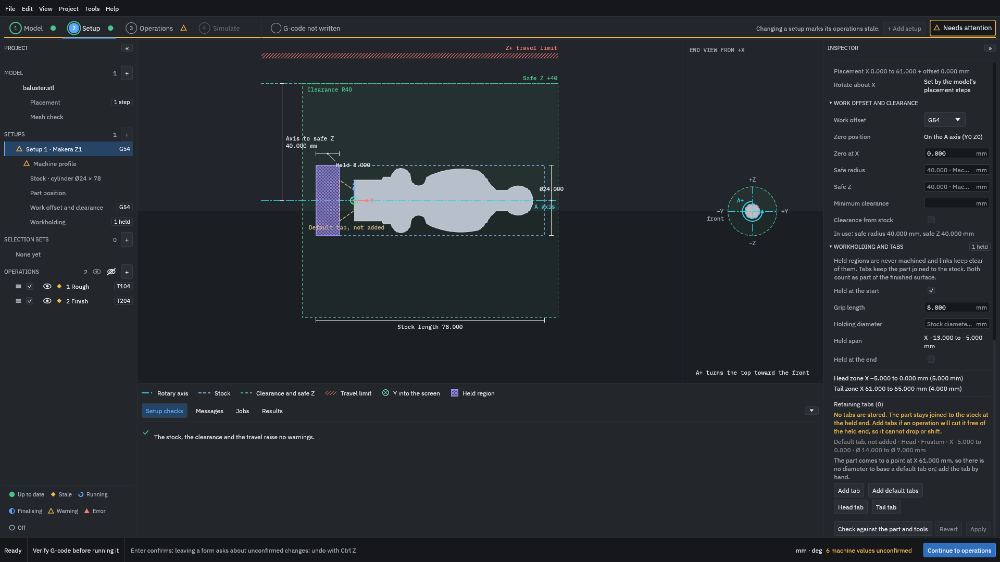
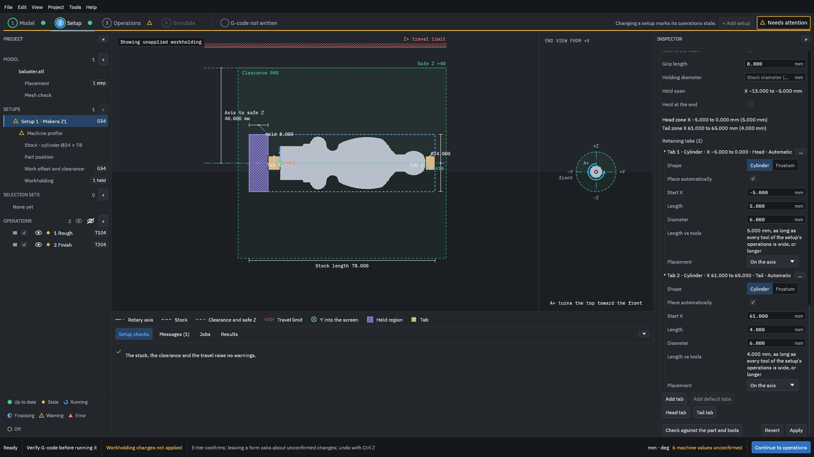
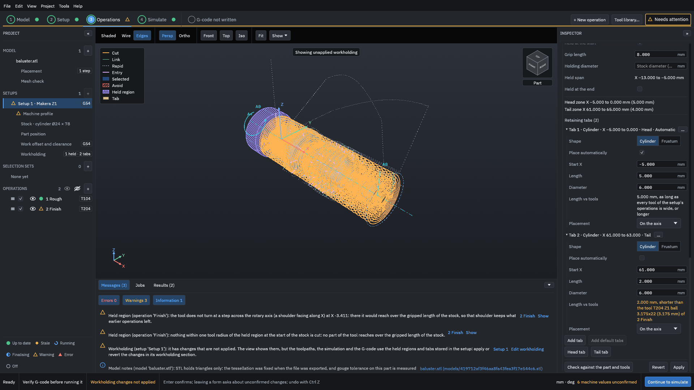
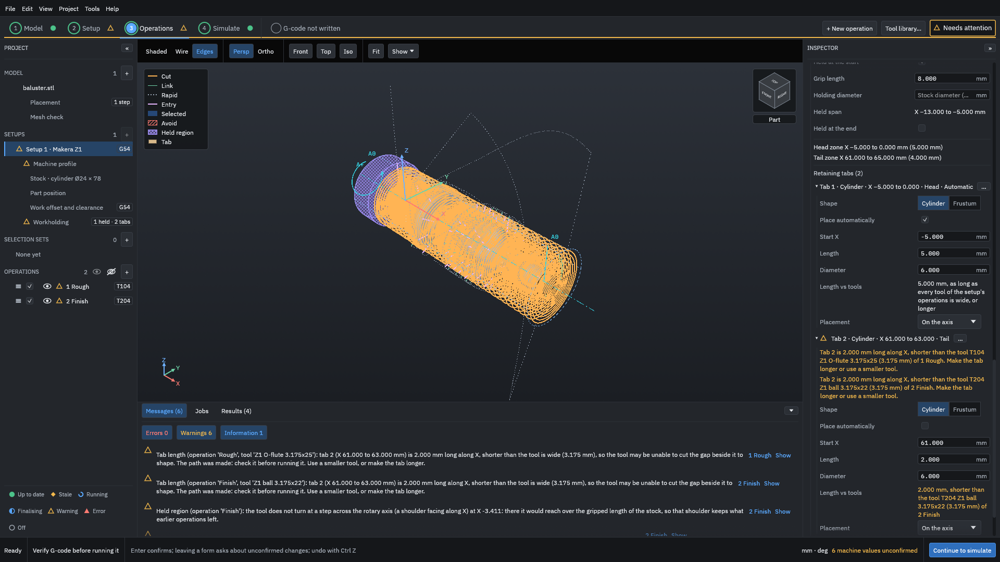
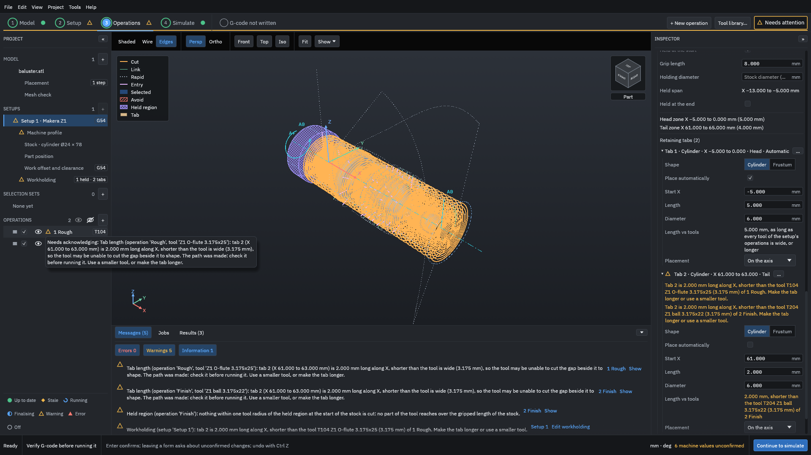
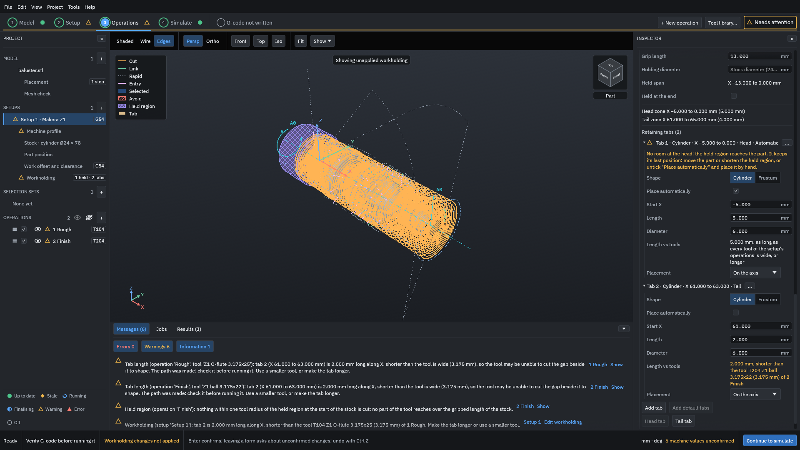
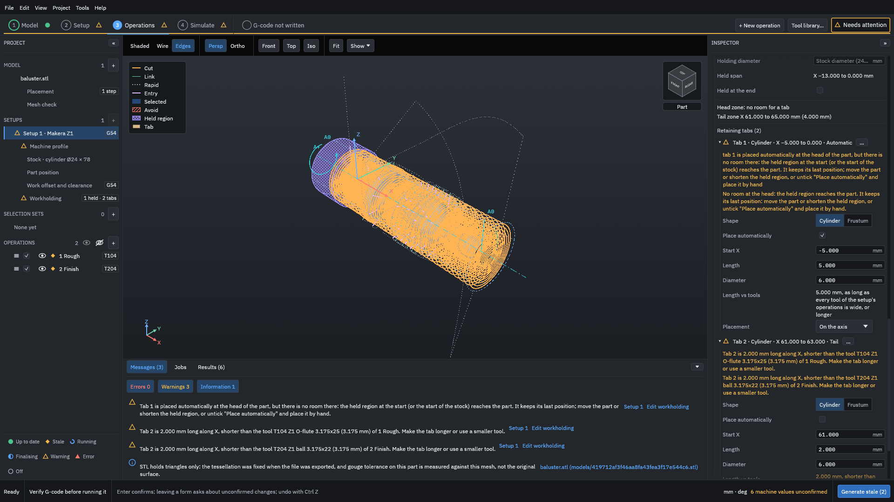

# Tabs and held regions

This example gives the tutorial's baluster a [tab](../glossary.md#tab) at each end, lets the program place them, and then makes the two mistakes that tabs most often meet: a tab shorter than the tool is wide, and a tab with no room left for it. You see what the program says each time and what to change.

> [!WARNING]
> Tabs and held regions change where the tool may go, but the program does not know your chuck jaws, your tailstock or how you will cut the tabs away. A tab that is too thin can break while the part is being cut. Check every path near a tab in the simulation, and run an [air cut](../glossary.md#air-cut) first. Generated G-code must be verified by you before it is run on a machine.

You need the tutorial's finished project, [`testdata/examples/baluster/baluster-project`](https://github.com/paulhampson/OpenChuckCAM/tree/main/testdata/examples/baluster/baluster-project). Copy it to a folder of your own and open the copy with **File > Open project**. The numbers on this page come from that project and the build named in the figures' record; your own part gives other numbers.

## What you are setting

A [held region](../glossary.md#held-region) is a length of the stock that the chuck or the tailstock holds. It is never cut, and links keep clear of it. A tab is a short bridge of uncut material between the part and the stock, so that the part stays attached until you cut it free yourself. Both count as part of the finished shape: the program cuts round them as if they were part of the model.

A tab may only sit in one of two zones along the rotary axis:

Head zone
: Between the end of the held region at the start (or the start of the stock) and the start of the part.

Tail zone
: Between the end of the part and the held region at the end (or the end of the stock).

The tutorial's project grips 8 mm of stock, and the grip reaches 7 mm into the part, so there is no head zone at all. You first make room.

## 1. Make room at the head

1. Click **Setup** at the top of the window.
2. In the project panel, under **Setup 1**, click **Stock**.
3. Set **Length** to `78` and **Start X** to `-13` (millimetres), pressing <kbd>Enter</kbd> after each.
4. Under **Setup 1**, click **Workholding**.

The grip is still 8 mm long, so it now holds X = -13 to -5, and the bar from X = -5 to the part at X = 0 is free. The section shows the zones:

<figure>

<figcaption><b>Figure 1.</b> A 5 mm head zone and a 4 mm tail zone. The amber line under <b>Retaining tabs (0)</b> says the part stays joined to the stock at the held end.</figcaption>
</figure>

<!-- Workaround for issue #604 (default-tab lines stale after a stock change). Remove this note when #604 is fixed. -->
> [!NOTE]
> After you change the stock, the lines under **Retaining tabs** can still say "No room for a default tab at the head: the held region reaches the part." and **Add default tabs** can stay greyed. The zone lines above them are right. To bring them up to date, save the project (**File > Save**) and open it again. This example uses **Head tab** and **Tail tab**, which do not depend on those lines.

## 2. Add a head and a tail tab

1. Click **Head tab**. A cylinder tab appears in the head zone, with **Place automatically** ticked.
2. Click **Tail tab**. A second tab appears in the tail zone.

<figure>

<figcaption><b>Figure 2.</b> Two tabs placed automatically. Each fills its zone; the "Showing unapplied workholding" chip at the top of the view says the changes are not stored yet.</figcaption>
</figure>

An automatic tab fills its zone and follows it: if you later move the part or change the stock, the tab moves with the zone. If you type a **Start X** or **Length** yourself, the tab stops being automatic and stays where you put it.

**Length vs tools** compares the tab with the tools of the setup's operations. Both tools of this project are 3.175 mm across, and both tabs are longer, so the line says only how long each tab is.

3. Press **Apply** at the bottom of the section.

Nothing the view shows is used until you apply it: the toolpaths, the simulation and the G-code use the held regions and tabs stored in the setup. Until you press **Apply** or **Revert**, the Messages list says "The workholding of 'Setup 1' has changes that are not applied." and the status bar says "Workholding changes not applied". Apply runs the same checks as **Check against the part and tools** first, and stores the workholding when they finish.

4. Click **Continue to operations**, then **Generate**.

With two 5 mm and 4 mm tabs, the Messages list has no warning about tabs, and the project chip reads "Good to go".

## 3. A tab shorter than the tool is wide

Make the tail tab shorter than the tool:

1. In the Inspector, under **Tab 2**, set **Length** to `2` and press <kbd>Enter</kbd>.

The tab is no longer automatic (you typed its length), and **Length vs tools** turns amber: "2.000 mm, shorter than the tool T204 Z1 ball 3.175x22 (3.175 mm) of 2 Finish".

<figure>

<figcaption><b>Figure 3.</b> The tab is 2 mm long and the tools are 3.175 mm across. <b>Length vs tools</b> warns before you apply.</figcaption>
</figure>

2. Press **Apply**, then **Generate**.

Apply stores the change and keeps the warning on the tab's row; it does not refuse a short tab. Generation then warns once for each operation whose path can reach the tab:

<figure>

<figcaption><b>Figure 4.</b> A short tab is a warning, not an error: the paths were made, and the two operations carry a warning triangle in the project panel.</figcaption>
</figure>

The operation's warning reads, in full:

> Tab length (operation 'Rough', tool 'Z1 O-flute 3.175x25'): tab 2 (X 61.000 to 63.000 mm) is 2.000 mm long along X, shorter than the tool is wide (3.175 mm), so the tool may be unable to cut the gap beside it to shape. The path was made: check it before running it. Use a smaller tool, or make the tab longer.

and the setup's own line reads "Tab 2 is 2.000 mm long along X, shorter than the tool T104 Z1 O-flute 3.175x25 (3.175 mm) of 1 Rough. Make the tab longer or use a smaller tool."

Because the tool may cut through a tab that is too short, and the part may then come loose, the program treats this warning as a possible collision. Hold the mouse over the warning mark beside **1 Rough** or **2 Finish**:

<figure>

<figcaption><b>Figure 5.</b> The mark starts "Needs acknowledging": the warning must be acknowledged before the G-code is written.</figcaption>
</figure>

In **Post and export...**, **Write G-code** then waits for the tick "I have read the possible collisions listed for this result and will check them before running the program", and the command line needs `--acknowledge-collision-warnings`. [The flute-length warning](flute-length-warning.md) shows that dialog. The tick lets you write the files; it does not change the path, so fix the tab first if you can.

What it means: a tool cannot cut a gap narrower than itself. Beside a tab shorter than the tool, the tool cannot reach down to the part on both sides of the tab, so material may be left there, or the path may not come as close to the part as you expect. Look at that end in the simulation before you go on.

What to change, in order of preference:

- Make the tab at least as long as the widest tool that reaches it. Here, set **Length** back to `4`, or tick **Place automatically** again so it fills the zone.
- Use a smaller tool for the operations that cut near the tab.
- If the operation only cuts part of the model, limit it to a region away from the tab: the check only counts operations whose path can reach the tab ([Limit an operation to a region](limit-to-a-region.md)).

When there is no room for the tab to sit beside the tool at all, the operation adds a warning that it "cannot cut down beside" the tab, with the room it had, and leaves the stock round the tab above it there.

## 4. A tab with no room

An automatic tab needs its zone. Take the zone away:

1. Set **Grip length** to `13` and press <kbd>Enter</kbd>.

The held region now runs from X = -13 to 0, up to the part, and Tab 1 has nowhere to go. Its row turns amber:

> No room at the head: the held region reaches the part. It keeps its last position: move the part or shorten the held region, or untick "Place automatically" and place it by hand.

<figure>

<figcaption><b>Figure 6.</b> The automatic head tab has no room once the grip reaches the part.</figcaption>
</figure>

2. Press **Apply**.

Apply stores the workholding with the 13 mm grip and keeps a warning for the tab. Tab 1 stays where it was last placed, X = -5 to 0, which is now inside the held region, and the section says "Head zone: no room for a tab". The operations become stale, because the held region changed.

<figure>

<figcaption><b>Figure 7.</b> Apply stores the workholding and warns about the tab with no room. Nothing is refused.</figcaption>
</figure>

The warning in the Messages list reads:

> Tab 1 is placed automatically at the head of the part, but there is no room there: the held region at the start (or the start of the stock) reaches the part. It keeps its last position; move the part or shorten the held region, or untick "Place automatically" and place it by hand.

A tab with no room is a warning because the job can still be made: the tab only takes up space that the grip already holds. Read it as "this tab is not doing what you set it up to do". Apply also stores and warns when two tabs overlap.

To fix it, do one of these, then press **Apply** again:

- Shorten the grip so the zone comes back (here, `8` again).
- Move the part along the stock (**Offset along X** under **Part position**), or lengthen the stock.
- Untick **Place automatically** on the tab and place it by hand inside a zone, or remove it with **...** on its row.

## Read the result

After step 2 the stored setup has an 8 mm grip from X = -13 and two tabs, X = -5 to 0 and X = 61 to 65, each 6 mm across. Generation treats them as part of the shape, so no path cuts into them; look at both ends in the simulation to see what is left round them. The project panel shows "1 held · 2 tabs" beside **Workholding**.

A warning about a tab is about whether the tool can cut beside it, not whether the part will hold: the program does not work out the cutting forces on a tab. Choose the tab's diameter for your material, and look at it in the simulation.

## Common mistakes

"No tabs are stored. The part stays joined to the stock at the held end."
: Not a mistake on its own: the part is held by its uncut end. Add tabs when an operation will cut the part free of the held end.

"The workholding of 'Setup 1' has changes that are not applied."
: You changed the workholding and did not press **Apply**. The view shows the change, but generation does not use it.

"Tab length (operation ...): ... shorter than the tool is wide"
: The tab is shorter than the tool. Make it longer, use a smaller tool, or keep the operation away from it.

"No room at the head: the held region reaches the part."
: An automatic tab has no zone. Shorten the grip, move the part, or place the tab by hand.

"The part comes to a point at X 61.000 mm, so there is no diameter to base a default tab on; add the tab by hand."
: **Add default tabs** sizes a tab from the part's diameter at its end, and the baluster's finial ends in a point. **Tail tab** still adds a tab of the default 6 mm diameter there.

The grip covers part of the model
: "The grip at the start of the stock covers 7.000 mm of the part ... which is never machined". That length stays as bar. Shorten the grip, or lengthen the stock as in step 1, if it should be cut.

Related: [Stock and the held region](../concepts/stock-and-held-region.md), [Tabs](../concepts/tabs.md).
