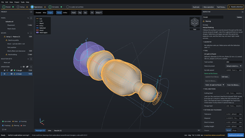
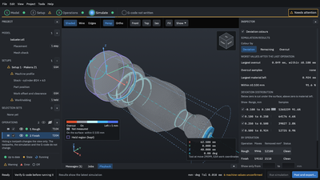

<section class="hero" aria-labelledby="hero-title">

OpenChuckCAM user guide · <a href="../versions.html">@@VERSION_LABEL@@</a>

<h1 id="hero-title">Turn a 3D model into G-code for 4-axis rotary machining</h1>

OpenChuckCAM is free, open-source CAM software for machines that hold the work in a chuck and turn it while the cutter works around it, such as the Makera Z1. This guide is for anyone making parts with it, including people new to CAM.

<ol class="routes">
<li><a href="start/install.md">1Start hereInstall the program and open it for the first time.</a></li>
<li><a href="tutorial/index.md">2Your first projectTake one part from a model file to G-code, in ten steps.</a></li>
</ol>

<strong>Before you cut:</strong> generated G-code must be checked by you before it is run on a machine. OpenChuckCAM does not guarantee that a program is safe or correct for your machine, tool or setup.

<figure class="hero-figure">

<figcaption>The Operations step: the finishing toolpath of the tutorial's baluster, in orange, around the part on the rotary axis. From a development build.</figcaption>
</figure>
</section>

## About OpenChuckCAM

**OpenChuckCAM is an open source CAM utility that targets 4-axis rotary CNC machine programming for makers and hobbyists.** Tools that comprehensively support 4-axis rotary CNC machining carry heavy licensing fees, which means that they are often out of reach for home and small-workshop users. OpenChuckCAM has been developed with the vision to close that gap.

<figure class="thumbs">

<figcaption>The real program, with the tutorial's example piece: the toolpath of a finishing operation, and the simulated cut part, coloured by deviation from the model. Select an image to see it full size.</figcaption>
</figure>

**OpenChuckCAM is machine agnostic** at its core: additional machines can be supported by adding a machine profile and a post template. Machine support is currently very limited and based on the machines the developer has access to and software used for simulation. OpenChuckCAM currently has support for G-Code post-processing output for:

* LinuxCNC (used and tested in simulation only)
* Makera Z1 (used for real life testing)

**OpenChuckCAM wants to integrate.** It has its own comprehensive front end and CLI version, but it is also architected with the intent to be able to provide 4-axis rotary CAM features to other open source software such as CAD tools which may wish to integrate it.

**OpenChuckCAM supports multiple machining strategies.** From the outset the aim has been to support greater flexibility in 4-axis strategies. Some exciting ones are:

* Swarf - which allows the machining of more complex face geometries - for example on blades on a disk
* Simultaneous XYZA - this moves the machine in all 4 axes to maintain the normal of the tool where needed - this means it is possible to mill items like crankshafts which have multiple centres of rotation in their design.

It is recognised that this project is likely never going to replace those high level CAM tools as they have specialists working on them and have a deep history of resolving edge cases and exercising their output on a huge range of machines. If this project persists then it may reach that level of maturity, but it is understood that it is not where it is today.

### Real world use
This project also recognises that you put your CNC machine on the line when you load G-Code into it. It is reasonably cautious to that and so will produce a lot of warnings which it is recommended that you pay attention to - but it doesn't have full safeguards and carries the risks of bugs. *Check your G-Code!*

Having said that, G-Code from the system has been run for real. Currently the Makera Z1 is the only CNC machine that can be accessed for real world testing. Access to or evidence of use on other machines is very welcome! Please contact the maintainer if you can support in provision of machine access. 

The first real tests were done on nightly v0.20.0 app binaries. Other real world machine jobs have been completed and evidence of these will be included in the repository to show that the project isn't without some grounding in reality.

### AI disclosure
This project has also been an experiment in so called 'agentic development'. Today's AI workflows fundamentally have the challenge of how to control the quality of code (/slop!). This project seeks to do this through comprehensive unit tests at high code coverage levels, test first development flows, use of third-party simulation (shout out LinuxCNC!) and golden references to verify and validate output as well as comprehensive guard-rails around use of requirements and architecture to drive consistent delivery. Comprehensive decision records (see the docs/ folder) reviewed by the developer are also a key part of the workflow and guardrailing.

However - it is still AI developed and you will encounter rough edges (as you would in any software!) but the intention is we find ways to hold and improve quality levels, address issues suitably and mature the software with thorough testing and guardrails.

*Note* For clarity - OpenChuckCAM itself does not use AI or have any external network connectivity. OpenChuckCAM is deterministic in output: the same project always gives the same G-code, which makes it reproducible and testable.

## Where to start

New to the program
: Read [Install and first run](start/install.md), then work through [Your first project](tutorial/index.md). The tutorial takes one small part from a model file to G-code, with a screenshot of each step.

New to CAM or to 4-axis work
: The concepts pages explain [what a rotary axis does](concepts/rotary-machining.md), what [stock and a held region](concepts/stock-and-held-region.md) are, and why a job is usually cut in two stages, [roughing and then finishing](concepts/roughing-and-finishing.md). Terms are defined the first time a page uses them and collected in the [glossary](glossary.md).

Before you run a program on the Makera Z1
: Read [Checking G-code before you run it](safety/checking-gcode.md), then follow the [air cut](safety/air-cut.md) and the [safe-practice checklist](safety/checklist.md). An air cut runs the program with no tool and no material, so you can watch every move before anything can be damaged.

Looking for a setting or a word
: Use the search box, the [glossary](glossary.md), or the reference pages.

## What the program does

You work through four steps, shown along the top of the window.

| Step | What you do there |
| --- | --- |
| Model | Import an STL or STEP file, check it, and place it on the rotary axis. |
| Setup | Choose the machine, describe the stock and how the work is held. |
| Operations | Choose tools and add the cutting operations, from roughing to finishing. |
| Simulate | Generate the toolpaths, watch the cut, and compare the result with the model. From here you also post and export the G-code and a setup sheet. |

Read the [known limitations](start/limitations.md) before you rely on the program for a real job.

## About this guide

Each release of OpenChuckCAM has its own copy of this guide; use **Version** at the top of the page to switch between them. The version called *latest* describes the nightly build, the development version built each night from the main branch, and may describe features that are not in a release yet.

The guide is part of the project's source and is licensed AGPL-3.0-or-later. To report a mistake in it, see [Contributing to this guide](contributing.md).
