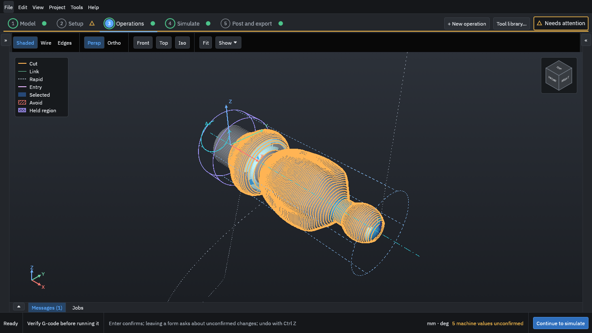

<section class="hero" aria-labelledby="hero-title">

OpenChuckCAM user guide · <a href="../versions.html">@@VERSION_LABEL@@</a>

<h1 id="hero-title">Turn a 3D model into G-code for 4-axis rotary machining</h1>

OpenChuckCAM is free, open-source CAM software for machines that hold the work in a chuck and turn it while the cutter works around it, such as the Makera Z1. This guide is for anyone making parts with it, including people new to CAM.

<ol class="routes">
<li><a href="start/install.md">1Start hereInstall the program and open it for the first time.</a></li>
<li><a href="tutorial/index.md">2Your first projectTake one part from a model file to G-code, in ten steps.</a></li>
</ol>

<strong>Before you cut:</strong> generated G-code must be checked by you before it is run on a machine. OpenChuckCAM does not guarantee that a program is safe or correct for your machine, tool or setup.

<figure class="hero-figure">

<figcaption>The Operations step: the finishing toolpath of the tutorial's baluster, in orange, around the part on the rotary axis. From a development build.</figcaption>
</figure>
</section>

## Where to start

New to the program
: Read [Install and first run](start/install.md), then work through [Your first project](tutorial/index.md). The tutorial takes one small part from a model file to G-code, with a screenshot of each step.

New to CAM or to 4-axis work
: The concepts pages explain [what a rotary axis does](concepts/rotary-machining.md), what [stock and a held region](concepts/stock-and-held-region.md) are, and why a job is usually cut in two stages, [roughing and then finishing](concepts/roughing-and-finishing.md). Terms are defined the first time a page uses them and collected in the [glossary](glossary.md).

Before you run a program on the Makera Z1
: Read [Checking G-code before you run it](safety/checking-gcode.md), then follow the [air cut](safety/air-cut.md) and the [safe-practice checklist](safety/checklist.md). An air cut runs the program with no tool and no material, so you can watch every move before anything can be damaged.

Looking for a setting or a word
: Use the search box, the [glossary](glossary.md), or the reference pages.

## What the program does

You work through four steps, shown along the top of the window.

| Step | What you do there |
| --- | --- |
| Model | Import an STL or STEP file, check it, and place it on the rotary axis. |
| Setup | Choose the machine, describe the stock and how the work is held. |
| Operations | Choose tools and add the cutting operations, from roughing to finishing. |
| Simulate | Generate the toolpaths, watch the cut, and compare the result with the model. From here you also post and export the G-code and a setup sheet. |

Read the [known limitations](start/limitations.md) before you rely on the program for a real job.

## About this guide

Each release of OpenChuckCAM has its own copy of this guide; use **Version** at the top of the page to switch between them. The development version describes the program as it is built from the main branch, and may describe features that are not in a release yet.

The guide is part of the project's source and is licensed AGPL-3.0-or-later. To report a mistake in it, see [Contributing to this guide](contributing.md).
