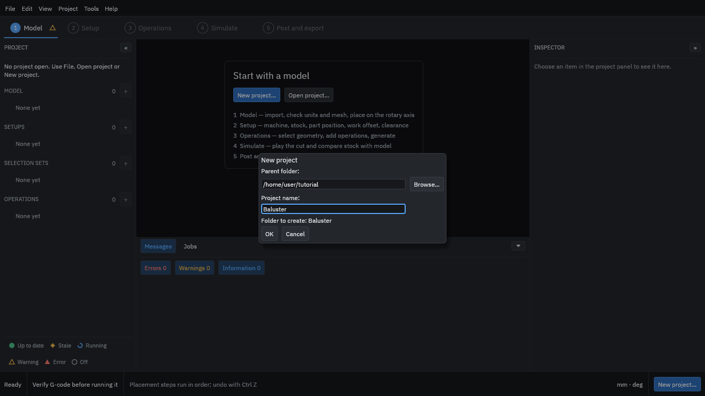
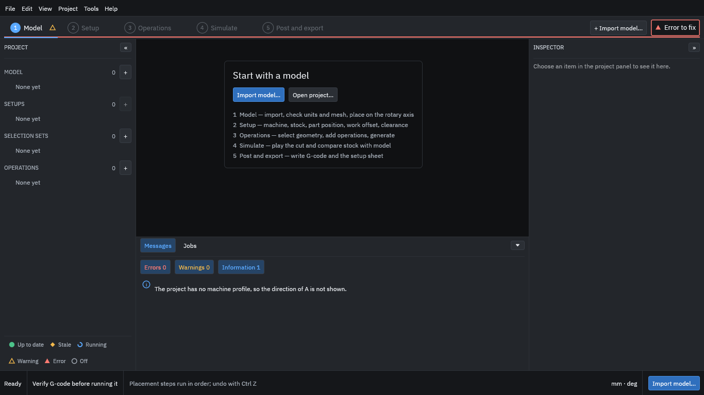

# 1. Create a project

A [project](../glossary.md#project) is a folder; the program asks for the folder it should go in and a name.

1. Start the program and choose **New project...** (or **File > New project...**, <kbd>Ctrl</kbd>+<kbd>N</kbd>).
2. Type or browse to a **Parent folder**.
3. Call the project **Baluster**.
4. Press **OK**.

<figure>
  
  <figcaption><b>Figure 1.</b> The New project dialog, with the parent folder and the name Baluster.</figcaption>
</figure>

The program creates the folder and opens the empty project.

<figure>
  
  <figcaption><b>Figure 2.</b> The empty project on the Model step. The row of steps runs along the top.</figcaption>
</figure>

The row of steps along the top is the order you work in. The marks beside each step show whether it is ready. At this point the program notes that the project has no machine yet; you add one in [step 3](03-machine.md).

The program does not save by itself: use **File > Save** (<kbd>Ctrl</kbd>+<kbd>S</kbd>) as you go. Edits in a form are applied when you press <kbd>Enter</kbd> or leave the field.
