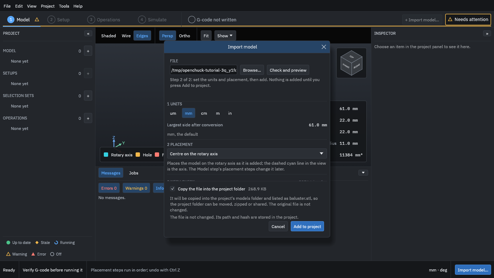
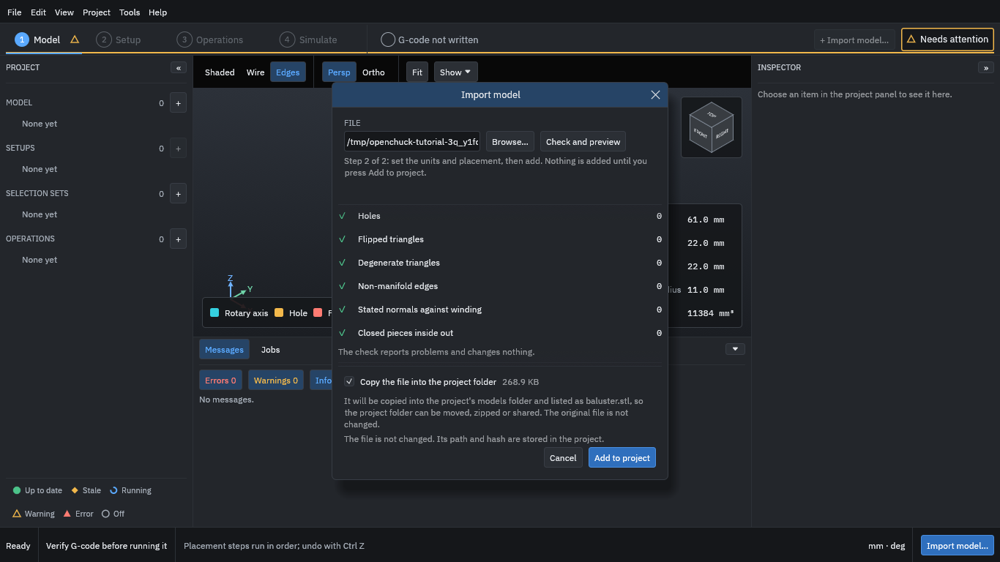

# 2. Import the model

1. Choose **Import model...**.
2. Type the path of `baluster.stl` (or use **Browse...**).
3. Press **Check and preview**.

<figure>
  
  <figcaption><b>Figure 1.</b> The Import model dialog after the check: the units and the placement. The part's size is in the panel behind the dialog.</figcaption>
</figure>

The dialog shows what the file holds before anything enters the project:

Units
: An STL file does not say what its numbers mean, so the program reads them as millimetres unless you choose another unit. The piece is 61 mm long and 22 mm across.

Placement
: **Centre on the rotary axis** puts the model's centre line on the A axis. The piece was made along X, so it needs nothing else.

Scroll down in the dialog for the mesh check and the copy option.

<figure>
  
  <figcaption><b>Figure 2.</b> The mesh check, and <b>Copy the file into the project folder</b>, ticked.</figcaption>
</figure>

Mesh check
: The program looks for holes, flipped faces and other faults in the mesh. This model has none. The check reports problems and changes nothing.

Copy the file into the project folder
: Ticked by default. The program keeps its own copy of the model in the project's `models` folder, so you can move, zip or share the project folder. The original file is not changed. Untick it to keep only a link to the original file.

Then:

1. Press **Add to project**.
2. Press **Continue to setup** at the bottom right.
