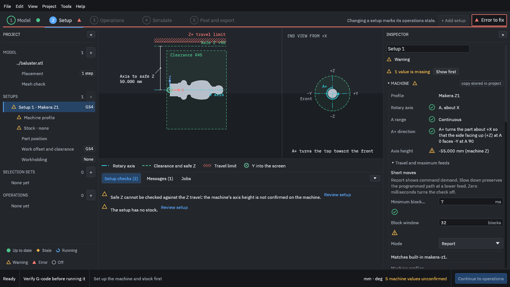

# 3. Choose the machine

The Setup step describes the machine, the stock and how the work is held.

1. Press **Add setup**.
2. In the Inspector (the panel on the right), under **Machine**, choose **Makera Z1**.
3. Press **Use this machine**.

<figure>
  
  <figcaption><b>Figure 1.</b> The Setup step with the Makera Z1 chosen. Note "5 machine values unconfirmed" at the bottom right.</figcaption>
</figure>

The view on the left of the window now shows the part on the A axis with the safe height and travel limit; the end view shows which way positive A turns. The Inspector shows the [machine profile](../glossary.md#machine-profile)'s rotary axis (A, about X), its range and direction.

> [!WARNING]
> Notice **"5 machine values unconfirmed"** at the bottom right. The built-in Z1 profile includes values nobody has confirmed on *your* machine, such as the height of the axis above the bed. They are the values the program uses to check that moves stay in range, so **measure them on your machine and correct the profile** before you trust a check that depends on them.
