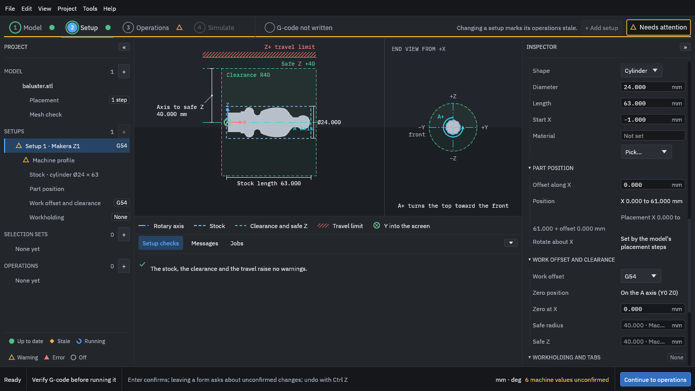

# 4. Set up the stock

1. In the project tree on the left, choose **Stock** under **Setup 1** (or scroll the Inspector to **Stock**).
2. Choose the **Cylinder** shape. The program fills in a diameter and length that surround the part with a small allowance: a 24 mm diameter, 63 mm long bar starting 1 mm before the part. Leave them.
3. Under **Material**, pick **Hardwood**.

<figure>
  
  <figcaption><b>Figure 1.</b> A cylinder of stock, 24 mm across and 63 mm long, drawn as a dashed outline around the part.</figcaption>
</figure>

The stock appears as the dashed outline around the part. The [material](../glossary.md#material) choice matters because the tool library has cutting data for each material, which the operations use later. [Stock and the held region](../concepts/stock-and-held-region.md) says more about the stock.
