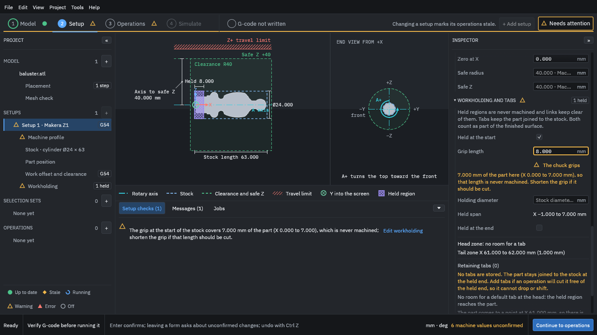

# 5. Hold the work

1. Under **Workholding and tabs**, tick **Held at the start**.
2. Set **Grip length** to **8** (millimetres).
3. Press **Apply** at the bottom of the section.

<figure>
  
  <figcaption><b>Figure 1.</b> An 8 mm held region at the start of the stock, drawn hatched in the view.</figcaption>
</figure>

The first 8 mm of the stock, from X = -1 to X = 7, is now a held region: it is where the chuck grips. It is never cut and the paths keep clear of it. The program warns that the chuck grips 7 mm of the part (the plain end), which therefore stays as bar. That is what you want here; the warning would matter if you had held part of the shape you meant to cut.

The program also says that no tabs are stored, and that the part stays joined to the stock at the held end. This piece stays joined to the held bar, so this tutorial uses no tab; add tabs if an operation in your own job will cut the part free of the held end. A [tab](../glossary.md#tab) is a small bridge left uncut so that a part stays attached until you separate it yourself.

If you also support the far end of the stock, tick **Held at the end** the same way. The program treats the [tailstock](../glossary.md#tailstock) end as a held length only, so keep your own track of clearances there.

Press **Continue to operations**.
