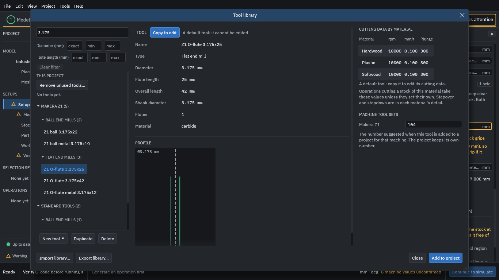

# 6. Choose the tools

1. Choose **Tool library...**. This lists the tools you can use: 54 ready-made Makera Z1 tools and some standard ones.
2. Type `3.175` in the search box to see the 3.175 mm tools.
3. Select **Z1 O-flute 3.175x25**.

<figure>
  
  <figcaption><b>Figure 1.</b> The tool library with the Z1 O-flute 3.175x25 selected. Its cutting data by material is on the right.</figcaption>
</figure>

On the right is the tool's **cutting data by material**: a spindle speed, a feed per tooth and a plunge feed for each. For Hardwood this tool has 10,000 rpm and 0.100 mm per tooth.

> [!WARNING]
> These are example numbers from the default library; they are not proven cutting data. A default tool cannot be edited, but you can copy it and change the copy.

Then add both tools to the project:

1. Press **Add to project**.
2. Select **Z1 ball 3.175x22**.
3. Press **Add to project** again.

<figure>
  
  <figcaption><b>Figure 2.</b> Both tools under <b>This project</b>, numbered T104 and T204.</figcaption>
</figure>

The project now holds two tools, numbered T104 and T204 (the numbers the Makera Z1 tool set suggests). Press **Close**.
