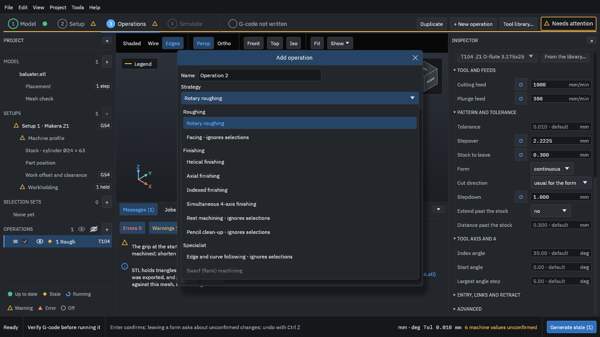
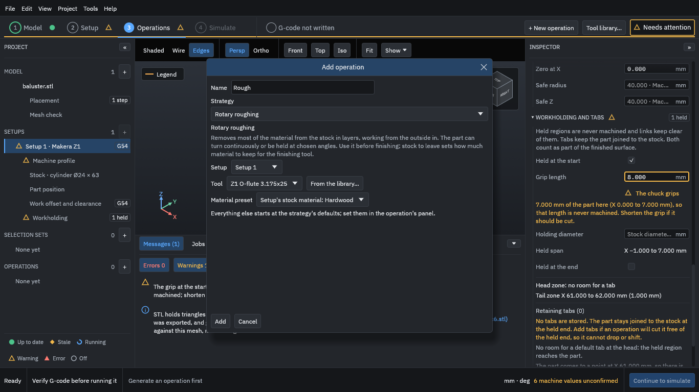
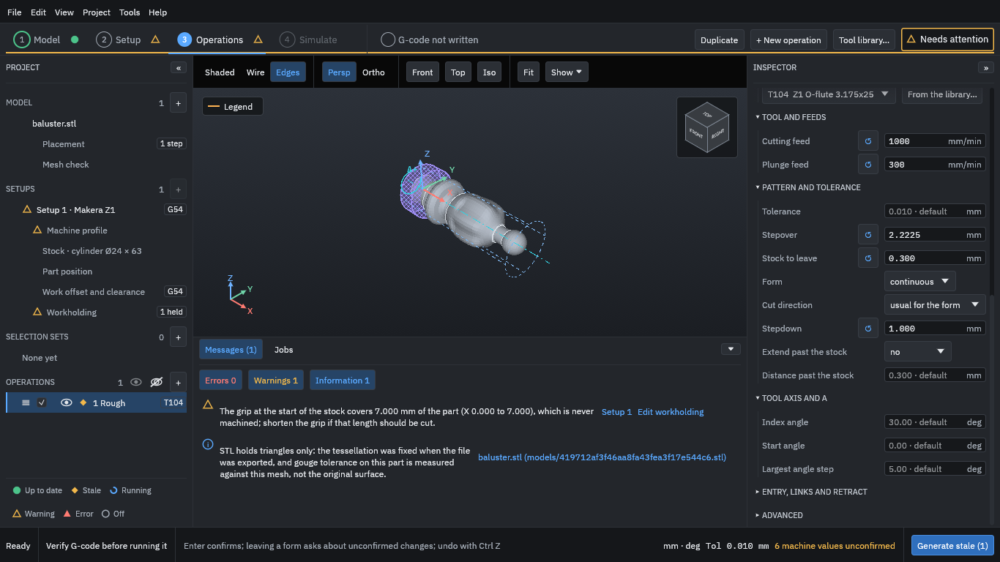
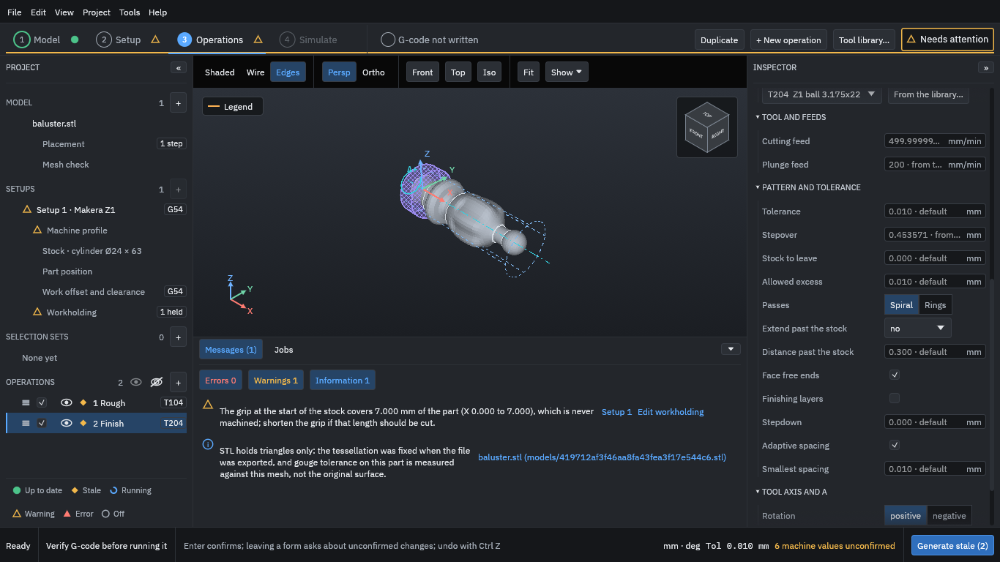
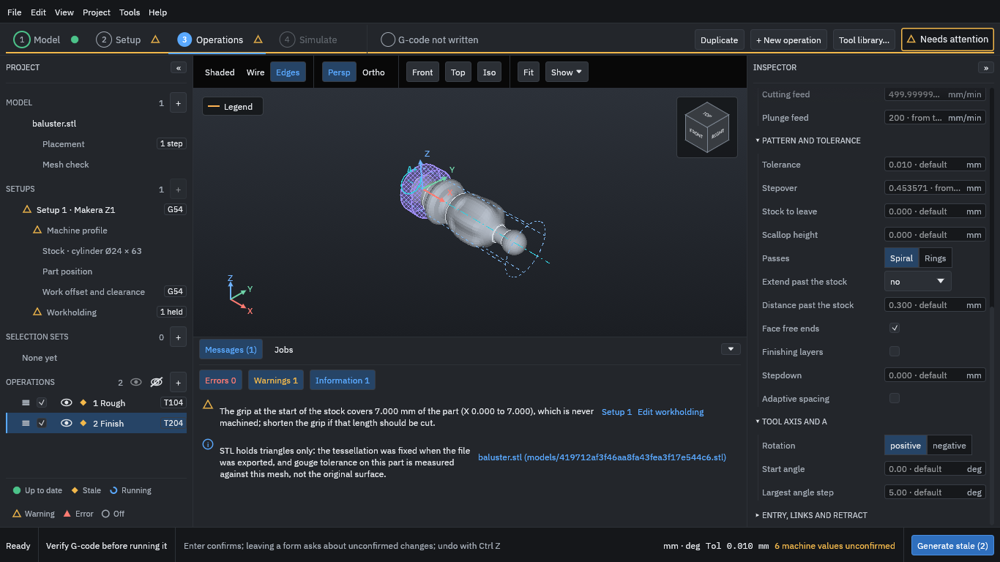

# 7. Add the operations

An [operation](../glossary.md#operation) is one machining job with one tool. You will add two: a [roughing](../glossary.md#roughing) operation that removes most of the material quickly, and a [finishing](../glossary.md#finishing) operation that cuts the final surface. [Roughing and finishing](../concepts/roughing-and-finishing.md) explains why there are two.

Choose **+ New operation**. The list of [strategies](../glossary.md#strategy) shows what the program can do:

<figure>
  
  <figcaption><b>Figure 1.</b> The strategy list, grouped under Roughing, Finishing and Specialist.</figcaption>
</figure>

Each entry has a one-paragraph description. Swarf is greyed because it needs a STEP model.

## Roughing

1. Name the operation **Rough** and keep **Rotary roughing** as the strategy. The setup (Setup 1), the tool (Z1 O-flute 3.175x25) and the material preset (the setup's Hardwood) are already right.
2. Press **Add**.

<figure>
  
  <figcaption><b>Figure 2.</b> The Add operation dialog for the Rough operation.</figcaption>
</figure>

3. In the Inspector, set **Stepdown** to **1** mm. This field starts empty: the program does not guess how deep a layer should be.

<figure>
  
  <figcaption><b>Figure 3.</b> The Rough operation's settings: stepover 2.2225 mm, stock to leave 0.3 mm and stepdown 1 mm.</figcaption>
</figure>

The rest comes from the tool and the strategy. Two to look at:

- **Stepover 2.2225 mm** is 70 % of the tool's diameter, from the tool's cutting data.
- **Stock to leave 0.300 mm**: roughing stops 0.3 mm short of the part so that the finishing tool has a little to cut.

The **cutting feed** shown is the programmed [feed](../glossary.md#feed). The machine profile's own feed limits can slow moves that turn A; after a run, the Inspector says how many moves were slowed, and the export dialog in [step 10](10-export.md) reports the effective feed. [Stepover, stepdown, scallop and stock to leave](../concepts/stepover-and-stock-to-leave.md) says more about these settings.

## Finishing

1. Choose **+ New operation** again.
2. Choose **Helical finishing**, name it **Finish** and pick the tool **Z1 ball 3.175x22**.
3. Press **Add**.

<figure>
  
  <figcaption><b>Figure 4.</b> The Finish operation's settings, with the ball tool T204, no stock to leave, and <b>Adaptive spacing</b> ticked.</figcaption>
</figure>

Helical finishing follows the surface in a spiral around the part as the tool moves along it. Its stock to leave is 0, so it cuts to the model. The strategy's description warns that "the tool may not reach tight inside corners": a ball of this size cannot cut a sharper corner than its own radius.

### Turn off adaptive spacing

New finishing operations have **Adaptive spacing** ticked. The program then measures the material left between neighbouring passes and adds passes where more than the **Allowed excess** (0.01 mm by default) would be left. On this piece, with this tool, it cannot confirm the excess at some places before it reaches its limits, so it keeps the path made so far, marks it as partial, and asks you to accept that before it writes any G-code. A partial path is not wrong, but it is not complete, so this tutorial keeps it simple:

1. Scroll to the end of the Inspector.
2. Untick **Adaptive spacing**.

<figure>
  
  <figcaption><b>Figure 5.</b> <b>Adaptive spacing</b> unticked. The setting above it is now <b>Scallop height</b>, which stays at 0, so the stepover alone sets the spacing.</figcaption>
</figure>

[Adaptive spacing](../glossary.md#adaptive-spacing) is worth trying on your own parts; read its warning, if it gives one, before you use the program. **Passes** can be **Spiral** (one continuous helix, the choice here) or **Rings** (separate rings, one after the other).
