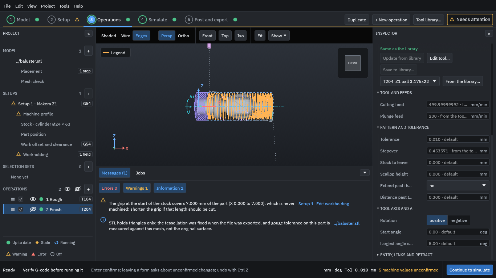

# 8. Generate the toolpaths

1. Press **Generate stale (2)** at the bottom right. "Stale" means the operation has no up-to-date [toolpath](../glossary.md#toolpath).
2. Wait until both operations show a green dot in the project tree: they are then up to date.

The status bar shows the progress. On a small part this takes about a minute without a graphics card, and less with one.

<figure>
  
  <figcaption><b>Figure 1.</b> The roughing toolpath in orange in the front view, with the held region hatched on the left. The Finish path is hidden.</figcaption>
</figure>

The orange lines are the roughing toolpath in the front view, with the held region hatched on the left. The eye icon beside an operation shows or hides its path in the view; hiding a path changes only the view, never what is machined. Use the view buttons (**Front**, **Top**, **Iso**, **Fit**) and the mouse to look around.

Press **Continue to simulate**.
