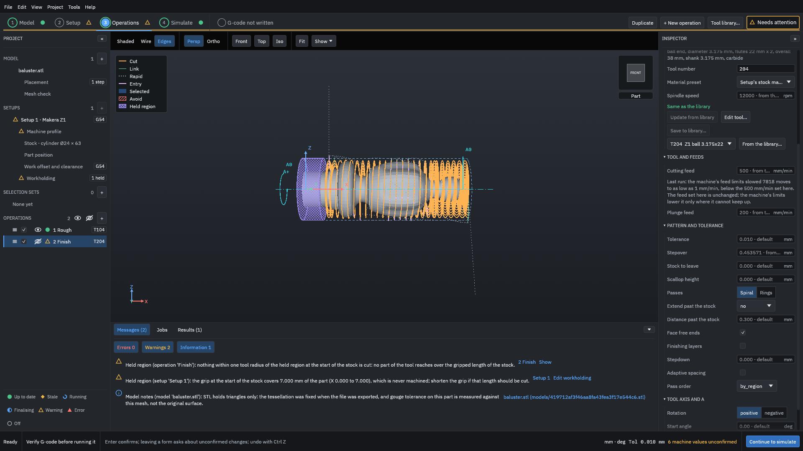

# 8. Generate the toolpaths

1. Press **Generate stale (2)** at the bottom right. "Stale" means the operation has no up-to-date [toolpath](../glossary.md#toolpath).
2. Wait until the status bar reads **Ready** again. **1 Rough** shows a green dot in the project tree: it is up to date. **2 Finish** shows a warning mark: it is up to date too, with a warning to read.

The status bar shows the progress. On this part it takes a few minutes on a computer with no graphics card, and less with one.

<figure>
  
  <figcaption><b>Figure 1.</b> The roughing toolpath in orange in the front view, with the held region hatched on the left. The Finish path is hidden.</figcaption>
</figure>

The orange lines are the roughing toolpath in the front view, with the held region hatched on the left. The eye icon beside an operation shows or hides its path in the view; hiding a path changes only the view, never what is machined. Use the view buttons (**Front**, **Top**, **Iso**, **Fit**) and the mouse to look around.

The Messages list under the view now holds two warnings: the setup's grip warning from [step 5](05-hold.md), and the warning on **2 Finish**. The second says that nothing within one tool radius of the held region is cut: the grip leaves the plain end, and the part of the surface beside it, uncut. That is what this tutorial means to do, so the project chip still reads **Needs attention**. Click a message to see the operation it is about.

Press **Continue to simulate**.
