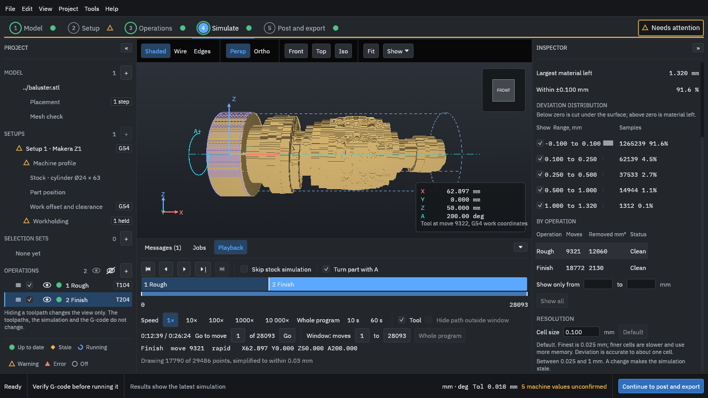
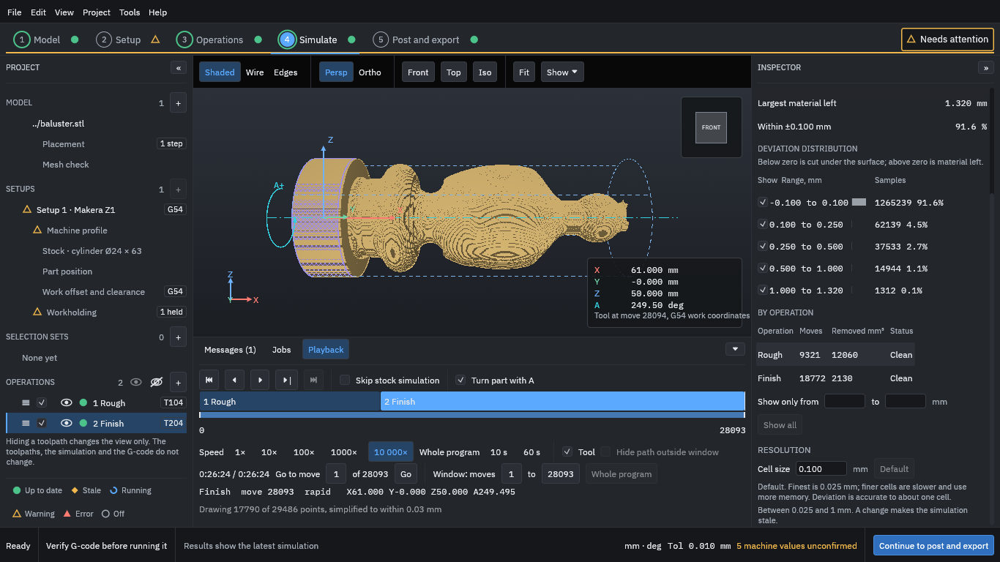

# 9. Simulate and read the results

The Simulate step plays the whole program back as a cut and compares the result with the model. The program first prepares the cut part, which takes a little longer than generating. [Simulation and deviation colours](../concepts/simulation.md) says more about the [simulation](../glossary.md#simulation).

1. Press **Show**, and set **Cut part display** to **Solid** if you want a solid view.
2. Use the playback controls under the view. The buttons go to the start, step back one move (<kbd>Left</kbd>), play or pause (<kbd>Space</kbd>), step on one move (<kbd>Right</kbd>), and go to the next operation (<kbd>Shift</kbd>+<kbd>Right</kbd>). **Speed** sets how fast it plays.
3. Jump to the start of the Finish operation to see the stock after roughing.

<figure>
  
  <figcaption><b>Figure 1.</b> The stock after roughing, with 0.3 mm left for the finishing tool.</figcaption>
</figure>

4. Play on to the end of the program.

<figure>
  
  <figcaption><b>Figure 2.</b> The cut part at the end of the program, and the results in the Inspector.</figcaption>
</figure>

The results on the right say how closely the cut matches the model:

- **Largest material left** (1.320 mm for this run) and **Within ±0.100 mm** (91.6 % of the sampled points). The rest is material the finishing tool left. Tick **Deviation colours** at the top of the Inspector to colour the cut part by how far each point is from the model (grey is on the surface, blue still has material left) and see where it is.
- The **deviation distribution** counts samples in each band of material left; below zero would mean cut *under* the surface.
- **By operation**: how many moves each makes and the volume it removes.
- **Cell size 0.100 mm** is the simulation's resolution. The stepped surface in the view is that cell size; it is not the finish the machine would leave. A finer cell is more accurate and slower.

> [!WARNING]
> Treat the simulation as a check on the toolpaths, not a guarantee. It does not model the chuck, the holder or the machine, and it cannot show whether your tool, speed and feed will cut well.

The **Playback** panel also shows the programmed time: about 26 minutes 24 seconds here. This is the sum of the moves at their programmed feeds. It is not an estimate of the machine's time.
