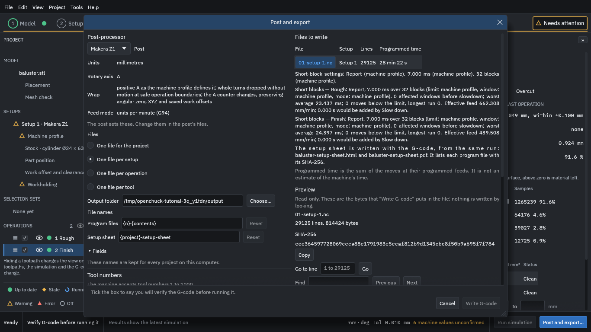
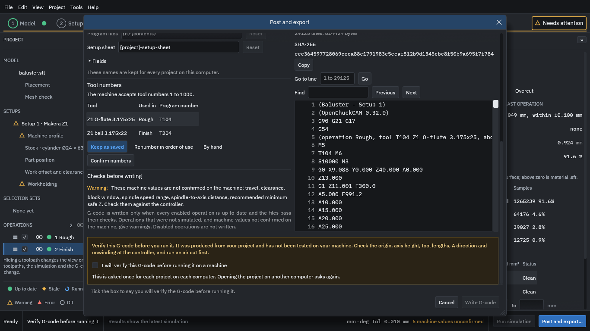
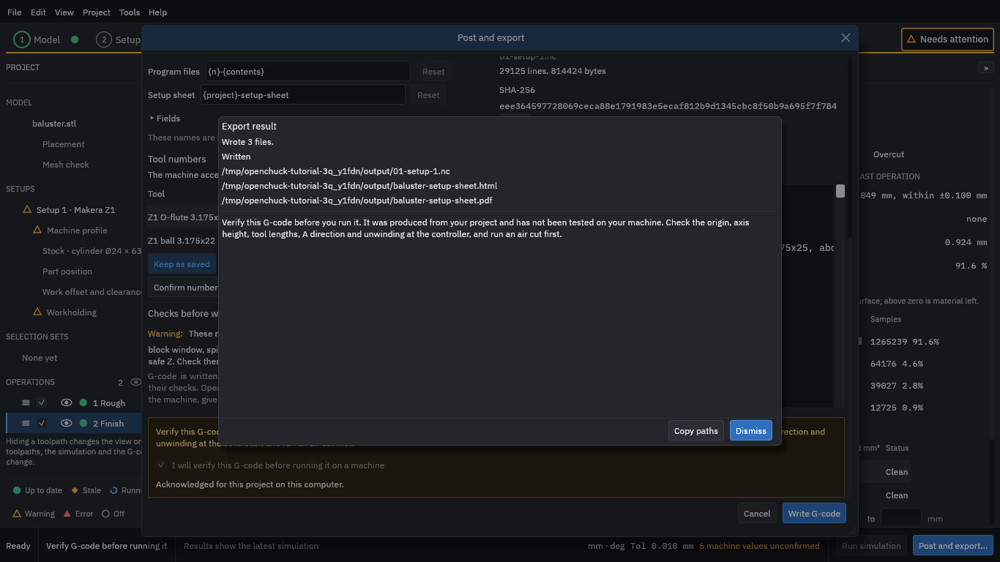

# 10. Post and export the G-code and the setup sheet

1. On the Simulate step, press **Post and export...** (bottom right), or choose **File > Post and export...**. The dialog opens.

<figure>
  
  <figcaption><b>Figure 1.</b> The Post and export dialog, with a preview of the start of the program.</figcaption>
</figure>

The dialog shows:

Post-processor
: *Makera Z1* writes [G-code](../glossary.md#g-code) for that machine (units in millimetres, A as the rotary axis, feed in units per minute). A *LinuxCNC* post is also available; it is used to check the output in a simulator.

Files
: One file for the project, per setup, per operation or per tool. Keep **One file per setup** here.

Output folder
: Where the files go. Type a folder.

File names
: The names are made from templates (`{n}-{contents}` gives `01-setup-1.nc`). The defaults are fine.

Files to write
: The list shows the file's lines (here 29,125) and programmed time. Below it, a read-only **Preview** shows the program as it will be written, with its size, its SHA-256 hash, and **Go to line** and **Find** to read it.

2. Scroll down to **Checks before writing**.

<figure>
  
  <figcaption><b>Figure 2.</b> The checks before writing: the tool numbers, the warning about unconfirmed machine values, and the notice to verify the G-code.</figcaption>
</figure>

3. Read the warning about the unconfirmed machine values, and the notice **"Verify this G-code before you run it."** If an operation had a partial path, the dialog would ask you to accept it here as well; this tutorial has none.
4. Tick **I will verify this G-code before running it on a machine** (the program asks this once per project on each computer).
5. Press **Write G-code**.

<figure>
  
  <figcaption><b>Figure 3.</b> The result: three files written to the output folder.</figcaption>
</figure>

Three files are written to the output folder:

- `01-setup-1.nc`: the G-code (about 810 KB for this job).
- `baluster-setup-sheet.html` and `baluster-setup-sheet.pdf`: the [setup sheet](../glossary.md#setup-sheet). It lists the project, machine, stock, held length, tools, operations with their speeds and times, each program file with its **SHA-256 hash**, and the notice to verify. Compare the hash of a file on the machine with the sheet to be sure it is the file the sheet describes.

Dismiss the result and save the project with **File > Save**.
